# Comparing seasonal and latitudinal patterns in thermal adaptation

2026-11-01

- [Main Message](#main-message)
- [1. Collections and environment](#1-collections-and-environment)
  - [Sites and collection conditions](#sites-and-collection-conditions)
  - [Long-term site temperatures (MUR
    SST)](#long-term-site-temperatures-mur-sst)
  - [Paired low- and high-salinity
    sites](#paired-low--and-high-salinity-sites)
  - [Generations between collections](#generations-between-collections)
- [2. Phenotypes: thermal limits and body
  size](#2-phenotypes-thermal-limits-and-body-size)
  - [Critical Thermal Limits](#critical-thermal-limits)
  - [Body Size](#body-size)
  - [Warming tolerance](#warming-tolerance)
  - [Trait correlations](#trait-correlations)
  - [Paired sites: trait differences](#paired-sites-trait-differences)
  - [Assay checks](#assay-checks)
- [3. Low-coverage whole genome data](#3-low-coverage-whole-genome-data)
  - [Sequencing summary](#sequencing-summary)
  - [Site filtering](#site-filtering)
  - [Clade identity](#clade-identity)
  - [Genetic differentiation within
    clades](#genetic-differentiation-within-clades)
  - [Relatedness and sample quality](#relatedness-and-sample-quality)
  - [Local PCA and candidate
    inversions](#local-pca-and-candidate-inversions)
  - [Parasites and symbionts](#parasites-and-symbionts)
  - [Seasonal allele-frequency
    change](#seasonal-allele-frequency-change)
  - [Spatial vs. seasonal genetic
    variation](#spatial-vs-seasonal-genetic-variation)
  - [Does space substitute for time? Concordance of temperature
    responses](#does-space-substitute-for-time-concordance-of-temperature-responses)
  - [Power of the genomic tests](#power-of-the-genomic-tests)
- [4. Clade-specific physiological
  patterns](#4-clade-specific-physiological-patterns)
  - [CTmax model](#ctmax-model)
  - [Acclimation vs. site differences (within- and between-site
    temperature)](#acclimation-vs-site-differences-within--and-between-site-temperature)
  - [Partitioning CTmax variation](#partitioning-ctmax-variation)
  - [Lineage differences under shared conditions (natural common
    garden)](#lineage-differences-under-shared-conditions-natural-common-garden)
  - [Genetic basis of CTmax within
    collections](#genetic-basis-of-ctmax-within-collections)
  - [Candidate genes: mitochondrial amino-acid
    differences](#candidate-genes-mitochondrial-amino-acid-differences)
  - [Candidate genes from experimental
    evolution](#candidate-genes-from-experimental-evolution)
  - [Clade-specific protein divergence and gene
    function](#clade-specific-protein-divergence-and-gene-function)
  - [Trait variability within clades](#trait-variability-within-clades)
  - [CTmax variance through the
    season](#ctmax-variance-through-the-season)
  - [Parasites, epibionts and thermal
    limits](#parasites-epibionts-and-thermal-limits)
- [5. Partitioning vulnerability](#5-partitioning-vulnerability)
- [6. Objects for the manuscript
  figures](#6-objects-for-the-manuscript-figures)

## Main Message

By assaying thermal limits several times per year in natural populations
distributed across a large latitudinal gradient, we highlight the
importance of intra-specific variation for predicting vulnerability to
climate change. Indeed, across the entire spatiotemporal framework
examined here, we observed an ~12°C range in thermal limits. Both
spatial and temporal variations in thermal limits are essential for
robust predictions. Also highlighted in this study are the major
differences in thermal limits between the various cryptic lineages of
*Acartia tonsa*. The broad (and sometimes overlapping) distrbutions of
these clades provide a unique opportunity to compare replicate
spatiotemporal patterns in adaptation against a relatively similar
genetic background.

## 1. Collections and environment

Collection sites, conditions at the time of collection, continuous
temperature records, and the timing of collections relative to copepod
generation times.

### Sites and collection conditions

Copepods were collected by surface tow from sites across the Western
Atlantic at several times throughout the year. The sites are shown below
along with surface temperatures and salinity were measured at the time
of collection. Across the entire set of collections, temperature ranged
from 10°C to 36°C.

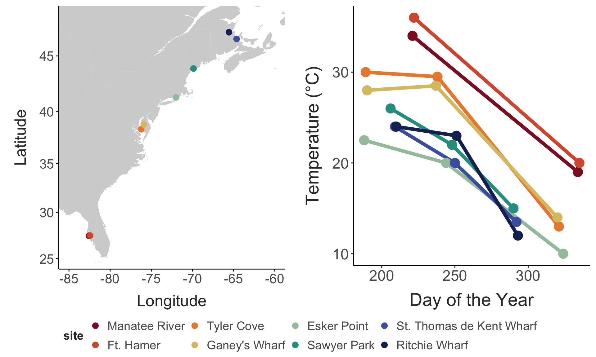

Collections aimed to obtain copepods near the onset of peak
temperatures, after peak temperatures, and then after temperatures
cooled during the Fall. To put the collections into this larger seasonal
context, the figure below shows daily sea surface temperature at each
site through the 2023 sampling season from the MUR analysis (0.01°,
bias-corrected; the same record used for the site climatology and the
generation-averaged temperatures, Section 1 below), with the
temperatures measured at each collection. In general, the first sample
from each site fell just after the site reached its warmest period; the
exception is Florida, where collections occurred after an extended
period of high temperatures. Temperatures measured at collection were
often warmer than the MUR daily mean, by about 3–5 °C at the Florida
peak collections and 2–8 °C in the early and peak collections in Maine
and the Gulf of St. Lawrence, as expected for shallow nearshore surface
water in the afternoon relative to a satellite average over a 5 km
radius; late-season collections matched MUR closely.

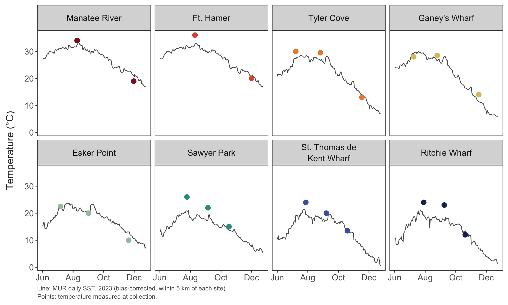

Exact locations for the sites are provided here:

|           Site           |    Region     |   Lat    |   Long    |
|:------------------------:|:-------------:|:--------:|:---------:|
|      Manatee River       |    Florida    | 27.50561 | -82.57277 |
|        Ft. Hamer         |    Florida    | 27.52488 | -82.43101 |
|        Tyler Cove        |   Maryland    | 38.35083 | -76.22902 |
|      Ganey’s Wharf       |   Maryland    | 38.80555 | -75.90906 |
|       Esker Point        |  Connecticut  | 41.32081 | -72.00166 |
|       Sawyer Park        |     Maine     | 43.90698 | -69.87179 |
| St. Thomas de Kent Wharf | New Brunswick | 46.44761 | -64.63692 |
|      Ritchie Wharf       | New Brunswick | 47.00481 | -65.56291 |

The latitudinal gradient covers a wide range of seasonality. Shown below
is the temperature range. While based on collection temperatures, and
therefore an underestimate of the total seasonal range of temperatures,
these patterns are representative of the expected latitudinal gradient
in seasonality.

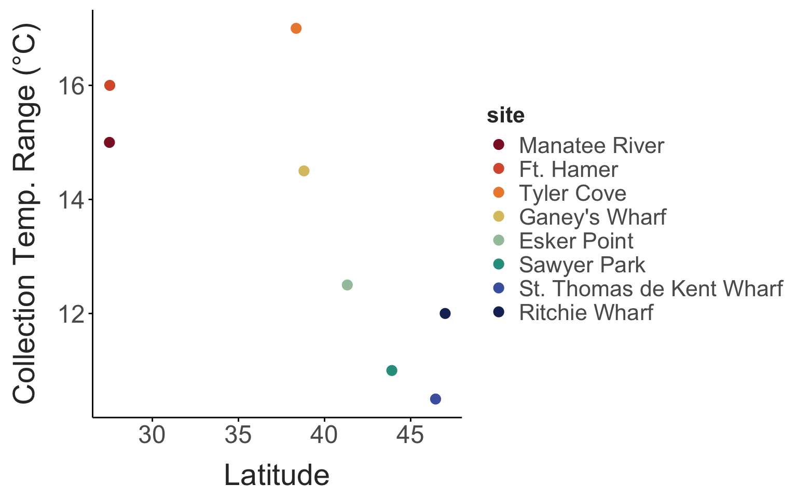

There was a general increase in the collection temperature range at
warmer sites. This provides an opportunity to disentangle some of the
traditionally proposed hypotheses about thermal adaptation
(macrophysiological gradients often include stable and warm environments
contrasted with cooler, more variable environment).

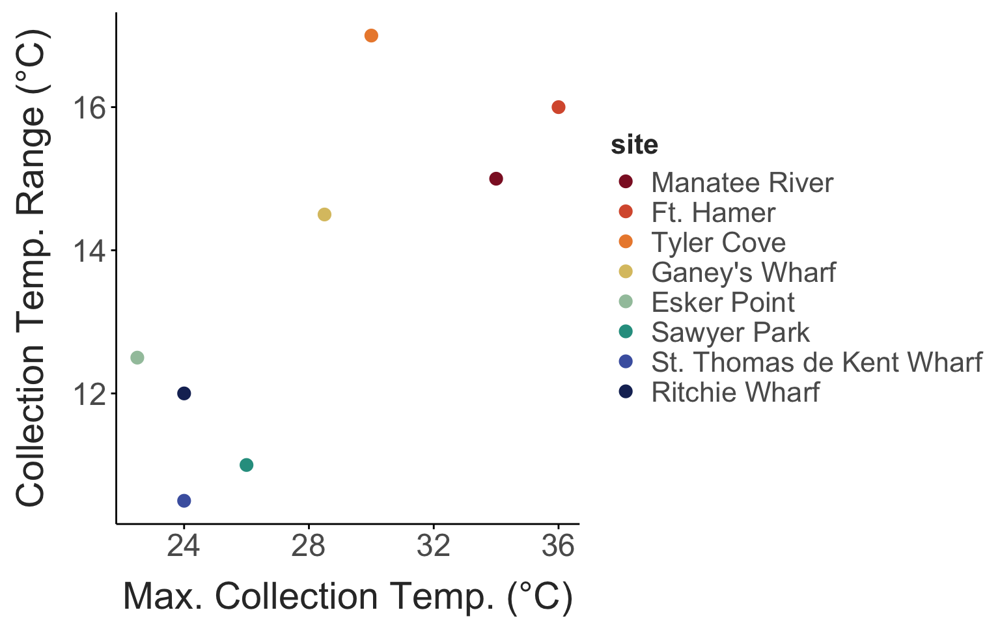

### Long-term site temperatures (MUR SST)

Daily sea-surface temperature for 2014–2023 was taken from the MUR SST
analysis (GHRSST Level 4, ~1 km) for each site, averaging the water
pixels within 5 km of the site (`Scripts/01_site_environment.R`). Where
MUR has no water near a site (Ganey’s Wharf, Ritchie Wharf), the water
within 5 km of the nearest water pixel (14–19 km away) was used. MUR
agreed closely with nearby monitoring stations wherever it resolves the
site’s own water (mean bias −0.4 to +0.4 °C at Noank, New London, Gooses
Reef, Port Manatee, Portland and the Manatee River gauge). At Ganey’s
Wharf, Chesapeake Bay Program station ET5.1 (at the wharf) is 2–4 °C
warmer than MUR in spring and 1–1.7 °C colder in autumn, as expected for
a shallow upper estuary, so Ganey’s Wharf uses MUR corrected by the
station’s smoothed monthly bias. Ritchie Wharf has no station within 50
km and is flagged. Temperatures measured at collection (shallow wharf
water, often at midday) run 2–6 °C warmer than MUR in summer at the
northern sites; MUR describes the water mass the plankton live in and is
used for site climatology and the genomic analyses, while the measured
temperatures are used for acclimation in the CTmax models.

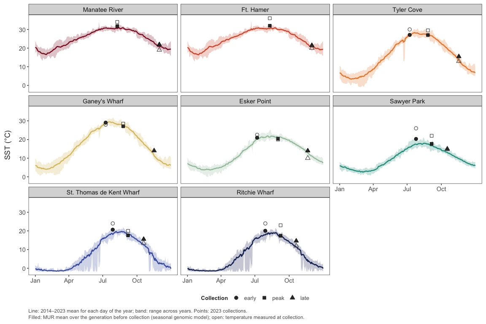

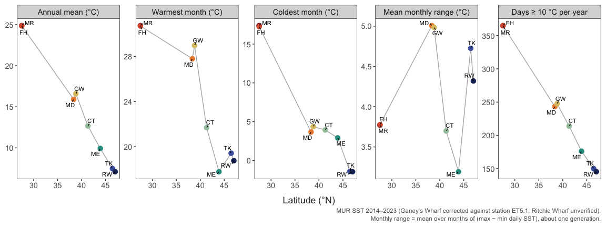

| Site | Lat (°N) | Annual mean | Jun–Nov mean | 95th pct | Warmest month | Coldest month | Monthly range | Days ≥ 10 °C | Note |
|:---|---:|---:|---:|---:|---:|---:|---:|---:|:---|
| MR | 27.5 | 24.9 | 28.3 | 31.1 | 30.7 | 17.4 | 3.8 | 365.0 |  |
| FH | 27.5 | 24.9 | 28.2 | 31.0 | 30.7 | 17.3 | 3.8 | 365.0 |  |
| MD | 38.4 | 15.9 | 22.8 | 28.2 | 27.8 | 3.7 | 5.0 | 243.2 |  |
| GW | 38.8 | 16.6 | 22.9 | 29.2 | 29.0 | 4.4 | 5.0 | 247.6 | corrected (ET5.1) |
| CT | 41.3 | 12.7 | 18.4 | 22.0 | 21.7 | 3.9 | 3.7 | 214.0 |  |
| ME | 43.9 | 9.9 | 14.4 | 18.0 | 17.8 | 2.9 | 3.2 | 176.2 |  |
| TK | 46.4 | 7.5 | 14.1 | 19.5 | 19.4 | -1.4 | 4.7 | 149.9 |  |
| RW | 47.0 | 7.1 | 13.5 | 18.9 | 18.8 | -1.4 | 4.3 | 145.4 | unverified |

Site climatology from MUR SST, 2014–2023 (°C unless stated).

### Paired low- and high-salinity sites

Nested within each of the three regions (South, Central, and Northern
regions) are pairs of low and high salinity sites:

| Region  | Low.Salinity  |      High.Salinity       |
|:-------:|:-------------:|:------------------------:|
|  South  |   Ft. Hamer   |      Manatee River       |
| Central | Ganey’s Wharf |        Tyler Cove        |
|  North  | Ritchie Wharf | St. Thomas de Kent Wharf |

 

There are fairly well-established divergences between high salinity and
low salinity populations of *Acartia tonsa*. These sets of
geographically proximate sites potentially provide independent
comparisons of the effects of seasonality across salinity gradients.
Shown here are the collection conditions for these pairs of sites.
Temperature was typically similar across the pairs within each
collection, while salinity differences were fairly stable across
collections.

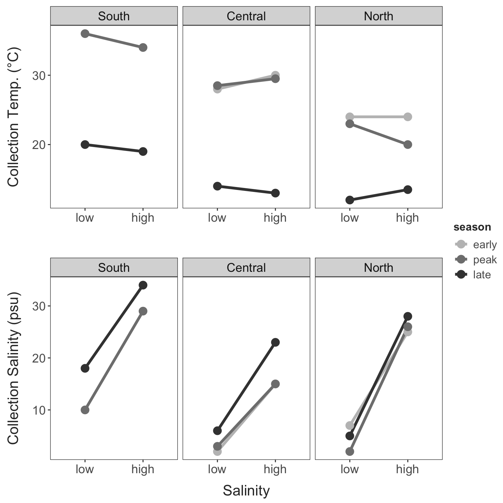

### Generations between collections

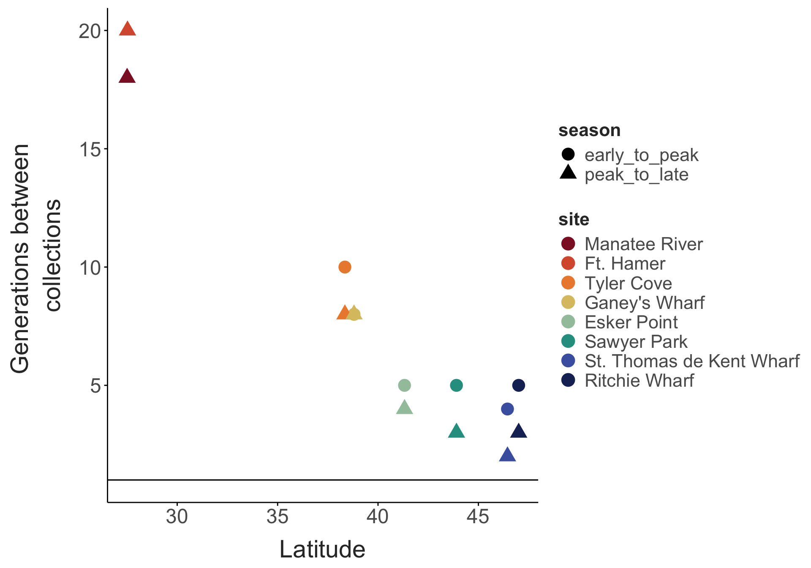

## 2. Phenotypes: thermal limits and body size

### Critical Thermal Limits

A total of 427 individuals were examined. Critical thermal limits and
body size measurements were made before individuals were preserved in
ethanol. We excluded data for individuals that were either later
classified as males or juveniles, that we were unable to assign to a
clade, or that were identified as individuals from a closely related
species (*Acartia hudsonica*). With these individuals excluded, the full
data set contains 395 adult females with CTmax and body size
measurements, and clade identifications.

Critical thermal maxima (CTmax) was measured using a custom setup. The
method uses a standard dynamic ramping assay to determine the maximum
temperature individuals could sustain normal functioning. This differs
from lethal temperatures, and indeed, all individuals recovered
following the assay.

Individuals were rested for one hour after collection before the assay.
During the assay, copepods were held in artificial seawater, composed of
bottled spring water and Instant Ocean salt mix adjusted to match
collection salinities. During the assay, several ‘control’ individuals
were maintained in this solution at ambient temperatures without the
temperature ramp to ensure that there was no background changes in
behavior or mortality. When sorting individuals from the plankton tow
contents, they were held in a 50:50 mix of 60 um filtered water from the
collection site and artificial seawater as an additional acclimation
step.

Sample sizes varied slightly across experiments, but generally ~20
individuals were measured per season at each site. The major exceptions
were the early samples from the Florida sites and the late sample from
Sawyer Park (Maine). Only two sets of samples (peak and late) were
collected from Fort Hamer and Manatee River. The late season collection
from Sawyer Park occurred after *Acartia tonsa* abundance decreased, and
samples were dominated by *Acartia hudsonica*. Thermal limits were
measured for all *A. tonsa* individuals recovered.

| site                     | early | peak | late |
|:-------------------------|------:|-----:|-----:|
| Manatee River            |     0 |   17 |   20 |
| Ft. Hamer                |     0 |   19 |   19 |
| Tyler Cove               |    20 |   19 |   20 |
| Ganey’s Wharf            |    20 |   20 |   20 |
| Esker Point              |    17 |   19 |   20 |
| Sawyer Park              |    14 |   17 |    8 |
| St. Thomas de Kent Wharf |    15 |   19 |   19 |
| Ritchie Wharf            |    16 |   18 |   19 |

Shown below are the measured CTmax values. Individual measurements are
shown in small points for each collection. The large points indicate the
mean values for each collection.

### Body Size

Following the CTmax assay, individuals were photographed for body size
measurements. Prosome lengths were measured from these photographs using
a scale micrometer and the software ImageJ. These measurements are shown
below. As before, large points indicate the mean body size. While less
cohesive than CTmax, a general trend of increasing body size with
latitude and time of year can be seen.

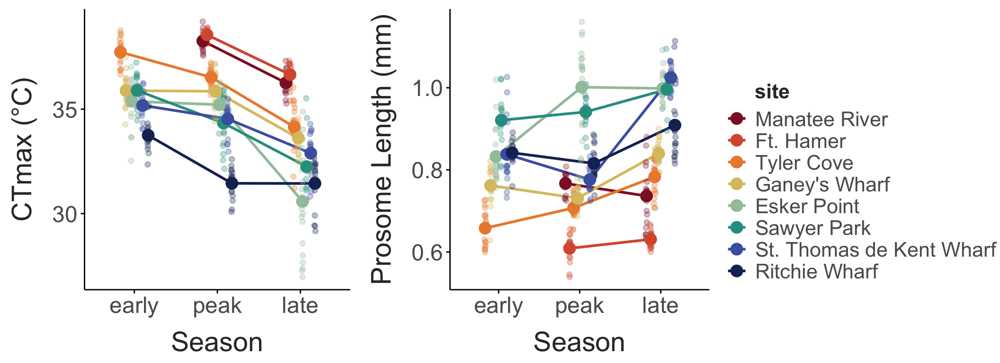

### Warming tolerance

Warming tolerance (the difference between thermal limits and
environmental temperatures) is a commonly used metric of climate
vulnerability. We calculated this as the difference between measured
CTmax values and the collection temperature. Smaller warming tolerance
values indicate that populations were nearer to their upper thermal
limits, suggesting greater vulnerability.

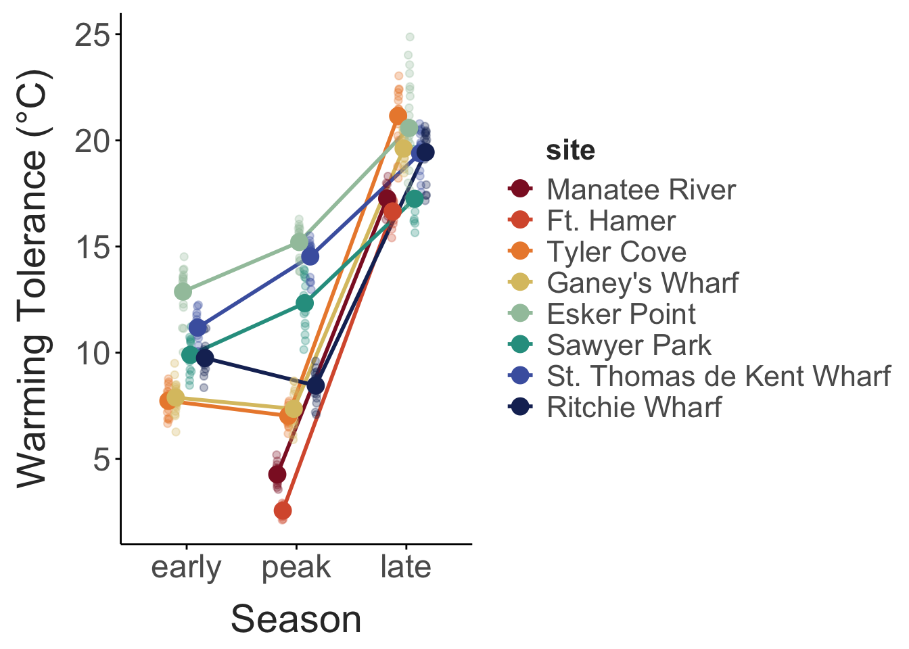

### Trait correlations

Regardless of the underlying mechanism (genetic differentiation or
phenotypic plasticity), we expect that collections from warmer waters
should yield copepods with higher thermal limits and smaller body sizes.
Our observations largely fit this expectation, with strong increases in
CTmax at higher temperatures, and a general decrease in prosome lengths
as temperature increased. There was a larger correlation between CTmax
and temperature than size and temperature. There are myriad reasons this
might be observed, but one potential is the potential for acclimation of
thermal limits. Body size is fixed in the adult stage, while CTmax can
continue to vary as water temperature changes. This is indirect evidence
for the importance of rapid acclimation in the observed patterns.

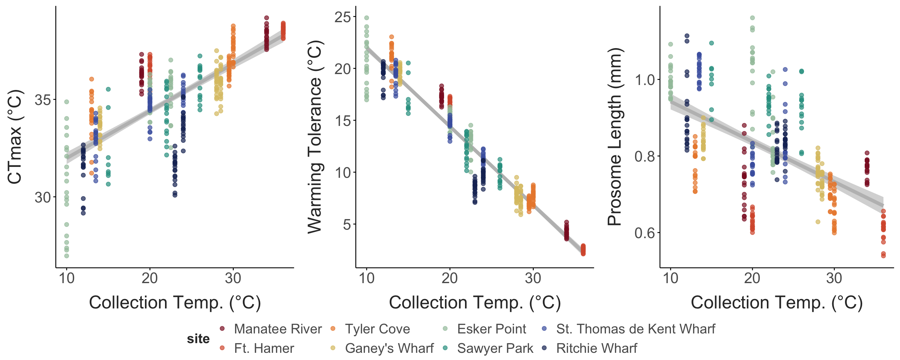

The relationship between prosome length and CTmax is also of interest.
Given that larger body sizes are associated with cold
adaptation/acclimation, it is unsurprising that there is a general trend
of decreasing thermal limits with increasing size. Individual regression
lines for each site are also included - the dark grey lines in the
background represent the ‘universal’ regression for that site, with
individual colored regression lines for each collection. At most sites,
evidence for this negative relationship between CTmax and body size is
observed across collections rather than within collections, suggesting
this relationship is primaly a reflection of the response to seasonal
temperature variation.

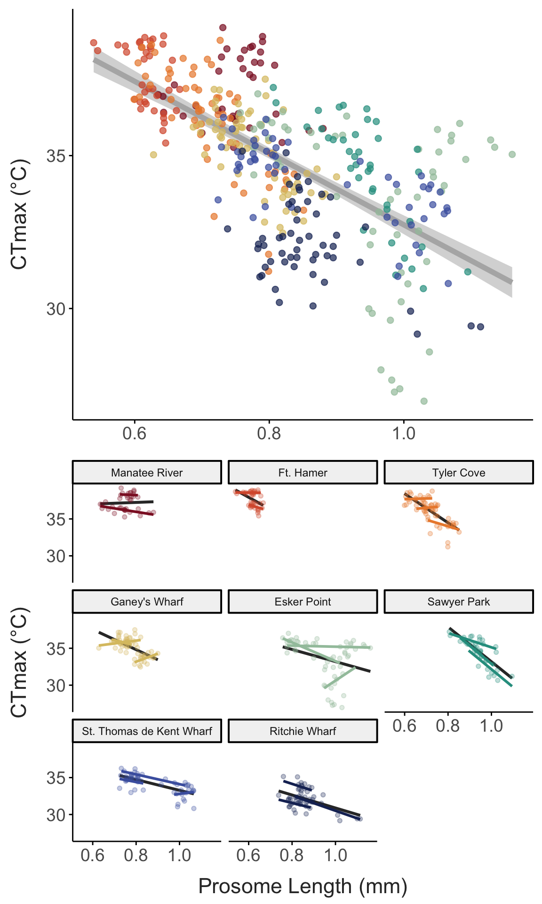

### Paired sites: trait differences

The three pairs of cross-salinity comparisons do show evidence for
fine-scale trait divergence, although there was no consistent pattern in
the direction or magnitude of differences. CTmax was similar across
sites in the Southern and Central pairs. In the Northern pair, CTmax
tended to be slightly lower for individuals from the low salinity site.
Size was more variable between the paired sites. In the South,
individuals from the low salinity site were consistently smaller than
individuals from the high salinity site, despite experiencing similar
temperatures. By contrast, in the Central pair individuals from the low
salinity site tended to be slightly larger than those from the high
salinity site, although the magnitude of this difference this varied
seasonally. In the Northern pair, individuals from the low salinity site
were slightly larger than individuals from the high salinity site during
the early and peak season collections, but there was an abrupt reversal
of this pattern during the late collection, when individuals from the
high salinity site were much larger than individuals from the low
salinity site.

Note that two of the three pairs also differ in clade composition:
Manatee River and Ft. Hamer hold different F lineages (F-MR, F-FH), and
St. Thomas de Kent Wharf and Ritchie Wharf differ in their mix of clades
X and IV (Section 3). Differences between paired sites therefore combine
environment, lineage and clade composition; Section 4 separates them.

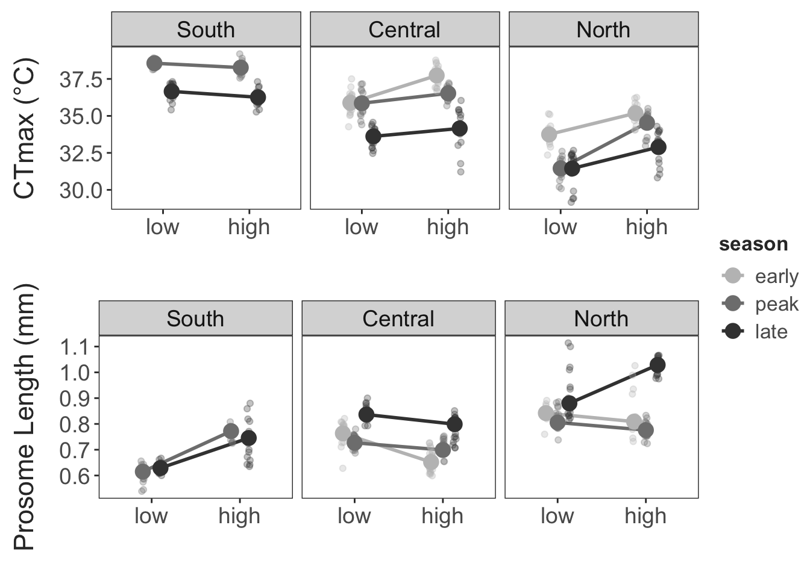

### Assay checks

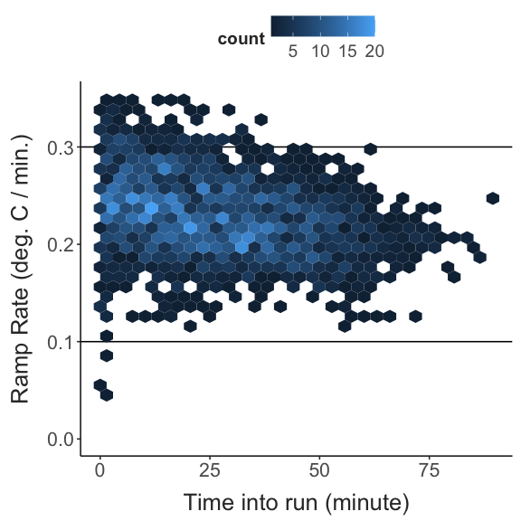

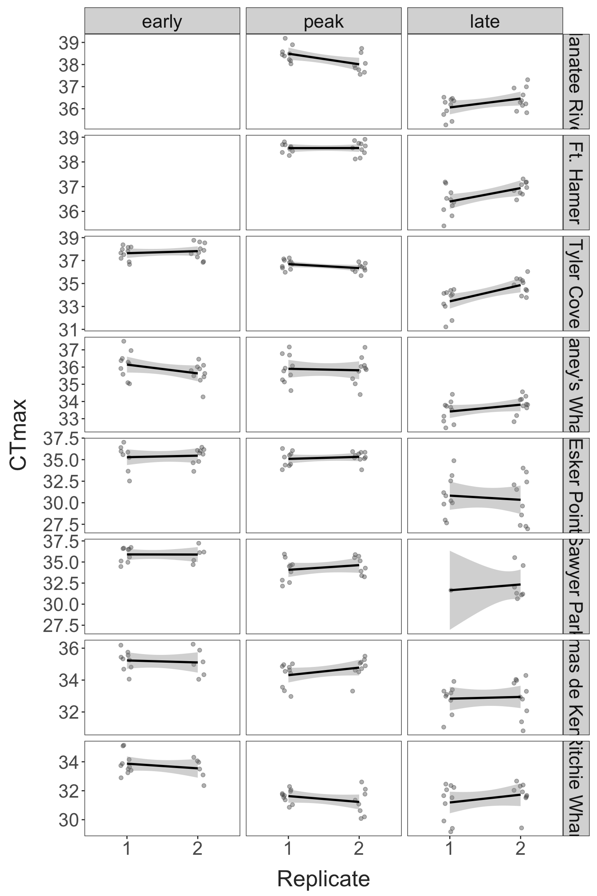

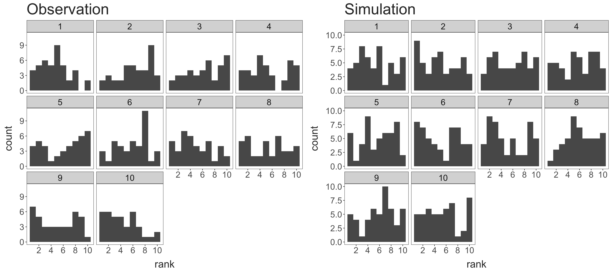

## 3. Low-coverage whole genome data

After phenotyping, each individual was preserved in 95% ethanol.
Individual DNA libraries were prepared using Twist Bio 96-plex prep
kits, then sequenced on two lanes of an Illumina NovaSeq X Plus 25B by
Novogene (436 libraries). Read processing, mapping, site filtering,
clade assignment and population genomic analyses were run on the Unity
cluster (Snakemake project `aton_lcwg`). The figures in this section are
built from the exported result tables (`Raw_data/cluster_exports/`;
export in use: aton_lcwg_tables_2026-10-31). *Acartia hudsonica*
libraries are excluded throughout.

### Sequencing summary

Reads per library varied over two orders of magnitude; 23 libraries
failed (\< 500,000 reads, 20 of them on plate 5). The reference genome
is closest to clade X: the other clades map less well and yield less
usable depth per read, on every plate. Libraries with low mapping and
high GC content carry DNA from other organisms (Section 3.3).

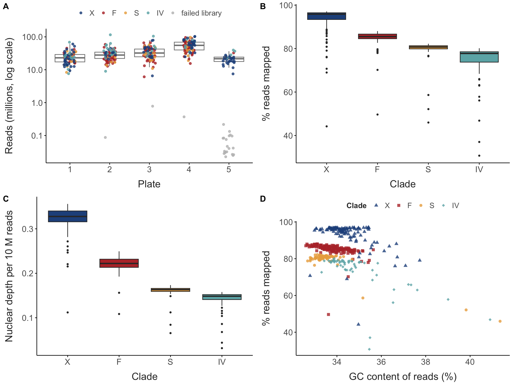

There is no clear relationship between the number of reads and
individual size or CTmax (phenotype analysis set only).

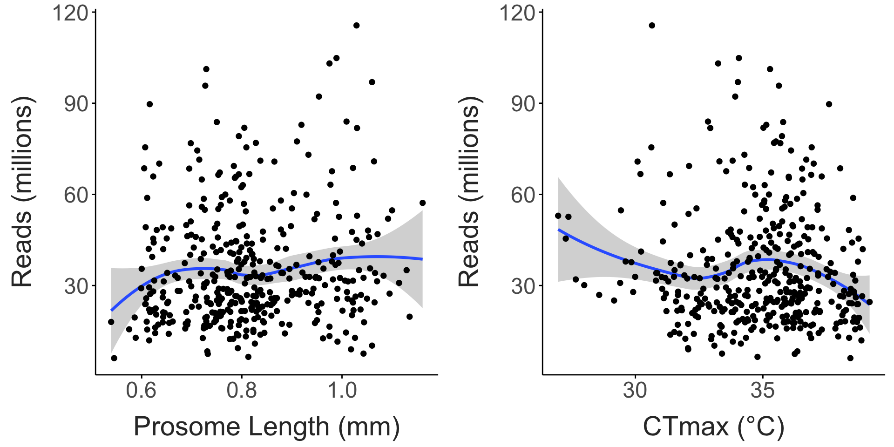

|           |       Sum Sq |  Df |   F value |   Pr(\>F) |
|:----------|-------------:|----:|----------:|----------:|
| size      | 9.603839e+14 |   1 | 2.6795203 | 0.1024488 |
| ctmax     | 1.671663e+11 |   1 | 0.0004664 | 0.9827809 |
| Residuals | 1.404992e+17 | 392 |        NA |        NA |

### Site filtering

Genotype-likelihood analyses use only the 15 chromosomes, minus
soft-masked repeats, nuclear copies of mitochondrial DNA (NUMTs) and
SNPs flagged as collapsed paralogs by ngsParalog. Because of the
reference bias, far fewer sites pass the missing-data filter (data in at
least 50% of individuals) in clades S and IV than in X.

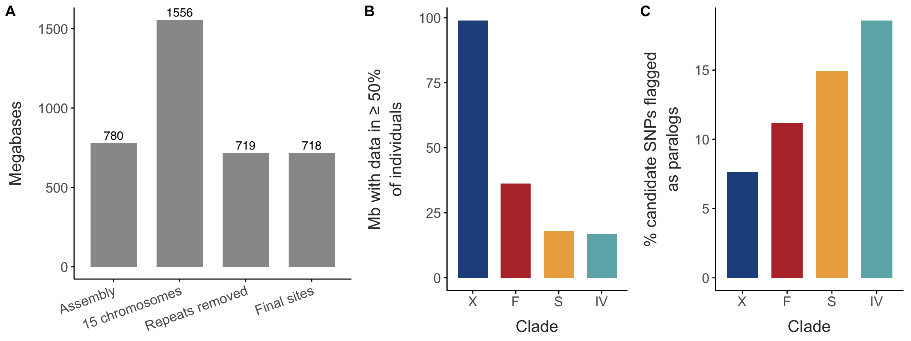

### Clade identity

Clades were assigned in two independent ways. **Mitochondrial:** each
individual’s reads were mapped to one partial mitogenome per clade, and
the clade was taken from the reads covering the COI barcode region.
**Nuclear:** genome-wide genotype likelihoods (PCAngsd, NGSadmix) on all
kept libraries. The two agree for every individual. Two libraries
contained DNA from individuals of two different clades (both
mitochondrial and nuclear signals mixed) and were excluded.

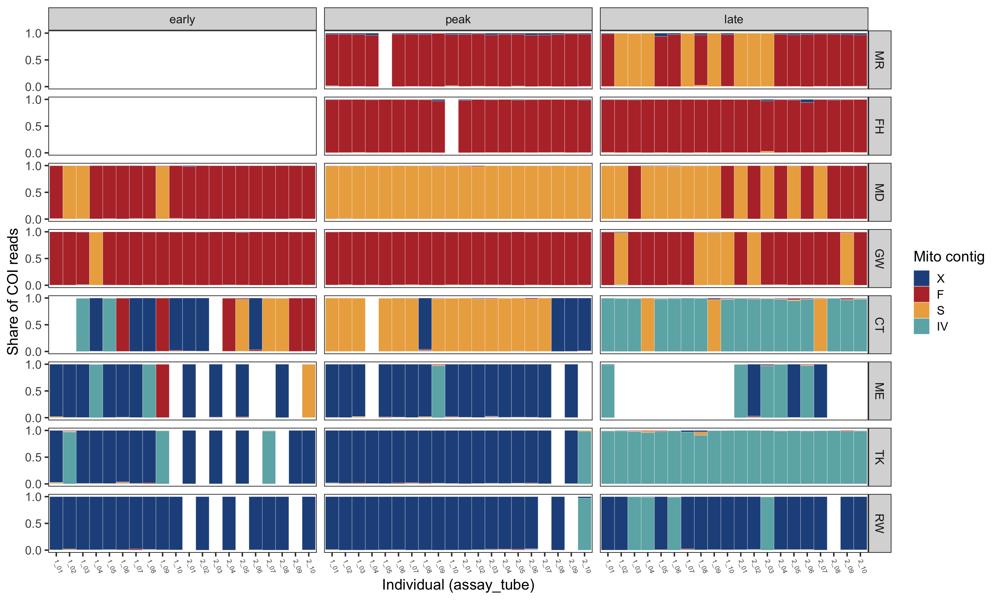

All four clades are cleanly separated in the nuclear genome. Clade F
splits further into site-specific sub-lineages (Manatee River, Ft.
Hamer, and the Chesapeake/New England group), visible on PC4 and at K =
5–6.

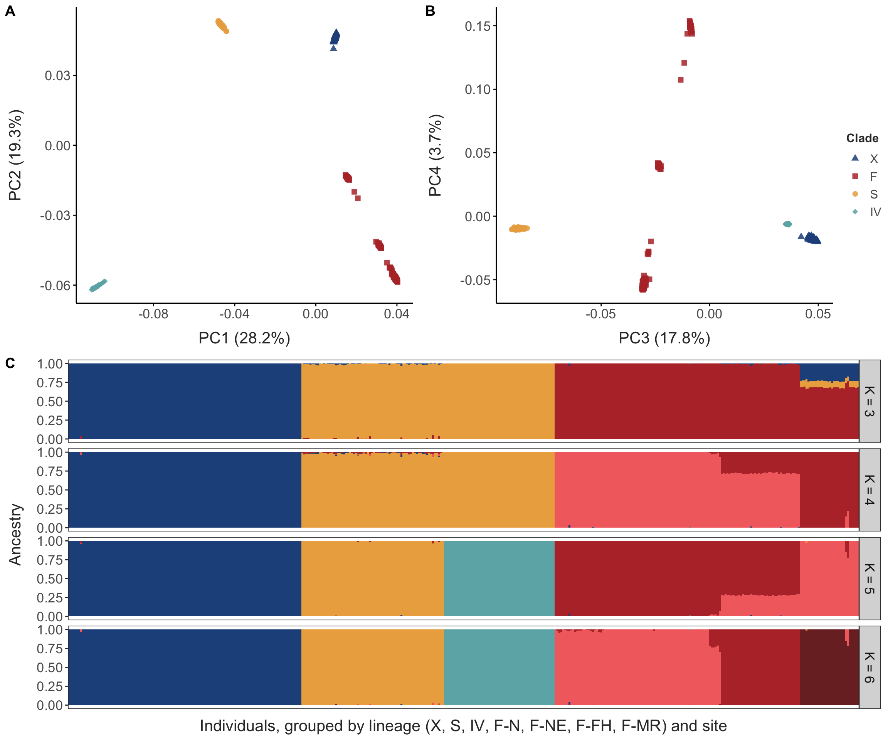

Within clade F, the sub-lineages are clearly separated (2–6% COI
divergence) but much less divergent than the clades are from each other
(12–18%). We therefore analyse four clades, and keep the F sub-lineage
as an annotation.

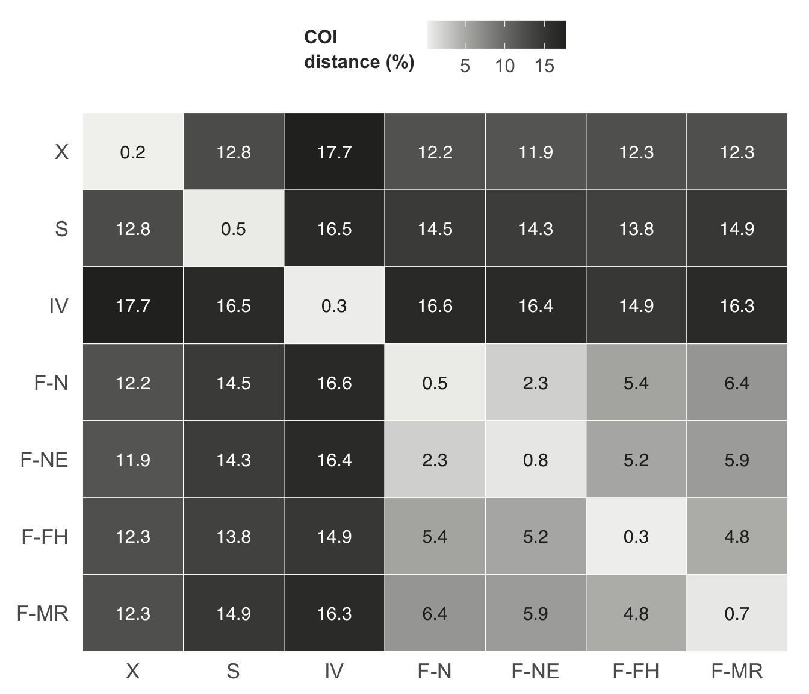

#### Lineage phylogeny: mitochondrial vs nuclear

Mitochondrial relationships come from the COI maximum-likelihood tree
(IQ-TREE, all individuals and reference haplotypes), reduced to one
representative per lineage (the individual with the most complete COI
sequence) and rooted on *A. hudsonica*. Support values are ultrafast
bootstraps of the corresponding node in the full tree. Nuclear
relationships come from genome-wide individual covariances (PCAngsd, all
individuals): pairwise distances dij = Cii +
Cjj − 2Cij were averaged between lineages and
corrected for within-lineage distance (net distance), and a
neighbour-joining tree was built from them (midpoint-rooted; support =
percentage of 200 bootstrap replicates resampling individuals within
lineages).

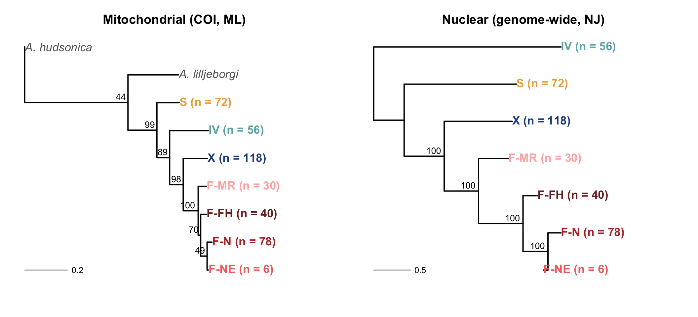

The two genomes give the same tree. Unrooted, both split the clades into
{S, IV} and {X, F}, with X sister to F (support 98 in COI, 100 in the
nuclear tree), and both order the F lineages the same way: F-MR first,
then F-FH, then F-N with F-NE. They differ only in where the root falls,
and the nuclear root is a midpoint placement, not an estimate.
Mito-nuclear concordance at every level means the lineages are not
mitochondrial types introgressed onto a shared nuclear background: they
are separate, non-interbreeding (or rarely interbreeding) genetic units.
Nuclear distances from the PCAngsd covariance summarise genome-wide
divergence rather than coming from a substitution model, so branch
lengths in the two panels are not comparable.

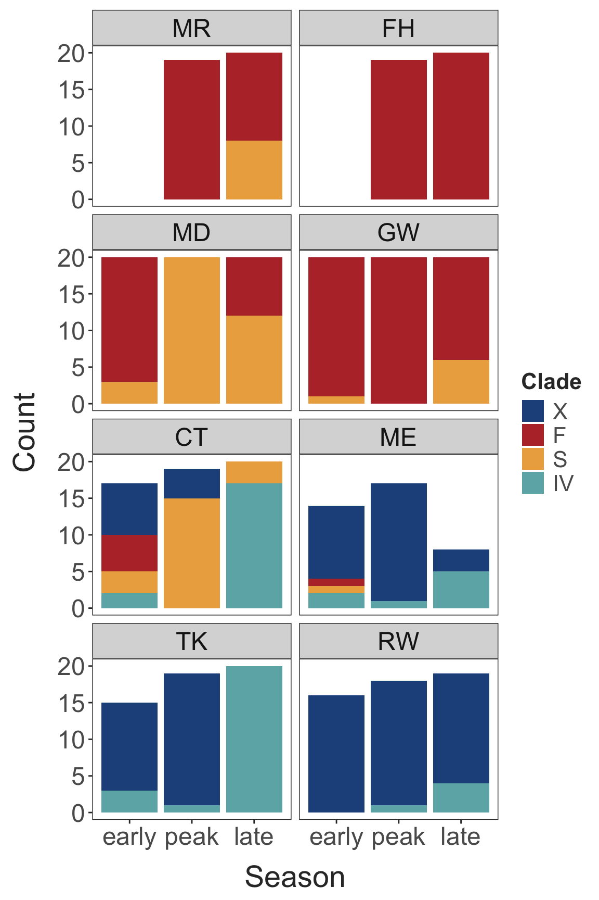

#### Seasonal turnover of lineages

Lineage composition is compared among the collections at each site
(sequenced individuals only; unassigned libraries excluded). Each site
gets a Fisher exact test of lineage × season (simulated p, 10⁴
replicates). The combined test uses the sum of per-site χ² statistics,
with season labels shuffled among individuals within each site (10⁴
permutations); sites with a single lineage contribute nothing.

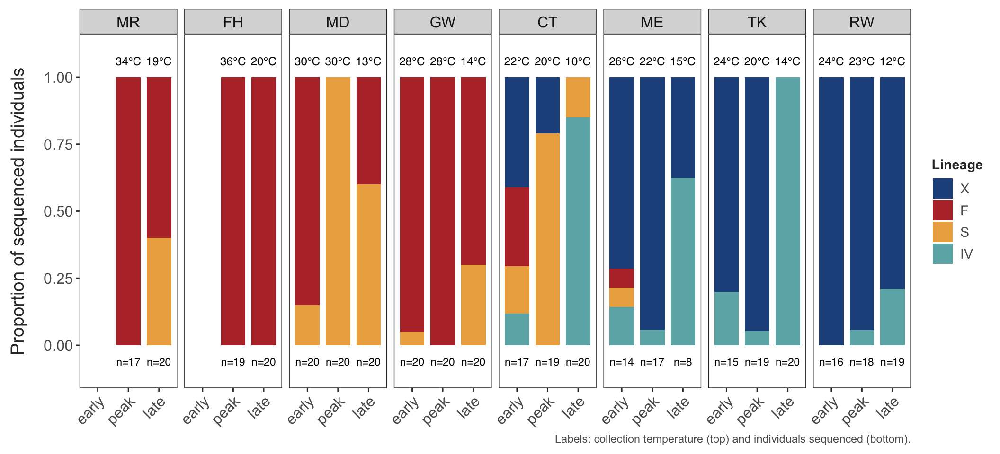

| Site | Seasons | Lineages | Individuals | Fisher p | Composition |
|:---|---:|---:|---:|:---|:---|
| MR | 2 | 2 | 37 | 0.0039 | peak: F 17; late: F 12, S 8 |
| FH | 2 | 1 | 39 | – | peak: F 19; late: F 20 |
| MD | 3 | 2 | 60 | \<1e-04 | early: F 17, S 3; peak: S 20; late: F 8, S 12 |
| GW | 3 | 2 | 60 | 0.0132 | early: F 19, S 1; peak: F 20; late: F 14, S 6 |
| CT | 3 | 4 | 56 | \<1e-04 | early: X 7, F 5, S 3, IV 2; peak: X 4, S 15; late: S 3, IV 17 |
| ME | 3 | 4 | 39 | 0.0081 | early: X 10, F 1, S 1, IV 2; peak: X 16, IV 1; late: X 3, IV 5 |
| TK | 3 | 2 | 54 | \<1e-04 | early: X 12, IV 3; peak: X 18, IV 1; late: IV 20 |
| RW | 3 | 2 | 53 | 0.1141 | early: X 16; peak: X 17, IV 1; late: X 15, IV 4 |

Lineage composition by season at each site. Combined test across sites:
χ² = 166, permutation p \<1e-04.

### Genetic differentiation within clades

Population structure and diversity are analysed within each clade (X, F,
S, IV), with populations defined as clade × site × sampling event (n ≥
8). Within clade F, site differences include differences between F
sub-lineages.

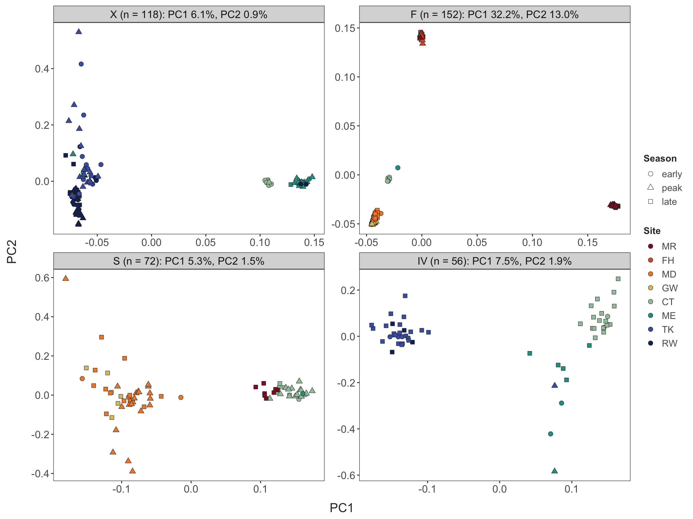

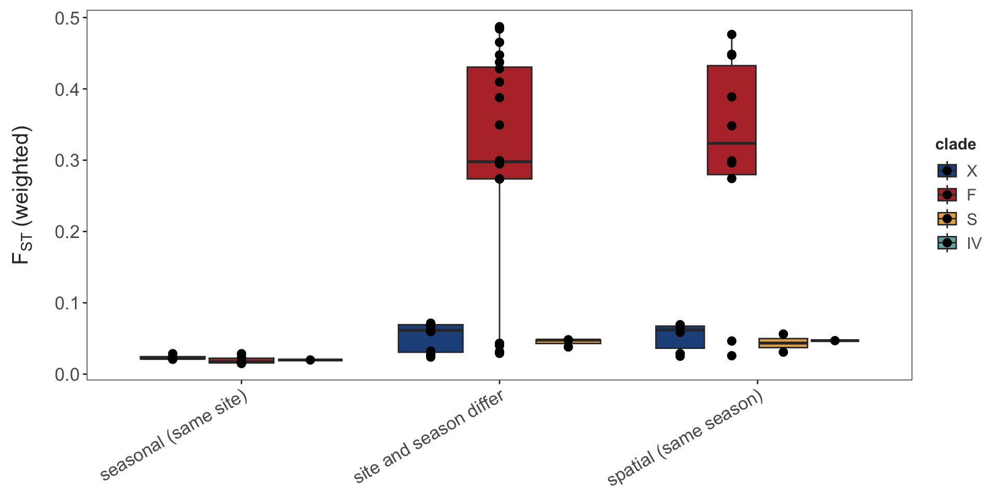

#### Isolation by distance

Genetic differentiation between sites within each clade, against the
straight-line distance between sites. FST is averaged over
the season pairs available for each pair of sites. F pairs between
sub-lineages (F-MR, F-FH, F-N) are shown separately: they reflect
divergence between lineages, not gene flow between populations.
Straight-line distances underestimate the distance by sea (around
Florida, and around Nova Scotia between Maine and the Gulf of
St. Lawrence), and each clade has only 2–4 sites, so this is
descriptive.

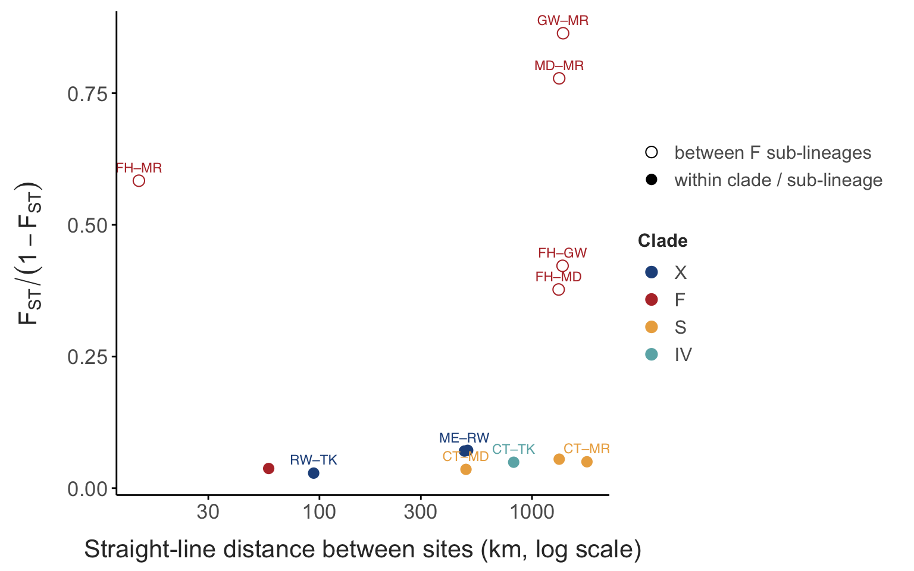

Shown below are estimates of diversity across the data set. Tajima’s D
can be used to detect random vs. non-random evolutionary processes
(e.g. drift vs. selection). A value near zero indicates neutral
processes and a stable population size. Negative values indicate an
excess of rare alleles, suggesting possible recent selective sweeps or
population expansion after a bottleneck. Positive values indicate
possible population contraction or balancing selection, resulting in
fewer rare alleles than expected.

Most values of Tajima’s D for our data set are small (within 0.5 of 0).
A few samples reached moderate values around -1 and 1. Interestingly,
all cases are from the two sites in the Chesapeake, with a low Tajima’s
D value for S clade individuals at the high salinity site, and high
values for F clade individuals at both high and low salinity sites.

We also calculated nucleotide diversity, which represents the average
number of nucleotide differences between randomly sampled sequences in a
population. Theta values tended to be high, with the exception of F
Clade individuals at the low salinity site in Florida and the two sites
in the Chesapeake.

We note that these diversity metrics should only be compared within
clades since reference bias changes which sites are usable in each
clade.

Within sites, there is notably little change in these metrics across
seasons. Three general within-clade patterns can be seen across sites:

1.  **Increasing Tajima’s D and decreased nucleotide diversity,** as
    seen in Clade F. This may indicate serial founder effects. Diversity
    should fall steadily in the direction of expansion ([Excoffier et
    al. 2009](https://doi.org/10.1146/annurev.ecolsys.39.110707.173414)).
    For a clade spreading north since the last glacial maximum, northern
    sites would be expected to have lower θπ and higher D ([Hewitt
    2000](https://doi.org/10.1038/35016000)). This suggests a low
    latitude origin for this clade.
2.  **Consistently low Tajima’s D and consistently high nucleotide
    diversity**, as seen in Clades S and IV (although note the limited
    sampling for these clades). This pattern suggests large,
    well-connected populations. There may have been population expansion
    before sites diverged, or there may be substantial gene flow between
    populations keeping them similar ([Excoffier et
    al. 2009](https://doi.org/10.1146/annurev.ecolsys.39.110707.173414)).
3.  **Consistently small Tajima’s D and consistently high nucleotide
    diversity**, as seen in Clade X. While this typically would indicate
    large, stable populations, Clade X is found only at the high
    latitude sites, where populations of *Acartia tonsa* are present
    during only part of the year, exhibiting drastic fluctuations in
    population size over this period. This may indicate the importance
    of an egg bank / resting eggs. If the population is generated each
    year by hatching out of eggs laid over many previous years,
    diversity would remain high. The egg bank acts as a store of
    diversity, so a brief active season doesn’t mean a small genetic
    population ([Hairston
    1996](https://doi.org/10.4319/lo.1996.41.5.1087)). Resting eggs are
    well documented in *Acartia* (Marcus 1996, *Hydrobiologia*
    320:141–152). In Narragansett Bay, *A. tonsa* replaces the
    egg-banking *A. hudsonica* each summer ([Sullivan & McManus
    1986](https://doi.org/10.3354/meps028121)), the same seasonal
    turnover your ME site shows. Under these dynamics, individual sites
    may retain distinct populations, as seen in the within-clade PCAs
    above.

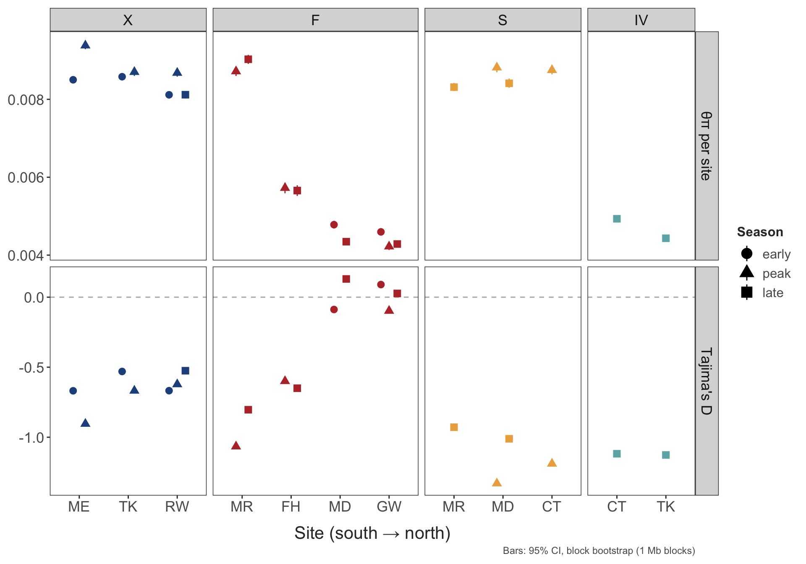

Diversity is compared within clades only: reference bias changes which
sites are usable in each clade. The spectra are folded (no outgroup),
and low-coverage data shift the absolute values of Tajima’s D, so
differences between populations of the same clade are more informative
than whether D is above or below zero. Confidence intervals come from a
block bootstrap over 1 Mb blocks; populations of 8 individuals (F MD
late, S MR late) are the least precise. \### Linkage disequilibrium

LD was estimated with ngsLD within each clade on every fifth SNP (MAF ≥
0.05), for a random 2% of SNP pairs up to 100 kb apart, and averaged in
distance bins. Dashed lines show the r² expected between unlinked SNPs
from sample size alone (≈ 1/n). LD decays to near that level within a
few kb in X, S and IV, as expected for very large long-term population
sizes. The higher plateau in F reflects allele-frequency differences
between the F sub-lineages pooled in the clade, not physical linkage.

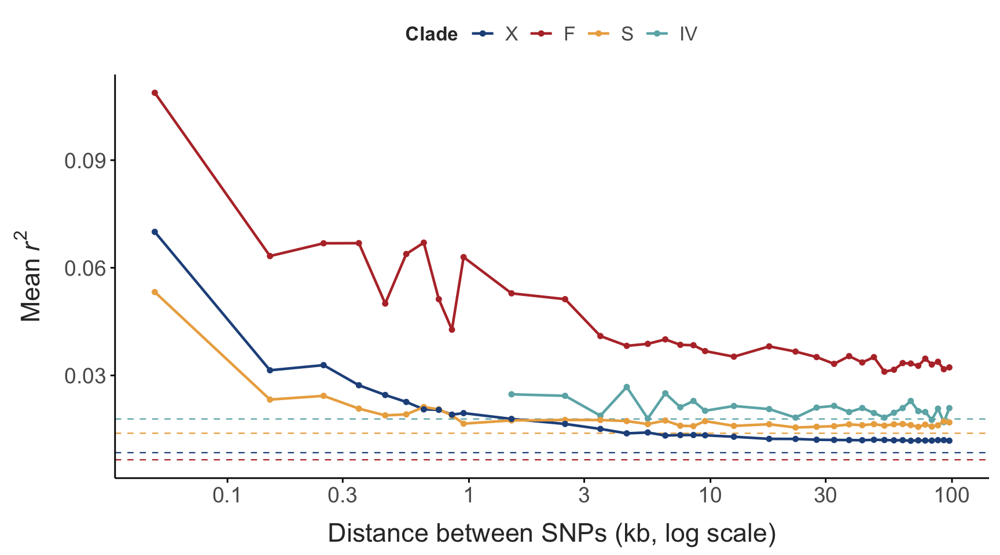

### Relatedness and sample quality

Relatedness was estimated with ngsRelate for every pair of individuals
within each population. KING-robust kinship does not depend on allele
frequencies, so it is less affected than *r*ab by the small
samples per population: unrelated pairs fall near or below 0,
second-degree relatives near 0.125 and first-degree relatives near 0.25.
In panel B, related pairs move towards high R1 and high KING; pairs
above 0.1 are labelled.

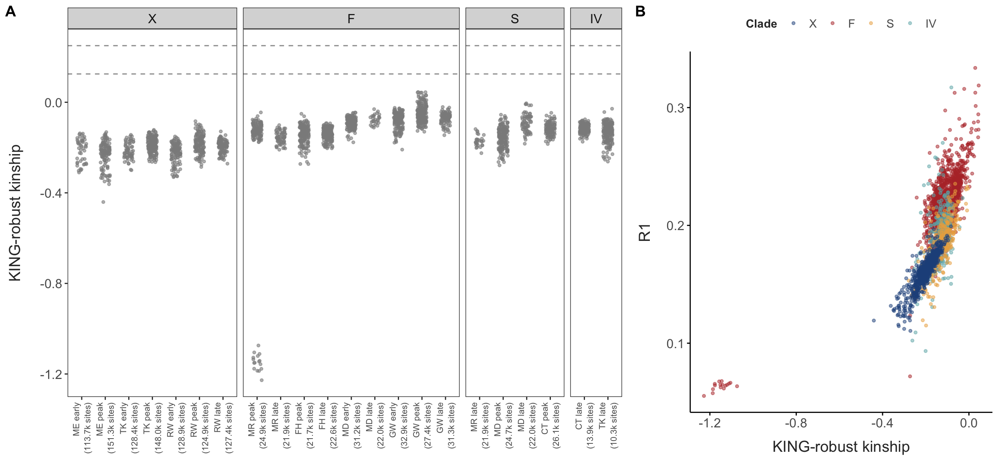

In MR peak, MR_peak_1_09 belongs to the F-FH sub-lineage while the rest
are F-MR, so its kinship with every other individual is strongly
negative (the cluster near −1.1). MR_peak_2_04 and MR_peak_2_05 carry
about 15% and 22% F-N ancestry (NGSadmix, K = 6) and have elevated
kinship with each other (KING 0.20, R0 0.11). The heterozygosity check
below shows both are far more heterozygous than any other F individual
(F = −0.18 and −0.22; clade median 0.13), so their libraries most likely
contain DNA from a second individual rather than coming from admixed
relatives. On library plate 3 they sit in wells F11 and G11, directly
next to GW early individuals (F-N; wells F10 and G10). Both were
excluded from the genomic analyses within clades
(`clades.exclude_samples` in the cluster config) and are not shown here;
their phenotype data are kept. With them removed, no pair in any
population reaches second-degree kinship.

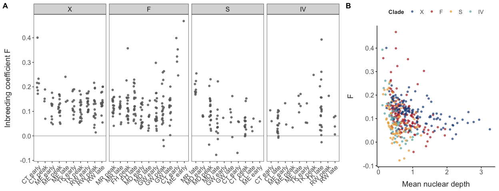

Per-individual inbreeding coefficients (PCAngsd, allowing for structure
within each clade) flag libraries that are more heterozygous than
expected (strongly negative F), the signature of DNA from two
individuals in one library. Individuals more than 4 robust SDs below
their clade’s median are labelled. High F mostly reflects low sequencing
depth (panel B: F falls with depth), so only unusually low values are
informative. MR_peak_2_04 and MR_peak_2_05 (F = −0.18 and −0.22) were
excluded on this basis and no longer appear; no other individual stands
out.

### Local PCA and candidate inversions

Each clade’s genome was split into windows of 2,000 SNPs, and the
population structure in each window (top two PCs of the covariance among
individuals) was compared between all windows (lostruct; Li & Ralph
2019). Windows were then placed on MDS axes: most of the genome shares
the same structure and clusters near zero; regions with distinct
structure, such as inversions, stand out as runs of windows far from
zero. Windows more than 4 robust SDs from the median are coloured.

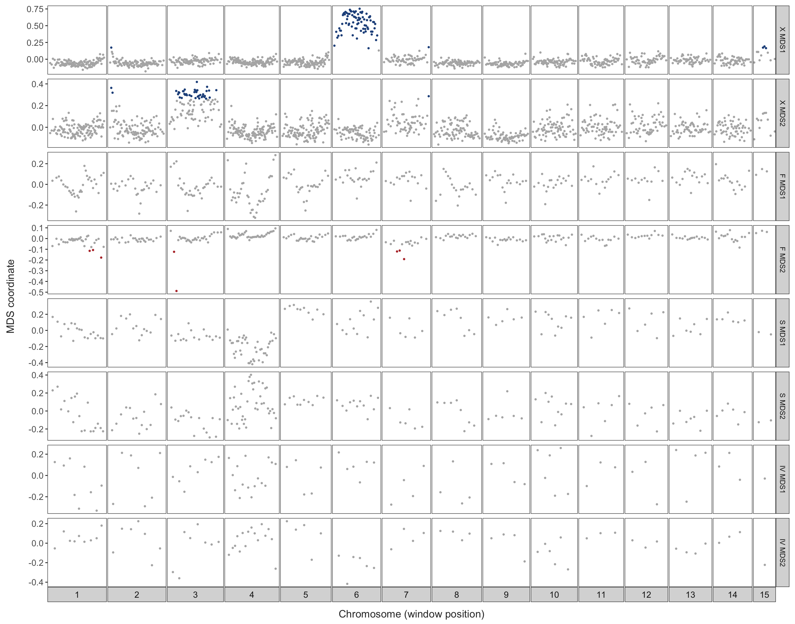

For each candidate region (at least 5 windows, mostly outliers),
individuals are placed by their average PC1 score across the region’s
windows. An inversion typically splits individuals into three groups
(the two homozygous arrangements and the heterozygotes); a region
tracking site or sub-lineage instead points to differentiation, and a
few individuals far from everyone else to a rare variant arrangement or
introgression.

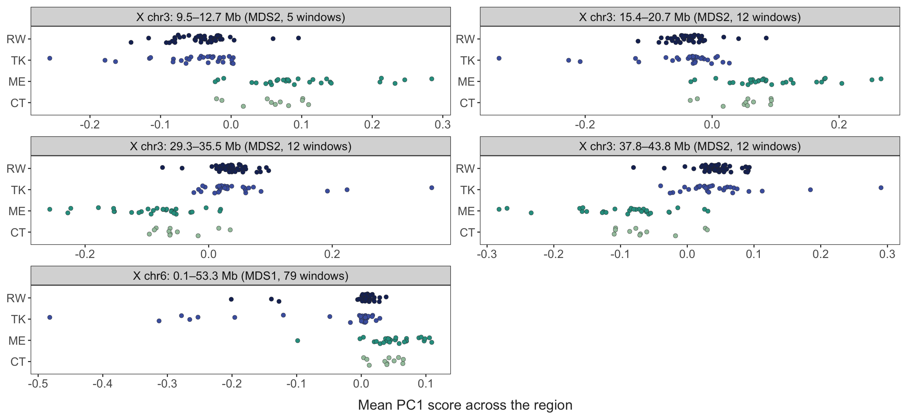

#### Follow-up of the candidate regions

Each candidate region (and a control region on chromosome 1 with no
local-PCA signal) was analysed on its own: a PCA of the region
(PCAngsd), each individual’s heterozygosity inside the region relative
to its genome-wide heterozygosity, and LD over distances up to 2 Mb. An
inversion shows as groups on the regional PC1 with heterozygotes raised
in heterozygosity (ratio above the bulk) and homozygotes for the rarer
arrangement lowered; suppressed recombination raises long-range LD when
both arrangements are common.

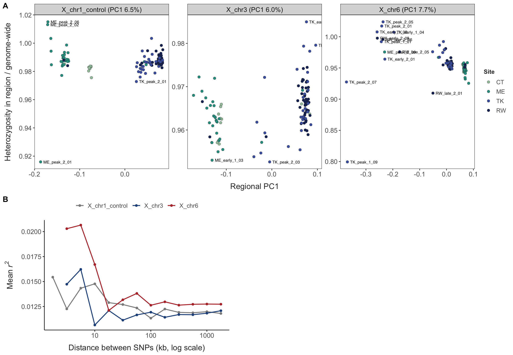

**Chromosome 6 (X)** fits a rare chromosomal variant such as an
inversion. A minority of individuals, almost all from St. Thomas de Kent
Wharf and a few from Ritchie Wharf, sits apart on the regional PC1. Most
of them are about 5% more heterozygous on chromosome 6 than their
genome-wide average, as expected for heterozygous carriers, while the
two most extreme individuals (TK_peak_1_09, TK_peak_2_07) are less
heterozygous, as expected for homozygotes of the rare arrangement. At
this frequency (roughly 5% of chromosomes overall) LD across the whole
sample is raised only slightly (panel B: higher at short distances and
marginally at 0.1–2 Mb than on the control chromosome). **Chromosome 3
(X)** does not: individuals split by site as on the control chromosome,
with no heterozygosity classes; only two or three TK early individuals
stand out on PC2 with slightly raised heterozygosity, which could be a
smaller rare variant within the region.

### Parasites and symbionts

Reads that did not map to the *A. tonsa* reference were screened for
small-subunit rRNA (phyloFlash, SILVA 138.1). Each read pair was
assigned to the shared ancestor of all equally good database hits, at a
rank limited by its identity, and host (*Acartia*) rRNA was removed. An
organism group was called present at ≥ 5 read pairs and ≥ 2 per million
library pairs (`Scripts/04_micro_calls.R`). Parasites (*Paradinium*,
trematodes) and epibionts (apostome and peritrich ciliates) show strong
site × season patterns: apostomes in every Connecticut late-season
individual, trematodes in most Ritchie Wharf peak-season individuals,
and *Zoothamnium* on late-season Maine and St. Thomas de Kent Wharf
copepods.

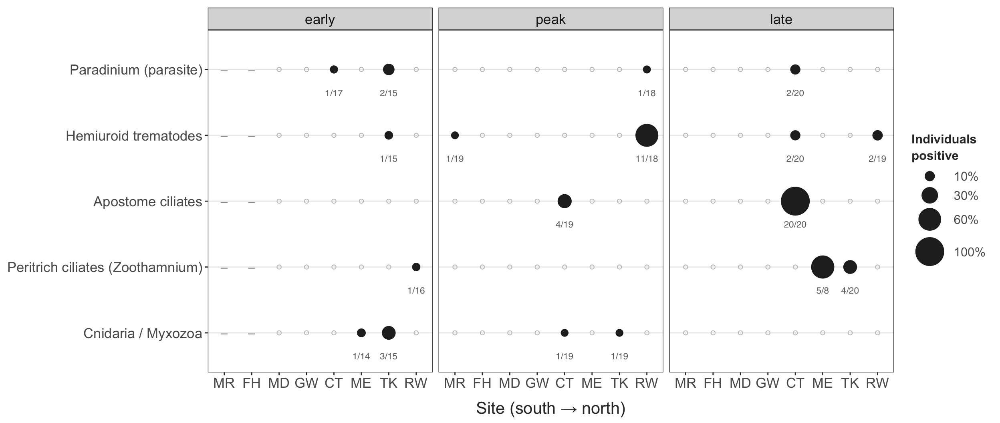

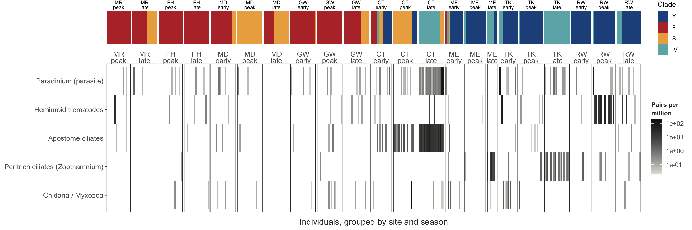

Kinetoplastids are present at low levels in most individuals, mostly at
the northern sites, and are treated as non-pathogenic background;
crustacean (Malacostraca) DNA is likely diet.

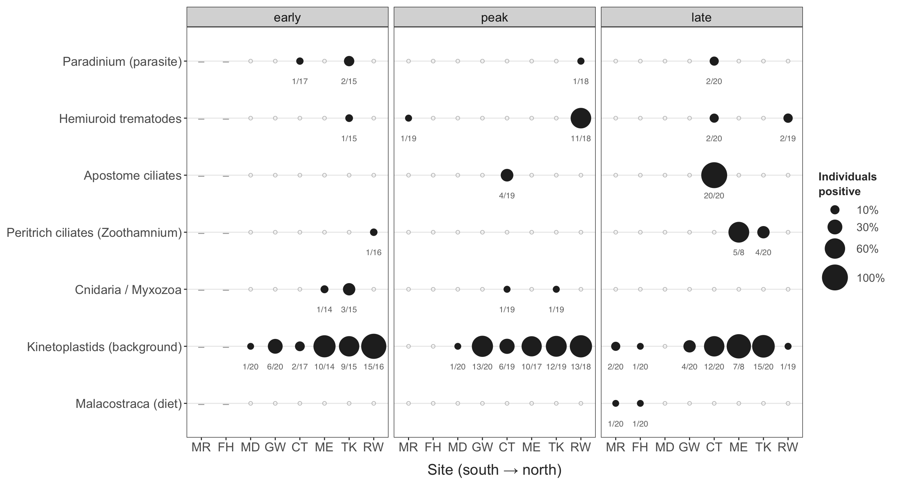

### Seasonal allele-frequency change

Allele frequencies per population at the unlinked SNP set (one SNP per
10 kb; Section 3.2, LD) were compared between seasons within each site.
Temporal differentiation is Nei & Tajima’s Fc ([Nei & Tajima
1981](https://doi.org/10.1093/genetics/98.3.625)) over SNPs with ≥ 5
individuals with data in both samples and a mean minor-allele frequency
of 0.05–0.95. Under the temporal method, Fc ≈
t/(2Ne) + sampling noise of both samples, so Ne
follows once the sampling noise is subtracted ([Waples
1989](https://doi.org/10.1093/genetics/121.2.379); [Jorde & Ryman
2007](https://doi.org/10.1534/genetics.107.075481)).

**Calibrating sampling noise.** With \< 1× coverage, frequencies are
sampled twice, once through the individuals and once through the reads,
so an individual contributes less than two chromosomes of information
([Jónás et al. 2016](https://doi.org/10.1534/genetics.116.191197)).
Pool-seq studies handle this with an “effective number of chromosomes”
([Feder et al. 2012](https://doi.org/10.1371/journal.pone.0048588);
[Bergland et al. 2014](https://doi.org/10.1371/journal.pgen.1004775);
[Machado et al. 2021](https://doi.org/10.7554/eLife.67577)). Here it was
measured directly: each population was split at random into two halves
(two replicates), allele frequencies were estimated for each half, and
Fc between the halves (pure sampling noise) was compared with
the 1/(2n) expectation. The ratio, c, is the effective number of
chromosomes per individual divided by two, and the sampling term for any
sample becomes 1/(2cn). This split-half calibration is an empirical
resampling check rather than a named published method.

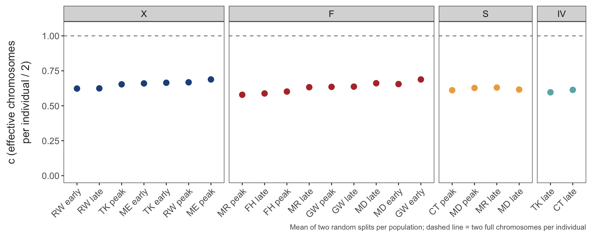

Every population gives c ≈ 0.6–0.7 (about 1.2–1.4 effective chromosomes
per individual), and the two random splits agree to within 0.02. The
calibration is therefore stable and similar across clades, sites and
seasons.

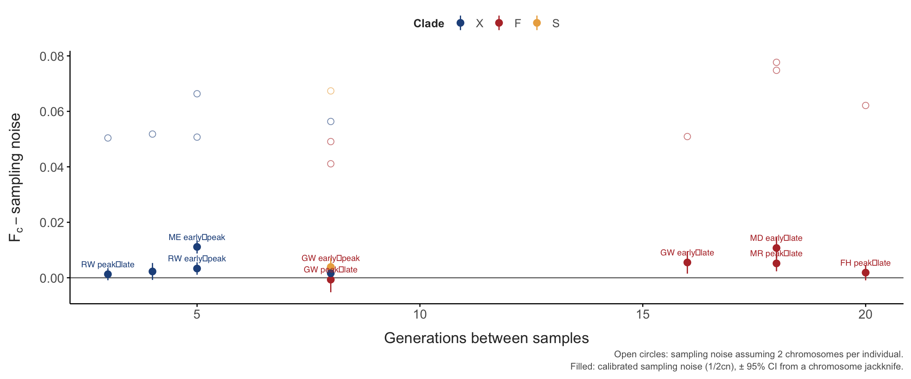

| Clade | Pair | Generations | SNPs | Fc | Excess (calibrated) | Ne | Ne 95% CI |
|:---|:---|---:|---:|---:|:---|:---|:---|
| F | FH peak→late | 20 | 33199 | 0.151 | 0.0019 ± 0.0014 | 5398 | 2155 – ∞ |
| F | GW early→late | 16 | 27144 | 0.138 | 0.0055 ± 0.0021 | 1450 | 838 – 5377 |
| F | GW early→peak | 8 | 27438 | 0.114 | 0.0036 ± 0.0018 | 1113 | 564 – 38734 |
| F | GW peak→late | 8 | 30102 | 0.136 | -0.0007 ± 0.0023 | ∞ | 1029 – ∞ |
| F | MD early→late | 18 | 20682 | 0.199 | 0.0107 ± 0.0019 | 838 | 620 – 1295 |
| F | MR peak→late | 18 | 24405 | 0.190 | 0.0052 ± 0.0015 | 1735 | 1118 – 3869 |
| S | MD peak→late | 8 | 24640 | 0.171 | 0.0039 ± 0.0016 | 1029 | 564 – 5888 |
| X | ME early→peak | 5 | 33373 | 0.179 | 0.0111 ± 0.0012 | 225 | 185 – 286 |
| X | RW early→late | 8 | 56735 | 0.147 | 0.0016 ± 0.0010 | 2459 | 1092 – ∞ |
| X | RW early→peak | 5 | 52812 | 0.136 | 0.0033 ± 0.0011 | 751 | 449 – 2297 |
| X | RW peak→late | 3 | 51775 | 0.139 | 0.0013 ± 0.0011 | 1176 | 434 – ∞ |
| X | TK early→peak | 4 | 46842 | 0.148 | 0.0023 ± 0.0016 | 880 | 375 – ∞ |

Temporal Fc and Ne per seasonal pair, with
sampling noise calibrated by the split-half c. CI from a
delete-one-chromosome jackknife of the excess; ∞ = excess not
distinguishable from zero.

| Group | π (median) | Long-term Ne (µ = 10⁻⁸ – 10⁻⁹) | Temporal Ne (median; range) | Seasonal pairs | Long-term / temporal (µ = 10⁻⁸) |
|:---|---:|:---|:---|---:|:---|
| F-FH | 0.0050 | 120,000 – 1,200,000 | 5,398 (5,398 – 5,398) | 1 | 23× |
| F-MR | 0.0077 | 190,000 – 1,900,000 | 1,735 (1,735 – 1,735) | 1 | 111× |
| F-N | 0.0038 | 95,000 – 950,000 | 1,113 ( 838 – 1,450) | 4 | 85× |
| S | 0.0073 | 180,000 – 1,800,000 | 1,029 (1,029 – 1,029) | 1 | 178× |
| X | 0.0075 | 190,000 – 1,900,000 | 880 ( 225 – 2,459) | 5 | 214× |

Long-term effective size from nucleotide diversity (π = 4Neµ, for
mutation rates of 10⁻⁸ and 10⁻⁹ per site per generation) against the
temporal (within-season) Ne. Even at the higher mutation rate, long-term
Ne exceeds the temporal estimate by two orders of magnitude: within a
season, local allele frequencies change far more than a closed
population of the long-term size would allow, as expected if sites are
open to immigration and mixing of water masses.

| comparison |  snps |      r |    se |
|:-----------|------:|-------:|------:|
| ME vs TK   | 40454 | -0.013 | 0.006 |
| ME vs RW   | 40454 |  0.000 | 0.005 |
| TK vs RW   | 40454 | -0.002 | 0.006 |

Clade X: correlation of early→peak allele-frequency change between sites
(unlinked SNPs; SE from a delete-one-chromosome jackknife)

Calibration removes almost all of the apparent excess: with two
chromosomes per individual assumed, every pair showed an excess of ≈
0.05 regardless of the number of generations (open circles); with the
calibrated sampling term the excess is 0.000–0.011 (filled points). Most
pairs give Ne in the high hundreds to a few thousand, with
lower 95% bounds of roughly 400–2,000, and several upper bounds are
infinite (no drift detectable within the season). These estimates
describe drift over a few to ~20 generations within one season, not
long-term Ne, and they are at or above the lab estimate of
~400. ME early→peak is the exception (Ne ≈ 225, CI ≈
185–285): ME early is the smallest X sample (10 individuals), so a
modest error in its c would inflate the excess, and the value should be
checked before it is interpreted biologically. In clade X, early→peak
changes at different sites remain uncorrelated genome-wide (r ≈ 0).

**Per-SNP seasonal test.** For each SNP, the minor-allele count was
modelled with a binomial GLM, count ~ site + x, with each population
weighted by its effective number of chromosomes (2cn), as in the
*Drosophila* seasonal studies ([Bergland et
al. 2014](https://doi.org/10.1371/journal.pgen.1004775); [Machado et
al. 2021](https://doi.org/10.7554/eLife.67577)). Two versions of x were
fitted: (1) **time**, the collection day of year scaled from 0 (first
sampling event at a site) to 1 (last), which rewards change in the same
direction through the season at every site; and (2) **temperature**, the
mean MUR SST over the generation before each collection (Ganey’s Wharf
corrected against station ET5.1), which rewards change that tracks
temperature, so that a warming and a cooling step move frequencies in
opposite directions. Temperature matters because the season is not a
monotonic temperature ramp: water before the early and peak collections
was similar (or cooler at peak in the north), and the late collections
followed a strong cooling. The null distribution comes from permuting x
among each site’s sampling events, enumerating every distinct ordering
(time: X 11 and F 23 permutations, as reversing all sites only flips the
sign; temperature: X 23 and F 47). The genome-wide test asks whether
more SNPs reach a given p value with the real values than with the
permuted ones. Results are shown with and without chromosome 6, which
carries the likely inversion in clade X (Section 3.2). Clade S has a
single seasonal site (MD) with two samples, so it has no permutation
null and is not shown.

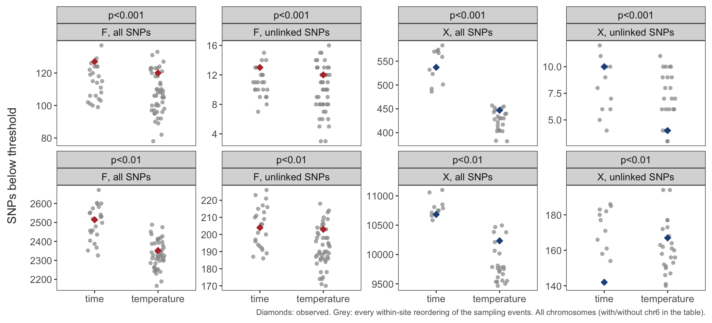

| Clade | SNPs | Model | Chromosomes | Threshold | Observed | Permutation mean | Permutation max | Rank of observed |
|:---|:---|:---|:---|:---|---:|---:|---:|:---|
| X | all | time | all chr. | p\<0.0001 | 17 | 19.5 | 28 | 11 / 12 |
| X | all | time | all chr. | p\<0.001 | 537 | 541.6 | 583 | 7 / 12 |
| X | all | time | all chr. | p\<0.01 | 10682 | 10798.4 | 11100 | 10 / 12 |
| X | all | time | no chr6 | p\<0.0001 | 16 | 18.6 | 24 | 11 / 12 |
| X | all | time | no chr6 | p\<0.001 | 496 | 507.7 | 540 | 9 / 12 |
| X | all | time | no chr6 | p\<0.01 | 10010 | 10164.2 | 10409 | 11 / 12 |
| X | all | temperature | all chr. | p\<0.0001 | 11 | 11.9 | 17 | 15 / 24 |
| X | all | temperature | all chr. | p\<0.001 | 447 | 425.2 | 457 | 6 / 24 |
| X | all | temperature | all chr. | p\<0.01 | 10233 | 9849.9 | 10496 | 5 / 24 |
| X | all | temperature | no chr6 | p\<0.0001 | 11 | 11.4 | 16 | 15 / 24 |
| X | all | temperature | no chr6 | p\<0.001 | 423 | 399.8 | 434 | 5 / 24 |
| X | all | temperature | no chr6 | p\<0.01 | 9615 | 9263.7 | 9844 | 5 / 24 |
| X | unlinked | time | all chr. | p\<0.0001 | 0 | 0.2 | 1 | 12 / 12 |
| X | unlinked | time | all chr. | p\<0.001 | 10 | 8.0 | 12 | 5 / 12 |
| X | unlinked | time | all chr. | p\<0.01 | 142 | 173.0 | 186 | 12 / 12 |
| X | unlinked | time | no chr6 | p\<0.0001 | 0 | 0.2 | 1 | 12 / 12 |
| X | unlinked | time | no chr6 | p\<0.001 | 10 | 7.3 | 11 | 2 / 12 |
| X | unlinked | time | no chr6 | p\<0.01 | 134 | 161.2 | 172 | 12 / 12 |
| X | unlinked | temperature | all chr. | p\<0.0001 | 0 | 0.2 | 1 | 24 / 24 |
| X | unlinked | temperature | all chr. | p\<0.001 | 4 | 7.1 | 11 | 22 / 24 |
| X | unlinked | temperature | all chr. | p\<0.01 | 167 | 161.5 | 194 | 8 / 24 |
| X | unlinked | temperature | no chr6 | p\<0.0001 | 0 | 0.2 | 1 | 24 / 24 |
| X | unlinked | temperature | no chr6 | p\<0.001 | 4 | 6.4 | 10 | 22 / 24 |
| X | unlinked | temperature | no chr6 | p\<0.01 | 158 | 150.7 | 181 | 9 / 24 |
| F | all | time | all chr. | p\<0.0001 | 2 | 3.3 | 9 | 19 / 24 |
| F | all | time | all chr. | p\<0.001 | 127 | 114.2 | 137 | 3 / 24 |
| F | all | time | all chr. | p\<0.01 | 2514 | 2498.2 | 2671 | 13 / 24 |
| F | all | time | no chr6 | p\<0.0001 | 2 | 3.0 | 9 | 19 / 24 |
| F | all | time | no chr6 | p\<0.001 | 116 | 103.2 | 122 | 3 / 24 |
| F | all | time | no chr6 | p\<0.01 | 2323 | 2286.2 | 2467 | 8 / 24 |
| F | all | temperature | all chr. | p\<0.0001 | 5 | 3.8 | 8 | 16 / 48 |
| F | all | temperature | all chr. | p\<0.001 | 120 | 107.5 | 133 | 13 / 48 |
| F | all | temperature | all chr. | p\<0.01 | 2352 | 2331.4 | 2488 | 17 / 48 |
| F | all | temperature | no chr6 | p\<0.0001 | 3 | 3.6 | 7 | 35 / 48 |
| F | all | temperature | no chr6 | p\<0.001 | 110 | 97.1 | 122 | 11 / 48 |
| F | all | temperature | no chr6 | p\<0.01 | 2162 | 2129.3 | 2305 | 16 / 48 |
| F | unlinked | time | all chr. | p\<0.0001 | 0 | 0.1 | 1 | 24 / 24 |
| F | unlinked | time | all chr. | p\<0.001 | 13 | 11.0 | 15 | 6 / 24 |
| F | unlinked | time | all chr. | p\<0.01 | 204 | 204.3 | 226 | 13 / 24 |
| F | unlinked | time | no chr6 | p\<0.0001 | 0 | 0.1 | 1 | 24 / 24 |
| F | unlinked | time | no chr6 | p\<0.001 | 12 | 9.9 | 14 | 6 / 24 |
| F | unlinked | time | no chr6 | p\<0.01 | 193 | 186.2 | 211 | 8 / 24 |
| F | unlinked | temperature | all chr. | p\<0.0001 | 0 | 0.1 | 1 | 48 / 48 |
| F | unlinked | temperature | all chr. | p\<0.001 | 12 | 10.1 | 16 | 20 / 48 |
| F | unlinked | temperature | all chr. | p\<0.01 | 203 | 192.9 | 218 | 13 / 48 |
| F | unlinked | temperature | no chr6 | p\<0.0001 | 0 | 0.1 | 1 | 48 / 48 |
| F | unlinked | temperature | no chr6 | p\<0.001 | 11 | 9.1 | 16 | 17 / 48 |
| F | unlinked | temperature | no chr6 | p\<0.01 | 189 | 176.2 | 206 | 10 / 48 |

Per-SNP seasonal GLM: SNPs below each p threshold with the real seasons
vs all within-site permutations (rank 1 = more than every permutation).

There is no genome-wide excess of seasonal SNPs in either clade, with
either model. With the real seasons, X and F have about as many low-p
SNPs as the permuted orderings, at every threshold, on both the unlinked
and the full SNP sets. Modelling temperature instead of time does not
change this: the closest to a signal is clade X on all SNPs (rank 5–6 of
24 at p \< 0.01 and p \< 0.001, i.e. p ≈ 0.2–0.25), which is not
significant and does not hold on the unlinked set. Removing chromosome 6
changes nothing, so the X inversion is not driving or masking a seasonal
signal. The genomic-control λ is close to 1 (X ≈ 1.1, F ≈ 1.0) for the
observed and permuted values alike, so the calibrated binomial weights
describe the sampling variance well. Together with the uncorrelated
early→peak changes across X sites, this means that any seasonal
selection in these populations acts on too few loci, or is too weak, to
show up genome-wide with 3–4 seasonal sites per clade, whether it is
modelled as a seasonal trend or as a response to temperature. Individual
SNPs with the smallest p values are listed in
`results/13_seasonal/*.top.tsv` and `results/13_seasonal/temp/*.top.tsv`
but are not more numerous than expected by chance, so none can be called
a seasonal candidate on its own. The permutation null is coarse (time:
12 and 24 orderings; temperature: 24 and 48), which limits the smallest
attainable rank-based p value to 1/12–1/48.

### Spatial vs. seasonal genetic variation

How much do allele frequencies differ between sites compared with
between seasons at the same site? Within each clade, the variance of
population allele frequencies at the unlinked SNPs was split into a
between-site component and a between-season (within-site) component,
after subtracting the calibrated sampling noise (1/(2cn) per population,
from the split-half calibration). Both are expressed relative to p̄(1 −
p̄), like FST, summed over SNPs (ratio of sums), with 95%
intervals from a delete-one-chromosome jackknife. The between-site
component reflects long-term history and spatial selection; the seasonal
component reflects drift and selection over a single season (3–20
generations).

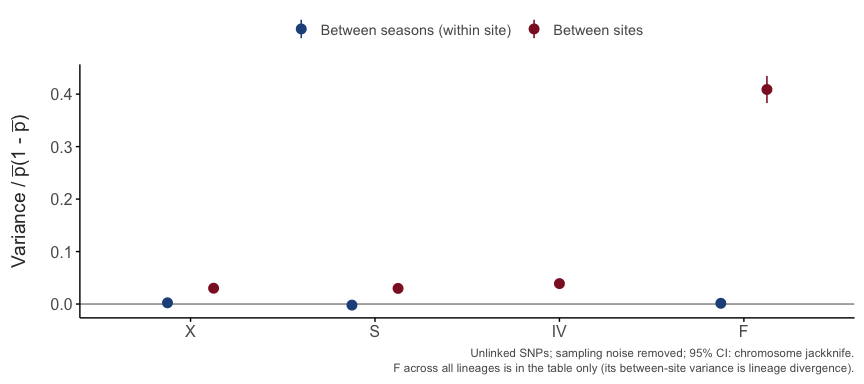

| Group | Sites | Sites with ≥ 2 seasons | Populations | SNPs | Between sites | Between seasons | Site : season ratio |
|:---|---:|---:|---:|---:|:---|:---|:---|
| X | 3 | 3 | 7 | 38543 | 0.0301 (0.0269, 0.0333) | 0.0023 (0.0012, 0.0034) | 13 |
| S | 3 | 1 | 4 | 16025 | 0.0298 (0.0231, 0.0365) | -0.0020 (-0.0044, 0.0004) | – |
| IV | 2 | 0 | 2 | 28489 | 0.0390 (0.0335, 0.0445) | – | – |
| F | 4 | 4 | 9 | 24494 | 0.4088 (0.3829, 0.4347) | 0.0014 (0.0006, 0.0022) | 289 |

Allele-frequency variance between sites and between seasons within
sites, relative to p̄(1 − p̄), after removing sampling noise (95% CI).
Ratio shown only where the seasonal component is clearly above zero.

Allele frequencies differ far more between sites than between seasons at
the same site. In clade X, the between-site variance (0.030) is about 13
times the seasonal variance (0.0023); in F-N (MD vs. GW) the ratio is
about . The seasonal component is small but above zero in X and F-N,
consistent with the temporal Fc excess above (drift over a
season with Ne in the high hundreds to thousands); in S, with
one seasonal site, it is indistinguishable from zero. Across the F
lineages the between-site component () is an order of magnitude larger,
because it measures divergence between lineages rather than among
populations of one lineage. Seasonal change in allele frequencies is
therefore a small fraction of the spatial differentiation it would have
to reproduce for seasonal evolution to mirror spatial adaptation, which
fits the absence of concordance below.

### Does space substitute for time? Concordance of temperature responses

If the alleles that are more common at warmer sites are favoured by warm
conditions, they should also rise after warm periods and fall after cool
ones within sites. For every SNP, two temperature slopes were estimated
with the same binomial GLM and calibrated weights as above: a
**spatial** slope (frequency against each site’s long-term MUR SST, with
a site’s seasonal samples pooled) and a **seasonal** slope (the
temperature model above: frequency against site + temperature before
collection). Their agreement across the genome was measured as the
correlation of the two z-scores, and, among the 1% and 5% of SNPs with
the strongest spatial slopes, as the fraction whose seasonal slope has
the same sign (0.5 = no agreement). The null keeps the spatial slopes
and permutes temperatures among each site’s sampling events (as in the
seasonal test); a second, smaller null permutes site temperatures among
sites. This is the genomic counterpart of the within- vs between-site
comparison for CTmax (Section 4) and follows the seasonal–clinal
comparison of [Machado et
al. (2021)](https://doi.org/10.7554/eLife.67577).

Clade X (ME, TK, RW; one lineage, three seasonal sites) is the main
test. In clade F the warm sites (MR, FH) and the cool sites (MD, GW)
belong to different lineages, so its spatial slopes mostly reflect
lineage differences, not temperature; F is shown for completeness but
not interpreted. Clade S has one seasonal site, so its seasonal null has
a single alternative ordering.

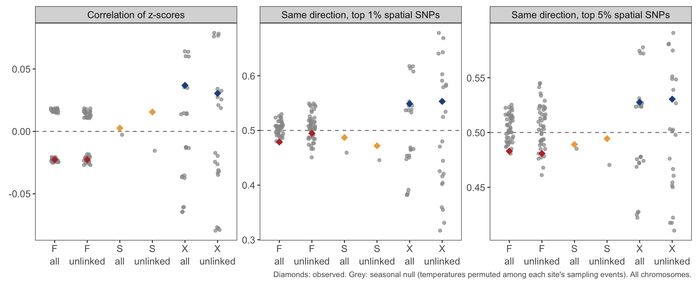

| Clade | SNPs | Chromosomes | SNPs tested | r | Rank | Top 1% same sign | Rank | Top 5% same sign | Rank |
|:---|:---|:---|---:|---:|:---|---:|:---|---:|:---|
| X | all | all chr. | 2056496 | 0.037 | 5 / 24 | 0.549 | 6 / 24 | 0.528 | 6 / 24 |
| X | all | no chr6 | 1918570 | 0.035 | 8 / 24 | 0.548 | 6 / 24 | 0.527 | 8 / 24 |
| X | unlinked | all chr. | 42357 | 0.030 | 8 / 24 | 0.553 | 10 / 24 | 0.530 | 9 / 24 |
| X | unlinked | no chr6 | 39302 | 0.030 | 9 / 24 | 0.555 | 10 / 24 | 0.534 | 9 / 24 |
| F | all | all chr. | 470321 | -0.023 | 36 / 48 | 0.479 | 48 / 48 | 0.483 | 47 / 48 |
| F | all | no chr6 | 437032 | -0.022 | 30 / 48 | 0.484 | 48 / 48 | 0.487 | 45 / 48 |
| F | unlinked | all chr. | 38608 | -0.023 | 36 / 48 | 0.495 | 34 / 48 | 0.481 | 43 / 48 |
| F | unlinked | no chr6 | 35928 | -0.023 | 34 / 48 | 0.493 | 33 / 48 | 0.486 | 39 / 48 |
| S | all | all chr. | 273722 | 0.003 | 1 / 2 | 0.487 | 1 / 2 | 0.489 | 1 / 2 |
| S | all | no chr6 | 254773 | 0.002 | 1 / 2 | 0.492 | 1 / 2 | 0.491 | 1 / 2 |
| S | unlinked | all chr. | 26743 | 0.016 | 1 / 2 | 0.472 | 1 / 2 | 0.494 | 1 / 2 |
| S | unlinked | no chr6 | 25076 | 0.016 | 1 / 2 | 0.472 | 1 / 2 | 0.494 | 1 / 2 |

Concordance of spatial and seasonal temperature slopes. Rank = position
of the observed value among all seasonal-null orderings (1 = higher than
every permutation).

### Power of the genomic tests

How much seasonal selection could these tests have detected? Selection
was injected into the observed allele frequencies (unlinked SNPs) and
each test rerun exactly as above (cluster target `power`;
`results/18_power/`), so drift, sampling noise and the sampling design
are those of the real data.

- **Seasonal GLM and temporal Fc:** a random fraction of SNPs (0.1–10%)
  had their logit frequency shifted by δ between each site’s first and
  last sample, in the same direction at every site. δ is shown below as
  the change in allele frequency for an allele starting at 50%, and as
  selection per generation using the generations between each clade’s
  first and last samples. A replicate counts as detected when the
  observed number of SNPs with p \< 10⁻³ exceeds every within-site
  permutation (the smallest attainable p is 1/12 for X and 1/24 for F),
  or, for Fc, when the added excess exceeds the observed excess plus
  1.96 SE (inverse-variance pooled over each site’s first → last pair).
- **Concordance:** the most temperature-associated SNPs across sites
  (top 1–100% by spatial z) were given a seasonal response equal to a
  fraction λ of their spatial slope; detection = ranking above every
  seasonal permutation.

With strong injected responses (λ ≥ 0.5) the sign-agreement statistic
saturates at 1 in the permutations too, so those cells can show as
undetected in F; the relevant region is the weak-response end, where
both clades detect responses of a tenth (X) or a twentieth (F) of the
spatial slope.

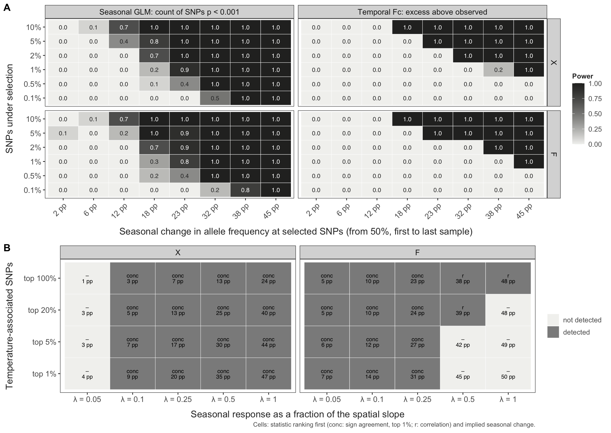

| Test | Clade | SNPs under selection | Smallest change detected (pp from 50%) | Selection per generation (s) |
|:---|:---|:---|---:|---:|
| Seasonal GLM | F | 0.1% | 38 | 0.110 |
| Seasonal GLM | F | 0.5% | 32 | 0.083 |
| Seasonal GLM | F | 1% | 23 | 0.056 |
| Seasonal GLM | F | 2% | 23 | 0.056 |
| Seasonal GLM | F | 5% | 18 | 0.042 |
| Seasonal GLM | F | 10% | 18 | 0.042 |
| Seasonal GLM | X | 0.1% | 38 | 0.350 |
| Seasonal GLM | X | 0.5% | 32 | 0.260 |
| Seasonal GLM | X | 1% | 23 | 0.180 |
| Seasonal GLM | X | 2% | 23 | 0.180 |
| Seasonal GLM | X | 5% | 18 | 0.130 |
| Seasonal GLM | X | 10% | 18 | 0.130 |
| Temporal Fc | F | 1% | 45 | 0.170 |
| Temporal Fc | F | 2% | 38 | 0.110 |
| Temporal Fc | F | 5% | 23 | 0.056 |
| Temporal Fc | F | 10% | 18 | 0.042 |
| Temporal Fc | X | 1% | 45 | 0.530 |
| Temporal Fc | X | 2% | 32 | 0.260 |
| Temporal Fc | X | 5% | 23 | 0.180 |
| Temporal Fc | X | 10% | 18 | 0.130 |

Smallest injected seasonal change detected with ≥ 80% power, by test,
clade and fraction of SNPs under selection (combinations not listed were
not detected at any tested strength). s = change in logit frequency
divided by the mean generations between each site’s first and last
sample.

In clade X the spatial and seasonal responses point weakly in the same
direction: across all SNPs the two slopes are slightly positively
correlated (r ≈ 0.04), and among the 1% of SNPs with the strongest
spatial slopes about 55% change in the same direction through the
season. But the real temperatures rank only 5th–6th of 24 orderings (p ≈
0.2), 8th–12th on the unlinked set, and the smaller spatial null (6
orderings) cannot go below p ≈ 0.17; removing chromosome 6 changes
nothing. So there is no detectable genome-wide concordance between
spatial and seasonal temperature responses. Two limits shape this
answer. First, the spatial temperature contrast within X is short
(7.1–9.9 °C long-term mean across ME, TK and RW), and the spatial slope
is mostly ME against the two Gulf of St. Lawrence sites, so it also
carries their geographic separation. Second, the null rests on only 24
orderings. A modest true concordance, of the size seen here, could go
undetected. Clade F shows the opposite tendency (its observed
concordance is the lowest of 48 orderings for the top-1% statistic), but
because its spatial contrast is a contrast between lineages (Florida
lineages vs F-N) it is not interpreted as a temperature response. Clade
S has no usable seasonal null.

In contrast to CTmax, whose between-site slope matches the within-site
(acclimation) slope (Section 4), allele frequencies give no evidence
that the response to temperature across sites predicts the response
through the season. The genomic side of the space-for-time question
therefore remains unresolved rather than negative: the data are
consistent with no shared response and with a weak one.

## 4. Clade-specific physiological patterns

### CTmax model

To more formally test the relationship between CTmax and collection
temperature, we used a linear mixed effects model, structured as
`ctmax ~ clade * temp_cent + (1 | site) + (1 | replicate) + (1 | tube)`.
This examines the effects of clade and temperature on CTmax, along with
clade-specific effects of temperature. Body size is not included, so
temperature effects include any effect acting through body size.
Collection temperature was centered before model fitting. The model also
includes random intercepts for each site, the assay run (replicate) and
the tube number (the position of each individual within the water bath
during the CTmax assay).

### Acclimation vs. site differences (within- and between-site temperature)

A single temperature slope mixes two processes. Within a site, CTmax
changes across the season as the same population experiences warmer or
cooler water, which is mostly acclimation. Between sites, CTmax differs
with each site’s typical temperature, which reflects acclimation plus
any local adaptation. Collection temperature was therefore split into a
within-site component (collection temperature minus the site’s mean
collection temperature, so it averages zero at every site) and a
between-site component (the site’s mean temperature minus the mean
across sites) ([van de Pol & Wright
2009](https://doi.org/10.1016/j.anbehav.2008.11.006)). If the
between-site slope equals the within-site slope, site differences are
explained by acclimation to different temperatures; a steeper
between-site slope indicates local adaptation on top of plasticity, and
a shallower one countergradient variation. Lineage (X, S, IV and the
four F lineages, F-MR, F-FH, F-N and F-NE) is in the model, so turnover
of lineages along the coast does not inflate the between-site slope;
grouping by clade would not suffice, because the F lineages replace one
another between sites (Florida vs. Chesapeake). The assay terms are kept
as in the CTmax model above; body size is not included, so the
temperature slopes include any effect acting through body size.

The site temperature is the long-term (2014–2023, full-year) MUR SST
mean (`Output_data/site_climatology.csv`, Section 1), not the mean of
the collection temperatures, which depends on which seasons were sampled
(MR and FH only at peak and late). The within-site component stays
centred on each site’s collection temperatures. Lineage-specific
within-site slopes are estimated for lineages with ≥ 15 individuals and
seasonal variation in collection temperature, and lineage-specific
between-site slopes only for lineages sampled at ≥ 3 sites (X, S, IV);
the remaining lineages share a pooled slope.

| term                      | slope |    se |     lo |    hi |
|:--------------------------|------:|------:|-------:|------:|
| Within site (acclimation) | 0.148 | 0.022 |  0.104 | 0.192 |
| Between sites             | 0.260 | 0.105 |  0.054 | 0.466 |
| Between − within          | 0.112 | 0.107 | -0.098 | 0.321 |

CTmax slopes (°C per °C) for within-site and between-site temperature,
all lineages (site temperature: mean of the site’s collection
temperatures). 95% CI = ± 1.96 SE.

| Lineage | Sites | Individuals | Within site       | Between sites      |
|:--------|------:|------------:|:------------------|:-------------------|
| F       |     5 |         151 | 0.13 (0.07, 0.18) | 0.24 (0.00, 0.47)  |
| IV      |     4 |          55 | 0.26 (0.18, 0.35) | 0.45 (-0.08, 0.97) |
| S       |     4 |          71 | 0.13 (0.07, 0.20) | 0.27 (0.03, 0.51)  |
| X       |     4 |         118 | 0.14 (0.05, 0.23) | 0.24 (-0.22, 0.69) |

Lineage-specific CTmax slopes. Sites = sites with ≥ 5 individuals of the
lineage. Between-site slopes are estimated only for lineages at ≥ 3
sites and rest on few sites; lineages without their own slope share the
pooled slope.

| Split | Group | Seasonal slope | Spatial slope | Spatial − seasonal (95% CI) | p |
|:---|:---|:---|:---|:---|---:|
| Season-mean split | All clades | 0.129 ± 0.024 | 0.249 ± 0.055 | 0.12 (-0.00, 0.24) | 0.054 |
| Season-mean split | X | 0.129 ± 0.040 | 0.350 ± 0.089 | 0.22 (0.05, 0.39) | 0.010 |
| Season-mean split | F | 0.105 ± 0.035 | 0.230 ± 0.074 | 0.13 (-0.06, 0.31) | 0.190 |
| Season-mean split | S | 0.099 ± 0.036 | 0.277 ± 0.072 | 0.18 (0.01, 0.35) | 0.036 |
| Season-mean split | IV | 0.256 ± 0.039 | 0.413 ± 0.118 | 0.16 (-0.08, 0.39) | 0.190 |
| Site-mean split | All clades | 0.148 ± 0.022 | 0.260 ± 0.105 | 0.11 (-0.10, 0.32) | 0.300 |
| Site-mean split | X | 0.142 ± 0.045 | 0.238 ± 0.233 | 0.10 (-0.37, 0.56) | 0.690 |
| Site-mean split | F | 0.127 ± 0.028 | 0.237 ± 0.120 | 0.11 (-0.13, 0.35) | 0.370 |
| Site-mean split | S | 0.131 ± 0.033 | 0.269 ± 0.122 | 0.14 (-0.10, 0.38) | 0.260 |
| Site-mean split | IV | 0.262 ± 0.044 | 0.447 ± 0.268 | 0.19 (-0.36, 0.73) | 0.510 |

Seasonal and spatial CTmax slopes (°C per °C, ± SE) under two
decompositions of collection temperature. Season-mean split: season =
the season’s mean collection temperature across sites; space = a
collection’s deviation from it. Site-mean split: space = the site’s mean
collection temperature; season = a collection’s deviation from it. All
models include clade, site, collection, replicate and tube.

#### Does genetic differentiation predict site differences in CTmax?

If the spatial CTmax differences beyond acclimation (Fig. 3A) have a
genetic basis that accumulates with isolation, pairs of sites that are
more differentiated within a clade might differ more in CTmax. For each
clade × site, CTmax was adjusted to a common temperature with the
within-site (acclimation) slope, and the absolute difference in adjusted
CTmax between genotyped site pairs was compared with FST/(1 −
FST) (from the isolation-by-distance pairs above).
Significance: Spearman ρ against all exact permutations of adjusted
CTmax among each clade’s genotyped sites. With 13 site pairs this is a
weak test, and neutral FST reflects drift and gene flow, not
selection on CTmax.

| Predictor | Site pairs | rho | p (one-sided, ρ \> 0) | Permutations |
|:---|---:|---:|---:|---:|
| FST/(1 − FST), all pairs | 13 | -0.30 | 0.72 | 1728 |
| FST/(1 − FST), without F | 7 | -0.32 | 0.75 | 1728 |
| Difference in mean collection temperature | 13 | -0.37 | 0.65 | 1728 |
| Distance (km) | 13 | 0.09 | 0.08 | 1728 |

Association between the difference in acclimation-adjusted CTmax of two
sites (same clade) and their genetic differentiation, temperature
difference or distance.

Adjusted CTmax differences were not larger between more differentiated
sites (ρ = -0.30, p = 0.72), nor between sites with more different
temperatures (ρ = -0.37). The spatial CTmax component is therefore not
explained by genome-wide differentiation, which is expected if it is
shaped by selection at few loci, by developmental plasticity, or both;
the test has little power.

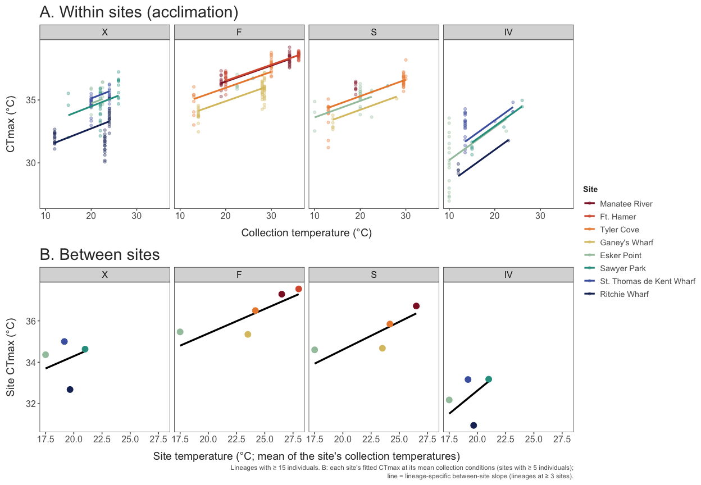

CTmax rises by 0.15 °C for every 1 °C of within-site temperature change
(95% CI 0.10–0.19), with lineage-specific acclimation slopes of 0.13 to
0.26. The between-site slope is 0.26 (CI 0.05 to 0.47; site temperature:
mean of the site’s collection temperatures), and the difference between
the two is 0.11 (CI -0.10 to 0.32). If that interval includes zero,
CTmax differences between sites within a lineage are consistent with
acclimation to each site’s temperature, with no detectable local
adaptation beyond it; with only 1–5 sites per lineage, the test can rule
out only large differences between the slopes. Panel B shows the
site-level pattern behind the between-site slope: each point is a site’s
CTmax at its own mean collection conditions.

The Stage 1 clade calls (Section 3.1) were merged with the CTmax and
body size data set to examine clade-specific patterns of divergence. By
plotting CTmax and size against the collection temperature we can see
that these clades appear to be physiologically differentiated. Clades F
and S tend to have higher CTmax, even when collected at the same
temperatures as Clades X and IV. Size is more variable, with varying
degrees of temperature sensitivity across the clades. Overall, however,
Clade F tends to be smaller than Clades S and X. Clade IV tended to be
the largest.

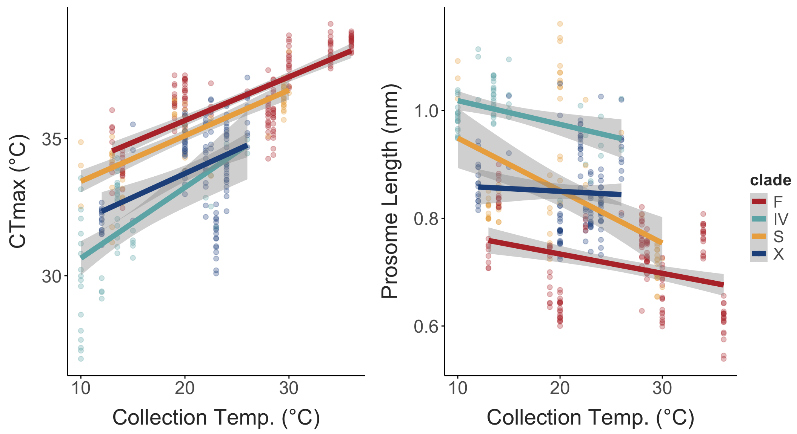

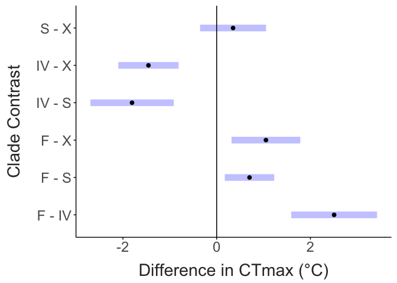

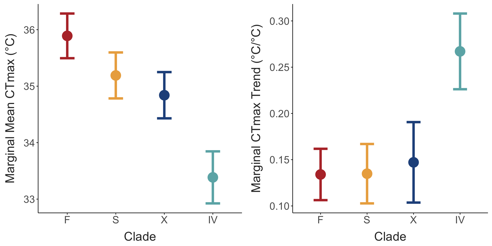

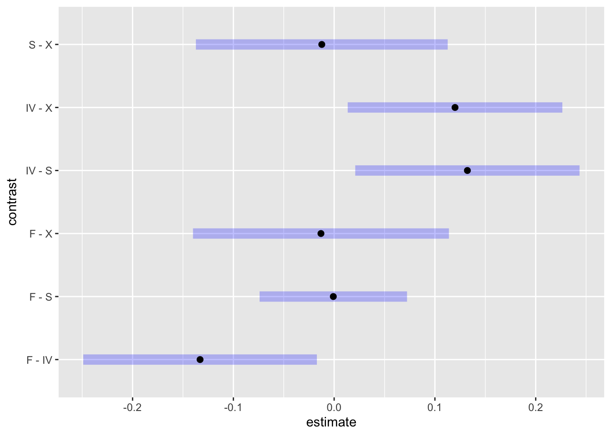

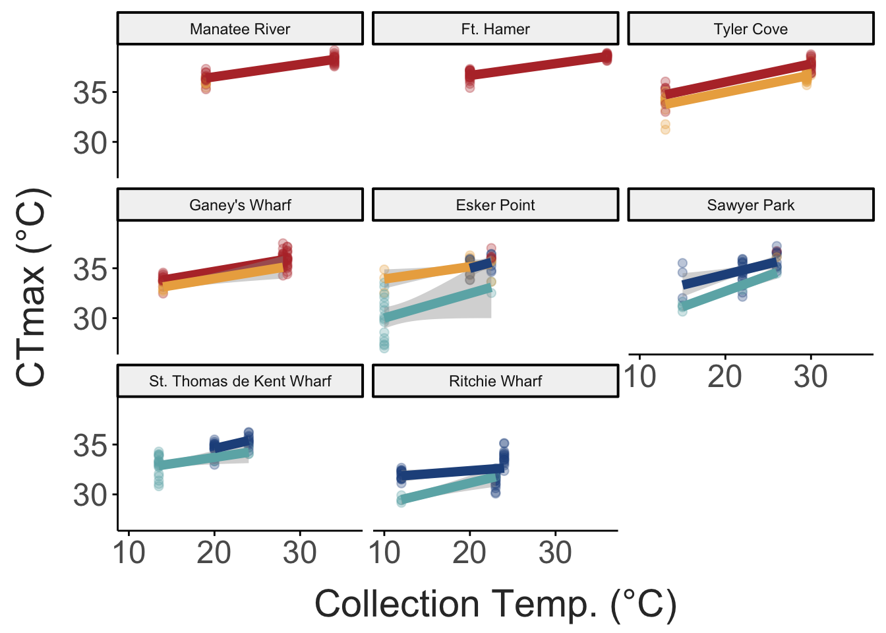

The general result here is that Clade F appears to be more thermally
tolerant than Clades S and X, which in turn are more thermally tolerant
than Clade IV. Clade IV does however, appear to exibit stronger
plasticity than the other clades (although this pattern is only
marginally significant in two of the comparisons; IV-S and IV-X)

These differences in physiology correspond to the distributional
patterns for each clade. Using a Loess smoother (span = 2) highlights
how the proportional abundance of the clades is affected by temperature
in different ways. Clade F occurs in high proportion at high
temperature, Clade IV occurs in high proportions at low temperatures,
while Clade X occurs in high proportions at intermediate temperatures.
Clade S generally occurs in low proportions, with a few exceptions.

### Partitioning CTmax variation

How much of the variation in CTmax among individuals is due to lineage,
to the site an animal comes from, to the conditions at collection
(acclimation), to the assay, and to individuals? The variance was
partitioned with a mixed model with random effects for lineage, site,
collection (site × sampling event), assay run and tube position, plus,
in the second model, fixed effects for the within- and between-site
temperature components from the previous section (body size is not
included). The variance explained by each fixed effect is the variance
of its fitted contribution ([Nakagawa & Schielzeth
2013](https://doi.org/10.1111/j.2041-210x.2012.00261.x)). Comparing the
two models shows how much of the site and collection components the
temperature terms absorb: collection-level variance taken up by
within-site temperature is acclimation, and site-level variance taken up
by long-term site temperature is the between-site temperature effect.
Intervals are from 200 parametric bootstrap replicates.

| Component | Without temperature | With seasonal and spatial temperature |
|:---|:---|:---|
| Clade | 35% (3–66) | 34% (2–64) |
| Spatial temperature | – | 22% (7–42) |
| Site (other) | 19% (0–54) | 14% (1–33) |
| Seasonal temperature | – | 10% (5–22) |
| Collection (other) | 32% (11–63) | 6% (2–14) |
| Assay | 0% (0–1) | 0% (0–1) |
| Individual | 13% (7–23) | 13% (8–23) |

Share of CTmax variance (95% parametric bootstrap interval).

Without temperature terms, the largest components are collection (32%),
clade (35%) and site (19%), with 13% among individuals within a
collection. The temperature terms follow the season-mean split of Fig.
3A: seasonal temperature (the season’s mean collection temperature
across sites) explains 10% of all CTmax variance, and spatial
temperature (a collection’s deviation from that season mean) 22%;
together they absorb most of the collection component (which drops to
6%), leaving 14% to other site differences. Clade accounts for 34%. The
intervals are wide because clade and site have few levels (4 clades, 8
sites).

### Lineage differences under shared conditions (natural common garden)

Lineage accounts for about a quarter of CTmax variance (above), but
lineages occupy different sites, so their differences could partly
reflect the conditions they were collected in. Several collections,
however, contain two or more lineages sampled at the same time and
place: those animals experienced the same water before the assay, so
differences between them cannot be acclimation. Lineage differences were
therefore re-estimated using only collections with ≥ 2 lineages of ≥ 3
individuals each, with collection as a fixed effect, so each lineage
contrast is a within-collection comparison. These estimates are compared
with the lineage effects from all collections (the within/between model
above, which adjusts for temperature but compares lineages across
different collections). Differences that persist within collections are
heritable (genetic, or developmental/maternal), not plastic responses to
recent conditions.

| Lineage pair (first − second) | Shared collections | Within shared collections | p | All collections (temperature-adjusted) |
|:---|---:|:---|---:|:---|
| F – X | 1 | 1.01 (0.28, 1.73) | 0.0066 | 1.13 (0.56, 1.69) |
| S – X | 2 | 0.37 (-0.29, 1.03) | 0.2700 | 0.50 (-0.01, 1.01) |
| IV – X | 3 | -2.46 (-3.09, -1.83) | 0.0000 | -1.97 (-2.38, -1.55) |
| F – S | 5 | 0.63 (0.20, 1.07) | 0.0048 | 0.63 (0.25, 1.00) |
| IV – S | 1 | -2.83 (-3.61, -2.06) | 0.0000 | -2.47 (-3.03, -1.91) |

CTmax differences (°C, 95% CI) between lineages that co-occur in at
least one collection: estimated only within shared collections, and from
all collections in the within/between model.

The two largest lineage differences hold up when lineages are compared
side by side. IV is about 2.5–2.9 °C less tolerant than X and S in the
same collections (three and one shared collections), as large as or
larger than the difference estimated across all collections. F-N is
about 0.8 °C more tolerant than S across the three Chesapeake
collections where both occur (MD early and late, GW late), close to its
overall estimate. These differences cannot be acclimation. The S–X
difference is the exception: about 1 °C across all collections, but only
0.4 °C (CI spanning zero) in the two Connecticut collections where they
co-occur, so part of it may reflect where each lineage was collected
rather than the lineages themselves. The F-MR and F-NE contrasts each
rest on a single collection and are uninformative. Caveats: co-occurring
lineages may differ in body size, development or recent history (for
example, advection from elsewhere), so “heritable” here means not
explained by shared recent conditions, not necessarily genetic.

#### Does clade turnover change thermal tolerance across space and season?

If clades differ heritably in CTmax and their make-up changes with
temperature, composition alone shifts the CTmax a collection would have,
independent of acclimation. For each collection, the expected CTmax from
composition alone is the mean of its individuals’ clade effects
(temperature-adjusted clade means from the season-mean model,
`wb_sm_add`). It is regressed, weighted by individuals, on the same two
temperature components as CTmax itself: the season’s mean collection
temperature across sites (seasonal) and the collection’s deviation from
it (spatial). These composition slopes sit beside the within-clade
(plasticity) slopes of the season-mean model; their sum is the slope of
the whole community’s CTmax. Uncertainty in the composition slopes comes
from 2,000 bootstraps that resample individuals within collections and
draw the clade effects from their estimated sampling distribution. Two
nulls, 10⁴ permutations each: for the seasonal slope, clade labels are
shuffled among individuals across the seasons of each site (each site
keeps its clades, their timing is removed); for the spatial slope, among
individuals across the sites of each season (each season keeps its
clades, their sites are removed). The within-site slope against
collection temperature (site as a fixed effect), used in earlier drafts,
is kept as a check.

Composition alone shifts expected CTmax by 0.05 °C per °C of seasonal
temperature (permutation p \< 0.001) and 0.12 °C per °C of spatial
temperature (p \< 0.001), against within-clade slopes of 0.13 and 0.25.
Turnover adds about 37% to the seasonal and 48% to the spatial response,
so the whole community’s CTmax changes by 0.18 °C per °C through the
season and 0.37 across sites (difference 0.19 (0.06, 0.32)). Composition
favours tolerant clades in warm water in both directions, more strongly
across sites than through the season (difference 0.07 (0.03, 0.11)): the
same asymmetry as plasticity within clades. The seasonal shift comes
mostly from IV dominating the cold late collections at CT, TK and ME.
The within-site check gives 0.04 °C per °C. This is a change in thermal
tolerance with a heritable basis that happens through the sorting of
clades, not evolution within them. Caveats: composition comes from the
individuals sequenced per collection (about 20), so proportions are
coarse; the seasonal axis has only three values (one per season);
collections were sampled in one year.

### Genetic basis of CTmax within collections

Is CTmax variation among individuals collected together associated with
particular genetic variants? Within each lineage with ≥ 30 phenotyped
and sequenced individuals (collections with ≥ 8 individuals of the
lineage: X 104, F-N 78, S 54, F-FH 38, IV 36), CTmax was regressed on
genotype dosage (the expected number of minor alleles, from ANGSD
genotype posteriors) at every SNP, with collection and log mean
sequencing depth as covariates. Collection absorbs acclimation and
population differences, so individuals are compared only with others
collected at the same time and place; depth is included because at \< 1×
coverage deeper individuals show more minor alleles, which would
otherwise bias every SNP’s effect if depth tracks CTmax (it does,
weakly: +0.26 °C per log unit of depth within collections, all lineages
pooled). Individuals without reads at a SNP were given their
collection’s mean dosage. Body size was not included. Genome-wide
calibration comes from 100 replicates with CTmax shuffled among
individuals of the same collection, which keep each collection’s CTmax
distribution and all genotype structure but break any genotype–phenotype
link.

| Lineage | SNPs | λ | p \< 10⁻³ | p \< 10⁻⁴ | p \< 10⁻⁵ | p \< 10⁻⁶ |
|:---|---:|:---|:---|:---|:---|:---|
| X | 2209940 | 0.95 vs 1.04 (94) | 2570 vs 3743 (91) | 338 vs 553 (89) | 48 vs 88 (86) | 11 vs 14 (63) |
| F-N | 313838 | 0.95 vs 0.97 (65) | 265 vs 274 (52) | 21 vs 27 (73) | 0 vs 3 (101) | 0 vs 0 (101) |
| S | 223199 | 0.96 vs 0.94 (41) | 332 vs 355 (54) | 62 vs 63 (50) | 7 vs 12 (85) | 5 vs 3 (16) |
| F-FH | 183335 | 0.97 vs 1.00 (65) | 195 vs 232 (67) | 18 vs 30 (91) | 2 vs 4 (85) | 2 vs 1 (15) |
| IV | 88781 | 1.15 vs 1.05 (6) | 212 vs 140 (6) | 16 vs 19 (64) | 2 vs 3 (74) | 1 vs 0 (29) |

Observed vs. mean of 100 within-collection CTmax shuffles (rank of the
observed value among the 101; 1 = larger than every shuffle).

| Lineage | Comparison     | Unlinked SNPs | r      | Shuffle SD of r | Rank     |
|:--------|:---------------|--------------:|:-------|:----------------|:---------|
| X       | Spatial slope  |         41784 | 0.011  | 0.053           | 90 / 101 |
| X       | Seasonal slope |         41784 | -0.004 | 0.010           | 69 / 101 |
| S       | Spatial slope  |         17707 | 0.009  | 0.008           | 21 / 101 |
| S       | Seasonal slope |         17707 | -0.008 | 0.017           | 59 / 101 |

Correlation between each SNP’s CTmax effect (t) and its spatial or
seasonal temperature slope (z), against 100 within-collection CTmax
shuffles (two-sided rank).

| Lineage | SNPs (freq \< 0.15, \|t\| \> 2.6) | Observed | Shuffles: mean (95% range) | Rank |
|:---|---:|:---|:---|:---|
| X | 454 | 0.64 | 0.63 (0.54–0.71) | 41 / 101 |
| F-N | 94 | 0.69 | 0.58 (0.45–0.70) | 4 / 101 |
| S | 114 | 0.85 | 0.86 (0.78–0.93) | 66 / 101 |
| F-FH | 21 | 0.76 | 0.80 (0.56–0.96) | 73 / 101 |
| IV | 25 | 0.60 | 0.49 (0.25–0.70) | 21 / 101 |

Fraction of the stronger associations at rare SNPs (minor-allele
frequency \< 0.15) in which the minor allele lowers CTmax, observed
vs. shuffles.

Power was simulated on each lineage’s own data (cluster target
`gwas_power`): for 2,000 SNPs sampled across the genome, true genotypes
were drawn from each individual’s genotype posterior, a causal effect
was added to CTmax shuffled within collections, and the scan’s test was
repeated against the genome-wide 5% threshold from its own permutations.
Genotype accuracy was low (r² between expected dosage and true genotype
0.39–0.47), and the scan reached 50% power only for loci of about 2 °C
per allele in F-N and 3 °C in X (explaining most of the
within-collection CTmax variance); in S, F-FH and IV it never did. The
scan rules out only loci of very large effect and does not constrain a
polygenic basis of within-lineage variation; it is reported for
completeness.

No lineage shows more association signal than the shuffles: the observed
counts of small p values sit inside, and in X below, the shuffle
distribution at every threshold, with or without chromosome 6. The one
marginal exception is IV, where moderately small p values (p \< 0.001)
are more common than in 94 of 100 shuffles but the tail is not; with
five lineages tested and the smallest sample (36 individuals, 2
collections), this is consistent with chance. The smallest individual p
values (down to ~10⁻⁷–10⁻⁸) are typical of the shuffles too, and the top
SNPs share a profile – low frequency, reads in only part of the
individuals, large estimated effects – expected from chance at weakly
informative sites, so none is reported as a candidate.

Two patterns that appeared in a first version of the scan (without the
depth covariate, and with missing individuals given the overall rather
than the collection mean) do not survive comparison with the shuffles.
First, CTmax effects do not line up with the spatial or seasonal
temperature slopes in X or S: the observed correlations (\|r\| ≤ 0.011)
are well inside the shuffle distributions, whose spread (SD 0.01–0.05)
is much larger than a chromosome jackknife suggests, because one shuffle
shifts the effects of all SNPs together. Second, the excess of negative
effects at rare SNPs (minor allele lowering CTmax) is reproduced by the
shuffles (63–86% negative in X, S and F-FH, as observed), so it is a
property of dosage regression at low-frequency sites, not evidence for
deleterious rare variants; only F-N is slightly above its shuffles (0.69
vs. 0.58, rank 4 of 101), which with five lineages tested is not
significant.

CTmax among individuals collected together therefore shows no detectable
association with individual variants, no polygenic excess, and no link
between the alleles that track temperature in space or season and those
that affect CTmax. With 36–104 individuals per lineage this rules out
only loci of large effect; it is consistent with the variance partition
above, in which CTmax variation is dominated by lineage, acclimation and
site.

### Candidate genes: mitochondrial amino-acid differences

Lineage differences in CTmax are heritable but, within lineages, no SNP
associates with CTmax. The comparative alternative asks which protein
differences between lineages could underlie them. Mitochondrial OXPHOS
genes are the first candidates: they are inherited as a unit, they
define the clades, and amino-acid changes in COX1, CYTB and other
respiratory-chain subunits alter thermal performance in copepods
(*Tigriopus californicus*: Willett 2010, Harada et al. 2019) and other
ectotherms. The clade mitogenome contigs are unannotated de novo
assemblies, so protein-coding genes were found as open reading frames
(invertebrate mitochondrial code, ≥ 150 codons; COX1 and CYTB identified
by conserved motifs, other ORFs by length and strand). ORFs nested
inside an ORF on the opposite strand are flagged; one member of each
such pair is probably not a gene. The F contig (16.1 kb) covers most of
the mitogenome, so the four F lineages can be compared across 11 ORFs;
the X and IV contigs (about 5 kb) cover only COX1, CYTB and one further
ORF, so clades are compared there (`Scripts/06_mito_aa.R`).

| ORF | Strand | Position (bp) | Codons | Nested antisense | Fixed nt differences | Nonsynonymous | Synonymous |
|:---|:---|:---|---:|:---|---:|---:|---:|
| ORF559- | \- | 788–2464 | 559 |  | 184 | 44 | 140 |
| ORF311+ | \+ | 2901–3833 | 311 |  | 87 | 15 | 72 |
| ORF435+ | \+ | 4259–5563 | 435 |  | 135 | 30 | 105 |
| ORF157- | \- | 5928–6398 | 157 |  | 40 | 12 | 28 |
| COX1 | \+ | 7456–8997 | 514 |  | 132 | 3 | 129 |
| CYTB | \+ | 9072–10217 | 382 |  | 111 | 9 | 102 |
| ORF129- | \- | 9536–9922 | 129 | yes | 42 | 4 | 38 |
| ORF316+ | \+ | 11689–12636 | 316 |  | 107 | 32 | 75 |
| ORF155- | \- | 11715–12179 | 155 | yes | 41 | 15 | 26 |
| ORF219- | \- | 14127–14783 | 219 |  | 66 | 10 | 56 |
| ORF216- | \- | 14950–15597 | 216 |  | 71 | 53 | 18 |

Open reading frames on the F mitogenome contig and nucleotide
differences fixed (≥ 80% of ≥ 5 called individuals) between at least two
F lineages.

| Lineage pair | Amino-acid differences | Excluding ORF216- |
|:-------------|-----------------------:|------------------:|
| F-FH – F-MR  |                     52 |                52 |
| F-FH – F-N   |                     86 |                86 |
| F-FH – F-NE  |                     89 |                89 |
| F-MR – F-N   |                     95 |                91 |
| F-MR – F-NE  |                    100 |                96 |
| F-N – F-NE   |                     73 |                32 |

Fixed amino-acid differences between F lineages, all ORFs on the F
contig.

| Clade pair | COX1     | CYTB     | ORF (LQDA) |
|:-----------|:---------|:---------|:-----------|
| F – S      | 5 / 495  | 26 / 366 | 17 / 205   |
| F – X      | 2 / 495  | 15 / 364 | 13 / 207   |
| F – IV     | 10 / 495 | 31 / 366 | 22 / 204   |
| S – X      | 5 / 495  | 30 / 364 | 13 / 205   |
| S – IV     | 11 / 495 | 39 / 367 | 18 / 202   |
| X – IV     | 8 / 495  | 32 / 364 | 18 / 206   |

Amino-acid differences between clade consensus proteins (differences /
aligned positions) in the three genes covered by all four clade contigs.

| Gene     | Position (F protein) | F, S, X | IV  | Context (F) |
|:---------|---------------------:|:--------|:----|:------------|
| COX1     |                  176 | M       | L   | LRSFGMVLDLM |
| COX1     |                  415 | G       | A   | LKAQFGMMFLG |
| COX1     |                  416 | M       | T   | KAQFGMMFLGV |
| COX1     |                  467 | Y       | F   | VISIMYFLFIL |
| COX1     |                  495 | Y       | F   | SSLEXYHSFPP |
| COX1     |                  512 | I       | S   | SIPVVISK    |
| COX1     |                  514 | K       | S   | PVVISK      |
| CYTB     |                    7 | I       | V   | KQLKXISPVTK |
| CYTB     |                   20 | E       | D   | FGSVVELPTPS |
| CYTB     |                  105 | G       | S   | RGLYYGSYYFS |
| CYTB     |                  110 | S       | T   | GSYYFSHTWLV |
| CYTB     |                  159 | D       | E   | PYLGGDLVLWM |
| CYTB     |                  184 | L       | F   | FSLHFLIPFVV |
| CYTB     |                  188 | V       | I   | FLIPFVVAAMS |
| CYTB     |                  192 | M       | L   | FVVAAMSAVHL |
| CYTB     |                  324 | M       | T   | PLSKMMFWIQI |
| CYTB     |                  334 | L       | M   | IXIVILLTWIG |
| CYTB     |                  353 | I       | T   | IVIGQILSVVY |
| CYTB     |                  360 | S       | L   | SVVYFSYYFFQ |
| CYTB     |                  364 | F       | I   | FSYYFFQPLMM |
| CYTB     |                  368 | M       | L   | FFQPLMMMFWD |
| ORF_LQDA |                   66 | V       | I   | ACPSLVLLYLM |
| ORF_LQDA |                   99 | A       | P   | YXDMIAGHQFP |
| ORF_LQDA |                  103 | F       | S   | IAGHQFPFEFD |
| ORF_LQDA |                  132 | T       | I   | VDXRTTLPLHV |
| ORF_LQDA |                  135 | L       | M   | RTTLPLHVKIR |
| ORF_LQDA |                  181 | F       | Y   | DRPGLFFGQCS |
| ORF_LQDA |                  202 | I       | V   | PIVVEIVXVET |
| ORF_LQDA |                  209 | Y       | F   | XVETFYAYILS |

Substitutions unique to IV, the low-CTmax clade (IV differs; F, S and X
share the state).

COX1 is almost invariant: 3 nonsynonymous against 129 synonymous fixed
differences among F lineages, and at most 11 amino-acid differences
between any two clades. CYTB and the other ORFs carry most of the
amino-acid divergence. 29 substitutions are unique to IV (7 in COX1, 14
in CYTB, 8 in ORF_LQDA).

These are candidates, not results. Every substitution on the branch
leading to IV is equally consistent with IV’s low CTmax, and with one
low-CTmax clade there is no replication to separate causal changes from
the many neutral ones that accumulated with them. Two observations
constrain the mitochondrial explanation. First, among F lineages, the
southern F-MR differs from F-N at about 90 amino acids, yet with S as a
common yardstick (both co-occur with S) F-MR is not more tolerant than
F-N: F-MR exceeds S by 0.3 °C at MR, and F-N exceeds S by 0.8 °C in the
Chesapeake. Large mitochondrial divergence within F does not translate
into a CTmax difference. Second, IV is not more divergent than other
clades in COX1, the most constrained OXPHOS gene. The useful next step
is structural: placing the IV-specific CYTB and COX1 substitutions on
the respiratory-complex structures (quinone-binding sites of complex
III, the proton channels of complex IV) to see whether any sit where
function, rather than sequence, changes. ORF216- is unreliable: it has
no calls in F-FH or F-MR, and F-N and F-NE differ there mostly at
nonsynonymous sites, the pattern of a misassembled or non-coding region
rather than a gene.

The nuclear part of the candidate analysis (heat-shock proteins, nuclear
OXPHOS subunits, lipid desaturases and elongases) needs the RefSeq
annotation of the reference genome (GCF_053477335.1), which is not yet
in the project.

### Candidate genes from experimental evolution

Fifteen transcripts that responded to selection in an
experimental-evolution study of *A. tonsa* \[REF\] were placed on the
reference genome with megablast (cluster target `candidates`, rules
`expevol_blast` and `expevol_map`): each transcript’s best locus
(74–100% of the transcript aligned, 93–99% identity) and the RefSeq
genes it overlaps. Three transcripts span two neighbouring genes, giving
18 genes, among them a mitochondrial HSP90 (Trap1), an HSP90
co-chaperone (AHSA1), complex I and III subunits or assembly factors
(ND-49, UQCC2), vitellogenin and its receptor, and growth-signalling,
transcription and ribosome-biogenesis genes. Three of the 15 transcripts
map to chromosome 6 (NC_137265.1), which carries the structural
polymorphism in northern X.

Two tests asked whether these genes behave differently from the rest of
the genome in the field. (1) SNPs within the genes (± 2 kb) were
compared with SNPs in random sets of the same number of other genes
(1,000 sets) for the spatial temperature association, seasonal change
(time in season and temperature), sign agreement of seasonal and spatial
slopes, and the within-lineage CTmax association (all SNPs, not only
unlinked ones). (2) Clade-specific amino-acid substitutions in the genes
were compared with the genome background (the gene-set test above,
codons called in at least three clades).

| Transcript | Chromosome | Aligned share | Identity (%) | Gene(s) |
|:---|:---|---:|---:|:---|
| TRINITY_DN119996_c0_g1 | NC_137262.1 | 0.872 | 97.22 | LOC145313523 (ubiquinol-cytochrome-c reductase complex assembly factor 2) |
| TRINITY_DN141181_c1_g5 | NC_137269.1 | 0.802 | 99.13 | TfIIFalpha (transcription factor IIFalpha isoform X1) |
| TRINITY_DN141476_c0_g3 | NC_137272.1 | 0.987 | 98.26 | ND-49 (NADH dehydrogenase (ubiquinone) 49 kDa subunit isoform X4) |
| TRINITY_DN144102_c0_g16 | NC_137260.1 | 0.946 | 98.76 | LOC145330791 (ribosome biogenesis protein BOP1 homolog); Ack-like (activated Cdc42 kinase-like) |
| TRINITY_DN146090_c0_g4 | NC_137273.1 | 0.900 | 98.39 | S6kII (ribosomal protein S6 kinase II) |
| TRINITY_DN147294_c5_g2 | NC_137265.1 | 0.745 | 93.19 | LOC145322399 (activator of 90 kDa heat shock protein ATPase homolog 1 isoform X1) |
| TRINITY_DN147803_c0_g1 | NC_137273.1 | 0.952 | 98.16 | LOC145305377 (uncharacterized protein LOC145305377) |
| TRINITY_DN148665_c4_g2 | NC_137271.1 | 0.821 | 97.19 | LOC145334047 (uncharacterized protein LOC145334047); LOC145334046 (ribosome biogenesis protein BMS1 homolog) |
| TRINITY_DN149301_c0_g7 | NC_137265.1 | 1.000 | 98.10 | Trap1 (TNF receptor associated protein 1 isoform X1) |
| TRINITY_DN149639_c2_g19 | NC_137274.1 | 0.837 | 95.67 | MBD-R2 (PHD finger protein MBD-R2 isoform X2) |
| TRINITY_DN149855_c0_g15 | NC_137270.1 | 0.963 | 97.97 | LOC145332331 (vitellogenin-like isoform X1) |
| TRINITY_DN150080_c2_g2 | NC_137273.1 | 0.916 | 97.98 | yl (putative vitellogenin receptor yl) |
| TRINITY_DN151024_c6_g2 | NC_137273.1 | 0.803 | 95.20 | LOC145305862 (uncharacterized protein LOC145305862) |
| TRINITY_DN151056_c4_g4 | NC_137263.1 | 0.912 | 96.19 | LOC145315635 (polyamine-transporting ATPase 13A3-like isoform X2) |
| TRINITY_DN151143_c1_g7 | NC_137265.1 | 0.994 | 95.29 | DCTN4-p62 (dynactin subunit 4); Taf2 (TATA-box binding protein associated factor 2) |

Placement of the experimental-evolution candidate transcripts on the
reference genome.

| Test | Group | Genes | SNPs | Statistic | Candidates | Other genes | p |
|:---|:---|---:|---:|:---|---:|---:|---:|
| Seasonal change (time) | F | 18 | 657 | mean z^2 | 0.964 | 0.946 | 0.39 |
| Seasonal change (time) | S | 16 | 400 | mean z^2 | 0.559 | 0.595 | 0.63 |
| Seasonal change (time) | X | 18 | 2371 | mean z^2 | 1.000 | 0.994 | 0.41 |
| Seasonal change (temperature) | F | 18 | 657 | mean z^2 | 0.933 | 0.930 | 0.47 |
| Seasonal change (temperature) | S | 16 | 400 | mean z^2 | 0.559 | 0.595 | 0.65 |
| Seasonal change (temperature) | X | 18 | 2371 | mean z^2 | 1.035 | 0.988 | 0.17 |
| Spatial temperature association | F | 18 | 657 | mean z^2 | 7.590 | 7.633 | 0.48 |
| Seasonal-spatial sign agreement | F | 18 | 657 | share same sign | 0.480 | 0.473 | 0.41 |
| Spatial temperature association | S | 16 | 368 | mean z^2 | 1.217 | 1.149 | 0.28 |
| Seasonal-spatial sign agreement | S | 16 | 368 | share same sign | 0.489 | 0.498 | 0.59 |
| Spatial temperature association | X | 18 | 2371 | mean z^2 | 1.604 | 1.806 | 0.84 |
| Seasonal-spatial sign agreement | X | 18 | 2371 | share same sign | 0.515 | 0.510 | 0.39 |
| CTmax association (within lineage) | F-FH | 17 | 303 | mean z^2 | 0.992 | 1.035 | 0.58 |
| CTmax association (within lineage) | F-N | 17 | 516 | mean z^2 | 0.868 | 0.991 | 0.83 |
| CTmax association (within lineage) | IV | 12 | 91 | mean z^2 | 1.298 | 1.231 | 0.38 |
| CTmax association (within lineage) | S | 16 | 345 | mean z^2 | 1.131 | 1.028 | 0.19 |
| CTmax association (within lineage) | X | 18 | 2623 | mean z^2 | 1.036 | 0.991 | 0.18 |

SNP-level signals in the experimental-evolution candidate genes against
random sets of other genes (one-sided p, larger in the candidates).

| Set                               | Genes | Clade |   N |   S | N/(N+S) | Background |     p |
|:----------------------------------|------:|:------|----:|----:|--------:|-----------:|------:|
| Heat-shock genes (by name)        |    41 | F     |   5 | 106 |   0.045 |      0.198 | 0.002 |
| Heat-shock genes (by name)        |    41 | S     |   7 |  99 |   0.066 |      0.185 | 0.008 |
| Heat-shock genes (by name)        |    41 | X     |   9 |  70 |   0.114 |      0.190 | 0.096 |
| Heat-shock genes (by name)        |    41 | IV    |  18 | 147 |   0.109 |      0.215 | 0.004 |
| Nuclear OXPHOS subunits (by name) |    13 | F     |   8 |  15 |   0.348 |      0.198 | 0.100 |
| Nuclear OXPHOS subunits (by name) |    13 | S     |   7 |  15 |   0.318 |      0.185 | 0.120 |
| Nuclear OXPHOS subunits (by name) |    13 | X     |   5 |  17 |   0.227 |      0.190 | 0.670 |
| Nuclear OXPHOS subunits (by name) |    13 | IV    |   6 |  20 |   0.231 |      0.215 | 0.810 |
| Experimental-evolution genes      |    12 | F     |  16 |  39 |   0.291 |      0.198 | 0.300 |
| Experimental-evolution genes      |    12 | S     |  12 |  31 |   0.279 |      0.185 | 0.340 |
| Experimental-evolution genes      |    12 | X     |   3 |  47 |   0.060 |      0.190 | 0.130 |
| Experimental-evolution genes      |    12 | IV    |  17 |  61 |   0.218 |      0.215 | 0.960 |

Clade-specific amino-acid substitutions in candidate gene sets against
random background gene sets (two-sided permutation p).

Neither test found anything. At the SNP level the candidate genes were
indistinguishable from other genes for every statistic and group (p =
0.17–0.84): genes that responded to selection in the laboratory show no
excess spatial, seasonal or CTmax-associated variation in the field. At
the protein level, 12 of the 18 genes had enough coverage, and no clade
had an excess of amino-acid substitutions in them (p = 0.13–0.96). The
core thermal candidates (Trap1, AHSA1, ND-49, UQCC2, vitellogenin) could
not be compared: at \< 1x coverage against a single reference, too few
of their codons were called in three clades (S and IV, the clades most
divergent from the reference, are under-called in coding sequence).
Heat-shock genes as a class were strongly conserved: N/(N+S) was
0.05–0.11 on every branch against 0.18–0.21 genome-wide (p = 0.002–0.008
in F, S and IV; 0.10 in X).

### Clade-specific protein divergence and gene function

Which kinds of genes have diverged most between the clades at the
protein level? For every RefSeq gene with at least 50 codons called in
at least three clades (cluster target `candidates`, `nuclear_aa`),
substitutions unique to one clade were counted as nonsynonymous (N) or
synonymous (S) on that clade’s branch. Genes were annotated with GO
terms and KEGG pathways by eggNOG-mapper (target `function`; GO terms
propagated to their ancestors). Two statistics were tested for every GO
term and KEGG pathway with at least 10 tested genes and 20
substitutions:

- **Amino-acid divergence:** nonsynonymous substitutions per codon
  compared, summed over all four branches (how much the term’s proteins
  differ among clades).
- **Branch-specific nonsynonymous fraction:** N / (N + S) on one clade’s
  branch, compared with that clade’s own genome-wide value. An excess
  means more protein change than expected from the clade’s overall
  divergence (positive selection or relaxed constraint); a deficit means
  stronger conservation.

For a term of k genes, the pooled ratio (sum of N over sum of codons, or
of N + S) was compared with the ratio over all genes annotated in the
same ontology (unannotated genes, often lineage-specific or poorly
predicted, have about twice the nonsynonymous fraction of annotated
genes and are excluded from the background) using the sampling variance
of a ratio estimator for random sets of k genes (finite-population
corrected); p values are two-sided, with Benjamini–Hochberg FDR within
each statistic, clade and ontology. Terms with q \< 0.1 were checked
against 2,000 random gene sets of the same size. Coverage differs among
clades (S and IV are under-called in coding sequence, which maps less
well to the single reference), so each clade is compared only with its
own background. Caveats: substitution counts per gene are small, GO
terms overlap heavily, and an excess N/(N + S) can reflect relaxed
constraint as well as positive selection.

| ontology | statistic                    | clade | q\<0.1: FALSE | q\<0.1: TRUE |
|:---------|:-----------------------------|:------|--------------:|-------------:|
| GO:BP    | N/(N+S) on branch            | F     |          4121 |          152 |
| GO:BP    | N/(N+S) on branch            | IV    |          4252 |          160 |
| GO:BP    | N/(N+S) on branch            | S     |          4181 |           10 |
| GO:BP    | N/(N+S) on branch            | X     |          4028 |          125 |
| GO:BP    | aa divergence (all branches) | all   |          3785 |          409 |
| GO:CC    | N/(N+S) on branch            | F     |           441 |           45 |
| GO:CC    | N/(N+S) on branch            | IV    |           466 |           40 |
| GO:CC    | N/(N+S) on branch            | S     |           449 |           21 |
| GO:CC    | N/(N+S) on branch            | X     |           441 |           33 |
| GO:CC    | aa divergence (all branches) | all   |           362 |          113 |
| GO:MF    | N/(N+S) on branch            | F     |           601 |            0 |
| GO:MF    | N/(N+S) on branch            | IV    |           607 |           10 |
| GO:MF    | N/(N+S) on branch            | S     |           582 |            3 |
| GO:MF    | N/(N+S) on branch            | X     |           584 |            0 |
| GO:MF    | aa divergence (all branches) | all   |           523 |           73 |
| KEGG     | N/(N+S) on branch            | F     |           272 |            2 |
| KEGG     | N/(N+S) on branch            | IV    |           274 |            6 |
| KEGG     | N/(N+S) on branch            | S     |           271 |            2 |
| KEGG     | N/(N+S) on branch            | X     |           263 |            4 |
| KEGG     | aa divergence (all branches) | all   |           256 |           12 |

Terms tested and terms with q \< 0.1 (8437 genes with substitution
counts; 5604 with at least one GO term or KEGG pathway).

| Statistic | Clade | Ontology | Term | Genes | Direction | Observed | Background | q | p (permutation) | Top genes |
|:---|:---|:---|:---|---:|:---|---:|---:|---:|---:|:---|
| N/(N+S) on branch | F | GO:BP | ribosome biogenesis (GO:0042254) | 131 | excess | 0.302 | 0.157 | 0.0e+00 | 0.0005 | MTOR, EFTUD1, NVL, GTPBP4, rluC |
| N/(N+S) on branch | F | GO:CC | nucleolus (GO:0005730) | 382 | excess | 0.222 | 0.153 | 2.7e-06 | 0.0005 | VRK1, MYBBP1A, URB1, DDX24, CHD5 |
| N/(N+S) on branch | F | GO:BP | rRNA processing (GO:0006364) | 96 | excess | 0.294 | 0.157 | 5.0e-05 | 0.0005 | GTPBP4, rluC, PWP2, MDN1, DCAF13 |
| N/(N+S) on branch | F | GO:BP | rRNA metabolic process (GO:0016072) | 120 | excess | 0.280 | 0.157 | 5.0e-05 | 0.0005 | GTF3C2, MTOR, GTPBP4, rluC, PWP2 |
| N/(N+S) on branch | F | KEGG | Ribosome biogenesis in eukaryotes (map03008) | 47 | excess | 0.289 | 0.141 | 1.4e-03 | 0.0005 | EFTUD1, NVL, GTPBP4, PWP2, MDN1 |
| N/(N+S) on branch | F | GO:BP | cellular anatomical entity morphogenesis (GO:0032989) | 751 | deficit | 0.117 | 0.157 | 1.5e-03 | 0.0005 | MAP1B, cher, BRD7, EP400, KDM3B |
| N/(N+S) on branch | F | GO:CC | cytoplasmic region (GO:0099568) | 242 | deficit | 0.085 | 0.153 | 2.0e-03 | 0.0005 | DNAH10, AMBRA1, DAXX, SHROOM2, DST |
| N/(N+S) on branch | F | GO:BP | sensory organ development (GO:0007423) | 596 | deficit | 0.114 | 0.157 | 4.9e-03 | 0.0005 | MAP1B, LOC145314308, G2E3, NPHS1, sev |
| N/(N+S) on branch | F | GO:CC | cell cortex (GO:0005938) | 194 | deficit | 0.084 | 0.153 | 6.1e-03 | 0.0005 | DAXX, SHROOM2, DST, PPP1R9B, SPSB4 |
| N/(N+S) on branch | F | GO:CC | cytoplasmic vesicle (GO:0031410) | 638 | deficit | 0.118 | 0.153 | 6.1e-03 | 0.0010 | WDR81, ESYT3, TRIP11, MYCBP2, SEL1L |
| N/(N+S) on branch | F | GO:CC | vesicle (GO:0031982) | 670 | deficit | 0.119 | 0.153 | 6.1e-03 | 0.0005 | WDR81, ESYT3, TRIP11, MYCBP2, SEL1L |
| N/(N+S) on branch | F | GO:CC | intracellular vesicle (GO:0097708) | 640 | deficit | 0.118 | 0.153 | 6.1e-03 | 0.0005 | WDR81, ESYT3, TRIP11, MYCBP2, SEL1L |
| N/(N+S) on branch | F | GO:BP | rRNA modification (GO:0000154) | 18 | excess | 0.415 | 0.157 | 6.1e-03 | 0.0005 | rluC, DIMT1, NSUN4, NOLC1, RPUSD2 |
| N/(N+S) on branch | F | GO:CC | neuron projection (GO:0043005) | 555 | deficit | 0.115 | 0.153 | 6.5e-03 | 0.0005 | MAP1B, MYCBP2, MTOR, Ank, DAXX |
| N/(N+S) on branch | F | GO:BP | actin filament-based process (GO:0030029) | 353 | deficit | 0.102 | 0.157 | 6.7e-03 | 0.0005 | cher, ASPM, MTOR, NPHS1, KLHL3 |
| N/(N+S) on branch | F | GO:BP | mitochondrial gene expression (GO:0140053) | 60 | excess | 0.295 | 0.157 | 6.7e-03 | 0.0005 | POLRMT, MTPAP, PUS1, YARS2, SUPV3L1 |
| N/(N+S) on branch | F | GO:CC | spliceosomal complex (GO:0005681) | 84 | deficit | 0.052 | 0.153 | 8.8e-03 | 0.0010 | LOC145316079, HNRNPU, RBMX2, DHX16, SLU7 |
| N/(N+S) on branch | F | GO:BP | maturation of SSU-rRNA from tricistronic rRNA transcript (SSU-rRNA, 5.8S rRNA, LSU-rRNA) (GO:0000462) | 24 | excess | 0.371 | 0.157 | 9.1e-03 | 0.0005 | PWP2, DCAF13, UTP18, UTP10, UTP20 |
| N/(N+S) on branch | F | GO:BP | locomotion (GO:0040011) | 822 | deficit | 0.124 | 0.157 | 1.1e-02 | 0.0005 | MAP1B, ASH1L, cher, LOC145317643, ASPM |
| N/(N+S) on branch | F | GO:BP | muscle structure development (GO:0061061) | 438 | deficit | 0.110 | 0.157 | 1.1e-02 | 0.0005 | cher, MTOR, InR, NPHS1, RXRB |
| N/(N+S) on branch | F | GO:BP | heart development (GO:0007507) | 341 | deficit | 0.103 | 0.157 | 1.2e-02 | 0.0005 | MTOR, RXRB, MYH7, KDM2A, JAG1 |
| N/(N+S) on branch | F | GO:BP | neuron differentiation (GO:0030182) | 832 | deficit | 0.125 | 0.157 | 1.2e-02 | 0.0005 | MAP1B, cher, mwh, BRD7, EP400 |
| N/(N+S) on branch | F | GO:CC | preribosome (GO:0030684) | 46 | excess | 0.285 | 0.153 | 1.2e-02 | 0.0010 | PWP2, MDN1, DCAF13, NOL6, EBNA1BP2 |
| N/(N+S) on branch | F | GO:CC | cell projection (GO:0042995) | 759 | deficit | 0.124 | 0.153 | 1.2e-02 | 0.0005 | MAP1B, CENPF, DNAH10, MYCBP2, AMBRA1 |
| N/(N+S) on branch | F | GO:BP | anatomical structure formation involved in morphogenesis (GO:0048646) | 698 | deficit | 0.121 | 0.157 | 1.2e-02 | 0.0005 | ASH1L, cher, ZNF219, lva, ASPM |
| N/(N+S) on branch | F | GO:BP | cytoskeleton organization (GO:0007010) | 612 | deficit | 0.119 | 0.157 | 1.3e-02 | 0.0010 | MAP1B, cher, ASPM, MTOR, CHD5 |
| N/(N+S) on branch | F | GO:BP | positive regulation of multicellular organismal process (GO:0051240) | 761 | deficit | 0.124 | 0.157 | 1.3e-02 | 0.0005 | MAP1B, ZNF219, lva, ASPM, MYCBP2 |
| N/(N+S) on branch | F | GO:BP | circulatory system development (GO:0072359) | 434 | deficit | 0.111 | 0.157 | 1.3e-02 | 0.0005 | MTOR, PIK3CB, HSPG2, RXRB, MYH7 |
| N/(N+S) on branch | F | GO:CC | plasma membrane bounded cell projection (GO:0120025) | 749 | deficit | 0.124 | 0.153 | 1.3e-02 | 0.0005 | MAP1B, CENPF, DNAH10, MYCBP2, AMBRA1 |
| N/(N+S) on branch | F | GO:BP | muscle organ development (GO:0007517) | 231 | deficit | 0.094 | 0.157 | 1.6e-02 | 0.0005 | NPHS1, DST, LOC145325127, MYH7, TTN |
| N/(N+S) on branch | F | GO:BP | actin cytoskeleton organization (GO:0030036) | 317 | deficit | 0.103 | 0.157 | 1.6e-02 | 0.0005 | cher, ASPM, MTOR, NPHS1, KLHL3 |
| N/(N+S) on branch | F | GO:BP | mitochondrial RNA metabolic process (GO:0000959) | 31 | excess | 0.330 | 0.157 | 1.8e-02 | 0.0005 | POLRMT, MTPAP, PUS1, YARS2, SUPV3L1 |
| N/(N+S) on branch | F | GO:BP | vesicle-mediated transport (GO:0016192) | 581 | deficit | 0.119 | 0.157 | 1.8e-02 | 0.0005 | WDR81, ESYT3, SEC16A, TRIP11, MTOR |
| N/(N+S) on branch | F | GO:BP | ribonucleoprotein complex biogenesis (GO:0022613) | 207 | excess | 0.222 | 0.157 | 1.8e-02 | 0.0005 | GEMIN5, MTOR, EFTUD1, NVL, GTPBP4 |
| N/(N+S) on branch | F | GO:BP | plasma membrane bounded cell projection organization (GO:0120036) | 705 | deficit | 0.124 | 0.157 | 1.9e-02 | 0.0010 | MAP1B, cher, mwh, BRD7, EP400 |
| N/(N+S) on branch | F | GO:BP | cell-cell signaling (GO:0007267) | 439 | deficit | 0.113 | 0.157 | 2.0e-02 | 0.0005 | ASH1L, ESYT3, PCDHAC2, NPHS1, FCHSD2 |
| N/(N+S) on branch | F | GO:BP | cell projection organization (GO:0030030) | 714 | deficit | 0.124 | 0.157 | 2.0e-02 | 0.0005 | MAP1B, cher, mwh, BRD7, EP400 |
| N/(N+S) on branch | F | GO:BP | neuron development (GO:0048666) | 727 | deficit | 0.124 | 0.157 | 2.0e-02 | 0.0005 | MAP1B, cher, BRD7, EP400, MYCBP2 |
| N/(N+S) on branch | F | GO:BP | central nervous system development (GO:0007417) | 585 | deficit | 0.120 | 0.157 | 2.0e-02 | 0.0005 | ASPM, CENPF, NR6A1, MYCBP2, MTOR |
| N/(N+S) on branch | F | GO:BP | regulation of catalytic activity (GO:0050790) | 679 | deficit | 0.123 | 0.157 | 2.0e-02 | 0.0005 | WDR81, FBLN2, AMBRA1, MTOR, TFPI |
| N/(N+S) on branch | F | GO:BP | RNA modification (GO:0009451) | 58 | excess | 0.279 | 0.157 | 2.1e-02 | 0.0010 | rluC, KIAA1456, KIAA1429, IKBKAP, PUS1 |
| N/(N+S) on branch | F | GO:BP | eye development (GO:0001654) | 458 | deficit | 0.116 | 0.157 | 2.2e-02 | 0.0005 | MAP1B, G2E3, NPHS1, sev, HIVEP1 |
| N/(N+S) on branch | F | GO:BP | cell activation (GO:0001775) | 280 | deficit | 0.103 | 0.157 | 2.2e-02 | 0.0005 | MTOR, PIK3CB, NAPRT, JAG1, KDELR1 |
| N/(N+S) on branch | F | GO:BP | neuron projection development (GO:0031175) | 564 | deficit | 0.120 | 0.157 | 2.2e-02 | 0.0005 | MAP1B, cher, BRD7, EP400, MYCBP2 |
| N/(N+S) on branch | F | GO:BP | embryonic organ morphogenesis (GO:0048562) | 193 | deficit | 0.091 | 0.157 | 2.2e-02 | 0.0015 | CHD5, KDM2A, JAG1, ASXL2, HIF1A |
| N/(N+S) on branch | F | GO:BP | sensory system development (GO:0048880) | 464 | deficit | 0.116 | 0.157 | 2.2e-02 | 0.0005 | MAP1B, G2E3, NPHS1, sev, HIVEP1 |
| N/(N+S) on branch | F | GO:BP | regulation of nervous system development (GO:0051960) | 600 | deficit | 0.121 | 0.157 | 2.2e-02 | 0.0005 | MAP1B, lva, ASPM, MYCBP2, MTOR |
| N/(N+S) on branch | F | GO:BP | visual system development (GO:0150063) | 458 | deficit | 0.116 | 0.157 | 2.2e-02 | 0.0005 | MAP1B, G2E3, NPHS1, sev, HIVEP1 |
| N/(N+S) on branch | F | GO:BP | muscle cell differentiation (GO:0042692) | 262 | deficit | 0.101 | 0.157 | 2.2e-02 | 0.0005 | cher, MTOR, InR, NPHS1, RXRB |
| N/(N+S) on branch | F | GO:BP | retina development in camera-type eye (GO:0060041) | 93 | deficit | 0.063 | 0.157 | 2.5e-02 | 0.0015 | RAB11FIP4, HIF1A, FAT1, APC, CHD7 |
| N/(N+S) on branch | F | GO:CC | 90S preribosome (GO:0030686) | 23 | excess | 0.328 | 0.153 | 2.6e-02 | 0.0030 | PWP2, DCAF13, NOL6, UTP18, UTP10 |
| N/(N+S) on branch | F | GO:CC | myelin sheath (GO:0043209) | 93 | deficit | 0.067 | 0.153 | 2.6e-02 | 0.0010 | TUFM, ATP5B, CRYAB, CHL1, CHL1 |
| N/(N+S) on branch | F | GO:BP | axon development (GO:0061564) | 405 | deficit | 0.114 | 0.157 | 2.6e-02 | 0.0005 | MAP1B, cher, MYCBP2, InR, PIK3CB |
| N/(N+S) on branch | F | GO:CC | actin cytoskeleton (GO:0015629) | 283 | deficit | 0.106 | 0.153 | 2.6e-02 | 0.0015 | cher, KLHL3, SHROOM2, DST, MYH7 |
| N/(N+S) on branch | F | GO:CC | cell leading edge (GO:0031252) | 166 | deficit | 0.091 | 0.153 | 2.6e-02 | 0.0030 | KLHL3, DST, JAG1, PPP1R9B, ANK1 |
| N/(N+S) on branch | F | GO:CC | small-subunit processome (GO:0032040) | 21 | excess | 0.333 | 0.153 | 2.6e-02 | 0.0055 | PWP2, DCAF13, NOL6, UTP18, UTP10 |
| N/(N+S) on branch | F | GO:CC | secretory vesicle (GO:0099503) | 297 | deficit | 0.108 | 0.153 | 2.6e-02 | 0.0010 | ESYT3, BRCA2, NAPRT, DMXL1, MADD |
| N/(N+S) on branch | F | GO:CC | synapse (GO:0045202) | 424 | deficit | 0.116 | 0.153 | 2.7e-02 | 0.0010 | MAP1B, ESYT3, PCDHAC2, MYCBP2, Ank |
| N/(N+S) on branch | F | GO:BP | cell morphogenesis (GO:0000902) | 617 | deficit | 0.123 | 0.157 | 2.7e-02 | 0.0005 | MAP1B, cher, BRD7, EP400, KDM3B |
| N/(N+S) on branch | F | GO:BP | cell adhesion (GO:0007155) | 219 | deficit | 0.097 | 0.157 | 2.7e-02 | 0.0010 | PCDHAC2, PIK3CB, NPHS1, PTPN23, AATF |
| N/(N+S) on branch | F | GO:BP | secretion by cell (GO:0032940) | 319 | deficit | 0.108 | 0.157 | 2.7e-02 | 0.0005 | ESYT3, SEL1L, PIK3CB, NAPRT, MTTP |
| N/(N+S) on branch | F | GO:BP | supramolecular fiber organization (GO:0097435) | 280 | deficit | 0.105 | 0.157 | 2.7e-02 | 0.0005 | cher, ASPM, MTOR, SHROOM2, DST |
| N/(N+S) on branch | F | GO:BP | axonogenesis (GO:0007409) | 384 | deficit | 0.113 | 0.157 | 2.8e-02 | 0.0005 | MAP1B, cher, MYCBP2, InR, PIK3CB |
| N/(N+S) on branch | F | GO:BP | localization of cell (GO:0051674) | 535 | deficit | 0.120 | 0.157 | 2.8e-02 | 0.0005 | MAP1B, ASH1L, ASPM, NR6A1, FBLN2 |
| N/(N+S) on branch | F | GO:BP | blood vessel development (GO:0001568) | 189 | deficit | 0.094 | 0.157 | 2.8e-02 | 0.0005 | PIK3CB, MTTP, JAG1, ANKRD17, HIF1A |
| N/(N+S) on branch | F | GO:BP | positive regulation of cell communication (GO:0010647) | 653 | deficit | 0.125 | 0.157 | 2.8e-02 | 0.0010 | ASPM, EP400, KCP, KMT2D, MTOR |
| N/(N+S) on branch | F | GO:BP | positive regulation of signaling (GO:0023056) | 655 | deficit | 0.125 | 0.157 | 2.8e-02 | 0.0020 | ASPM, EP400, KCP, KMT2D, MTOR |
| N/(N+S) on branch | F | GO:BP | regulation of cell projection organization (GO:0031344) | 375 | deficit | 0.113 | 0.157 | 2.8e-02 | 0.0020 | MAP1B, lva, MYCBP2, MTOR, PIK3CB |
| N/(N+S) on branch | F | GO:BP | camera-type eye development (GO:0043010) | 194 | deficit | 0.095 | 0.157 | 2.8e-02 | 0.0005 | SHROOM2, KDM2A, JAG1, RAB11FIP4, TDRD7 |
| N/(N+S) on branch | F | GO:BP | positive regulation of molecular function (GO:0044093) | 561 | deficit | 0.121 | 0.157 | 2.8e-02 | 0.0005 | FBLN2, AMBRA1, MTOR, PIK3CB, NVL |
| N/(N+S) on branch | F | GO:BP | cell morphogenesis involved in neuron differentiation (GO:0048667) | 480 | deficit | 0.118 | 0.157 | 2.8e-02 | 0.0010 | MAP1B, cher, EP400, MYCBP2, MTOR |
| N/(N+S) on branch | F | GO:BP | tissue morphogenesis (GO:0048729) | 685 | deficit | 0.125 | 0.157 | 2.8e-02 | 0.0005 | tnc, TNRC18, cher, dpy, mwh |
| N/(N+S) on branch | F | GO:BP | cell projection morphogenesis (GO:0048858) | 501 | deficit | 0.120 | 0.157 | 2.8e-02 | 0.0005 | MAP1B, cher, BRD7, EP400, MYCBP2 |
| N/(N+S) on branch | F | GO:BP | cell motility (GO:0048870) | 534 | deficit | 0.121 | 0.157 | 2.8e-02 | 0.0005 | MAP1B, ASH1L, ASPM, NR6A1, FBLN2 |
| N/(N+S) on branch | F | GO:BP | sensory organ morphogenesis (GO:0090596) | 365 | deficit | 0.112 | 0.157 | 2.8e-02 | 0.0010 | NPHS1, sev, HIVEP1, DOME, SHROOM2 |
| N/(N+S) on branch | F | GO:BP | regulation of plasma membrane bounded cell projection organization (GO:0120035) | 371 | deficit | 0.113 | 0.157 | 2.8e-02 | 0.0005 | MAP1B, lva, MYCBP2, MTOR, PIK3CB |
| N/(N+S) on branch | F | GO:BP | intracellular signaling cassette (GO:0141124) | 287 | deficit | 0.106 | 0.157 | 2.8e-02 | 0.0010 | NPHS1, DAXX, IKBKAP, PPP1R9B, SETX |
| N/(N+S) on branch | F | GO:BP | tube morphogenesis (GO:0035239) | 632 | deficit | 0.124 | 0.157 | 2.8e-02 | 0.0010 | tnc, TNRC18, dpy, mwh, TNRC18 |
| N/(N+S) on branch | F | GO:BP | regulation of cell development (GO:0060284) | 682 | deficit | 0.126 | 0.157 | 2.8e-02 | 0.0005 | MAP1B, cher, lva, ASPM, MYCBP2 |
| N/(N+S) on branch | F | GO:BP | positive regulation of response to stimulus (GO:0048584) | 733 | deficit | 0.127 | 0.157 | 2.9e-02 | 0.0005 | DMAP1, ASPM, EP400, KCP, KMT2D |
| N/(N+S) on branch | F | GO:BP | pattern specification process (GO:0007389) | 531 | deficit | 0.121 | 0.157 | 2.9e-02 | 0.0010 | EP400, NR6A1, KMT2D, LOC145316284, sev |
| N/(N+S) on branch | F | GO:CC | synaptonemal complex (GO:0000795) | 20 | excess | 0.330 | 0.153 | 2.9e-02 | 0.0030 | MLH3, SYCP2L, RAD21, BRCA2, INCENP |
| N/(N+S) on branch | F | GO:CC | secretory granule (GO:0030141) | 210 | deficit | 0.100 | 0.153 | 2.9e-02 | 0.0010 | BRCA2, NAPRT, SYTL5, LTA4H, ERBB2IP |
| N/(N+S) on branch | F | GO:CC | synaptonemal structure (GO:0099086) | 20 | excess | 0.330 | 0.153 | 2.9e-02 | 0.0030 | MLH3, SYCP2L, RAD21, BRCA2, INCENP |
| N/(N+S) on branch | F | GO:BP | regulation of hydrolase activity (GO:0051336) | 382 | deficit | 0.114 | 0.157 | 3.0e-02 | 0.0005 | WDR81, FBLN2, MTOR, TFPI, SENP1 |
| N/(N+S) on branch | F | GO:CC | U2-type spliceosomal complex (GO:0005684) | 35 | deficit | 0.021 | 0.153 | 3.1e-02 | 0.0030 | SDE2, CRNKL1, PRPF6 |
| N/(N+S) on branch | F | GO:CC | endoplasmic reticulum (GO:0005783) | 462 | deficit | 0.119 | 0.153 | 3.1e-02 | 0.0010 | ESYT3, SEC16A, PCDHAC2, SEL1L, CES5A |
| N/(N+S) on branch | F | GO:BP | neuron projection morphogenesis (GO:0048812) | 499 | deficit | 0.120 | 0.157 | 3.2e-02 | 0.0015 | MAP1B, cher, BRD7, EP400, MYCBP2 |
| N/(N+S) on branch | F | GO:BP | plasma membrane bounded cell projection morphogenesis (GO:0120039) | 499 | deficit | 0.120 | 0.157 | 3.2e-02 | 0.0015 | MAP1B, cher, BRD7, EP400, MYCBP2 |
| N/(N+S) on branch | F | GO:BP | regionalization (GO:0003002) | 509 | deficit | 0.121 | 0.157 | 3.3e-02 | 0.0010 | EP400, NR6A1, KMT2D, LOC145316284, sev |
| N/(N+S) on branch | F | GO:BP | hindbrain development (GO:0030902) | 99 | deficit | 0.071 | 0.157 | 3.3e-02 | 0.0010 | KDM2A, MECP2, AKAP9, EN2, USP9X |
| N/(N+S) on branch | F | GO:BP | regulation of multicellular organismal development (GO:2000026) | 1016 | deficit | 0.133 | 0.157 | 3.3e-02 | 0.0015 | MAP1B, cher, ZNF219, lva, ASPM |
| N/(N+S) on branch | F | GO:BP | epithelium development (GO:0060429) | 987 | deficit | 0.133 | 0.157 | 3.4e-02 | 0.0015 | tnc, TNRC18, cher, dpy, ken |
| N/(N+S) on branch | F | GO:BP | immune effector process (GO:0002252) | 233 | deficit | 0.102 | 0.157 | 3.4e-02 | 0.0015 | MTOR, PIK3CB, ZCCHC7, NAPRT, JAG1 |
| N/(N+S) on branch | F | GO:BP | ribosomal small subunit biogenesis (GO:0042274) | 42 | excess | 0.287 | 0.157 | 3.4e-02 | 0.0025 | PWP2, DCAF13, NOM1, UTP18, UTP10 |
| N/(N+S) on branch | F | GO:BP | biological process involved in interspecies interaction between organisms (GO:0044419) | 471 | deficit | 0.120 | 0.157 | 3.7e-02 | 0.0010 | MTOR, TFPI, PIK3CB, ZCCHC7, PTPN23 |
| N/(N+S) on branch | F | GO:BP | regulation of locomotion (GO:0040012) | 443 | deficit | 0.119 | 0.157 | 3.7e-02 | 0.0005 | MYCBP2, FBLN2, MTOR, PIK3CB, GTPBP4 |
| N/(N+S) on branch | F | GO:BP | taxis (GO:0042330) | 391 | deficit | 0.116 | 0.157 | 3.7e-02 | 0.0015 | cher, LOC145317643, EP400, MYCBP2, InR |
| N/(N+S) on branch | F | GO:BP | exocytosis (GO:0006887) | 220 | deficit | 0.101 | 0.157 | 3.9e-02 | 0.0015 | ESYT3, PIK3CB, NAPRT, TTN, SYTL5 |
| N/(N+S) on branch | F | GO:BP | secretion (GO:0046903) | 358 | deficit | 0.114 | 0.157 | 3.9e-02 | 0.0010 | ESYT3, SEL1L, PIK3CB, FOXB1, NAPRT |
| N/(N+S) on branch | F | GO:CC | catalytic step 2 spliceosome (GO:0071013) | 57 | deficit | 0.053 | 0.153 | 4.0e-02 | 0.0045 | LOC145316079, HNRNPU, RBMX2, SLU7, CRNKL1 |
| N/(N+S) on branch | F | GO:BP | vasculature development (GO:0001944) | 196 | deficit | 0.098 | 0.157 | 4.0e-02 | 0.0010 | PIK3CB, MTTP, JAG1, ANKRD17, HIF1A |
| N/(N+S) on branch | F | KEGG | Glycosaminoglycan biosynthesis - chondroitin sulfate / dermatan sulfate (map00532) | 11 | excess | 0.385 | 0.141 | 4.3e-02 | 0.0025 | CHST3, XYLT2, LOC145322972, CHST9, Chst4 |
| N/(N+S) on branch | F | GO:BP | epithelial cell differentiation (GO:0030855) | 492 | deficit | 0.121 | 0.157 | 4.3e-02 | 0.0015 | cher, mwh, KDM3B, KDM3B, InR |
| N/(N+S) on branch | F | GO:BP | cell migration (GO:0016477) | 491 | deficit | 0.121 | 0.157 | 4.3e-02 | 0.0020 | MAP1B, ASPM, NR6A1, FBLN2, PIK3CB |
| N/(N+S) on branch | F | GO:BP | positive regulation of protein metabolic process (GO:0051247) | 563 | deficit | 0.124 | 0.157 | 4.3e-02 | 0.0015 | BRD7, KMT2D, FBLN2, MTOR, PIK3CB |
| N/(N+S) on branch | F | GO:BP | positive regulation of hydrolase activity (GO:0051345) | 231 | deficit | 0.104 | 0.157 | 4.3e-02 | 0.0010 | FBLN2, MTOR, SENP1, USP42, PSME4 |
| N/(N+S) on branch | F | GO:BP | chemotaxis (GO:0006935) | 357 | deficit | 0.115 | 0.157 | 4.5e-02 | 0.0005 | cher, EP400, MYCBP2, InR, PIK3CB |
| N/(N+S) on branch | F | GO:BP | morphogenesis of an epithelium (GO:0002009) | 640 | deficit | 0.127 | 0.157 | 4.5e-02 | 0.0005 | tnc, TNRC18, cher, dpy, mwh |
| N/(N+S) on branch | F | GO:CC | cell junction (GO:0030054) | 636 | deficit | 0.126 | 0.153 | 4.6e-02 | 0.0025 | MAP1B, ASH1L, MDC1, ESYT3, PCDHAC2 |
| N/(N+S) on branch | F | GO:CC | clathrin coat (GO:0030118) | 13 | excess | 0.357 | 0.153 | 4.6e-02 | 0.0065 | IGF2R, DAB2, IGF2R, PICALM, AP-1gamma |
| N/(N+S) on branch | F | GO:CC | axon (GO:0030424) | 349 | deficit | 0.115 | 0.153 | 4.6e-02 | 0.0015 | MAP1B, MYCBP2, Ank, DST, JAG1 |
| N/(N+S) on branch | F | GO:CC | secretory granule lumen (GO:0034774) | 82 | deficit | 0.072 | 0.153 | 4.6e-02 | 0.0045 | NAPRT, ERBB2IP, DDX3X, KPNB1, STK11IP |
| N/(N+S) on branch | F | GO:CC | basal part of cell (GO:0045178) | 142 | deficit | 0.092 | 0.153 | 4.6e-02 | 0.0025 | SHROOM2, DST, MTTP, Sln, ANK1 |
| N/(N+S) on branch | F | GO:CC | cytoplasmic vesicle lumen (GO:0060205) | 85 | deficit | 0.074 | 0.153 | 4.6e-02 | 0.0030 | NAPRT, ERBB2IP, DDX3X, KPNB1, STK11IP |
| N/(N+S) on branch | F | GO:BP | cell activation involved in immune response (GO:0002263) | 162 | deficit | 0.094 | 0.157 | 4.7e-02 | 0.0015 | MTOR, PIK3CB, NAPRT, LTA4H, ERBB2IP |
| N/(N+S) on branch | F | GO:BP | cell surface receptor signaling pathway (GO:0007166) | 625 | deficit | 0.126 | 0.157 | 4.8e-02 | 0.0015 | cher, MYCBP2, MTOR, InR, PIK3CB |
| N/(N+S) on branch | F | GO:BP | regulation of actin filament-based process (GO:0032970) | 194 | deficit | 0.099 | 0.157 | 4.8e-02 | 0.0005 | mwh, MTOR, NPHS1, FCHSD2, SHROOM2 |
| N/(N+S) on branch | F | GO:BP | cell fate determination (GO:0001709) | 164 | deficit | 0.094 | 0.157 | 4.8e-02 | 0.0010 | CHD5, DST, LOC145316537, JAG1, ASXL2 |
| N/(N+S) on branch | F | GO:BP | immune system process (GO:0002376) | 680 | deficit | 0.128 | 0.157 | 4.8e-02 | 0.0010 | EP400, KCP, MTOR, PIK3CB, GP2 |
| N/(N+S) on branch | F | GO:CC | vesicle lumen (GO:0031983) | 87 | deficit | 0.076 | 0.153 | 4.8e-02 | 0.0030 | NAPRT, ERBB2IP, DDX3X, KPNB1, STK11IP |
| N/(N+S) on branch | F | GO:BP | positive regulation of catalytic activity (GO:0043085) | 424 | deficit | 0.119 | 0.157 | 5.0e-02 | 0.0020 | FBLN2, AMBRA1, MTOR, PIK3CB, NVL |
| N/(N+S) on branch | F | GO:BP | embryo development ending in birth or egg hatching (GO:0009792) | 633 | deficit | 0.127 | 0.157 | 5.2e-02 | 0.0025 | ASH1L, NR6A1, KMT2D, AMBRA1, InR |
| N/(N+S) on branch | F | GO:BP | response to abiotic stimulus (GO:0009628) | 602 | deficit | 0.126 | 0.157 | 5.3e-02 | 0.0025 | MAP1B, LOC145317643, KDM3B, KDM3B, MTOR |
| N/(N+S) on branch | F | GO:BP | regulation of anatomical structure morphogenesis (GO:0022603) | 537 | deficit | 0.124 | 0.157 | 5.4e-02 | 0.0020 | VRK1, MAP1B, lva, MYCBP2, FBLN2 |
| N/(N+S) on branch | F | GO:BP | gliogenesis (GO:0042063) | 163 | deficit | 0.095 | 0.157 | 5.4e-02 | 0.0020 | LOC145316537, GLE1, JAG1, PIK3AP1, MECP2 |
| N/(N+S) on branch | F | GO:CC | somatodendritic compartment (GO:0036477) | 428 | deficit | 0.121 | 0.153 | 5.6e-02 | 0.0070 | MAP1B, MTOR, SHROOM2, RXRB, LOC145331742 |
| N/(N+S) on branch | F | GO:BP | tRNA processing (GO:0008033) | 48 | excess | 0.271 | 0.157 | 5.7e-02 | 0.0010 | KIAA1456, IKBKAP, PUS1, TSEN54, SUPV3L1 |
| N/(N+S) on branch | F | GO:BP | system process (GO:0003008) | 710 | deficit | 0.129 | 0.157 | 5.7e-02 | 0.0030 | MAP1B, cher, MYCBP2, MTOR, PIK3CB |
| N/(N+S) on branch | F | GO:BP | neutrophil mediated immunity (GO:0002446) | 135 | deficit | 0.089 | 0.157 | 5.7e-02 | 0.0025 | NAPRT, LTA4H, ERBB2IP, IGF2R, LAMP1 |
| N/(N+S) on branch | F | GO:BP | brain development (GO:0007420) | 442 | deficit | 0.121 | 0.157 | 5.7e-02 | 0.0010 | ASPM, CENPF, NR6A1, MYCBP2, MTOR |
| N/(N+S) on branch | F | GO:BP | export from cell (GO:0140352) | 346 | deficit | 0.116 | 0.157 | 5.7e-02 | 0.0010 | ESYT3, NR1I3, SEL1L, PIK3CB, NR1I3 |
| N/(N+S) on branch | F | GO:BP | animal organ morphogenesis (GO:0009887) | 886 | deficit | 0.133 | 0.157 | 6.1e-02 | 0.0030 | tnc, TNRC18, ASH1L, cher, dpy |
| N/(N+S) on branch | F | GO:BP | eye morphogenesis (GO:0048592) | 315 | deficit | 0.114 | 0.157 | 6.1e-02 | 0.0020 | NPHS1, sev, HIVEP1, DOME, SHROOM2 |
| N/(N+S) on branch | F | GO:CC | large ribosomal subunit (GO:0015934) | 30 | excess | 0.281 | 0.153 | 6.1e-02 | 0.0040 | RPL23A, MRPL45, NSUN4, MRPL40, MRPL48 |
| N/(N+S) on branch | F | GO:BP | RNA metabolic process (GO:0016070) | 897 | excess | 0.180 | 0.157 | 6.4e-02 | 0.0015 | ASH1L, MYBBP1A, ZNF219, NR1I3, GEMIN5 |
| N/(N+S) on branch | F | GO:BP | regulated exocytosis (GO:0045055) | 197 | deficit | 0.102 | 0.157 | 6.4e-02 | 0.0020 | ESYT3, PIK3CB, NAPRT, TTN, SYTL5 |
| N/(N+S) on branch | F | GO:BP | embryonic morphogenesis (GO:0048598) | 496 | deficit | 0.123 | 0.157 | 6.4e-02 | 0.0010 | tnc, ASH1L, FBLN2, InR, CHD5 |
| N/(N+S) on branch | F | GO:BP | negative regulation of nervous system development (GO:0051961) | 234 | deficit | 0.107 | 0.157 | 6.4e-02 | 0.0030 | ASPM, MYCBP2, FCHSD2, KDM4A, TTC3 |
| N/(N+S) on branch | F | GO:CC | bounding membrane of organelle (GO:0098588) | 450 | deficit | 0.122 | 0.153 | 6.4e-02 | 0.0045 | WDR81, TRIP11, AMBRA1, MTOR, MICALL1 |
| N/(N+S) on branch | F | GO:CC | cytoskeleton (GO:0005856) | 725 | deficit | 0.130 | 0.153 | 6.6e-02 | 0.0075 | MAP1B, cher, ASPM, CENPF, NR1I3 |
| N/(N+S) on branch | F | GO:BP | leukocyte activation (GO:0045321) | 253 | deficit | 0.109 | 0.157 | 6.7e-02 | 0.0030 | MTOR, PIK3CB, NAPRT, JAG1, KDELR1 |
| N/(N+S) on branch | F | GO:BP | RNA splicing, via transesterification reactions with bulged adenosine as nucleophile (GO:0000377) | 177 | deficit | 0.100 | 0.157 | 6.7e-02 | 0.0010 | GEMIN5, ASCC3, LOC145316537, SETX, BRDT |
| N/(N+S) on branch | F | GO:BP | mRNA splicing, via spliceosome (GO:0000398) | 177 | deficit | 0.100 | 0.157 | 6.7e-02 | 0.0010 | GEMIN5, ASCC3, LOC145316537, SETX, BRDT |
| N/(N+S) on branch | F | GO:BP | axon guidance (GO:0007411) | 300 | deficit | 0.114 | 0.157 | 6.7e-02 | 0.0025 | cher, MYCBP2, InR, PIK3CB, Ank |
| N/(N+S) on branch | F | GO:BP | cell projection assembly (GO:0030031) | 175 | deficit | 0.099 | 0.157 | 6.7e-02 | 0.0030 | DNAH10, TRIP11, PTPN23, DNAAF2, KIF27 |
| N/(N+S) on branch | F | GO:BP | maturation of SSU-rRNA (GO:0030490) | 34 | excess | 0.288 | 0.157 | 6.7e-02 | 0.0040 | PWP2, DCAF13, UTP18, UTP10, UTP20 |
| N/(N+S) on branch | F | GO:BP | neutrophil degranulation (GO:0043312) | 131 | deficit | 0.090 | 0.157 | 6.7e-02 | 0.0020 | NAPRT, LTA4H, ERBB2IP, IGF2R, LAMP1 |
| N/(N+S) on branch | F | GO:BP | blood vessel morphogenesis (GO:0048514) | 155 | deficit | 0.096 | 0.157 | 6.7e-02 | 0.0045 | PIK3CB, MTTP, JAG1, HIF1A, ETS1 |
| N/(N+S) on branch | F | GO:BP | embryonic organ development (GO:0048568) | 285 | deficit | 0.112 | 0.157 | 6.7e-02 | 0.0015 | ASH1L, ZNF219, CHD5, RBBP6, KDM2A |
| N/(N+S) on branch | F | GO:BP | neuron projection guidance (GO:0097485) | 316 | deficit | 0.114 | 0.157 | 6.7e-02 | 0.0020 | cher, EP400, MYCBP2, InR, PIK3CB |
| N/(N+S) on branch | F | GO:BP | immune response (GO:0006955) | 340 | deficit | 0.116 | 0.157 | 6.8e-02 | 0.0015 | MTOR, PIK3CB, GP2, DOME, PTPN23 |
| N/(N+S) on branch | F | GO:BP | head development (GO:0060322) | 465 | deficit | 0.123 | 0.157 | 6.8e-02 | 0.0005 | ASPM, CENPF, NR6A1, MYCBP2, MTOR |
| N/(N+S) on branch | F | GO:BP | positive regulation of signal transduction (GO:0009967) | 581 | deficit | 0.127 | 0.157 | 6.8e-02 | 0.0040 | ASPM, EP400, KCP, KMT2D, MTOR |
| N/(N+S) on branch | F | GO:BP | morphogenesis of a branching structure (GO:0001763) | 154 | deficit | 0.096 | 0.157 | 6.9e-02 | 0.0035 | MTOR, DST, KDM4A, PIK3AP1, KDM5B |
| N/(N+S) on branch | F | GO:BP | regulation of Wnt signaling pathway (GO:0030111) | 143 | deficit | 0.094 | 0.157 | 6.9e-02 | 0.0035 | ASPM, WNK2, DST, LOC145316537, ZEB2 |
| N/(N+S) on branch | F | GO:BP | regulation of neurogenesis (GO:0050767) | 523 | deficit | 0.125 | 0.157 | 6.9e-02 | 0.0030 | MAP1B, lva, ASPM, MYCBP2, MTOR |
| N/(N+S) on branch | F | GO:BP | negative regulation of neurogenesis (GO:0050768) | 198 | deficit | 0.103 | 0.157 | 6.9e-02 | 0.0025 | ASPM, MYCBP2, KDM4A, TTC3, XYLT2 |
| N/(N+S) on branch | F | GO:BP | epithelial tube morphogenesis (GO:0060562) | 530 | deficit | 0.126 | 0.157 | 7.1e-02 | 0.0015 | tnc, TNRC18, dpy, mwh, TNRC18 |
| N/(N+S) on branch | F | GO:BP | neutrophil activation involved in immune response (GO:0002283) | 133 | deficit | 0.092 | 0.157 | 7.3e-02 | 0.0035 | NAPRT, LTA4H, ERBB2IP, IGF2R, LAMP1 |
| N/(N+S) on branch | F | GO:BP | plasma membrane bounded cell projection assembly (GO:0120031) | 165 | deficit | 0.099 | 0.157 | 7.4e-02 | 0.0030 | DNAH10, TRIP11, PTPN23, DNAAF2, KIF27 |
| N/(N+S) on branch | F | GO:CC | dendrite (GO:0030425) | 281 | deficit | 0.114 | 0.153 | 7.5e-02 | 0.0080 | MAP1B, MTOR, RXRB, PPP1R9B, RYK |
| N/(N+S) on branch | F | GO:CC | dendritic tree (GO:0097447) | 281 | deficit | 0.114 | 0.153 | 7.5e-02 | 0.0080 | MAP1B, MTOR, RXRB, PPP1R9B, RYK |
| N/(N+S) on branch | F | GO:BP | response to light stimulus (GO:0009416) | 184 | deficit | 0.102 | 0.157 | 7.5e-02 | 0.0035 | MTOR, FOXB1, BRCA2, MECP2, HIF1A |
| N/(N+S) on branch | F | GO:BP | regulation of neuron projection development (GO:0010975) | 302 | deficit | 0.115 | 0.157 | 7.5e-02 | 0.0030 | MAP1B, lva, MYCBP2, MTOR, PIK3CB |
| N/(N+S) on branch | F | GO:BP | granulocyte activation (GO:0036230) | 134 | deficit | 0.092 | 0.157 | 7.5e-02 | 0.0020 | NAPRT, LTA4H, ERBB2IP, IGF2R, LAMP1 |
| N/(N+S) on branch | F | GO:BP | neutrophil activation (GO:0042119) | 134 | deficit | 0.092 | 0.157 | 7.5e-02 | 0.0020 | NAPRT, LTA4H, ERBB2IP, IGF2R, LAMP1 |
| N/(N+S) on branch | F | GO:BP | striated muscle cell differentiation (GO:0051146) | 219 | deficit | 0.107 | 0.157 | 7.5e-02 | 0.0020 | cher, MTOR, InR, NPHS1, RXRB |
| N/(N+S) on branch | F | GO:BP | regulation of cytosolic calcium ion concentration (GO:0051480) | 82 | deficit | 0.074 | 0.157 | 7.5e-02 | 0.0035 | nAChRa4, ADCY5, LOC145316151, cac, MGEA5 |
| N/(N+S) on branch | F | GO:BP | calcium ion homeostasis (GO:0055074) | 128 | deficit | 0.091 | 0.157 | 7.6e-02 | 0.0020 | PIK3CB, nAChRa4, ADCY5, WWOX, LOC145316151 |
| N/(N+S) on branch | F | GO:BP | regulation of transmembrane transport (GO:0034762) | 132 | deficit | 0.092 | 0.157 | 7.9e-02 | 0.0045 | MTOR, WNK2, CACNB2, AKAP9, DPP10 |
| N/(N+S) on branch | F | GO:BP | regulation of cellular component biogenesis (GO:0044087) | 517 | deficit | 0.126 | 0.157 | 7.9e-02 | 0.0020 | MAP1B, MYBBP1A, mwh, SEC16A, MYCBP2 |
| N/(N+S) on branch | F | GO:CC | coated vesicle (GO:0030135) | 78 | deficit | 0.078 | 0.153 | 8.7e-02 | 0.0055 | IGF2R, DAB2, IGF2R, SCYL2, PICALM |
| N/(N+S) on branch | F | GO:CC | ribosomal subunit (GO:0044391) | 53 | excess | 0.243 | 0.153 | 8.7e-02 | 0.0065 | RPL23A, MRPS27, RPS8, MRPL45, NSUN4 |
| N/(N+S) on branch | F | GO:CC | plasma membrane region (GO:0098590) | 420 | deficit | 0.123 | 0.153 | 8.7e-02 | 0.0055 | ASPM, MYCBP2, TFPI, PIK3CB, Ank |
| N/(N+S) on branch | F | GO:BP | intracellular chemical homeostasis (GO:0055082) | 216 | deficit | 0.108 | 0.157 | 8.8e-02 | 0.0035 | PIK3CB, nAChRa4, DMXL1, HIF1A, CNNM2 |
| N/(N+S) on branch | F | GO:BP | cellular homeostasis (GO:0019725) | 285 | deficit | 0.114 | 0.157 | 8.9e-02 | 0.0015 | MAP1B, PIK3CB, Ank, nAChRa4, DMXL1 |
| N/(N+S) on branch | F | GO:BP | glial cell differentiation (GO:0010001) | 128 | deficit | 0.092 | 0.157 | 9.0e-02 | 0.0025 | LOC145316537, GLE1, PIK3AP1, MECP2, CDT1 |
| N/(N+S) on branch | F | GO:BP | RNA biosynthetic process (GO:0032774) | 801 | excess | 0.180 | 0.157 | 9.0e-02 | 0.0030 | ASH1L, MYBBP1A, ZNF219, NR1I3, GEMIN5 |
| N/(N+S) on branch | F | GO:BP | regulation of transport (GO:0051049) | 604 | deficit | 0.129 | 0.157 | 9.0e-02 | 0.0020 | MAP1B, DMAP1, WDR81, SEC16A, FBLN2 |
| N/(N+S) on branch | F | GO:BP | leukocyte activation involved in immune response (GO:0002366) | 160 | deficit | 0.100 | 0.157 | 9.2e-02 | 0.0030 | MTOR, PIK3CB, NAPRT, LTA4H, ERBB2IP |
| N/(N+S) on branch | F | GO:BP | skeletal muscle organ development (GO:0060538) | 113 | deficit | 0.088 | 0.157 | 9.2e-02 | 0.0015 | NPHS1, DST, LOC145325127, RYK, NAV2 |
| N/(N+S) on branch | F | GO:CC | basal plasma membrane (GO:0009925) | 123 | deficit | 0.095 | 0.153 | 9.2e-02 | 0.0050 | SHROOM2, DST, MTTP, Sln, ANK1 |
| N/(N+S) on branch | F | GO:CC | basolateral plasma membrane (GO:0016323) | 123 | deficit | 0.095 | 0.153 | 9.2e-02 | 0.0050 | SHROOM2, DST, MTTP, Sln, ANK1 |
| N/(N+S) on branch | F | GO:CC | plasma membrane protein complex (GO:0098797) | 138 | deficit | 0.099 | 0.153 | 9.2e-02 | 0.0110 | InR, HSPG2, nAChRa4, LOC145322823, CACNB2 |
| N/(N+S) on branch | F | GO:CC | supramolecular complex (GO:0099080) | 591 | deficit | 0.129 | 0.153 | 9.2e-02 | 0.0085 | MAP1B, cher, ASPM, CENPF, EP400 |
| N/(N+S) on branch | F | GO:CC | cell cortex region (GO:0099738) | 67 | deficit | 0.074 | 0.153 | 9.2e-02 | 0.0070 | RAB11FIP4, ITSN2, INSC, APC, SAPCD2 |
| N/(N+S) on branch | F | GO:BP | metal ion transport (GO:0030001) | 198 | deficit | 0.106 | 0.157 | 9.4e-02 | 0.0035 | KLHL3, SHROOM2, nAChRa4, LOC145332982, LOC145331742 |
| N/(N+S) on branch | F | GO:BP | intracellular calcium ion homeostasis (GO:0006874) | 121 | deficit | 0.091 | 0.157 | 9.5e-02 | 0.0045 | PIK3CB, nAChRa4, ADCY5, WWOX, LOC145316151 |
| N/(N+S) on branch | F | GO:BP | cell-cell adhesion (GO:0098609) | 118 | deficit | 0.090 | 0.157 | 9.5e-02 | 0.0060 | PCDHAC2, PIK3CB, NPHS1, PTPN23, LOC145322823 |
| N/(N+S) on branch | F | GO:BP | nucleic acid biosynthetic process (GO:0141187) | 850 | excess | 0.179 | 0.157 | 9.5e-02 | 0.0025 | ASH1L, MYBBP1A, ZNF219, NR1I3, GEMIN5 |
| N/(N+S) on branch | F | GO:BP | RNA splicing, via transesterification reactions (GO:0000375) | 180 | deficit | 0.103 | 0.157 | 9.6e-02 | 0.0035 | GEMIN5, ASCC3, KIAA1429, LOC145316537, SETX |
| N/(N+S) on branch | F | GO:BP | negative regulation of signaling (GO:0023057) | 597 | deficit | 0.129 | 0.157 | 9.6e-02 | 0.0020 | ASH1L, ken, MYCBP2, SEL1L, FBLN2 |
| N/(N+S) on branch | F | GO:BP | myeloid leukocyte mediated immunity (GO:0002444) | 137 | deficit | 0.096 | 0.157 | 9.7e-02 | 0.0055 | PIK3CB, NAPRT, LTA4H, ERBB2IP, IGF2R |
| N/(N+S) on branch | F | GO:BP | response to radiation (GO:0009314) | 250 | deficit | 0.112 | 0.157 | 9.7e-02 | 0.0055 | MTOR, TICRR, FOXB1, BRCA2, LOC145313557 |
| N/(N+S) on branch | F | GO:BP | negative regulation of cell communication (GO:0010648) | 596 | deficit | 0.129 | 0.157 | 9.7e-02 | 0.0010 | ASH1L, ken, MYCBP2, SEL1L, FBLN2 |
| N/(N+S) on branch | F | GO:BP | cellular component assembly involved in morphogenesis (GO:0010927) | 170 | deficit | 0.102 | 0.157 | 9.7e-02 | 0.0040 | cher, NUAK1, TTN, SPSB4, ANKRD17 |
| N/(N+S) on branch | F | GO:BP | protein-containing complex assembly (GO:0065003) | 570 | deficit | 0.128 | 0.157 | 9.7e-02 | 0.0050 | ASPM, CENPF, SEC16A, GEMIN5, KMT2D |
| N/(N+S) on branch | F | GO:BP | striated muscle tissue development (GO:0014706) | 172 | deficit | 0.103 | 0.157 | 9.9e-02 | 0.0075 | MTOR, NPHS1, RXRB, LOC145325127, MYH7 |
| N/(N+S) on branch | IV | GO:CC | neuron projection (GO:0043005) | 596 | deficit | 0.126 | 0.175 | 1.9e-05 | 0.0005 | MAP1B, Ank, DST, MPDZ, BZW2 |
| N/(N+S) on branch | IV | GO:CC | cell projection (GO:0042995) | 812 | deficit | 0.136 | 0.175 | 2.8e-05 | 0.0005 | MAP1B, Ank, CRB2, CENPF, LOC145305589 |
| N/(N+S) on branch | IV | GO:CC | plasma membrane bounded cell projection (GO:0120025) | 801 | deficit | 0.137 | 0.175 | 4.3e-05 | 0.0005 | MAP1B, Ank, CRB2, CENPF, LOC145305589 |
| N/(N+S) on branch | IV | GO:CC | vesicle (GO:0031982) | 692 | deficit | 0.135 | 0.175 | 8.0e-05 | 0.0005 | ESYT3, USP10, DST, ARHGAP21, MPDZ |
| N/(N+S) on branch | IV | GO:CC | intracellular vesicle (GO:0097708) | 657 | deficit | 0.134 | 0.175 | 8.0e-05 | 0.0005 | ESYT3, USP10, DST, ARHGAP21, MPDZ |
| N/(N+S) on branch | IV | GO:CC | cytoplasmic vesicle (GO:0031410) | 655 | deficit | 0.134 | 0.175 | 8.5e-05 | 0.0005 | ESYT3, USP10, DST, ARHGAP21, MPDZ |
| N/(N+S) on branch | IV | GO:CC | synapse (GO:0045202) | 443 | deficit | 0.128 | 0.175 | 6.1e-04 | 0.0005 | MAP1B, Ank, ESYT3, DST, PCDHAC2 |
| N/(N+S) on branch | IV | GO:CC | cell junction (GO:0030054) | 660 | deficit | 0.138 | 0.175 | 7.5e-04 | 0.0010 | MAP1B, MDC1, Ank, CRB2, ASH1L |
| N/(N+S) on branch | IV | GO:CC | nucleolus (GO:0005730) | 385 | excess | 0.225 | 0.175 | 8.1e-04 | 0.0005 | VRK1, UTP18, POLR1A, CHD5, CHD7 |
| N/(N+S) on branch | IV | GO:CC | axon (GO:0030424) | 369 | deficit | 0.126 | 0.175 | 1.7e-03 | 0.0005 | MAP1B, Ank, DST, MPDZ, BZW2 |
| N/(N+S) on branch | IV | GO:CC | cytoplasmic region (GO:0099568) | 251 | deficit | 0.116 | 0.175 | 2.3e-03 | 0.0005 | DST, DNAH10, LOC145317647, DNAH5, TTLL8 |
| N/(N+S) on branch | IV | GO:CC | dendrite (GO:0030425) | 303 | deficit | 0.123 | 0.175 | 2.5e-03 | 0.0005 | MAP1B, MPDZ, LRP1B, GIGYF1, FRMPD3 |
| N/(N+S) on branch | IV | GO:CC | dendritic tree (GO:0097447) | 303 | deficit | 0.123 | 0.175 | 2.5e-03 | 0.0005 | MAP1B, MPDZ, LRP1B, GIGYF1, FRMPD3 |
| N/(N+S) on branch | IV | GO:CC | bounding membrane of organelle (GO:0098588) | 462 | deficit | 0.134 | 0.175 | 2.8e-03 | 0.0005 | LOC145325127, ARHGAP21, CLCA1, IGF2R, NPC1 |
| N/(N+S) on branch | IV | GO:CC | somatodendritic compartment (GO:0036477) | 466 | deficit | 0.135 | 0.175 | 2.9e-03 | 0.0005 | MAP1B, LOC145305589, MPDZ, BZW2, LRP1B |
| N/(N+S) on branch | IV | GO:CC | secretory vesicle (GO:0099503) | 299 | deficit | 0.124 | 0.175 | 3.0e-03 | 0.0005 | ESYT3, CLCA1, IGF2R, SYTL5, RAB3GAP2 |
| N/(N+S) on branch | IV | GO:CC | presynapse (GO:0098793) | 212 | deficit | 0.114 | 0.175 | 3.3e-03 | 0.0005 | Ank, ESYT3, RAB3GAP2, LOC145313612, MAGI2 |
| N/(N+S) on branch | IV | GO:BP | regulation of cell projection organization (GO:0031344) | 394 | deficit | 0.122 | 0.177 | 3.5e-03 | 0.0005 | MAP1B, lva, DST, MECP2, NAV2 |
| N/(N+S) on branch | IV | GO:BP | regulation of plasma membrane bounded cell projection organization (GO:0120035) | 391 | deficit | 0.122 | 0.177 | 3.5e-03 | 0.0005 | MAP1B, lva, DST, MECP2, NAV2 |
| N/(N+S) on branch | IV | GO:BP | regulation of neuron projection development (GO:0010975) | 320 | deficit | 0.118 | 0.177 | 4.5e-03 | 0.0005 | MAP1B, lva, DST, MECP2, NAV2 |
| N/(N+S) on branch | IV | GO:BP | regulation of nervous system development (GO:0051960) | 624 | deficit | 0.136 | 0.177 | 4.5e-03 | 0.0005 | MAP1B, lva, Ank, ASPM, DST |
| N/(N+S) on branch | IV | GO:BP | vesicle-mediated transport (GO:0016192) | 595 | deficit | 0.137 | 0.177 | 6.8e-03 | 0.0005 | SEC16A, HSPG2, ESYT3, DST, IGF2R |
| N/(N+S) on branch | IV | GO:BP | regulation of locomotion (GO:0040012) | 474 | deficit | 0.132 | 0.177 | 7.5e-03 | 0.0005 | DST, MECP2, unc-22, NAV2, PTPN23 |
| N/(N+S) on branch | IV | GO:CC | plasma membrane region (GO:0098590) | 446 | deficit | 0.137 | 0.175 | 8.3e-03 | 0.0010 | Ank, ASPM, CRB2, DST, MPDZ |
| N/(N+S) on branch | IV | GO:BP | cell adhesion (GO:0007155) | 217 | deficit | 0.109 | 0.177 | 9.0e-03 | 0.0005 | PCDHAC2, MPDZ, PTPN23, NR1H3, KIRREL |
| N/(N+S) on branch | IV | GO:BP | regulation of neurogenesis (GO:0050767) | 542 | deficit | 0.136 | 0.177 | 9.0e-03 | 0.0005 | MAP1B, lva, ASPM, DST, MECP2 |
| N/(N+S) on branch | IV | GO:BP | neuron differentiation (GO:0030182) | 862 | deficit | 0.146 | 0.177 | 1.0e-02 | 0.0005 | cher, MAP1B, Ank, CRB2, BRD7 |
| N/(N+S) on branch | IV | GO:BP | secretion (GO:0046903) | 364 | deficit | 0.126 | 0.177 | 1.0e-02 | 0.0005 | ESYT3, MECP2, IGF2R, Tango1, SYTL5 |
| N/(N+S) on branch | IV | GO:CC | preribosome (GO:0030684) | 46 | excess | 0.297 | 0.175 | 1.1e-02 | 0.0030 | UTP18, MDN1, WDR46, NOL6, CHD1 |
| N/(N+S) on branch | IV | GO:BP | rRNA metabolic process (GO:0016072) | 113 | excess | 0.268 | 0.177 | 1.4e-02 | 0.0005 | UTP18, POLR1A, SIRT7, MDN1, WDR46 |
| N/(N+S) on branch | IV | GO:BP | intracellular signaling cassette (GO:0141124) | 297 | deficit | 0.122 | 0.177 | 1.4e-02 | 0.0005 | ARHGAP21, LOC145316244, RALBP1, CREBBP, RBCK1 |
| N/(N+S) on branch | IV | GO:CC | cell projection membrane (GO:0031253) | 142 | deficit | 0.108 | 0.175 | 1.5e-02 | 0.0025 | DST, KIRREL, WWC1, JAG1, KCNB1 |
| N/(N+S) on branch | IV | GO:CC | small-subunit processome (GO:0032040) | 21 | excess | 0.350 | 0.175 | 1.6e-02 | 0.0025 | UTP18, WDR46, NOL6, UTP10, UTP20 |
| N/(N+S) on branch | IV | GO:CC | 90S preribosome (GO:0030686) | 23 | excess | 0.341 | 0.175 | 1.8e-02 | 0.0020 | UTP18, WDR46, NOL6, UTP10, UTP20 |
| N/(N+S) on branch | IV | GO:BP | sensory organ development (GO:0007423) | 621 | deficit | 0.142 | 0.177 | 1.9e-02 | 0.0005 | MAP1B, CRB2, ASXL2, ANKRD17, LOC145316537 |
| N/(N+S) on branch | IV | GO:BP | regulation of neuron differentiation (GO:0045664) | 445 | deficit | 0.134 | 0.177 | 1.9e-02 | 0.0005 | MAP1B, lva, ASPM, DST, MECP2 |
| N/(N+S) on branch | IV | GO:CC | cell cortex (GO:0005938) | 200 | deficit | 0.121 | 0.175 | 2.0e-02 | 0.0005 | DST, LOC145317647, chs1, LOC145324467, ELP2 |
| N/(N+S) on branch | IV | GO:CC | Cajal body (GO:0015030) | 32 | excess | 0.312 | 0.175 | 2.1e-02 | 0.0015 | ANGEL2, ICE2, HINFP, PARP1, SRRM2 |
| N/(N+S) on branch | IV | KEGG | Spliceosome (map03040) | 101 | deficit | 0.087 | 0.169 | 2.1e-02 | 0.0005 | PCBP3, B3GALTL, HNRNPU, DDX17, LOC145327770 |
| N/(N+S) on branch | IV | KEGG | Apoptosis - fly (map04214) | 51 | excess | 0.281 | 0.169 | 2.1e-02 | 0.0015 | LOC145313557, ELF2, NR1H3, CASPL2, HIF1A |
| N/(N+S) on branch | IV | GO:CC | side of membrane (GO:0098552) | 134 | deficit | 0.109 | 0.175 | 2.2e-02 | 0.0010 | ESYT3, DST, MTOR, GLRA3, WWC1 |
| N/(N+S) on branch | IV | GO:BP | tube morphogenesis (GO:0035239) | 651 | deficit | 0.143 | 0.177 | 2.3e-02 | 0.0005 | tnc, TNRC18, CRB2, ASXL2, LOC145316537 |
| N/(N+S) on branch | IV | GO:CC | vesicle membrane (GO:0012506) | 254 | deficit | 0.129 | 0.175 | 2.5e-02 | 0.0020 | ARHGAP21, CLCA1, IGF2R, NPC1, SYTL5 |
| N/(N+S) on branch | IV | GO:CC | secretory granule (GO:0030141) | 212 | deficit | 0.124 | 0.175 | 2.5e-02 | 0.0025 | CLCA1, IGF2R, SYTL5, FRMPD3, SUN1 |
| N/(N+S) on branch | IV | GO:CC | basal part of cell (GO:0045178) | 153 | deficit | 0.115 | 0.175 | 2.5e-02 | 0.0025 | DST, LRP1B, ERBB2IP, SHROOM2, PTK2 |
| N/(N+S) on branch | IV | GO:BP | secretion by cell (GO:0032940) | 323 | deficit | 0.128 | 0.177 | 2.6e-02 | 0.0005 | ESYT3, MECP2, IGF2R, Tango1, SYTL5 |
| N/(N+S) on branch | IV | GO:BP | ribosome biogenesis (GO:0042254) | 122 | excess | 0.259 | 0.177 | 2.6e-02 | 0.0005 | UTP18, MDN1, WDR46, NVL, RRN3 |
| N/(N+S) on branch | IV | GO:BP | epithelium development (GO:0060429) | 1029 | deficit | 0.152 | 0.177 | 2.6e-02 | 0.0005 | cher, tnc, ken, TNRC18, CRB2 |
| N/(N+S) on branch | IV | GO:BP | exocytosis (GO:0006887) | 223 | deficit | 0.117 | 0.177 | 2.6e-02 | 0.0005 | ESYT3, IGF2R, SYTL5, FRMPD3, ERBB2IP |
| N/(N+S) on branch | IV | GO:BP | embryo development ending in birth or egg hatching (GO:0009792) | 654 | deficit | 0.144 | 0.177 | 2.6e-02 | 0.0010 | CRB2, ASH1L, ASXL2, DST, CHD7 |
| N/(N+S) on branch | IV | GO:BP | export from cell (GO:0140352) | 350 | deficit | 0.130 | 0.177 | 2.6e-02 | 0.0005 | ESYT3, MECP2, IGF2R, Tango1, NR1I3 |
| N/(N+S) on branch | IV | GO:BP | regulation of cell development (GO:0060284) | 706 | deficit | 0.146 | 0.177 | 2.9e-02 | 0.0005 | cher, MAP1B, lva, ASPM, ASXL2 |
| N/(N+S) on branch | IV | GO:BP | inorganic ion homeostasis (GO:0098771) | 197 | deficit | 0.115 | 0.177 | 2.9e-02 | 0.0005 | nAChRa4, PTK2, TRIM24, HIF1A, unc-32 |
| N/(N+S) on branch | IV | GO:BP | maturation of SSU-rRNA from tricistronic rRNA transcript (SSU-rRNA, 5.8S rRNA, LSU-rRNA) (GO:0000462) | 24 | excess | 0.356 | 0.177 | 3.2e-02 | 0.0005 | UTP18, WDR46, UTP10, UTP20, UTP15 |
| N/(N+S) on branch | IV | GO:BP | regulation of cell adhesion (GO:0030155) | 230 | deficit | 0.120 | 0.177 | 3.2e-02 | 0.0005 | DST, PTPN23, RREB1, JAG1, PTK2 |
| N/(N+S) on branch | IV | GO:BP | negative regulation of cell projection organization (GO:0031345) | 109 | deficit | 0.094 | 0.177 | 3.2e-02 | 0.0010 | MECP2, LRP1B, bif, CCP110, MYCBP2 |
| N/(N+S) on branch | IV | GO:BP | neuron development (GO:0048666) | 754 | deficit | 0.148 | 0.177 | 3.2e-02 | 0.0015 | cher, MAP1B, Ank, CRB2, BRD7 |
| N/(N+S) on branch | IV | GO:BP | tissue morphogenesis (GO:0048729) | 717 | deficit | 0.147 | 0.177 | 3.2e-02 | 0.0010 | cher, tnc, TNRC18, CRB2, ASXL2 |
| N/(N+S) on branch | IV | GO:BP | sensory organ morphogenesis (GO:0090596) | 381 | deficit | 0.134 | 0.177 | 3.2e-02 | 0.0005 | CRB2, ANKRD17, CHD7, LOC145317647, RBBP6 |
| N/(N+S) on branch | IV | KEGG | Fanconi anemia pathway (map03460) | 28 | excess | 0.313 | 0.169 | 3.2e-02 | 0.0015 | BRIP1, FANCA, POLI, FANCI, BRCA1 |
| N/(N+S) on branch | IV | GO:BP | cell activation (GO:0001775) | 284 | deficit | 0.127 | 0.177 | 3.3e-02 | 0.0010 | KMT2E, CHD7, IGF2R, LRP1B, FRMPD3 |
| N/(N+S) on branch | IV | GO:BP | animal organ morphogenesis (GO:0009887) | 924 | deficit | 0.151 | 0.177 | 3.3e-02 | 0.0010 | cher, tnc, TNRC18, ASPM, CRB2 |
| N/(N+S) on branch | IV | GO:BP | negative regulation of nervous system development (GO:0051961) | 244 | deficit | 0.123 | 0.177 | 3.4e-02 | 0.0005 | ASPM, MECP2, KDM4A, Sox11, LRP1B |
| N/(N+S) on branch | IV | GO:BP | monoatomic cation homeostasis (GO:0055080) | 195 | deficit | 0.116 | 0.177 | 3.4e-02 | 0.0010 | nAChRa4, PTK2, TRIM24, HIF1A, unc-32 |
| N/(N+S) on branch | IV | GO:BP | negative regulation of neuron differentiation (GO:0045665) | 147 | deficit | 0.107 | 0.177 | 3.5e-02 | 0.0010 | ASPM, MECP2, LRP1B, bif, TTC3 |
| N/(N+S) on branch | IV | GO:BP | cell-cell adhesion (GO:0098609) | 120 | deficit | 0.099 | 0.177 | 3.5e-02 | 0.0010 | PCDHAC2, PTPN23, KIRREL, LOC145322823, FAT1 |
| N/(N+S) on branch | IV | GO:BP | morphogenesis of an epithelium (GO:0002009) | 674 | deficit | 0.147 | 0.177 | 3.6e-02 | 0.0010 | cher, tnc, TNRC18, CRB2, ASXL2 |
| N/(N+S) on branch | IV | GO:BP | cell activation involved in immune response (GO:0002263) | 166 | deficit | 0.112 | 0.177 | 3.6e-02 | 0.0005 | IGF2R, LRP1B, FRMPD3, MTOR, MUC5B |
| N/(N+S) on branch | IV | GO:BP | intracellular monoatomic ion homeostasis (GO:0006873) | 175 | deficit | 0.114 | 0.177 | 3.6e-02 | 0.0005 | nAChRa4, PTK2, HIF1A, unc-32, RYR2 |
| N/(N+S) on branch | IV | GO:BP | negative regulation of neuron projection development (GO:0010977) | 92 | deficit | 0.089 | 0.177 | 3.6e-02 | 0.0005 | MECP2, LRP1B, bif, MYCBP2, PTK2 |
| N/(N+S) on branch | IV | GO:BP | intracellular monoatomic cation homeostasis (GO:0030003) | 170 | deficit | 0.113 | 0.177 | 3.6e-02 | 0.0005 | nAChRa4, PTK2, HIF1A, unc-32, RYR2 |
| N/(N+S) on branch | IV | GO:BP | immune effector process (GO:0002252) | 237 | deficit | 0.123 | 0.177 | 3.6e-02 | 0.0010 | KMT2E, IGF2R, ZCCHC7, LRP1B, FRMPD3 |
| N/(N+S) on branch | IV | GO:BP | rRNA processing (GO:0006364) | 90 | excess | 0.265 | 0.177 | 3.7e-02 | 0.0005 | UTP18, MDN1, WDR46, NOL6, CHD1 |
| N/(N+S) on branch | IV | GO:BP | regulation of cellular component biogenesis (GO:0044087) | 517 | deficit | 0.142 | 0.177 | 3.7e-02 | 0.0005 | MAP1B, SEC16A, Ank, unc-54, Mhc |
| N/(N+S) on branch | IV | GO:BP | regulated exocytosis (GO:0045055) | 201 | deficit | 0.119 | 0.177 | 3.8e-02 | 0.0005 | ESYT3, IGF2R, SYTL5, FRMPD3, ERBB2IP |
| N/(N+S) on branch | IV | GO:CC | cytoskeleton (GO:0005856) | 752 | deficit | 0.152 | 0.175 | 3.9e-02 | 0.0020 | cher, MAP1B, ASPM, CRB2, sls |
| N/(N+S) on branch | IV | GO:CC | ficolin-1-rich granule (GO:0101002) | 67 | deficit | 0.087 | 0.175 | 3.9e-02 | 0.0045 | PTPRN, ACLY, HSP90AB1, CCT8, UBR4 |
| N/(N+S) on branch | IV | GO:BP | monoatomic ion transmembrane transport (GO:0034220) | 300 | deficit | 0.130 | 0.177 | 4.0e-02 | 0.0010 | CLCA1, nAChRa4, LOC145311659, NOX5, GLRA3 |
| N/(N+S) on branch | IV | GO:CC | cytoplasmic vesicle membrane (GO:0030659) | 244 | deficit | 0.131 | 0.175 | 4.0e-02 | 0.0025 | ARHGAP21, CLCA1, IGF2R, NPC1, SYTL5 |
| N/(N+S) on branch | IV | GO:BP | double-strand break repair (GO:0006302) | 87 | excess | 0.265 | 0.177 | 4.1e-02 | 0.0015 | MDC1, C17orf104, POLQ, BRIP1, KDM2A |
| N/(N+S) on branch | IV | GO:BP | embryo development (GO:0009790) | 957 | deficit | 0.153 | 0.177 | 4.2e-02 | 0.0015 | tnc, CRB2, ASH1L, ZNF219, ASXL2 |
| N/(N+S) on branch | IV | GO:BP | antigen processing and presentation of exogenous antigen (GO:0019884) | 32 | deficit | 0.031 | 0.177 | 4.2e-02 | 0.0010 | CALR, KLC4, KIF18A, KIF26B, SEC24C |
| N/(N+S) on branch | IV | GO:BP | positive regulation of molecular function (GO:0044093) | 581 | deficit | 0.145 | 0.177 | 4.2e-02 | 0.0010 | ASXL2, LRRFIP2, WNK2, BRD4, ARHGAP21 |
| N/(N+S) on branch | IV | GO:BP | intracellular chemical homeostasis (GO:0055082) | 229 | deficit | 0.124 | 0.177 | 4.2e-02 | 0.0010 | nAChRa4, PTK2, KCNB1, HIF1A, unc-32 |
| N/(N+S) on branch | IV | GO:CC | basal plasma membrane (GO:0009925) | 131 | deficit | 0.114 | 0.175 | 4.3e-02 | 0.0040 | DST, LRP1B, ERBB2IP, SHROOM2, PTK2 |
| N/(N+S) on branch | IV | GO:CC | microtubule cytoskeleton (GO:0015630) | 416 | deficit | 0.142 | 0.175 | 4.3e-02 | 0.0015 | MAP1B, ASPM, CENPF, DST, CHD5 |
| N/(N+S) on branch | IV | GO:CC | basolateral plasma membrane (GO:0016323) | 131 | deficit | 0.114 | 0.175 | 4.3e-02 | 0.0040 | DST, LRP1B, ERBB2IP, SHROOM2, PTK2 |
| N/(N+S) on branch | IV | GO:BP | leukocyte activation involved in immune response (GO:0002366) | 164 | deficit | 0.114 | 0.177 | 4.4e-02 | 0.0020 | IGF2R, FRMPD3, MTOR, MUC5B, ERBB2IP |
| N/(N+S) on branch | IV | GO:BP | immune response (GO:0006955) | 348 | deficit | 0.135 | 0.177 | 4.4e-02 | 0.0010 | ANKRD17, CHD7, IGF2R, PTPN23, LRP1B |
| N/(N+S) on branch | IV | GO:BP | post-embryonic animal morphogenesis (GO:0009886) | 391 | deficit | 0.137 | 0.177 | 4.4e-02 | 0.0010 | tnc, TNRC18, ASXL2, LOC145316537, dpy |
| N/(N+S) on branch | IV | GO:BP | antigen processing and presentation of exogenous peptide antigen (GO:0002478) | 31 | deficit | 0.031 | 0.177 | 4.7e-02 | 0.0015 | CALR, KLC4, KIF18A, KIF26B, SEC24C |
| N/(N+S) on branch | IV | GO:BP | regulation of anatomical structure morphogenesis (GO:0022603) | 549 | deficit | 0.145 | 0.177 | 5.0e-02 | 0.0020 | VRK1, MAP1B, lva, CRB2, HSPG2 |
| N/(N+S) on branch | IV | GO:BP | ribosomal small subunit biogenesis (GO:0042274) | 43 | excess | 0.299 | 0.177 | 5.2e-02 | 0.0020 | UTP18, WDR46, CHD1, UTP10, UTP20 |
| N/(N+S) on branch | IV | GO:BP | cell-cell signaling (GO:0007267) | 464 | deficit | 0.142 | 0.177 | 5.3e-02 | 0.0010 | CRB2, ASH1L, LRRFIP2, ESYT3, DST |
| N/(N+S) on branch | IV | GO:BP | tube development (GO:0035295) | 845 | deficit | 0.152 | 0.177 | 5.3e-02 | 0.0005 | tnc, ken, TNRC18, CRB2, ASH1L |
| N/(N+S) on branch | IV | GO:CC | cell body (GO:0044297) | 374 | deficit | 0.141 | 0.175 | 5.4e-02 | 0.0040 | MAP1B, LOC145305589, BZW2, LRP1B, GIGYF1 |
| N/(N+S) on branch | IV | KEGG | Homologous recombination (map03440) | 17 | excess | 0.343 | 0.169 | 5.4e-02 | 0.0040 | BRIP1, polA, BARD1, RAD50, BRCA1 |
| N/(N+S) on branch | IV | GO:BP | regulation of dendrite development (GO:0050773) | 122 | deficit | 0.106 | 0.177 | 5.7e-02 | 0.0020 | lva, MECP2, MTOR, RICTOR, NUMB |
| N/(N+S) on branch | IV | GO:BP | regulation of multicellular organismal development (GO:2000026) | 1057 | deficit | 0.156 | 0.177 | 5.7e-02 | 0.0015 | cher, MAP1B, lva, Ank, ASPM |
| N/(N+S) on branch | IV | GO:BP | cell morphogenesis (GO:0000902) | 639 | deficit | 0.148 | 0.177 | 5.8e-02 | 0.0010 | cher, MAP1B, Ank, CRB2, BRD7 |
| N/(N+S) on branch | IV | GO:BP | post-embryonic development (GO:0009791) | 671 | deficit | 0.149 | 0.177 | 5.8e-02 | 0.0005 | tnc, TNRC18, LOC145325127, ASH1L, ASXL2 |
| N/(N+S) on branch | IV | GO:BP | cellular anatomical entity morphogenesis (GO:0032989) | 776 | deficit | 0.151 | 0.177 | 5.8e-02 | 0.0025 | cher, MAP1B, Ank, CRB2, sls |
| N/(N+S) on branch | IV | GO:BP | taxis (GO:0042330) | 396 | deficit | 0.139 | 0.177 | 5.8e-02 | 0.0020 | cher, Ank, HSPG2, LOC145316537, WNK2 |
| N/(N+S) on branch | IV | GO:BP | mitochondrial gene expression (GO:0140053) | 60 | excess | 0.278 | 0.177 | 5.8e-02 | 0.0010 | POLRMT, EARS2, SLC25A36, C10orf2, LRPPRC |
| N/(N+S) on branch | IV | GO:BP | epithelial tube morphogenesis (GO:0060562) | 553 | deficit | 0.146 | 0.177 | 5.8e-02 | 0.0010 | tnc, TNRC18, CRB2, ASXL2, LOC145316537 |
| N/(N+S) on branch | IV | GO:CC | spliceosomal complex (GO:0005681) | 91 | deficit | 0.105 | 0.175 | 6.0e-02 | 0.0050 | HNRNPU, DDX17, SRRM2, HNRNPA2B1, GPATCH1 |
| N/(N+S) on branch | IV | GO:MF | DNA-binding transcription factor activity (GO:0003700) | 609 | excess | 0.210 | 0.176 | 6.1e-02 | 0.0005 | ken, DMAP1, PRDM10, ASH1L, ZNF219 |
| N/(N+S) on branch | IV | GO:BP | regulation of catalytic activity (GO:0050790) | 706 | deficit | 0.150 | 0.177 | 6.1e-02 | 0.0020 | CRB2, ASXL2, PPP4R4, WNK2, FGD5 |
| N/(N+S) on branch | IV | GO:BP | antigen processing and presentation (GO:0019882) | 36 | deficit | 0.047 | 0.177 | 6.1e-02 | 0.0025 | BAG6, CALR, KLC4, KIF18A, KDM5A |
| N/(N+S) on branch | IV | GO:BP | epithelial cell differentiation (GO:0030855) | 504 | deficit | 0.144 | 0.177 | 6.2e-02 | 0.0025 | cher, CRB2, unc-54, LOC145316537, Mhc |
| N/(N+S) on branch | IV | GO:BP | negative regulation of neurogenesis (GO:0050768) | 202 | deficit | 0.124 | 0.177 | 6.5e-02 | 0.0025 | ASPM, MECP2, KDM4A, Sox11, LRP1B |
| N/(N+S) on branch | IV | GO:BP | regulation of Wnt signaling pathway (GO:0030111) | 154 | deficit | 0.116 | 0.177 | 6.5e-02 | 0.0005 | ASPM, LOC145316537, WNK2, DST, CHD7 |
| N/(N+S) on branch | IV | GO:BP | establishment of localization in cell (GO:0051649) | 882 | deficit | 0.154 | 0.177 | 6.5e-02 | 0.0010 | cher, MAP1B, SEC16A, lva, ASPM |
| N/(N+S) on branch | IV | KEGG | Systemic lupus erythematosus (map05322) | 24 | deficit | 0.028 | 0.169 | 6.9e-02 | 0.0055 | C5 |
| N/(N+S) on branch | IV | GO:BP | cell recognition (GO:0008037) | 137 | deficit | 0.112 | 0.177 | 7.0e-02 | 0.0015 | cher, HSPG2, DST, BZW2, KIRREL |
| N/(N+S) on branch | IV | GO:BP | leukocyte degranulation (GO:0043299) | 138 | deficit | 0.113 | 0.177 | 7.0e-02 | 0.0020 | IGF2R, FRMPD3, ERBB2IP, IGF2R, ATP8A1 |
| N/(N+S) on branch | IV | GO:BP | instar larval or pupal morphogenesis (GO:0048707) | 370 | deficit | 0.139 | 0.177 | 7.0e-02 | 0.0025 | tnc, TNRC18, ASXL2, LOC145316537, dpy |
| N/(N+S) on branch | IV | GO:BP | antigen processing and presentation of peptide antigen (GO:0048002) | 33 | deficit | 0.044 | 0.177 | 7.0e-02 | 0.0030 | BAG6, CALR, KLC4, KIF18A, KIF26B |
| N/(N+S) on branch | IV | GO:BP | eye development (GO:0001654) | 481 | deficit | 0.144 | 0.177 | 7.0e-02 | 0.0015 | MAP1B, CRB2, ANKRD17, LOC145316537, CHD7 |
| N/(N+S) on branch | IV | GO:BP | neutrophil activation involved in immune response (GO:0002283) | 137 | deficit | 0.113 | 0.177 | 7.0e-02 | 0.0020 | IGF2R, FRMPD3, ERBB2IP, IGF2R, ATP8A1 |
| N/(N+S) on branch | IV | GO:BP | antigen processing and presentation of peptide antigen via MHC class II (GO:0002495) | 27 | deficit | 0.032 | 0.177 | 7.0e-02 | 0.0035 | KLC4, KIF18A, KIF26B, SEC24C |
| N/(N+S) on branch | IV | GO:BP | antigen processing and presentation of peptide or polysaccharide antigen via MHC class II (GO:0002504) | 27 | deficit | 0.032 | 0.177 | 7.0e-02 | 0.0035 | KLC4, KIF18A, KIF26B, SEC24C |
| N/(N+S) on branch | IV | GO:BP | chemotaxis (GO:0006935) | 362 | deficit | 0.139 | 0.177 | 7.0e-02 | 0.0015 | cher, Ank, HSPG2, LOC145316537, WNK2 |
| N/(N+S) on branch | IV | GO:BP | maturation of SSU-rRNA (GO:0030490) | 34 | excess | 0.306 | 0.177 | 7.0e-02 | 0.0025 | UTP18, WDR46, CHD1, UTP10, UTP20 |
| N/(N+S) on branch | IV | GO:BP | imaginal disc-derived appendage morphogenesis (GO:0035114) | 293 | deficit | 0.134 | 0.177 | 7.0e-02 | 0.0025 | tnc, ASXL2, LOC145316537, dpy, DST |
| N/(N+S) on branch | IV | GO:BP | positive regulation of response to stimulus (GO:0048584) | 758 | deficit | 0.152 | 0.177 | 7.0e-02 | 0.0015 | DMAP1, ASPM, CRB2, ASXL2, ANKRD17 |
| N/(N+S) on branch | IV | GO:BP | branching morphogenesis of an epithelial tube (GO:0048754) | 135 | deficit | 0.113 | 0.177 | 7.0e-02 | 0.0020 | DST, KDM4A, KDM5B, MTOR, DICER1 |
| N/(N+S) on branch | IV | GO:BP | sensory system development (GO:0048880) | 488 | deficit | 0.144 | 0.177 | 7.0e-02 | 0.0030 | MAP1B, CRB2, ANKRD17, LOC145316537, CHD7 |
| N/(N+S) on branch | IV | GO:BP | regulation of anatomical structure size (GO:0090066) | 368 | deficit | 0.139 | 0.177 | 7.0e-02 | 0.0020 | tnc, MAP1B, dpy, DST, mwh |
| N/(N+S) on branch | IV | GO:BP | vesicle-mediated transport in synapse (GO:0099003) | 93 | deficit | 0.099 | 0.177 | 7.0e-02 | 0.0015 | ESYT3, SYTL5, unc-10, C2CD5, NSF |
| N/(N+S) on branch | IV | GO:BP | visual system development (GO:0150063) | 481 | deficit | 0.144 | 0.177 | 7.0e-02 | 0.0015 | MAP1B, CRB2, ANKRD17, LOC145316537, CHD7 |
| N/(N+S) on branch | IV | GO:BP | regulation of cell motility (GO:2000145) | 333 | deficit | 0.137 | 0.177 | 7.0e-02 | 0.0010 | DST, MECP2, NAV2, PTPN23, LRP1B |
| N/(N+S) on branch | IV | GO:BP | positive regulation of cell communication (GO:0010647) | 677 | deficit | 0.150 | 0.177 | 7.1e-02 | 0.0020 | ASPM, CRB2, ASXL2, ANKRD17, HSPG2 |
| N/(N+S) on branch | IV | GO:BP | myeloid cell activation involved in immune response (GO:0002275) | 141 | deficit | 0.115 | 0.177 | 7.5e-02 | 0.0035 | IGF2R, FRMPD3, MUC5B, ERBB2IP, IGF2R |
| N/(N+S) on branch | IV | GO:BP | imaginal disc morphogenesis (GO:0007560) | 336 | deficit | 0.138 | 0.177 | 7.5e-02 | 0.0030 | tnc, TNRC18, ASXL2, LOC145316537, dpy |
| N/(N+S) on branch | IV | GO:BP | leukocyte activation (GO:0045321) | 257 | deficit | 0.132 | 0.177 | 7.5e-02 | 0.0030 | KMT2E, CHD7, IGF2R, FRMPD3, CREBBP |
| N/(N+S) on branch | IV | GO:BP | epidermis development (GO:0008544) | 155 | deficit | 0.118 | 0.177 | 7.5e-02 | 0.0025 | LOC145316537, mwh, ELF3, UBN1, NR1H3 |
| N/(N+S) on branch | IV | GO:BP | neutrophil degranulation (GO:0043312) | 135 | deficit | 0.114 | 0.177 | 7.5e-02 | 0.0020 | IGF2R, FRMPD3, ERBB2IP, IGF2R, ATP8A1 |
| N/(N+S) on branch | IV | GO:BP | positive regulation of signaling (GO:0023056) | 678 | deficit | 0.151 | 0.177 | 7.6e-02 | 0.0035 | ASPM, CRB2, ASXL2, ANKRD17, HSPG2 |
| N/(N+S) on branch | IV | GO:BP | positive regulation of catalytic activity (GO:0043085) | 435 | deficit | 0.143 | 0.177 | 7.6e-02 | 0.0030 | ASXL2, WNK2, ARHGAP21, STIL, NVL |
| N/(N+S) on branch | IV | GO:BP | morphogenesis of a branching structure (GO:0001763) | 159 | deficit | 0.119 | 0.177 | 7.7e-02 | 0.0010 | DST, KDM4A, KDM5B, MTOR, KIRREL |
| N/(N+S) on branch | IV | GO:BP | pattern specification process (GO:0007389) | 547 | deficit | 0.147 | 0.177 | 7.7e-02 | 0.0025 | CRB2, LRRFIP2, LOC145316537, EP400, CHD7 |
| N/(N+S) on branch | IV | GO:BP | open tracheal system development (GO:0007424) | 194 | deficit | 0.125 | 0.177 | 7.7e-02 | 0.0035 | CRB2, dpy, DST, KDM4A, chs1 |
| N/(N+S) on branch | IV | GO:BP | antigen processing and presentation of exogenous peptide antigen via MHC class II (GO:0019886) | 26 | deficit | 0.033 | 0.177 | 7.7e-02 | 0.0030 | KLC4, KIF18A, KIF26B, SEC24C |
| N/(N+S) on branch | IV | GO:BP | neuron recognition (GO:0008038) | 122 | deficit | 0.111 | 0.177 | 7.8e-02 | 0.0040 | cher, HSPG2, DST, BZW2, KIRREL |
| N/(N+S) on branch | IV | GO:BP | immune system process (GO:0002376) | 697 | deficit | 0.151 | 0.177 | 7.9e-02 | 0.0020 | ANKRD17, LRRFIP2, KMT2E, EP400, POLQ |
| N/(N+S) on branch | IV | GO:BP | myeloid leukocyte mediated immunity (GO:0002444) | 142 | deficit | 0.116 | 0.177 | 7.9e-02 | 0.0025 | KMT2E, IGF2R, FRMPD3, ERBB2IP, IGF2R |
| N/(N+S) on branch | IV | GO:BP | regulation of cell migration (GO:0030334) | 324 | deficit | 0.138 | 0.177 | 7.9e-02 | 0.0040 | DST, MECP2, NAV2, PTPN23, LRP1B |
| N/(N+S) on branch | IV | GO:BP | regulation of cellular component size (GO:0032535) | 258 | deficit | 0.133 | 0.177 | 7.9e-02 | 0.0020 | MAP1B, DST, mwh, InR, NAV2 |
| N/(N+S) on branch | IV | GO:BP | biological process involved in interspecies interaction between organisms (GO:0044419) | 492 | deficit | 0.146 | 0.177 | 7.9e-02 | 0.0020 | ANKRD17, LOC145316537, MECP2, CHD7, NPC1 |
| N/(N+S) on branch | IV | GO:CC | neuronal cell body (GO:0043025) | 344 | deficit | 0.142 | 0.175 | 8.1e-02 | 0.0080 | MAP1B, LOC145305589, BZW2, LRP1B, GIGYF1 |
| N/(N+S) on branch | IV | GO:CC | catalytic step 2 spliceosome (GO:0071013) | 60 | deficit | 0.092 | 0.175 | 8.1e-02 | 0.0075 | HNRNPU, DDX17, SRRM2, HNRNPA2B1, GPATCH1 |
| N/(N+S) on branch | IV | GO:BP | double-strand break repair via homologous recombination (GO:0000724) | 48 | excess | 0.281 | 0.177 | 8.3e-02 | 0.0030 | POLQ, INO80, RECQL4, TONSL, SUN1 |
| N/(N+S) on branch | IV | GO:BP | recombinational repair (GO:0000725) | 48 | excess | 0.281 | 0.177 | 8.3e-02 | 0.0030 | POLQ, INO80, RECQL4, TONSL, SUN1 |
| N/(N+S) on branch | IV | GO:BP | larval development (GO:0002164) | 292 | deficit | 0.136 | 0.177 | 8.3e-02 | 0.0010 | LOC145325127, ASH1L, NPC1, ATRX, LOC145316244 |
| N/(N+S) on branch | IV | GO:BP | brain development (GO:0007420) | 479 | deficit | 0.146 | 0.177 | 8.3e-02 | 0.0040 | ASPM, CENPF, HSPG2, DST, MECP2 |
| N/(N+S) on branch | IV | GO:BP | metamorphosis (GO:0007552) | 381 | deficit | 0.141 | 0.177 | 8.3e-02 | 0.0025 | tnc, TNRC18, ASXL2, LOC145316537, dpy |
| N/(N+S) on branch | IV | GO:BP | post-embryonic appendage morphogenesis (GO:0035120) | 288 | deficit | 0.136 | 0.177 | 8.3e-02 | 0.0020 | tnc, ASXL2, LOC145316537, dpy, DST |
| N/(N+S) on branch | IV | GO:BP | camera-type eye development (GO:0043010) | 204 | deficit | 0.127 | 0.177 | 8.3e-02 | 0.0035 | CHD7, KDM2A, Sox11, ZEB2, OSR2 |
| N/(N+S) on branch | IV | GO:BP | nematode larval development (GO:0002119) | 201 | deficit | 0.127 | 0.177 | 8.3e-02 | 0.0015 | ASH1L, NPC1, ATRX, LOC145316244, MTOR |
| N/(N+S) on branch | IV | GO:BP | leukocyte mediated immunity (GO:0002443) | 156 | deficit | 0.121 | 0.177 | 8.3e-02 | 0.0005 | KMT2E, IGF2R, FRMPD3, ERBB2IP, JAG1 |
| N/(N+S) on branch | IV | GO:BP | central nervous system development (GO:0007417) | 638 | deficit | 0.150 | 0.177 | 8.3e-02 | 0.0015 | ASPM, CENPF, HSPG2, DST, MECP2 |
| N/(N+S) on branch | IV | GO:BP | positive regulation of signal transduction (GO:0009967) | 602 | deficit | 0.150 | 0.177 | 8.3e-02 | 0.0025 | ASPM, CRB2, ASXL2, ANKRD17, HSPG2 |
| N/(N+S) on branch | IV | GO:BP | negative regulation of cell communication (GO:0010648) | 626 | deficit | 0.150 | 0.177 | 8.3e-02 | 0.0040 | ken, Ank, CRB2, ASH1L, WNK2 |
| N/(N+S) on branch | IV | GO:BP | negative regulation of signaling (GO:0023057) | 627 | deficit | 0.150 | 0.177 | 8.3e-02 | 0.0030 | ken, Ank, CRB2, ASH1L, WNK2 |
| N/(N+S) on branch | IV | GO:BP | locomotion (GO:0040011) | 841 | deficit | 0.155 | 0.177 | 8.3e-02 | 0.0010 | cher, MAP1B, Ank, ASPM, CRB2 |
| N/(N+S) on branch | IV | GO:BP | positive regulation of locomotion (GO:0040017) | 243 | deficit | 0.132 | 0.177 | 8.3e-02 | 0.0030 | unc-22, NAV2, RREB1, MTOR, RUNDC1 |
| N/(N+S) on branch | IV | GO:BP | eye morphogenesis (GO:0048592) | 332 | deficit | 0.139 | 0.177 | 8.3e-02 | 0.0025 | CRB2, ANKRD17, LOC145317647, RBBP6, KDM4A |
| N/(N+S) on branch | IV | GO:BP | anatomical structure formation involved in morphogenesis (GO:0048646) | 713 | deficit | 0.152 | 0.177 | 8.3e-02 | 0.0055 | cher, lva, ASPM, CRB2, sls |
| N/(N+S) on branch | IV | GO:BP | imaginal disc-derived appendage development (GO:0048737) | 300 | deficit | 0.137 | 0.177 | 8.3e-02 | 0.0025 | tnc, ASXL2, LOC145316537, dpy, DST |
| N/(N+S) on branch | IV | GO:BP | monoatomic ion homeostasis (GO:0050801) | 227 | deficit | 0.131 | 0.177 | 8.3e-02 | 0.0045 | WNK2, KLHL3, nAChRa4, PTK2, TRIM24 |
| N/(N+S) on branch | IV | GO:BP | response to monoamine (GO:0071867) | 36 | deficit | 0.058 | 0.177 | 8.3e-02 | 0.0050 | RYR2, TAAR1, PRKACB, GPRDOP2, RNLS |
| N/(N+S) on branch | IV | GO:BP | response to catecholamine (GO:0071869) | 36 | deficit | 0.058 | 0.177 | 8.3e-02 | 0.0050 | RYR2, TAAR1, PRKACB, GPRDOP2, RNLS |
| N/(N+S) on branch | IV | GO:BP | synaptic signaling (GO:0099536) | 247 | deficit | 0.132 | 0.177 | 8.3e-02 | 0.0030 | ESYT3, MECP2, DNAAF1, nAChRa4, SYTL5 |
| N/(N+S) on branch | IV | GO:BP | trans-synaptic signaling (GO:0099537) | 238 | deficit | 0.132 | 0.177 | 8.3e-02 | 0.0025 | ESYT3, MECP2, DNAAF1, nAChRa4, SYTL5 |
| N/(N+S) on branch | IV | GO:CC | actin-based cell projection (GO:0098858) | 101 | deficit | 0.112 | 0.175 | 8.5e-02 | 0.0040 | CRB2, DST, CLCA1, NAV2, BZW2 |
| N/(N+S) on branch | IV | GO:MF | DNA-binding transcription factor activity, RNA polymerase II-specific (GO:0000981) | 508 | excess | 0.211 | 0.176 | 8.6e-02 | 0.0005 | DMAP1, PRDM10, ASH1L, ZNF219, LRRFIP2 |
| N/(N+S) on branch | IV | GO:MF | ion binding (GO:0043167) | 751 | deficit | 0.150 | 0.176 | 8.6e-02 | 0.0020 | MAP1B, ESYT3, WNK2, PCDHAC2, CHD5 |
| N/(N+S) on branch | IV | GO:MF | monosaccharide binding (GO:0048029) | 18 | excess | 0.362 | 0.176 | 8.6e-02 | 0.0020 | LOC145335268, IGF2R, MRC1, IGF2R, TKT |
| N/(N+S) on branch | IV | GO:MF | carbohydrate derivative binding (GO:0097367) | 340 | deficit | 0.135 | 0.176 | 8.6e-02 | 0.0005 | WNK2, CHD7, Myh6, TREX2, NVL |
| N/(N+S) on branch | IV | GO:MF | transcription regulator activity (GO:0140110) | 766 | excess | 0.202 | 0.176 | 8.6e-02 | 0.0020 | ken, DMAP1, PRDM10, ASH1L, ZNF219 |
| N/(N+S) on branch | IV | GO:BP | cell junction organization (GO:0034330) | 289 | deficit | 0.136 | 0.177 | 8.6e-02 | 0.0020 | MAP1B, Ank, CRB2, DST, MECP2 |
| N/(N+S) on branch | IV | GO:BP | import into cell (GO:0098657) | 247 | deficit | 0.133 | 0.177 | 8.6e-02 | 0.0030 | HSPG2, IGF2R, NPC1, nAChRa4, RALBP1 |
| N/(N+S) on branch | IV | GO:BP | instar larval or pupal development (GO:0002165) | 409 | deficit | 0.143 | 0.177 | 8.6e-02 | 0.0035 | tnc, TNRC18, ASXL2, LOC145316537, dpy |
| N/(N+S) on branch | IV | GO:BP | neutrophil mediated immunity (GO:0002446) | 139 | deficit | 0.118 | 0.177 | 8.6e-02 | 0.0030 | KMT2E, IGF2R, FRMPD3, ERBB2IP, IGF2R |
| N/(N+S) on branch | IV | GO:BP | macromolecule localization (GO:0033036) | 897 | deficit | 0.156 | 0.177 | 8.7e-02 | 0.0025 | cher, MAP1B, SEC16A, Ank, LOC145335268 |
| N/(N+S) on branch | IV | GO:BP | head development (GO:0060322) | 506 | deficit | 0.147 | 0.177 | 8.7e-02 | 0.0025 | ASPM, CENPF, HSPG2, DST, MECP2 |
| N/(N+S) on branch | IV | GO:BP | regulation of cell differentiation (GO:0045595) | 893 | deficit | 0.156 | 0.177 | 8.8e-02 | 0.0030 | cher, MAP1B, DMAP1, lva, ASPM |
| N/(N+S) on branch | IV | GO:BP | regulation of protein kinase activity (GO:0045859) | 265 | deficit | 0.135 | 0.177 | 8.8e-02 | 0.0020 | WNK2, STIL, CISH, CLSPN, PNPLA6 |
| N/(N+S) on branch | IV | KEGG | Ribosome biogenesis in eukaryotes (map03008) | 49 | excess | 0.263 | 0.169 | 8.8e-02 | 0.0035 | UTP18, BRD4, MDN1, REXO5, NVL |
| N/(N+S) on branch | IV | GO:BP | monoatomic cation transmembrane transport (GO:0098655) | 219 | deficit | 0.130 | 0.177 | 8.8e-02 | 0.0040 | nAChRa4, LOC145311659, NOX5, SHROOM2, KCNB1 |
| N/(N+S) on branch | IV | GO:BP | plasma membrane bounded cell projection organization (GO:0120036) | 731 | deficit | 0.153 | 0.177 | 8.8e-02 | 0.0045 | cher, MAP1B, Ank, CRB2, BRD7 |
| N/(N+S) on branch | IV | GO:MF | transporter activity (GO:0005215) | 377 | deficit | 0.139 | 0.176 | 8.9e-02 | 0.0030 | CLCA1, NPC1, LOC145313745, nAChRa4, LOC145311659 |
| N/(N+S) on branch | IV | GO:MF | calcium channel activity (GO:0005262) | 52 | deficit | 0.071 | 0.176 | 8.9e-02 | 0.0010 | RYR2, TRPA1, pain, LOC145331742, SLC24A2 |
| N/(N+S) on branch | IV | GO:MF | histone binding (GO:0042393) | 109 | excess | 0.247 | 0.176 | 8.9e-02 | 0.0025 | VRK1, BRD7, KMT2E, CHD5, CHD7 |
| N/(N+S) on branch | IV | GO:MF | anion binding (GO:0043168) | 481 | deficit | 0.144 | 0.176 | 8.9e-02 | 0.0015 | MAP1B, ESYT3, WNK2, CHD7, Myh6 |
| N/(N+S) on branch | IV | GO:BP | negative regulation of signal transduction (GO:0009968) | 561 | deficit | 0.149 | 0.177 | 9.1e-02 | 0.0045 | ken, CRB2, ASH1L, WNK2, USP10 |
| N/(N+S) on branch | IV | GO:BP | cell projection organization (GO:0030030) | 741 | deficit | 0.153 | 0.177 | 9.1e-02 | 0.0025 | cher, MAP1B, Ank, CRB2, BRD7 |
| N/(N+S) on branch | IV | GO:BP | chemical synaptic transmission (GO:0007268) | 236 | deficit | 0.132 | 0.177 | 9.1e-02 | 0.0045 | ESYT3, MECP2, DNAAF1, nAChRa4, SYTL5 |
| N/(N+S) on branch | IV | GO:BP | anterograde trans-synaptic signaling (GO:0098916) | 236 | deficit | 0.132 | 0.177 | 9.1e-02 | 0.0045 | ESYT3, MECP2, DNAAF1, nAChRa4, SYTL5 |
| N/(N+S) on branch | IV | GO:CC | ficolin-1-rich granule lumen (GO:1904813) | 52 | deficit | 0.087 | 0.175 | 9.2e-02 | 0.0080 | ACLY, HSP90AB1, CCT8, KPNB1, HUWE1 |
| N/(N+S) on branch | IV | GO:BP | nuclear membrane reassembly (GO:0031468) | 10 | excess | 0.398 | 0.177 | 9.3e-02 | 0.0040 | VRK1, VRK1, LPIN3, LMNB1, SPAST |
| N/(N+S) on branch | IV | GO:BP | regionalization (GO:0003002) | 527 | deficit | 0.148 | 0.177 | 9.6e-02 | 0.0040 | CRB2, LRRFIP2, LOC145316537, EP400, CHD7 |
| N/(N+S) on branch | IV | GO:BP | peptidyl-lysine trimethylation (GO:0018023) | 19 | excess | 0.336 | 0.177 | 9.6e-02 | 0.0050 | KMT2E, SUV420H1, ZNF335, SETD1A, KMT2A |
| N/(N+S) on branch | IV | GO:BP | synapse organization (GO:0050808) | 192 | deficit | 0.128 | 0.177 | 9.6e-02 | 0.0035 | MAP1B, Ank, MECP2, CHD5, CREBBP |
| N/(N+S) on branch | IV | GO:BP | retina development in camera-type eye (GO:0060041) | 100 | deficit | 0.108 | 0.177 | 9.6e-02 | 0.0040 | CHD7, APC, PROX1, SMARCA4, HIF1A |
| N/(N+S) on branch | IV | GO:BP | regulation of cell projection assembly (GO:0060491) | 97 | deficit | 0.107 | 0.177 | 9.6e-02 | 0.0030 | DST, BZW2, MTOR, CCP110, APC |
| N/(N+S) on branch | IV | GO:BP | morphogenesis of a branching epithelium (GO:0061138) | 146 | deficit | 0.120 | 0.177 | 9.6e-02 | 0.0055 | DST, KDM4A, KDM5B, MTOR, DICER1 |
| N/(N+S) on branch | IV | GO:BP | nitrogen compound transport (GO:0071705) | 494 | deficit | 0.147 | 0.177 | 9.6e-02 | 0.0035 | MAP1B, CENPF, DST, MECP2, VPS13B |
| N/(N+S) on branch | IV | GO:BP | vesicle cytoskeletal trafficking (GO:0099518) | 17 | deficit | 0.009 | 0.177 | 9.6e-02 | 0.0080 | unc-104 |
| N/(N+S) on branch | IV | GO:BP | regulation of plasma membrane bounded cell projection assembly (GO:0120032) | 97 | deficit | 0.107 | 0.177 | 9.6e-02 | 0.0030 | DST, BZW2, MTOR, CCP110, APC |
| N/(N+S) on branch | IV | GO:BP | calcium ion transmembrane transport (GO:0070588) | 76 | deficit | 0.098 | 0.177 | 9.7e-02 | 0.0040 | nAChRa4, RYR2, PMCA, TRPA1, LETM1 |
| N/(N+S) on branch | IV | GO:BP | ear development (GO:0043583) | 129 | deficit | 0.117 | 0.177 | 9.9e-02 | 0.0025 | CHD7, RBCK1, ZEB2, STOX1, GABRB2 |
| N/(N+S) on branch | IV | GO:BP | cellular response to monoamine stimulus (GO:0071868) | 33 | deficit | 0.057 | 0.177 | 9.9e-02 | 0.0055 | RYR2, TAAR1, PRKACB, GPRDOP2, ENSA |
| N/(N+S) on branch | IV | GO:BP | cellular response to catecholamine stimulus (GO:0071870) | 33 | deficit | 0.057 | 0.177 | 9.9e-02 | 0.0055 | RYR2, TAAR1, PRKACB, GPRDOP2, ENSA |
| N/(N+S) on branch | IV | GO:BP | monoatomic ion transport (GO:0006811) | 376 | deficit | 0.143 | 0.177 | 9.9e-02 | 0.0030 | WNK2, CLCA1, KLHL3, NFKBIE, nAChRa4 |
| N/(N+S) on branch | S | GO:CC | mitochondrial protein-containing complex (GO:0098798) | 74 | excess | 0.272 | 0.141 | 3.8e-04 | 0.0005 | POLRMT, POLG, LOC145318056, MRPS15, NDUFB10 |
| N/(N+S) on branch | S | GO:CC | organellar large ribosomal subunit (GO:0000315) | 13 | excess | 0.429 | 0.141 | 1.1e-03 | 0.0005 | LOC145318056, MRPL49, MRPL46, MRPL16, MTERF4 |
| N/(N+S) on branch | S | GO:CC | mitochondrial large ribosomal subunit (GO:0005762) | 13 | excess | 0.429 | 0.141 | 1.1e-03 | 0.0005 | LOC145318056, MRPL49, MRPL46, MRPL16, MTERF4 |
| N/(N+S) on branch | S | GO:CC | organellar ribosome (GO:0000313) | 17 | excess | 0.378 | 0.141 | 2.1e-03 | 0.0005 | LOC145318056, MRPS15, MRPL49, MRPL46, MRPL16 |
| N/(N+S) on branch | S | GO:CC | mitochondrial ribosome (GO:0005761) | 17 | excess | 0.378 | 0.141 | 2.1e-03 | 0.0005 | LOC145318056, MRPS15, MRPL49, MRPL46, MRPL16 |
| N/(N+S) on branch | S | GO:CC | large ribosomal subunit (GO:0015934) | 28 | excess | 0.314 | 0.141 | 4.5e-03 | 0.0020 | LOC145318056, RpL9, MRPL49, MRPL46, MRPL16 |
| N/(N+S) on branch | S | GO:CC | neuron projection (GO:0043005) | 541 | deficit | 0.104 | 0.141 | 4.5e-03 | 0.0005 | MAP1B, MTOR, POLG, LRP1B, MAGI2 |
| N/(N+S) on branch | S | GO:CC | axon (GO:0030424) | 329 | deficit | 0.093 | 0.141 | 5.5e-03 | 0.0005 | MAP1B, POLG, MAGI2, JAG1, APC |
| N/(N+S) on branch | S | GO:BP | mitochondrial gene expression (GO:0140053) | 49 | excess | 0.297 | 0.142 | 1.2e-02 | 0.0005 | MTPAP, POLRMT, LOC145318056, C10orf2, FASTKD5 |
| N/(N+S) on branch | S | GO:BP | rRNA metabolic process (GO:0016072) | 105 | excess | 0.241 | 0.142 | 2.1e-02 | 0.0005 | MTOR, MDN1, POLR1A, DDX27, GTF3C2 |
| N/(N+S) on branch | S | GO:BP | ribosome biogenesis (GO:0042254) | 116 | excess | 0.234 | 0.142 | 2.2e-02 | 0.0005 | MTOR, MDN1, DDX27, WDR43, UTP18 |
| N/(N+S) on branch | S | GO:CC | 90S preribosome (GO:0030686) | 23 | excess | 0.308 | 0.141 | 2.6e-02 | 0.0025 | UTP18, BOP1, PES1, NOP14, KRI1 |
| N/(N+S) on branch | S | GO:CC | nucleolus (GO:0005730) | 355 | excess | 0.179 | 0.141 | 3.2e-02 | 0.0020 | VRK1, TTC3, RBBP6, MDN1, URB1 |
| N/(N+S) on branch | S | GO:CC | mitochondrial matrix (GO:0005759) | 134 | excess | 0.206 | 0.141 | 3.2e-02 | 0.0015 | MIPEP, POLRMT, POLG, LOC145318056, TDRD7 |
| N/(N+S) on branch | S | GO:CC | ribosomal subunit (GO:0044391) | 45 | excess | 0.255 | 0.141 | 3.2e-02 | 0.0020 | LOC145318056, RpL9, MRPS15, MRPL49, MRPL46 |
| N/(N+S) on branch | S | GO:CC | synapse (GO:0045202) | 419 | deficit | 0.106 | 0.141 | 3.3e-02 | 0.0025 | ESYT3, MAP1B, LOC145313348, mav, POLG |
| N/(N+S) on branch | S | GO:BP | mitochondrial translational termination (GO:0070126) | 15 | excess | 0.390 | 0.142 | 3.7e-02 | 0.0010 | LOC145318056, MRPS15, MRPL49, MRPL46, MRPL16 |
| N/(N+S) on branch | S | GO:MF | DNA-binding transcription factor activity (GO:0003700) | 579 | excess | 0.176 | 0.143 | 5.7e-02 | 0.0005 | ZNF219, LOC145319095, DMAP1, CREBBP, MTOR |
| N/(N+S) on branch | S | GO:MF | metalloendopeptidase activity (GO:0004222) | 27 | excess | 0.311 | 0.143 | 5.7e-02 | 0.0005 | CLCA1, MIPEP, LOC145317042, CLCA1, TMPRSS6 |
| N/(N+S) on branch | S | GO:CC | mitochondrial intermembrane space (GO:0005758) | 18 | excess | 0.310 | 0.141 | 5.9e-02 | 0.0050 | LOC145317042, CCP1, CCP1, DUSP14, AGK |
| N/(N+S) on branch | S | GO:CC | organelle inner membrane (GO:0019866) | 118 | excess | 0.206 | 0.141 | 5.9e-02 | 0.0015 | ATP11B, TUFM, TIMMDC1, TMEM201, SLC25A3 |
| N/(N+S) on branch | S | GO:CC | preribosome (GO:0030684) | 43 | excess | 0.249 | 0.141 | 5.9e-02 | 0.0035 | MDN1, UTP18, BOP1, PES1, NOP14 |
| N/(N+S) on branch | S | KEGG | Glutathione metabolism (map00480) | 14 | excess | 0.341 | 0.131 | 5.9e-02 | 0.0015 | CCP1, CCP1, RRM1, icd, LOC145313238 |
| N/(N+S) on branch | S | KEGG | Longevity regulating pathway - worm (map04212) | 39 | excess | 0.251 | 0.131 | 5.9e-02 | 0.0025 | InR, MTOR, LOC145313557, Cyp18a1, CCZ1 |
| N/(N+S) on branch | S | GO:BP | cellular anatomical entity morphogenesis (GO:0032989) | 738 | deficit | 0.111 | 0.142 | 6.3e-02 | 0.0005 | cher, CRB2, MAP1B, BRD7, HSPG2 |
| N/(N+S) on branch | S | GO:CC | mitochondrial inner membrane (GO:0005743) | 102 | excess | 0.209 | 0.141 | 6.3e-02 | 0.0030 | TUFM, TIMMDC1, SLC25A3, MRPS15, ECSIT |
| N/(N+S) on branch | S | GO:BP | DNA recombination (GO:0006310) | 78 | excess | 0.244 | 0.142 | 6.3e-02 | 0.0010 | INO80, ATRX, SMC6, POLQ, MAD2L2 |
| N/(N+S) on branch | S | GO:BP | translational termination (GO:0006415) | 18 | excess | 0.354 | 0.142 | 6.4e-02 | 0.0005 | LOC145318056, MRPS15, MRPL49, MRPL46, MRPL16 |
| N/(N+S) on branch | S | GO:CC | cell junction (GO:0030054) | 620 | deficit | 0.116 | 0.141 | 7.5e-02 | 0.0045 | ESYT3, CRB2, MAP1B, LOC145313348, mav |
| N/(N+S) on branch | S | GO:BP | mitochondrial RNA metabolic process (GO:0000959) | 28 | excess | 0.309 | 0.142 | 7.7e-02 | 0.0015 | MTPAP, POLRMT, C10orf2, FASTKD5, TEFM |
| N/(N+S) on branch | S | GO:CC | nucleoid (GO:0009295) | 23 | excess | 0.280 | 0.141 | 8.0e-02 | 0.0070 | POLRMT, POLG, TUFM, C10orf2, FASTKD5 |
| N/(N+S) on branch | S | GO:CC | mitochondrial nucleoid (GO:0042645) | 23 | excess | 0.280 | 0.141 | 8.0e-02 | 0.0070 | POLRMT, POLG, TUFM, C10orf2, FASTKD5 |
| N/(N+S) on branch | S | GO:CC | inner mitochondrial membrane protein complex (GO:0098800) | 32 | excess | 0.259 | 0.141 | 8.0e-02 | 0.0060 | NDUFB10, NDUFB3, ATP5F1, AGK, COX4I1 |
| N/(N+S) on branch | S | GO:BP | regulation of neuron projection development (GO:0010975) | 302 | deficit | 0.094 | 0.142 | 9.1e-02 | 0.0005 | MAP1B, lva, CREBBP, MTOR, LRP1B |
| N/(N+S) on branch | S | GO:BP | muscle structure development (GO:0061061) | 430 | deficit | 0.102 | 0.142 | 9.1e-02 | 0.0005 | cher, InR, CREBBP, MTOR, KDM5B |
| N/(N+S) on branch | S | GO:MF | rRNA binding (GO:0019843) | 20 | excess | 0.327 | 0.143 | 9.1e-02 | 0.0025 | EEF2, FASTKD5, ppan, MRPL16, MTERF4 |
| N/(N+S) on branch | X | GO:CC | preribosome (GO:0030684) | 39 | excess | 0.366 | 0.143 | 7.7e-06 | 0.0005 | MDN1, UTP3, NOB1, NAN1, Nnp-1 |
| N/(N+S) on branch | X | GO:CC | 90S preribosome (GO:0030686) | 22 | excess | 0.424 | 0.143 | 2.2e-05 | 0.0005 | NAN1, DCAF13, RPS7, UTP18, UTP10 |
| N/(N+S) on branch | X | GO:BP | rRNA processing (GO:0006364) | 75 | excess | 0.306 | 0.146 | 5.4e-05 | 0.0005 | MDN1, UTP3, WDR43, DDX49, NOB1 |
| N/(N+S) on branch | X | GO:CC | small-subunit processome (GO:0032040) | 17 | excess | 0.436 | 0.143 | 1.5e-04 | 0.0005 | UTP3, NAN1, DCAF13, RPS7, UTP18 |
| N/(N+S) on branch | X | GO:BP | tissue morphogenesis (GO:0048729) | 633 | deficit | 0.099 | 0.146 | 2.6e-04 | 0.0005 | tnc, TNRC18, LOC145316537, CRB2, WDPCP |
| N/(N+S) on branch | X | GO:BP | ribosomal small subunit biogenesis (GO:0042274) | 38 | excess | 0.351 | 0.146 | 3.2e-04 | 0.0005 | UTP3, NOB1, NAN1, ERAL1, DCAF13 |
| N/(N+S) on branch | X | GO:BP | cellular anatomical entity morphogenesis (GO:0032989) | 712 | deficit | 0.104 | 0.146 | 3.6e-04 | 0.0005 | MAP1B, Ank, MYCBP2, CASPL2, WNK2 |
| N/(N+S) on branch | X | GO:BP | ribosome biogenesis (GO:0042254) | 109 | excess | 0.264 | 0.146 | 3.6e-04 | 0.0005 | MDN1, UTP3, WDR43, MTOR, DDX49 |
| N/(N+S) on branch | X | GO:BP | anatomical structure formation involved in morphogenesis (GO:0048646) | 647 | deficit | 0.102 | 0.146 | 3.6e-04 | 0.0005 | ASH1L, lva, ASPM, CASPL2, DMXL1 |
| N/(N+S) on branch | X | GO:BP | morphogenesis of an epithelium (GO:0002009) | 596 | deficit | 0.101 | 0.146 | 8.2e-04 | 0.0005 | tnc, TNRC18, LOC145316537, CRB2, WDPCP |
| N/(N+S) on branch | X | GO:BP | maturation of SSU-rRNA (GO:0030490) | 29 | excess | 0.362 | 0.146 | 1.0e-03 | 0.0005 | UTP3, NOB1, NAN1, DCAF13, UTP18 |
| N/(N+S) on branch | X | KEGG | Ribosome biogenesis in eukaryotes (map03008) | 44 | excess | 0.279 | 0.128 | 1.4e-03 | 0.0005 | MDN1, WDR43, LOC145318601, NOB1, NAN1 |
| N/(N+S) on branch | X | GO:BP | cell-cell signaling (GO:0007267) | 420 | deficit | 0.093 | 0.146 | 1.6e-03 | 0.0005 | ASH1L, ESYT3, FCHSD2, CRB2, CHD7 |
| N/(N+S) on branch | X | GO:BP | locomotion (GO:0040011) | 764 | deficit | 0.109 | 0.146 | 1.6e-03 | 0.0005 | LOC145325127, ASH1L, MAP1B, ASPM, Ank |
| N/(N+S) on branch | X | GO:BP | animal organ morphogenesis (GO:0009887) | 838 | deficit | 0.111 | 0.146 | 1.7e-03 | 0.0005 | tnc, ASH1L, TNRC18, ASPM, CASPL2 |
| N/(N+S) on branch | X | GO:BP | axon development (GO:0061564) | 388 | deficit | 0.092 | 0.146 | 2.1e-03 | 0.0005 | MAP1B, Ank, MYCBP2, WNK2, LOC145316537 |
| N/(N+S) on branch | X | GO:BP | maturation of SSU-rRNA from tricistronic rRNA transcript (SSU-rRNA, 5.8S rRNA, LSU-rRNA) (GO:0000462) | 21 | excess | 0.385 | 0.146 | 2.5e-03 | 0.0015 | UTP3, NAN1, DCAF13, UTP18, UTP10 |
| N/(N+S) on branch | X | GO:BP | positive regulation of humoral immune response (GO:0002922) | 16 | excess | 0.417 | 0.146 | 2.8e-03 | 0.0005 | DMAP1, key, PRKCD, BIRC3, PARP1 |
| N/(N+S) on branch | X | GO:BP | system process (GO:0003008) | 677 | deficit | 0.108 | 0.146 | 2.8e-03 | 0.0005 | MAP1B, Ank, MYCBP2, WNK2, LOC145331742 |
| N/(N+S) on branch | X | GO:BP | pattern specification process (GO:0007389) | 495 | deficit | 0.101 | 0.146 | 3.7e-03 | 0.0005 | NR6A1, LOC145316537, CRB2, Tm1, DOME |
| N/(N+S) on branch | X | GO:BP | neuron differentiation (GO:0030182) | 793 | deficit | 0.112 | 0.146 | 3.7e-03 | 0.0010 | MAP1B, Ank, MYCBP2, CASPL2, WNK2 |
| N/(N+S) on branch | X | GO:BP | taxis (GO:0042330) | 368 | deficit | 0.094 | 0.146 | 3.7e-03 | 0.0005 | Ank, MYCBP2, WNK2, LOC145316537, HSPG2 |
| N/(N+S) on branch | X | GO:BP | neuron development (GO:0048666) | 697 | deficit | 0.110 | 0.146 | 3.7e-03 | 0.0005 | MAP1B, Ank, MYCBP2, CASPL2, WNK2 |
| N/(N+S) on branch | X | GO:BP | axonogenesis (GO:0007409) | 366 | deficit | 0.094 | 0.146 | 3.9e-03 | 0.0005 | MAP1B, Ank, MYCBP2, WNK2, LOC145316537 |
| N/(N+S) on branch | X | GO:BP | heart development (GO:0007507) | 329 | deficit | 0.091 | 0.146 | 3.9e-03 | 0.0005 | LOC145329316, LRP1B, KDM2A, CHD7, MYH7 |
| N/(N+S) on branch | X | GO:BP | striated muscle cell differentiation (GO:0051146) | 207 | deficit | 0.075 | 0.146 | 3.9e-03 | 0.0005 | NUAK1, sls, cher, MTOR, Mhc |
| N/(N+S) on branch | X | GO:CC | nucleolus (GO:0005730) | 354 | excess | 0.194 | 0.143 | 4.2e-03 | 0.0005 | URB1, MDN1, VRK1, USP42, UTP3 |
| N/(N+S) on branch | X | GO:BP | tube morphogenesis (GO:0035239) | 579 | deficit | 0.106 | 0.146 | 4.5e-03 | 0.0005 | tnc, TNRC18, LOC145316537, DMXL1, CRB2 |
| N/(N+S) on branch | X | GO:BP | regulation of cell development (GO:0060284) | 644 | deficit | 0.109 | 0.146 | 4.7e-03 | 0.0005 | lva, MAP1B, ASPM, MYCBP2, CASPL2 |
| N/(N+S) on branch | X | GO:BP | positive regulation of antimicrobial peptide production (GO:0002225) | 13 | excess | 0.429 | 0.146 | 4.9e-03 | 0.0005 | DMAP1, key, PRKCD, BIRC3, PARP1 |
| N/(N+S) on branch | X | GO:BP | positive regulation of antimicrobial humoral response (GO:0002760) | 13 | excess | 0.429 | 0.146 | 4.9e-03 | 0.0005 | DMAP1, key, PRKCD, BIRC3, PARP1 |
| N/(N+S) on branch | X | GO:BP | chemotaxis (GO:0006935) | 336 | deficit | 0.093 | 0.146 | 4.9e-03 | 0.0005 | Ank, MYCBP2, WNK2, LOC145316537, HSPG2 |
| N/(N+S) on branch | X | GO:BP | circulatory system development (GO:0072359) | 404 | deficit | 0.099 | 0.146 | 6.1e-03 | 0.0005 | CRB2, WDPCP, LOC145329316, HSPG2, LRP1B |
| N/(N+S) on branch | X | GO:BP | muscle cell differentiation (GO:0042692) | 245 | deficit | 0.084 | 0.146 | 6.2e-03 | 0.0005 | NUAK1, sls, cher, MKL2, MTOR |
| N/(N+S) on branch | X | GO:BP | epithelial tube morphogenesis (GO:0060562) | 490 | deficit | 0.104 | 0.146 | 6.4e-03 | 0.0005 | tnc, TNRC18, LOC145316537, CRB2, WDPCP |
| N/(N+S) on branch | X | GO:BP | neuron projection development (GO:0031175) | 534 | deficit | 0.106 | 0.146 | 6.6e-03 | 0.0005 | MAP1B, Ank, MYCBP2, CASPL2, WNK2 |
| N/(N+S) on branch | X | GO:BP | regionalization (GO:0003002) | 480 | deficit | 0.104 | 0.146 | 7.0e-03 | 0.0005 | NR6A1, LOC145316537, CRB2, Tm1, DOME |
| N/(N+S) on branch | X | GO:BP | embryonic morphogenesis (GO:0048598) | 455 | deficit | 0.102 | 0.146 | 7.0e-03 | 0.0005 | tnc, ASH1L, CASPL2, CRB2, WDPCP |
| N/(N+S) on branch | X | GO:BP | neuron projection guidance (GO:0097485) | 298 | deficit | 0.091 | 0.146 | 7.0e-03 | 0.0005 | Ank, MYCBP2, WNK2, LOC145316537, HSPG2 |
| N/(N+S) on branch | X | GO:BP | regulation of multicellular organismal development (GO:2000026) | 960 | deficit | 0.118 | 0.146 | 7.7e-03 | 0.0005 | CENPF, lva, MAP1B, ASPM, INSC |
| N/(N+S) on branch | X | GO:BP | regulation of antimicrobial peptide production (GO:0002784) | 21 | excess | 0.357 | 0.146 | 8.9e-03 | 0.0025 | DMAP1, PAXIP1, key, GATA4, PRKCD |
| N/(N+S) on branch | X | GO:BP | axon guidance (GO:0007411) | 282 | deficit | 0.091 | 0.146 | 1.1e-02 | 0.0005 | Ank, MYCBP2, WNK2, LOC145316537, HSPG2 |
| N/(N+S) on branch | X | GO:CC | basal part of cell (GO:0045178) | 141 | deficit | 0.065 | 0.143 | 1.2e-02 | 0.0010 | LRP1B, APC, ANK1, CNNM2, ERBB2IP |
| N/(N+S) on branch | X | GO:BP | regulation of humoral immune response (GO:0002920) | 33 | excess | 0.308 | 0.146 | 1.3e-02 | 0.0005 | DMAP1, PAXIP1, key, GATA4, PRKCD |
| N/(N+S) on branch | X | GO:BP | cell surface receptor signaling pathway (GO:0007166) | 592 | deficit | 0.110 | 0.146 | 1.3e-02 | 0.0005 | MYCBP2, LOC145316537, DGKD, WDPCP, DOME |
| N/(N+S) on branch | X | GO:BP | embryo development (GO:0009790) | 861 | deficit | 0.118 | 0.146 | 1.3e-02 | 0.0005 | tnc, ASH1L, G2E3, NR6A1, CASPL2 |
| N/(N+S) on branch | X | GO:BP | neuron projection morphogenesis (GO:0048812) | 477 | deficit | 0.106 | 0.146 | 1.3e-02 | 0.0005 | MAP1B, Ank, MYCBP2, CASPL2, WNK2 |
| N/(N+S) on branch | X | GO:BP | cell projection morphogenesis (GO:0048858) | 479 | deficit | 0.106 | 0.146 | 1.3e-02 | 0.0005 | MAP1B, Ank, MYCBP2, CASPL2, WNK2 |
| N/(N+S) on branch | X | GO:BP | muscle structure development (GO:0061061) | 407 | deficit | 0.102 | 0.146 | 1.3e-02 | 0.0010 | LOC145325127, INSC, NUAK1, KDM2A, sls |
| N/(N+S) on branch | X | GO:BP | plasma membrane bounded cell projection morphogenesis (GO:0120039) | 477 | deficit | 0.106 | 0.146 | 1.3e-02 | 0.0005 | MAP1B, Ank, MYCBP2, CASPL2, WNK2 |
| N/(N+S) on branch | X | GO:BP | cell morphogenesis (GO:0000902) | 586 | deficit | 0.110 | 0.146 | 1.3e-02 | 0.0005 | MAP1B, Ank, MYCBP2, CASPL2, WNK2 |
| N/(N+S) on branch | X | GO:BP | rRNA metabolic process (GO:0016072) | 97 | excess | 0.240 | 0.146 | 1.3e-02 | 0.0010 | MDN1, UTP3, WDR43, MTOR, DDX49 |
| N/(N+S) on branch | X | GO:CC | cell junction (GO:0030054) | 605 | deficit | 0.109 | 0.143 | 1.4e-02 | 0.0005 | ASH1L, MAP1B, Ank, MYCBP2, WNK2 |
| N/(N+S) on branch | X | GO:CC | actin cytoskeleton (GO:0015629) | 271 | deficit | 0.090 | 0.143 | 1.5e-02 | 0.0005 | CRB2, Tm1, sls, MYH7, cher |
| N/(N+S) on branch | X | GO:CC | Golgi cisterna (GO:0031985) | 28 | excess | 0.314 | 0.143 | 1.5e-02 | 0.0015 | lva, TRIP11, GCC2, RUNDC1, GORASP1 |
| N/(N+S) on branch | X | GO:BP | regulation of nervous system development (GO:0051960) | 571 | deficit | 0.110 | 0.146 | 1.5e-02 | 0.0005 | lva, MAP1B, ASPM, INSC, Ank |
| N/(N+S) on branch | X | GO:BP | negative regulation of cell development (GO:0010721) | 245 | deficit | 0.089 | 0.146 | 1.6e-02 | 0.0010 | ASPM, MYCBP2, LRP1B, cher, APC |
| N/(N+S) on branch | X | GO:BP | cell morphogenesis involved in neuron differentiation (GO:0048667) | 459 | deficit | 0.106 | 0.146 | 1.6e-02 | 0.0005 | MAP1B, Ank, MYCBP2, CASPL2, WNK2 |
| N/(N+S) on branch | X | GO:BP | regulation of neurogenesis (GO:0050767) | 498 | deficit | 0.108 | 0.146 | 1.6e-02 | 0.0005 | lva, MAP1B, ASPM, MYCBP2, LRP1B |
| N/(N+S) on branch | X | GO:BP | actin filament-based process (GO:0030029) | 330 | deficit | 0.098 | 0.146 | 1.7e-02 | 0.0005 | LOC145325127, ASPM, CRB2, Tm1, ARHGAP9 |
| N/(N+S) on branch | X | GO:CC | basal plasma membrane (GO:0009925) | 121 | deficit | 0.064 | 0.143 | 1.7e-02 | 0.0005 | LRP1B, ANK1, CNNM2, ERBB2IP, FAT1 |
| N/(N+S) on branch | X | GO:CC | basolateral plasma membrane (GO:0016323) | 121 | deficit | 0.064 | 0.143 | 1.7e-02 | 0.0005 | LRP1B, ANK1, CNNM2, ERBB2IP, FAT1 |
| N/(N+S) on branch | X | GO:CC | neuron projection (GO:0043005) | 548 | deficit | 0.108 | 0.143 | 1.7e-02 | 0.0005 | MAP1B, Ank, MYCBP2, LRP1B, MPDZ |
| N/(N+S) on branch | X | GO:BP | regulation of locomotion (GO:0040012) | 432 | deficit | 0.105 | 0.146 | 1.7e-02 | 0.0020 | MYCBP2, USP42, PTPN23, WDPCP, DOME |
| N/(N+S) on branch | X | GO:BP | regulation of cell differentiation (GO:0045595) | 820 | deficit | 0.118 | 0.146 | 1.7e-02 | 0.0010 | DMAP1, lva, MAP1B, ASPM, MYCBP2 |
| N/(N+S) on branch | X | GO:BP | cellular response to chemical stimulus (GO:0070887) | 828 | deficit | 0.118 | 0.146 | 1.7e-02 | 0.0015 | MAP1B, NR6A1, MYCBP2, WNK2, KDM3B |
| N/(N+S) on branch | X | GO:BP | cell projection organization (GO:0030030) | 670 | deficit | 0.114 | 0.146 | 1.9e-02 | 0.0005 | MAP1B, TRIP11, Ank, MYCBP2, CASPL2 |
| N/(N+S) on branch | X | GO:BP | negative regulation of nervous system development (GO:0051961) | 223 | deficit | 0.088 | 0.146 | 2.0e-02 | 0.0010 | ASPM, MYCBP2, FCHSD2, LRP1B, Sox11 |
| N/(N+S) on branch | X | GO:BP | muscle organ development (GO:0007517) | 216 | deficit | 0.087 | 0.146 | 2.2e-02 | 0.0010 | LOC145325127, sls, CHD7, MYH7, Sox11 |
| N/(N+S) on branch | X | GO:BP | epithelium development (GO:0060429) | 932 | deficit | 0.121 | 0.146 | 2.2e-02 | 0.0005 | tnc, ken, TNRC18, INSC, NR6A1 |
| N/(N+S) on branch | X | GO:BP | mitochondrial translational termination (GO:0070126) | 16 | excess | 0.367 | 0.146 | 2.2e-02 | 0.0025 | ERAL1, MRPL45, MRPL47, MRPL38, LOC145318056 |
| N/(N+S) on branch | X | GO:CC | plasma membrane region (GO:0098590) | 401 | deficit | 0.103 | 0.143 | 2.2e-02 | 0.0015 | ASPM, Ank, MYCBP2, CRB2, DOME |
| N/(N+S) on branch | X | GO:BP | axis specification (GO:0009798) | 187 | deficit | 0.083 | 0.146 | 2.4e-02 | 0.0010 | Tm1, sev, APC, AKAP1, TDRD7 |
| N/(N+S) on branch | X | GO:BP | cellular response to oxygen-containing compound (GO:1901701) | 371 | deficit | 0.103 | 0.146 | 2.4e-02 | 0.0005 | MAP1B, LRP1B, APC, MTOR, AKAP1 |
| N/(N+S) on branch | X | GO:BP | regulation of antimicrobial humoral response (GO:0002759) | 27 | excess | 0.313 | 0.146 | 2.5e-02 | 0.0015 | DMAP1, PAXIP1, key, GATA4, PRKCD |
| N/(N+S) on branch | X | GO:BP | cellular response to endogenous stimulus (GO:0071495) | 483 | deficit | 0.109 | 0.146 | 2.5e-02 | 0.0005 | MAP1B, NR6A1, MYCBP2, KDM3B, KDM3B |
| N/(N+S) on branch | X | GO:BP | muscle cell development (GO:0055001) | 153 | deficit | 0.077 | 0.146 | 2.6e-02 | 0.0010 | NUAK1, sls, cher, MTOR, Mhc |
| N/(N+S) on branch | X | GO:BP | plasma membrane bounded cell projection organization (GO:0120036) | 660 | deficit | 0.115 | 0.146 | 2.7e-02 | 0.0005 | MAP1B, TRIP11, Ank, MYCBP2, CASPL2 |
| N/(N+S) on branch | X | GO:BP | striated muscle cell development (GO:0055002) | 147 | deficit | 0.076 | 0.146 | 2.8e-02 | 0.0025 | NUAK1, sls, cher, MTOR, Mhc |
| N/(N+S) on branch | X | GO:CC | organellar large ribosomal subunit (GO:0000315) | 14 | excess | 0.360 | 0.143 | 3.2e-02 | 0.0045 | MRPL45, MRPL47, MRPL38, LOC145318056, MRPL19 |
| N/(N+S) on branch | X | GO:CC | synaptonemal complex (GO:0000795) | 20 | excess | 0.323 | 0.143 | 3.2e-02 | 0.0040 | SMC3, MLH3, WAPAL, BRCA2, SYCP2L |
| N/(N+S) on branch | X | GO:CC | mitochondrial large ribosomal subunit (GO:0005762) | 14 | excess | 0.360 | 0.143 | 3.2e-02 | 0.0045 | MRPL45, MRPL47, MRPL38, LOC145318056, MRPL19 |
| N/(N+S) on branch | X | GO:CC | synapse (GO:0045202) | 415 | deficit | 0.106 | 0.143 | 3.2e-02 | 0.0010 | MAP1B, Ank, MYCBP2, DMXL1, ESYT3 |
| N/(N+S) on branch | X | GO:CC | synaptonemal structure (GO:0099086) | 20 | excess | 0.323 | 0.143 | 3.2e-02 | 0.0040 | SMC3, MLH3, WAPAL, BRCA2, SYCP2L |
| N/(N+S) on branch | X | GO:CC | cytoplasmic region (GO:0099568) | 228 | deficit | 0.091 | 0.143 | 3.2e-02 | 0.0025 | INSC, DNAH10, WDPCP, DNAH2, APC |
| N/(N+S) on branch | X | GO:BP | central nervous system development (GO:0007417) | 572 | deficit | 0.113 | 0.146 | 3.3e-02 | 0.0010 | CENPF, ASPM, NR6A1, MYCBP2, CASPL2 |
| N/(N+S) on branch | X | GO:BP | positive regulation of locomotion (GO:0040017) | 226 | deficit | 0.091 | 0.146 | 3.4e-02 | 0.0010 | APC, FBLN2, MTOR, SMC3, RUNDC1 |
| N/(N+S) on branch | X | GO:CC | Cul4-RING E3 ubiquitin ligase complex (GO:0080008) | 15 | excess | 0.347 | 0.143 | 3.4e-02 | 0.0040 | DCAF5, GLMN, DCAF13, VPRBP, DTL |
| N/(N+S) on branch | X | GO:CC | anchoring junction (GO:0070161) | 228 | deficit | 0.093 | 0.143 | 3.6e-02 | 0.0035 | ASH1L, WNK2, MDC1, CRB2, MPDZ |
| N/(N+S) on branch | X | GO:BP | negative regulation of neurogenesis (GO:0050768) | 187 | deficit | 0.086 | 0.146 | 3.7e-02 | 0.0015 | ASPM, MYCBP2, LRP1B, Sox11, MECP2 |
| N/(N+S) on branch | X | GO:BP | RNA splicing, via transesterification reactions with bulged adenosine as nucleophile (GO:0000377) | 179 | deficit | 0.085 | 0.146 | 3.7e-02 | 0.0010 | LOC145316537, ASCC3, CDK12, UPF3B, LOC145316079 |
| N/(N+S) on branch | X | GO:BP | mRNA splicing, via spliceosome (GO:0000398) | 179 | deficit | 0.085 | 0.146 | 3.7e-02 | 0.0010 | LOC145316537, ASCC3, CDK12, UPF3B, LOC145316079 |
| N/(N+S) on branch | X | GO:BP | cytoskeleton organization (GO:0007010) | 581 | deficit | 0.114 | 0.146 | 3.7e-02 | 0.0005 | LOC145325127, MAP1B, ASPM, INSC, Ank |
| N/(N+S) on branch | X | GO:BP | embryo development ending in birth or egg hatching (GO:0009792) | 581 | deficit | 0.114 | 0.146 | 3.7e-02 | 0.0005 | ASH1L, G2E3, NR6A1, CASPL2, USP42 |
| N/(N+S) on branch | X | GO:BP | post-embryonic animal morphogenesis (GO:0009886) | 348 | deficit | 0.103 | 0.146 | 3.7e-02 | 0.0020 | tnc, TNRC18, CASPL2, LOC145316537, WDPCP |
| N/(N+S) on branch | X | GO:BP | intracellular signaling cassette (GO:0141124) | 260 | deficit | 0.096 | 0.146 | 3.8e-02 | 0.0015 | AKAP9, LOC145316244, ARHGAP21, KPNB1, DAXX |
| N/(N+S) on branch | X | GO:CC | spliceosomal complex (GO:0005681) | 83 | deficit | 0.059 | 0.143 | 4.0e-02 | 0.0045 | LOC145316079, RSRC2, ALYREF, ALYREF, GPATCH1 |
| N/(N+S) on branch | X | GO:CC | cell leading edge (GO:0031252) | 158 | deficit | 0.083 | 0.143 | 4.2e-02 | 0.0040 | APC, JAG1, ALS2, ALS2, ANK1 |
| N/(N+S) on branch | X | GO:BP | regulation of neuron projection development (GO:0010975) | 293 | deficit | 0.100 | 0.146 | 4.2e-02 | 0.0010 | lva, MAP1B, MYCBP2, LRP1B, CSMD3 |
| N/(N+S) on branch | X | GO:CC | cell-cell junction (GO:0005911) | 224 | deficit | 0.094 | 0.143 | 4.6e-02 | 0.0045 | ASH1L, WNK2, MDC1, CRB2, MPDZ |
| N/(N+S) on branch | X | GO:CC | cell projection (GO:0042995) | 725 | deficit | 0.118 | 0.143 | 4.6e-02 | 0.0025 | CENPF, MAP1B, Ank, MYCBP2, LOC145331742 |
| N/(N+S) on branch | X | GO:BP | response to endogenous stimulus (GO:0009719) | 582 | deficit | 0.115 | 0.146 | 4.7e-02 | 0.0020 | MAP1B, NR6A1, MYCBP2, KDM3B, KDM3B |
| N/(N+S) on branch | X | GO:BP | cell adhesion (GO:0007155) | 199 | deficit | 0.090 | 0.146 | 4.9e-02 | 0.0025 | PTPN23, MPDZ, APC, VEZT, LAMC3 |
| N/(N+S) on branch | X | GO:BP | response to growth factor (GO:0070848) | 222 | deficit | 0.093 | 0.146 | 4.9e-02 | 0.0005 | MAP1B, MYCBP2, APC, Myh6, EEF2 |
| N/(N+S) on branch | X | GO:BP | cell junction organization (GO:0034330) | 263 | deficit | 0.098 | 0.146 | 5.2e-02 | 0.0020 | MAP1B, Ank, MYCBP2, ASCC3, CRB2 |
| N/(N+S) on branch | X | GO:BP | localization of cell (GO:0051674) | 499 | deficit | 0.112 | 0.146 | 5.2e-02 | 0.0010 | LOC145325127, ASH1L, MAP1B, ASPM, NR6A1 |
| N/(N+S) on branch | X | GO:CC | plasma membrane protein complex (GO:0098797) | 127 | deficit | 0.078 | 0.143 | 5.3e-02 | 0.0040 | CRB2, HSPG2, LRP1B, APC, AKAP9 |
| N/(N+S) on branch | X | GO:BP | cell motility (GO:0048870) | 498 | deficit | 0.112 | 0.146 | 5.5e-02 | 0.0005 | LOC145325127, ASH1L, MAP1B, ASPM, NR6A1 |
| N/(N+S) on branch | X | GO:BP | regulation of neuron differentiation (GO:0045664) | 410 | deficit | 0.109 | 0.146 | 5.8e-02 | 0.0015 | lva, MAP1B, ASPM, MYCBP2, LRP1B |
| N/(N+S) on branch | X | GO:BP | cellular response to growth factor stimulus (GO:0071363) | 213 | deficit | 0.093 | 0.146 | 5.8e-02 | 0.0025 | MAP1B, MYCBP2, APC, Myh6, EEF2 |
| N/(N+S) on branch | X | GO:BP | cell-cell adhesion (GO:0098609) | 112 | deficit | 0.072 | 0.146 | 5.9e-02 | 0.0030 | PTPN23, VEZT, FAT1, SRF, CDH23 |
| N/(N+S) on branch | X | KEGG | Glycerolipid metabolism (map00561) | 19 | excess | 0.306 | 0.128 | 6.0e-02 | 0.0035 | DGKD, LOC145316385, LCLAT1, LCLAT1, mri |
| N/(N+S) on branch | X | GO:BP | eye morphogenesis (GO:0048592) | 302 | deficit | 0.102 | 0.146 | 6.1e-02 | 0.0020 | CRB2, DOME, sev, Sox11, RBBP6 |
| N/(N+S) on branch | X | GO:CC | cell cortex (GO:0005938) | 184 | deficit | 0.091 | 0.143 | 6.3e-02 | 0.0040 | INSC, APC, ELP2, SBF1, DAXX |
| N/(N+S) on branch | X | GO:CC | axon (GO:0030424) | 344 | deficit | 0.106 | 0.143 | 6.3e-02 | 0.0065 | MAP1B, Ank, MYCBP2, MPDZ, APC |
| N/(N+S) on branch | X | GO:CC | cell projection membrane (GO:0031253) | 121 | deficit | 0.078 | 0.143 | 6.3e-02 | 0.0020 | APC, JAG1, ANK1, SGCE, PIK3CB |
| N/(N+S) on branch | X | GO:BP | regulation of cell projection organization (GO:0031344) | 353 | deficit | 0.106 | 0.146 | 6.4e-02 | 0.0020 | lva, MAP1B, MYCBP2, USP42, WDPCP |
| N/(N+S) on branch | X | GO:BP | cellular component assembly involved in morphogenesis (GO:0010927) | 162 | deficit | 0.085 | 0.146 | 6.4e-02 | 0.0025 | NUAK1, sls, cher, AKAP1, Mhc |
| N/(N+S) on branch | X | GO:BP | cell migration (GO:0016477) | 456 | deficit | 0.111 | 0.146 | 6.4e-02 | 0.0025 | LOC145325127, MAP1B, ASPM, NR6A1, CRB2 |
| N/(N+S) on branch | X | GO:BP | response to oxygen-containing compound (GO:1901700) | 575 | deficit | 0.116 | 0.146 | 6.4e-02 | 0.0025 | MAP1B, LRP1B, DNAAF2, cher, APC |
| N/(N+S) on branch | X | GO:BP | enzyme-linked receptor protein signaling pathway (GO:0007167) | 299 | deficit | 0.102 | 0.146 | 6.4e-02 | 0.0025 | MYCBP2, LOC145316537, DGKD, sev, APC |
| N/(N+S) on branch | X | GO:BP | instar larval or pupal morphogenesis (GO:0048707) | 327 | deficit | 0.105 | 0.146 | 6.4e-02 | 0.0030 | tnc, TNRC18, CASPL2, LOC145316537, WDPCP |
| N/(N+S) on branch | X | GO:CC | U2-type spliceosomal complex (GO:0005684) | 34 | deficit | 0.022 | 0.143 | 6.6e-02 | 0.0070 | SF3B1, PRPF6, SF3A2 |
| N/(N+S) on branch | X | GO:CC | side of membrane (GO:0098552) | 124 | deficit | 0.080 | 0.143 | 6.6e-02 | 0.0060 | ESYT3, MTOR, LOC145319052, SHROOM2, DST |
| N/(N+S) on branch | X | GO:BP | sensory organ morphogenesis (GO:0090596) | 346 | deficit | 0.106 | 0.146 | 6.7e-02 | 0.0025 | CRB2, WDPCP, DOME, CHD7, sev |
| N/(N+S) on branch | X | GO:BP | regulation of plasma membrane bounded cell projection organization (GO:0120035) | 351 | deficit | 0.106 | 0.146 | 6.7e-02 | 0.0015 | lva, MAP1B, MYCBP2, USP42, WDPCP |
| N/(N+S) on branch | X | GO:CC | plasma membrane bounded cell projection (GO:0120025) | 715 | deficit | 0.119 | 0.143 | 6.8e-02 | 0.0055 | CENPF, MAP1B, Ank, MYCBP2, LOC145331742 |
| N/(N+S) on branch | X | GO:CC | adherens junction (GO:0005912) | 134 | deficit | 0.084 | 0.143 | 7.0e-02 | 0.0035 | WNK2, MDC1, CRB2, NUP214, APC |
| N/(N+S) on branch | X | GO:BP | regulation of system process (GO:0044057) | 276 | deficit | 0.101 | 0.146 | 7.0e-02 | 0.0040 | WNK2, LOC145329316, MYH7, SRL, MTOR |
| N/(N+S) on branch | X | GO:CC | replication fork (GO:0005657) | 25 | excess | 0.282 | 0.143 | 7.0e-02 | 0.0100 | DMAP1, TONSL, REV1, MCM10, RPA1 |
| N/(N+S) on branch | X | GO:BP | behavior (GO:0007610) | 582 | deficit | 0.116 | 0.146 | 7.0e-02 | 0.0020 | ASH1L, MAP1B, Ank, MYCBP2, LOC145331742 |
| N/(N+S) on branch | X | GO:BP | appendage development (GO:0048736) | 322 | deficit | 0.105 | 0.146 | 7.1e-02 | 0.0020 | tnc, LOC145316537, ZNF219, WDPCP, LOC145316284 |
| N/(N+S) on branch | X | GO:BP | head development (GO:0060322) | 459 | deficit | 0.112 | 0.146 | 7.1e-02 | 0.0010 | CENPF, ASPM, NR6A1, MYCBP2, UTP3 |
| N/(N+S) on branch | X | GO:BP | monoatomic ion transmembrane transport (GO:0034220) | 255 | deficit | 0.100 | 0.146 | 7.5e-02 | 0.0020 | LOC145331742, LOC145311659, SLC37A1, NOX5, LOC145332982 |
| N/(N+S) on branch | X | GO:BP | tube development (GO:0035295) | 758 | deficit | 0.121 | 0.146 | 7.8e-02 | 0.0035 | tnc, ken, ASH1L, TNRC18, INSC |
| N/(N+S) on branch | X | GO:BP | muscle contraction (GO:0006936) | 128 | deficit | 0.080 | 0.146 | 7.9e-02 | 0.0030 | Tm1, MYH7, MTOR, Mhc, Myh6 |
| N/(N+S) on branch | X | GO:BP | brain development (GO:0007420) | 437 | deficit | 0.112 | 0.146 | 8.3e-02 | 0.0020 | CENPF, ASPM, NR6A1, MYCBP2, UTP3 |
| N/(N+S) on branch | X | GO:BP | regulation of membrane potential (GO:0042391) | 146 | deficit | 0.085 | 0.146 | 8.3e-02 | 0.0025 | LOC145311659, MECP2, AKAP9, ATP2A2, ATP1A1 |
| N/(N+S) on branch | X | GO:BP | positive regulation of multicellular organismal process (GO:0051240) | 714 | deficit | 0.120 | 0.146 | 8.3e-02 | 0.0020 | lva, MAP1B, ASPM, Ank, MYCBP2 |
| N/(N+S) on branch | X | GO:BP | mRNA processing (GO:0006397) | 217 | deficit | 0.096 | 0.146 | 8.6e-02 | 0.0015 | LOC145316537, ASCC3, KIAA1429, CDK12, MTPAP |
| N/(N+S) on branch | X | GO:BP | imaginal disc morphogenesis (GO:0007560) | 297 | deficit | 0.104 | 0.146 | 8.7e-02 | 0.0020 | tnc, TNRC18, LOC145316537, WDPCP, LOC145316284 |
| N/(N+S) on branch | X | GO:BP | hindbrain development (GO:0030902) | 93 | deficit | 0.069 | 0.146 | 8.7e-02 | 0.0020 | MECP2, AKAP9, SMARCA4, MPP5, RPGRIP1L |
| N/(N+S) on branch | X | GO:BP | post-embryonic development (GO:0009791) | 611 | deficit | 0.118 | 0.146 | 8.7e-02 | 0.0020 | tnc, LOC145325127, ASH1L, TNRC18, CASPL2 |
| N/(N+S) on branch | X | GO:BP | sensory system development (GO:0048880) | 444 | deficit | 0.113 | 0.146 | 8.7e-02 | 0.0015 | MAP1B, G2E3, CASPL2, LOC145316537, CRB2 |
| N/(N+S) on branch | X | GO:BP | anterior/posterior pattern specification (GO:0009952) | 237 | deficit | 0.099 | 0.146 | 8.8e-02 | 0.0025 | NR6A1, CRB2, Tm1, sev, APC |
| N/(N+S) on branch | X | GO:BP | intracellular protein localization (GO:0008104) | 689 | deficit | 0.120 | 0.146 | 8.9e-02 | 0.0030 | CENPF, MAP1B, INSC, Ank, WNK2 |
| N/(N+S) on branch | X | GO:BP | developmental growth (GO:0048589) | 345 | deficit | 0.108 | 0.146 | 8.9e-02 | 0.0025 | MAP1B, ASPM, Ank, KDM2A, RBBP6 |
| N/(N+S) on branch | X | GO:BP | eye development (GO:0001654) | 439 | deficit | 0.113 | 0.146 | 9.0e-02 | 0.0030 | MAP1B, G2E3, CASPL2, LOC145316537, CRB2 |
| N/(N+S) on branch | X | GO:BP | sensory organ development (GO:0007423) | 559 | deficit | 0.117 | 0.146 | 9.0e-02 | 0.0025 | MAP1B, INSC, G2E3, CASPL2, LOC145316537 |
| N/(N+S) on branch | X | GO:BP | anterior/posterior axis specification (GO:0009948) | 136 | deficit | 0.083 | 0.146 | 9.0e-02 | 0.0040 | Tm1, sev, TDRD7, tud, SRF |
| N/(N+S) on branch | X | GO:BP | striated muscle tissue development (GO:0014706) | 165 | deficit | 0.089 | 0.146 | 9.0e-02 | 0.0015 | LOC145325127, sls, CHD7, MYH7, MKL2 |
| N/(N+S) on branch | X | GO:BP | actin cytoskeleton organization (GO:0030036) | 296 | deficit | 0.104 | 0.146 | 9.0e-02 | 0.0025 | LOC145325127, ASPM, CRB2, Tm1, ARHGAP9 |
| N/(N+S) on branch | X | GO:BP | regulation of cellular component biogenesis (GO:0044087) | 478 | deficit | 0.114 | 0.146 | 9.0e-02 | 0.0030 | MAP1B, Ank, MYCBP2, USP42, FCHSD2 |
| N/(N+S) on branch | X | GO:BP | visual system development (GO:0150063) | 439 | deficit | 0.113 | 0.146 | 9.0e-02 | 0.0030 | MAP1B, G2E3, CASPL2, LOC145316537, CRB2 |
| N/(N+S) on branch | X | GO:BP | growth (GO:0040007) | 362 | deficit | 0.109 | 0.146 | 9.2e-02 | 0.0020 | MAP1B, ASPM, Ank, DGKD, KDM2A |
| N/(N+S) on branch | X | GO:BP | negative regulation of developmental process (GO:0051093) | 466 | deficit | 0.114 | 0.146 | 9.3e-02 | 0.0035 | DMAP1, ASPM, MYCBP2, FCHSD2, CRB2 |
| N/(N+S) on branch | X | GO:BP | muscle tissue development (GO:0060537) | 176 | deficit | 0.092 | 0.146 | 9.3e-02 | 0.0040 | LOC145325127, sls, CHD7, MYH7, MKL2 |
| N/(N+S) on branch | X | KEGG | Arginine and proline metabolism (map00330) | 22 | excess | 0.281 | 0.128 | 9.5e-02 | 0.0045 | P4HA2, P4HA2, P4HA1, P4HA2, F46H5.3 |
| N/(N+S) on branch | X | KEGG | Base excision repair (map03410) | 19 | excess | 0.289 | 0.128 | 9.5e-02 | 0.0060 | LOC145313557, MECP2, NTHL1, LOC145322180, MBD4 |
| N/(N+S) on branch | X | GO:BP | regulation of actin filament-based process (GO:0032970) | 179 | deficit | 0.092 | 0.146 | 9.6e-02 | 0.0035 | FCHSD2, Tm1, LRP1B, mwh, MTOR |
| N/(N+S) on branch | X | GO:BP | oocyte development (GO:0048599) | 103 | deficit | 0.075 | 0.146 | 9.9e-02 | 0.0040 | Tm1, TDRD7, BRCA2, CDC25A, tud |
| N/(N+S) on branch | X | GO:BP | morphogenesis of embryonic epithelium (GO:0016331) | 168 | deficit | 0.091 | 0.146 | 1.0e-01 | 0.0040 | CRB2, chs-2, KDM2A, Sox11, SALL1 |
| aa divergence (all branches) | all | GO:BP | ribosome biogenesis (GO:0042254) | 142 | excess | 0.019 | 0.010 | 0.0e+00 | 0.0005 | MDN1, UTP18, MTOR, NVL, WDR43 |
| aa divergence (all branches) | all | GO:BP | rRNA processing (GO:0006364) | 100 | excess | 0.020 | 0.010 | 0.0e+00 | 0.0005 | MDN1, UTP18, WDR43, UTP3, WDR46 |
| aa divergence (all branches) | all | GO:BP | rRNA metabolic process (GO:0016072) | 125 | excess | 0.019 | 0.010 | 0.0e+00 | 0.0005 | MDN1, UTP18, MTOR, GTF3C2, POLR1A |
| aa divergence (all branches) | all | GO:CC | nucleolus (GO:0005730) | 430 | excess | 0.014 | 0.010 | 0.0e+00 | 0.0005 | VRK1, URB1, MYBBP1A, MDN1, UTP18 |
| aa divergence (all branches) | all | GO:BP | maturation of SSU-rRNA from tricistronic rRNA transcript (SSU-rRNA, 5.8S rRNA, LSU-rRNA) (GO:0000462) | 24 | excess | 0.028 | 0.010 | 0.0e+00 | 0.0005 | UTP18, UTP3, WDR46, UTP10, KRI1 |
| aa divergence (all branches) | all | GO:CC | preribosome (GO:0030684) | 48 | excess | 0.022 | 0.010 | 1.0e-07 | 0.0005 | MDN1, UTP18, UTP3, WDR46, NOL6 |
| aa divergence (all branches) | all | KEGG | Ribosome biogenesis in eukaryotes (map03008) | 56 | excess | 0.018 | 0.009 | 3.0e-07 | 0.0005 | MDN1, UTP18, NVL, WDR43, BRD4 |
| aa divergence (all branches) | all | GO:CC | 90S preribosome (GO:0030686) | 24 | excess | 0.026 | 0.010 | 3.0e-07 | 0.0005 | UTP18, WDR46, NOL6, UTP10, KRI1 |
| aa divergence (all branches) | all | GO:CC | neuron projection (GO:0043005) | 699 | deficit | 0.007 | 0.010 | 3.0e-07 | 0.0005 | MAP1B, Ank, MYCBP2, MTOR, DST |
| aa divergence (all branches) | all | GO:CC | cell projection (GO:0042995) | 943 | deficit | 0.007 | 0.010 | 5.9e-06 | 0.0005 | MAP1B, CENPF, Ank, CRB2, DNAH10 |
| aa divergence (all branches) | all | GO:CC | plasma membrane bounded cell projection (GO:0120025) | 932 | deficit | 0.007 | 0.010 | 6.4e-06 | 0.0005 | MAP1B, CENPF, Ank, CRB2, DNAH10 |
| aa divergence (all branches) | all | GO:BP | ribosomal small subunit biogenesis (GO:0042274) | 45 | excess | 0.021 | 0.010 | 1.5e-05 | 0.0005 | UTP18, UTP3, WDR46, UTP10, KRI1 |
| aa divergence (all branches) | all | GO:CC | small-subunit processome (GO:0032040) | 21 | excess | 0.025 | 0.010 | 1.9e-05 | 0.0005 | UTP18, UTP3, WDR46, NOL6, UTP10 |
| aa divergence (all branches) | all | GO:CC | synapse (GO:0045202) | 518 | deficit | 0.007 | 0.010 | 4.1e-05 | 0.0005 | MAP1B, ESYT3, Ank, MYCBP2, PCDHAC2 |
| aa divergence (all branches) | all | GO:CC | axon (GO:0030424) | 427 | deficit | 0.006 | 0.010 | 4.1e-05 | 0.0005 | MAP1B, Ank, MYCBP2, DST, MPDZ |
| aa divergence (all branches) | all | GO:CC | cell junction (GO:0030054) | 776 | deficit | 0.007 | 0.010 | 4.9e-05 | 0.0005 | MAP1B, ASH1L, MDC1, ESYT3, Ank |
| aa divergence (all branches) | all | GO:BP | system process (GO:0003008) | 867 | deficit | 0.007 | 0.010 | 8.3e-05 | 0.0005 | cher, MAP1B, Ank, WNK2, MYCBP2 |
| aa divergence (all branches) | all | GO:BP | cell-cell signaling (GO:0007267) | 537 | deficit | 0.007 | 0.010 | 8.3e-05 | 0.0005 | ASH1L, ESYT3, CRB2, PCDHAC2, CHD7 |
| aa divergence (all branches) | all | GO:BP | cellular anatomical entity morphogenesis (GO:0032989) | 866 | deficit | 0.007 | 0.010 | 8.3e-05 | 0.0005 | cher, MAP1B, BRD7, Ank, CRB2 |
| aa divergence (all branches) | all | GO:BP | mitochondrial gene expression (GO:0140053) | 66 | excess | 0.018 | 0.010 | 9.8e-05 | 0.0005 | POLRMT, MTPAP, C10orf2, LOC145318056, FASTKD5 |
| aa divergence (all branches) | all | GO:BP | maturation of SSU-rRNA (GO:0030490) | 35 | excess | 0.021 | 0.010 | 1.3e-04 | 0.0005 | UTP18, UTP3, WDR46, UTP10, KRI1 |
| aa divergence (all branches) | all | GO:MF | DNA-binding transcription factor activity (GO:0003700) | 673 | excess | 0.012 | 0.010 | 2.3e-04 | 0.0005 | DMAP1, ken, ZNF219, ASH1L, LOC145319095 |
| aa divergence (all branches) | all | GO:BP | anatomical structure formation involved in morphogenesis (GO:0048646) | 789 | deficit | 0.008 | 0.010 | 3.4e-04 | 0.0005 | cher, ZNF219, lva, ASH1L, ASPM |
| aa divergence (all branches) | all | GO:CC | cytoplasmic region (GO:0099568) | 287 | deficit | 0.006 | 0.010 | 4.2e-04 | 0.0005 | DNAH10, DST, LOC145317647, APC, AMBRA1 |
| aa divergence (all branches) | all | GO:BP | regulation of cell projection organization (GO:0031344) | 452 | deficit | 0.007 | 0.010 | 4.3e-04 | 0.0005 | MAP1B, lva, MYCBP2, MTOR, DST |
| aa divergence (all branches) | all | GO:BP | muscle structure development (GO:0061061) | 506 | deficit | 0.007 | 0.010 | 4.3e-04 | 0.0005 | cher, LOC145325127, sls, InR, MTOR |
| aa divergence (all branches) | all | GO:BP | regulation of plasma membrane bounded cell projection organization (GO:0120035) | 447 | deficit | 0.007 | 0.010 | 4.4e-04 | 0.0005 | MAP1B, lva, MYCBP2, MTOR, DST |
| aa divergence (all branches) | all | GO:CC | actin cytoskeleton (GO:0015629) | 346 | deficit | 0.006 | 0.010 | 4.8e-04 | 0.0005 | cher, CRB2, sls, DST, MYO18B |
| aa divergence (all branches) | all | GO:MF | DNA binding (GO:0003677) | 875 | excess | 0.012 | 0.010 | 4.8e-04 | 0.0005 | TNRC18, ken, ZNF219, BRD7, MYBBP1A |
| aa divergence (all branches) | all | GO:CC | vesicle (GO:0031982) | 786 | deficit | 0.008 | 0.010 | 4.9e-04 | 0.0005 | ESYT3, TRIP11, WDR81, MYCBP2, MTOR |
| aa divergence (all branches) | all | GO:CC | intracellular vesicle (GO:0097708) | 748 | deficit | 0.008 | 0.010 | 4.9e-04 | 0.0005 | ESYT3, TRIP11, WDR81, MYCBP2, MTOR |
| aa divergence (all branches) | all | GO:CC | cytoskeleton (GO:0005856) | 863 | deficit | 0.008 | 0.010 | 5.1e-04 | 0.0005 | cher, MAP1B, CENPF, ASPM, CRB2 |
| aa divergence (all branches) | all | GO:CC | cytoplasmic vesicle (GO:0031410) | 746 | deficit | 0.008 | 0.010 | 5.1e-04 | 0.0005 | ESYT3, TRIP11, WDR81, MYCBP2, MTOR |
| aa divergence (all branches) | all | GO:CC | large ribosomal subunit (GO:0015934) | 39 | excess | 0.019 | 0.010 | 5.2e-04 | 0.0005 | LOC145318056, MRPL45, MRPL48, RpL9, ZNF622 |
| aa divergence (all branches) | all | GO:BP | intracellular signaling cassette (GO:0141124) | 342 | deficit | 0.006 | 0.010 | 5.4e-04 | 0.0005 | CREBBP, ARHGAP21, SETX, LOC145316244, RBCK1 |
| aa divergence (all branches) | all | GO:BP | regulation of nervous system development (GO:0051960) | 712 | deficit | 0.007 | 0.010 | 5.6e-04 | 0.0005 | MAP1B, lva, ASPM, Ank, InR |
| aa divergence (all branches) | all | GO:MF | transcription regulator activity (GO:0140110) | 841 | excess | 0.012 | 0.010 | 5.7e-04 | 0.0005 | DMAP1, ken, ZNF219, ASH1L, BRD7 |
| aa divergence (all branches) | all | GO:CC | dendrite (GO:0030425) | 359 | deficit | 0.007 | 0.010 | 5.7e-04 | 0.0005 | MAP1B, MTOR, LRP1B, MPDZ, APC |
| aa divergence (all branches) | all | GO:CC | dendritic tree (GO:0097447) | 359 | deficit | 0.007 | 0.010 | 5.7e-04 | 0.0005 | MAP1B, MTOR, LRP1B, MPDZ, APC |
| aa divergence (all branches) | all | GO:CC | somatodendritic compartment (GO:0036477) | 543 | deficit | 0.007 | 0.010 | 6.8e-04 | 0.0005 | MAP1B, LOC145328658, MTOR, LOC145305589, LRP1B |
| aa divergence (all branches) | all | GO:BP | tissue morphogenesis (GO:0048729) | 785 | deficit | 0.008 | 0.010 | 7.2e-04 | 0.0005 | tnc, cher, TNRC18, CRB2, dpy |
| aa divergence (all branches) | all | GO:BP | cell surface receptor signaling pathway (GO:0007166) | 756 | deficit | 0.008 | 0.010 | 1.3e-03 | 0.0005 | cher, InR, LOC145316537, MYCBP2, MTOR |
| aa divergence (all branches) | all | GO:BP | regulation of neuron projection development (GO:0010975) | 360 | deficit | 0.007 | 0.010 | 1.3e-03 | 0.0005 | MAP1B, lva, MYCBP2, MTOR, DST |
| aa divergence (all branches) | all | GO:BP | neuron differentiation (GO:0030182) | 967 | deficit | 0.008 | 0.010 | 1.3e-03 | 0.0005 | cher, MAP1B, BRD7, Ank, CRB2 |
| aa divergence (all branches) | all | GO:CC | spliceosomal complex (GO:0005681) | 105 | deficit | 0.004 | 0.010 | 1.5e-03 | 0.0005 | HNRNPU, LOC145316079, RSRC2, DDX17, CACTIN |
| aa divergence (all branches) | all | GO:CC | organellar large ribosomal subunit (GO:0000315) | 22 | excess | 0.021 | 0.010 | 1.5e-03 | 0.0010 | LOC145318056, MRPL45, MRPL48, MRPL49, MRPL46 |
| aa divergence (all branches) | all | GO:CC | mitochondrial large ribosomal subunit (GO:0005762) | 22 | excess | 0.021 | 0.010 | 1.5e-03 | 0.0010 | LOC145318056, MRPL45, MRPL48, MRPL49, MRPL46 |
| aa divergence (all branches) | all | GO:BP | mitochondrial RNA metabolic process (GO:0000959) | 31 | excess | 0.021 | 0.010 | 1.5e-03 | 0.0005 | POLRMT, MTPAP, C10orf2, FASTKD5, PUS1 |
| aa divergence (all branches) | all | GO:BP | heart development (GO:0007507) | 403 | deficit | 0.007 | 0.010 | 1.5e-03 | 0.0005 | ASXL2, MTOR, CHD7, MECP2, MYH7 |
| aa divergence (all branches) | all | GO:BP | muscle organ development (GO:0007517) | 267 | deficit | 0.006 | 0.010 | 1.5e-03 | 0.0005 | LOC145325127, sls, CHD7, DST, unc-54 |
| aa divergence (all branches) | all | GO:BP | locomotion (GO:0040011) | 946 | deficit | 0.008 | 0.010 | 1.5e-03 | 0.0005 | cher, MAP1B, ASH1L, ASPM, LOC145325127 |
| aa divergence (all branches) | all | GO:BP | regulation of system process (GO:0044057) | 352 | deficit | 0.007 | 0.010 | 1.5e-03 | 0.0005 | WNK2, MTOR, MECP2, MYH7, CREBBP |
| aa divergence (all branches) | all | GO:BP | secretion (GO:0046903) | 419 | deficit | 0.007 | 0.010 | 1.5e-03 | 0.0005 | ESYT3, MECP2, SEL1L, SYTL5, CREBBP |
| aa divergence (all branches) | all | GO:BP | cell adhesion (GO:0007155) | 247 | deficit | 0.006 | 0.010 | 1.6e-03 | 0.0005 | PCDHAC2, PTPN23, MPDZ, APC, LOC145322823 |
| aa divergence (all branches) | all | GO:BP | intracellular chemical homeostasis (GO:0055082) | 267 | deficit | 0.006 | 0.010 | 1.8e-03 | 0.0005 | DMXL1, nAChRa4, HIF1A, PIK3CB, POLG |
| aa divergence (all branches) | all | GO:BP | regulation of locomotion (GO:0040012) | 518 | deficit | 0.007 | 0.010 | 1.8e-03 | 0.0005 | FBLN2, MYCBP2, MTOR, PTPN23, DST |
| aa divergence (all branches) | all | GO:BP | muscle cell differentiation (GO:0042692) | 303 | deficit | 0.006 | 0.010 | 1.8e-03 | 0.0005 | cher, sls, InR, MTOR, ANKRD17 |
| aa divergence (all branches) | all | GO:BP | regulation of catalytic activity (GO:0050790) | 806 | deficit | 0.008 | 0.010 | 1.8e-03 | 0.0005 | CRB2, PPP4R4, WNK2, WDR81, FBLN2 |
| aa divergence (all branches) | all | GO:BP | regulation of cell development (GO:0060284) | 807 | deficit | 0.008 | 0.010 | 1.8e-03 | 0.0005 | cher, MAP1B, lva, ASPM, InR |
| aa divergence (all branches) | all | GO:BP | circulatory system development (GO:0072359) | 508 | deficit | 0.007 | 0.010 | 1.8e-03 | 0.0005 | CRB2, HSPG2, ASXL2, MTOR, ANKRD17 |
| aa divergence (all branches) | all | GO:BP | regulation of multicellular organismal development (GO:2000026) | 1192 | deficit | 0.008 | 0.010 | 1.8e-03 | 0.0005 | cher, MAP1B, ZNF219, lva, CENPF |
| aa divergence (all branches) | all | GO:MF | DNA-binding transcription factor activity, RNA polymerase II-specific (GO:0000981) | 559 | excess | 0.012 | 0.010 | 1.9e-03 | 0.0005 | DMAP1, ZNF219, ASH1L, PRDM10, NR1I3 |
| aa divergence (all branches) | all | GO:MF | sequence-specific DNA binding (GO:0043565) | 592 | excess | 0.012 | 0.010 | 1.9e-03 | 0.0005 | TNRC18, ZNF219, MYBBP1A, LOC145319095, KDM3B |
| aa divergence (all branches) | all | GO:CC | plasma membrane region (GO:0098590) | 515 | deficit | 0.007 | 0.010 | 2.0e-03 | 0.0005 | ASPM, Ank, CRB2, MYCBP2, TFPI |
| aa divergence (all branches) | all | GO:BP | secretion by cell (GO:0032940) | 372 | deficit | 0.007 | 0.010 | 2.0e-03 | 0.0005 | ESYT3, MECP2, SEL1L, SYTL5, CREBBP |
| aa divergence (all branches) | all | GO:BP | positive regulation of molecular function (GO:0044093) | 668 | deficit | 0.008 | 0.010 | 2.1e-03 | 0.0005 | WNK2, FBLN2, ASXL2, MTOR, NVL |
| aa divergence (all branches) | all | GO:BP | neuron development (GO:0048666) | 846 | deficit | 0.008 | 0.010 | 2.1e-03 | 0.0010 | cher, MAP1B, BRD7, Ank, CRB2 |
| aa divergence (all branches) | all | GO:CC | cell leading edge (GO:0031252) | 202 | deficit | 0.006 | 0.010 | 2.1e-03 | 0.0010 | DST, FGD5, KLHL3, JAG1, APC |
| aa divergence (all branches) | all | GO:BP | cytoskeleton organization (GO:0007010) | 726 | deficit | 0.008 | 0.010 | 2.1e-03 | 0.0005 | cher, MAP1B, ASPM, LOC145325127, Ank |
| aa divergence (all branches) | all | GO:BP | actin filament-based process (GO:0030029) | 411 | deficit | 0.007 | 0.010 | 2.3e-03 | 0.0010 | cher, ASPM, LOC145325127, CRB2, sls |
| aa divergence (all branches) | all | GO:BP | response to abiotic stimulus (GO:0009628) | 745 | deficit | 0.008 | 0.010 | 2.4e-03 | 0.0005 | MAP1B, LOC145313557, KDM3B, WNK2, LOC145317643 |
| aa divergence (all branches) | all | GO:BP | embryo development ending in birth or egg hatching (GO:0009792) | 725 | deficit | 0.008 | 0.010 | 2.4e-03 | 0.0005 | ASH1L, CRB2, G2E3, InR, ASXL2 |
| aa divergence (all branches) | all | GO:BP | vesicle-mediated transport (GO:0016192) | 673 | deficit | 0.008 | 0.010 | 2.4e-03 | 0.0005 | ESYT3, SEC16A, HSPG2, TRIP11, WDR81 |
| aa divergence (all branches) | all | GO:CC | supramolecular polymer (GO:0099081) | 355 | deficit | 0.007 | 0.010 | 2.5e-03 | 0.0005 | cher, MAP1B, ASPM, LOC145325127, sls |
| aa divergence (all branches) | all | GO:MF | carbohydrate derivative binding (GO:0097367) | 386 | deficit | 0.007 | 0.010 | 2.6e-03 | 0.0005 | WNK2, CHD7, Cht3, NVL, MYO18B |
| aa divergence (all branches) | all | GO:CC | supramolecular fiber (GO:0099512) | 354 | deficit | 0.007 | 0.010 | 2.7e-03 | 0.0020 | cher, MAP1B, ASPM, LOC145325127, sls |
| aa divergence (all branches) | all | GO:BP | phosphorus metabolic process (GO:0006793) | 790 | deficit | 0.008 | 0.010 | 2.7e-03 | 0.0005 | VRK1, WNK2, InR, MTOR, PTPN23 |
| aa divergence (all branches) | all | GO:CC | presynapse (GO:0098793) | 256 | deficit | 0.006 | 0.010 | 2.7e-03 | 0.0005 | ESYT3, Ank, MYCBP2, DMXL1, MAGI2 |
| aa divergence (all branches) | all | GO:BP | phosphate-containing compound metabolic process (GO:0006796) | 775 | deficit | 0.008 | 0.010 | 3.1e-03 | 0.0005 | VRK1, WNK2, InR, MTOR, PTPN23 |
| aa divergence (all branches) | all | GO:BP | regulation of cellular component biogenesis (GO:0044087) | 601 | deficit | 0.008 | 0.010 | 3.1e-03 | 0.0005 | MAP1B, SEC16A, Ank, MYBBP1A, mwh |
| aa divergence (all branches) | all | GO:MF | ribonucleotide binding (GO:0032553) | 292 | deficit | 0.006 | 0.010 | 3.3e-03 | 0.0010 | WNK2, CHD7, NVL, MYO18B, MTPAP |
| aa divergence (all branches) | all | GO:MF | purine ribonucleotide binding (GO:0032555) | 287 | deficit | 0.006 | 0.010 | 3.3e-03 | 0.0005 | WNK2, CHD7, NVL, MYO18B, MTPAP |
| aa divergence (all branches) | all | GO:CC | secretory vesicle (GO:0099503) | 347 | deficit | 0.007 | 0.010 | 3.6e-03 | 0.0005 | ESYT3, SYTL5, DMXL1, CLCA1, IGF2R |
| aa divergence (all branches) | all | GO:BP | animal organ morphogenesis (GO:0009887) | 1019 | deficit | 0.008 | 0.010 | 3.6e-03 | 0.0005 | tnc, cher, TNRC18, ASH1L, ASPM |
| aa divergence (all branches) | all | GO:BP | taxis (GO:0042330) | 446 | deficit | 0.007 | 0.010 | 3.6e-03 | 0.0005 | cher, Ank, HSPG2, WNK2, LOC145317643 |
| aa divergence (all branches) | all | GO:BP | regulation of neurogenesis (GO:0050767) | 617 | deficit | 0.008 | 0.010 | 3.6e-03 | 0.0005 | MAP1B, lva, ASPM, InR, MYCBP2 |
| aa divergence (all branches) | all | GO:CC | basal part of cell (GO:0045178) | 170 | deficit | 0.006 | 0.010 | 3.7e-03 | 0.0015 | DST, LRP1B, APC, ERBB2IP, SHROOM2 |
| aa divergence (all branches) | all | GO:MF | transporter activity (GO:0005215) | 448 | deficit | 0.007 | 0.010 | 4.0e-03 | 0.0005 | LOC145313745, LRP1B, nAChRa4, CLCA1, LOC145311659 |
| aa divergence (all branches) | all | GO:MF | purine nucleotide binding (GO:0017076) | 315 | deficit | 0.007 | 0.010 | 4.0e-03 | 0.0005 | WNK2, CHD7, NVL, MYO18B, MTPAP |
| aa divergence (all branches) | all | GO:BP | synaptic signaling (GO:0099536) | 299 | deficit | 0.007 | 0.010 | 4.2e-03 | 0.0005 | ESYT3, MECP2, SYTL5, FCHSD2, CREBBP |
| aa divergence (all branches) | all | GO:BP | central nervous system development (GO:0007417) | 706 | deficit | 0.008 | 0.010 | 4.3e-03 | 0.0010 | CENPF, ASPM, HSPG2, MYCBP2, MTOR |
| aa divergence (all branches) | all | GO:BP | positive regulation of cell communication (GO:0010647) | 776 | deficit | 0.008 | 0.010 | 4.3e-03 | 0.0010 | ASPM, CRB2, HSPG2, WNK2, InR |
| aa divergence (all branches) | all | GO:BP | intracellular monoatomic cation homeostasis (GO:0030003) | 201 | deficit | 0.006 | 0.010 | 4.3e-03 | 0.0005 | DMXL1, nAChRa4, HIF1A, PIK3CB, MGEA5 |
| aa divergence (all branches) | all | GO:BP | monoatomic ion transmembrane transport (GO:0034220) | 356 | deficit | 0.007 | 0.010 | 4.3e-03 | 0.0005 | nAChRa4, CLCA1, LOC145311659, LOC145332982, LOC145331742 |
| aa divergence (all branches) | all | GO:BP | striated muscle cell differentiation (GO:0051146) | 254 | deficit | 0.006 | 0.010 | 4.3e-03 | 0.0005 | cher, sls, InR, MTOR, ANKRD17 |
| aa divergence (all branches) | all | GO:BP | exocytosis (GO:0006887) | 257 | deficit | 0.006 | 0.010 | 4.4e-03 | 0.0005 | ESYT3, SYTL5, IGF2R, ERBB2IP, KPNB1 |
| aa divergence (all branches) | all | GO:BP | positive regulation of signaling (GO:0023056) | 777 | deficit | 0.008 | 0.010 | 4.5e-03 | 0.0005 | ASPM, CRB2, HSPG2, WNK2, InR |
| aa divergence (all branches) | all | GO:BP | export from cell (GO:0140352) | 402 | deficit | 0.007 | 0.010 | 4.6e-03 | 0.0005 | ESYT3, NR1I3, MECP2, SEL1L, SYTL5 |
| aa divergence (all branches) | all | GO:CC | cell cortex (GO:0005938) | 225 | deficit | 0.006 | 0.010 | 4.7e-03 | 0.0005 | DST, LOC145317647, APC, chs1, INSC |
| aa divergence (all branches) | all | GO:BP | nuclear membrane reassembly (GO:0031468) | 12 | excess | 0.025 | 0.010 | 4.8e-03 | 0.0020 | VRK1, LPIN3, VRK1, LMNB1, SPAST |
| aa divergence (all branches) | all | GO:BP | intracellular monoatomic ion homeostasis (GO:0006873) | 207 | deficit | 0.006 | 0.010 | 4.8e-03 | 0.0005 | DMXL1, nAChRa4, HIF1A, PIK3CB, CNNM2 |
| aa divergence (all branches) | all | GO:BP | inorganic ion homeostasis (GO:0098771) | 233 | deficit | 0.006 | 0.010 | 4.8e-03 | 0.0005 | DMXL1, nAChRa4, HIF1A, PIK3CB, TRIM24 |
| aa divergence (all branches) | all | GO:BP | maturation of 5.8S rRNA (GO:0000460) | 17 | excess | 0.023 | 0.010 | 4.9e-03 | 0.0020 | UTP10, KRI1, UTP20, PES1, FTSJ3 |
| aa divergence (all branches) | all | GO:BP | chemotaxis (GO:0006935) | 407 | deficit | 0.007 | 0.010 | 4.9e-03 | 0.0005 | cher, Ank, HSPG2, WNK2, InR |
| aa divergence (all branches) | all | GO:BP | macromolecule methylation (GO:0043414) | 128 | excess | 0.014 | 0.010 | 4.9e-03 | 0.0010 | DMAP1, ASH1L, KDM3B, KIAA1429, KDM3B |
| aa divergence (all branches) | all | KEGG | Spliceosome (map03040) | 110 | deficit | 0.004 | 0.009 | 5.1e-03 | 0.0005 | HNRNPU, PCBP3, B3GALTL, LOC145327770, THOC1 |
| aa divergence (all branches) | all | GO:BP | monoatomic cation homeostasis (GO:0055080) | 230 | deficit | 0.006 | 0.010 | 5.1e-03 | 0.0005 | DMXL1, nAChRa4, HIF1A, PIK3CB, TRIM24 |
| aa divergence (all branches) | all | GO:BP | biological process involved in interspecies interaction between organisms (GO:0044419) | 568 | deficit | 0.008 | 0.010 | 5.1e-03 | 0.0005 | LOC145316537, MTOR, ANKRD17, PTPN23, CHD7 |
| aa divergence (all branches) | all | GO:BP | methylation (GO:0032259) | 135 | excess | 0.014 | 0.010 | 5.3e-03 | 0.0005 | DMAP1, ASH1L, KDM3B, KIAA1429, KDM3B |
| aa divergence (all branches) | all | GO:BP | muscle contraction (GO:0006936) | 164 | deficit | 0.006 | 0.010 | 5.5e-03 | 0.0010 | MTOR, unc-54, MYH7, unc-22, unc-54 |
| aa divergence (all branches) | all | GO:BP | tube morphogenesis (GO:0035239) | 711 | deficit | 0.008 | 0.010 | 5.5e-03 | 0.0005 | tnc, TNRC18, CRB2, dpy, mwh |
| aa divergence (all branches) | all | GO:BP | positive regulation of multicellular organismal process (GO:0051240) | 890 | deficit | 0.008 | 0.010 | 5.5e-03 | 0.0005 | MAP1B, ZNF219, lva, ASPM, Ank |
| aa divergence (all branches) | all | GO:BP | trans-synaptic signaling (GO:0099537) | 289 | deficit | 0.007 | 0.010 | 5.5e-03 | 0.0010 | ESYT3, MECP2, SYTL5, FCHSD2, CREBBP |
| aa divergence (all branches) | all | GO:BP | double-strand break repair (GO:0006302) | 91 | excess | 0.015 | 0.010 | 5.6e-03 | 0.0010 | MDC1, INO80, POLQ, TONSL, C17orf104 |
| aa divergence (all branches) | all | GO:CC | cell projection membrane (GO:0031253) | 159 | deficit | 0.006 | 0.010 | 5.8e-03 | 0.0010 | DST, JAG1, APC, PIK3CB, PPP1R9B |
| aa divergence (all branches) | all | GO:BP | cell-cell adhesion (GO:0098609) | 136 | deficit | 0.005 | 0.010 | 6.0e-03 | 0.0010 | PCDHAC2, PTPN23, LOC145322823, PIK3CB, FAT1 |
| aa divergence (all branches) | all | GO:CC | bounding membrane of organelle (GO:0098588) | 543 | deficit | 0.008 | 0.010 | 6.0e-03 | 0.0015 | LOC145325127, TRIP11, WDR81, MTOR, ZFYVE9 |
| aa divergence (all branches) | all | GO:CC | cell body (GO:0044297) | 443 | deficit | 0.007 | 0.010 | 6.1e-03 | 0.0015 | MAP1B, LOC145328658, LOC145305589, LRP1B, APC |
| aa divergence (all branches) | all | GO:BP | morphogenesis of an epithelium (GO:0002009) | 733 | deficit | 0.008 | 0.010 | 6.1e-03 | 0.0005 | tnc, cher, TNRC18, CRB2, dpy |
| aa divergence (all branches) | all | GO:BP | chemical synaptic transmission (GO:0007268) | 287 | deficit | 0.007 | 0.010 | 6.1e-03 | 0.0005 | ESYT3, MECP2, SYTL5, FCHSD2, CREBBP |
| aa divergence (all branches) | all | GO:BP | pattern specification process (GO:0007389) | 611 | deficit | 0.008 | 0.010 | 6.1e-03 | 0.0005 | CRB2, LOC145316537, EP400, EP400, NR6A1 |
| aa divergence (all branches) | all | GO:BP | sensory organ development (GO:0007423) | 682 | deficit | 0.008 | 0.010 | 6.1e-03 | 0.0005 | MAP1B, CRB2, G2E3, LOC145316537, ASXL2 |
| aa divergence (all branches) | all | GO:BP | embryo development (GO:0009790) | 1073 | deficit | 0.008 | 0.010 | 6.1e-03 | 0.0005 | tnc, ZNF219, ASH1L, CRB2, G2E3 |
| aa divergence (all branches) | all | GO:BP | positive regulation of catalytic activity (GO:0043085) | 508 | deficit | 0.007 | 0.010 | 6.1e-03 | 0.0005 | WNK2, FBLN2, ASXL2, MTOR, NVL |
| aa divergence (all branches) | all | GO:BP | cellular response to chemical stimulus (GO:0070887) | 1064 | deficit | 0.008 | 0.010 | 6.1e-03 | 0.0005 | MAP1B, KDM3B, NR1I3, WNK2, InR |
| aa divergence (all branches) | all | GO:BP | monoatomic cation transmembrane transport (GO:0098655) | 263 | deficit | 0.007 | 0.010 | 6.1e-03 | 0.0015 | nAChRa4, LOC145311659, LOC145332982, LOC145331742, SHROOM2 |
| aa divergence (all branches) | all | GO:BP | anterograde trans-synaptic signaling (GO:0098916) | 287 | deficit | 0.007 | 0.010 | 6.1e-03 | 0.0005 | ESYT3, MECP2, SYTL5, FCHSD2, CREBBP |
| aa divergence (all branches) | all | GO:BP | cell projection organization (GO:0030030) | 825 | deficit | 0.008 | 0.010 | 6.1e-03 | 0.0005 | cher, MAP1B, BRD7, Ank, CRB2 |
| aa divergence (all branches) | all | GO:BP | regulation of membrane potential (GO:0042391) | 210 | deficit | 0.006 | 0.010 | 6.5e-03 | 0.0010 | MECP2, nAChRa4, LOC145311659, AKAP9, SMAD7 |
| aa divergence (all branches) | all | GO:BP | regulation of neuron differentiation (GO:0045664) | 509 | deficit | 0.008 | 0.010 | 6.5e-03 | 0.0005 | MAP1B, lva, ASPM, InR, MYCBP2 |
| aa divergence (all branches) | all | GO:BP | axon development (GO:0061564) | 465 | deficit | 0.007 | 0.010 | 6.5e-03 | 0.0005 | cher, MAP1B, Ank, HSPG2, WNK2 |
| aa divergence (all branches) | all | GO:BP | plasma membrane bounded cell projection organization (GO:0120036) | 814 | deficit | 0.008 | 0.010 | 6.5e-03 | 0.0005 | cher, MAP1B, BRD7, Ank, CRB2 |
| aa divergence (all branches) | all | GO:BP | muscle system process (GO:0003012) | 200 | deficit | 0.006 | 0.010 | 6.6e-03 | 0.0005 | MTOR, KDM4A, unc-54, MYH7, unc-22 |
| aa divergence (all branches) | all | GO:BP | ribonucleoprotein complex biogenesis (GO:0022613) | 239 | excess | 0.013 | 0.010 | 6.7e-03 | 0.0005 | MDN1, UTP18, MTOR, TICRR, GEMIN5 |
| aa divergence (all branches) | all | GO:BP | regulation of blood circulation (GO:1903522) | 156 | deficit | 0.006 | 0.010 | 7.0e-03 | 0.0010 | MYH7, AKAP9, Myh6, HIF1A, SP4 |
| aa divergence (all branches) | all | GO:MF | nucleotide binding (GO:0000166) | 341 | deficit | 0.007 | 0.010 | 7.6e-03 | 0.0005 | WNK2, CHD7, NVL, MYO18B, MECP2 |
| aa divergence (all branches) | all | GO:MF | nucleoside phosphate binding (GO:1901265) | 341 | deficit | 0.007 | 0.010 | 7.6e-03 | 0.0005 | WNK2, CHD7, NVL, MYO18B, MECP2 |
| aa divergence (all branches) | all | GO:MF | nuclear steroid receptor activity (GO:0003707) | 19 | excess | 0.022 | 0.010 | 7.7e-03 | 0.0025 | NR1I3, RXRB, NR1I3, NR1H3, NR2E1 |
| aa divergence (all branches) | all | GO:CC | secretory granule (GO:0030141) | 246 | deficit | 0.007 | 0.010 | 8.0e-03 | 0.0015 | SYTL5, CLCA1, IGF2R, ERBB2IP, KPNB1 |
| aa divergence (all branches) | all | GO:CC | supramolecular complex (GO:0099080) | 711 | deficit | 0.008 | 0.010 | 8.0e-03 | 0.0010 | cher, MAP1B, CENPF, ASPM, LOC145325127 |
| aa divergence (all branches) | all | GO:MF | monoatomic ion transmembrane transporter activity (GO:0015075) | 339 | deficit | 0.007 | 0.010 | 8.2e-03 | 0.0010 | nAChRa4, CLCA1, LOC145311659, LOC145332982, LOC145331742 |
| aa divergence (all branches) | all | GO:CC | basal plasma membrane (GO:0009925) | 148 | deficit | 0.006 | 0.010 | 8.2e-03 | 0.0025 | DST, LRP1B, ERBB2IP, SHROOM2, FAT1 |
| aa divergence (all branches) | all | GO:CC | basolateral plasma membrane (GO:0016323) | 148 | deficit | 0.006 | 0.010 | 8.2e-03 | 0.0025 | DST, LRP1B, ERBB2IP, SHROOM2, FAT1 |
| aa divergence (all branches) | all | GO:CC | organellar ribosome (GO:0000313) | 29 | excess | 0.018 | 0.010 | 8.2e-03 | 0.0045 | LOC145318056, MRPL45, MRPL48, MRPL49, MRPL46 |
| aa divergence (all branches) | all | GO:CC | mitochondrial ribosome (GO:0005761) | 29 | excess | 0.018 | 0.010 | 8.2e-03 | 0.0045 | LOC145318056, MRPL45, MRPL48, MRPL49, MRPL46 |
| aa divergence (all branches) | all | GO:CC | ribosomal subunit (GO:0044391) | 68 | excess | 0.015 | 0.010 | 8.2e-03 | 0.0030 | LOC145318056, MRPL45, RPS6, MRPL48, SIS1 |
| aa divergence (all branches) | all | GO:CC | postsynapse (GO:0098794) | 250 | deficit | 0.007 | 0.010 | 8.2e-03 | 0.0010 | MAP1B, DST, MPDZ, nAChRa4, MAGI2 |
| aa divergence (all branches) | all | GO:BP | neuron projection development (GO:0031175) | 649 | deficit | 0.008 | 0.010 | 8.3e-03 | 0.0005 | cher, MAP1B, BRD7, Ank, CRB2 |
| aa divergence (all branches) | all | GO:MF | protein dimerization activity (GO:0046983) | 588 | deficit | 0.008 | 0.010 | 8.3e-03 | 0.0015 | CENPF, MYCBP2, NR6A1, DST, KLHL3 |
| aa divergence (all branches) | all | GO:BP | positive regulation of phosphorus metabolic process (GO:0010562) | 404 | deficit | 0.007 | 0.010 | 8.4e-03 | 0.0010 | WNK2, MTOR, CREBBP, AMBRA1, MAGI2 |
| aa divergence (all branches) | all | GO:BP | positive regulation of phosphate metabolic process (GO:0045937) | 404 | deficit | 0.007 | 0.010 | 8.4e-03 | 0.0010 | WNK2, MTOR, CREBBP, AMBRA1, MAGI2 |
| aa divergence (all branches) | all | GO:BP | cellular response to oxygen-containing compound (GO:1901701) | 488 | deficit | 0.008 | 0.010 | 8.4e-03 | 0.0005 | MAP1B, InR, MTOR, WDR6, TFPI |
| aa divergence (all branches) | all | GO:BP | cell morphogenesis (GO:0000902) | 714 | deficit | 0.008 | 0.010 | 8.7e-03 | 0.0005 | cher, MAP1B, BRD7, Ank, CRB2 |
| aa divergence (all branches) | all | GO:BP | response to oxygen-containing compound (GO:1901700) | 735 | deficit | 0.008 | 0.010 | 8.7e-03 | 0.0010 | cher, MAP1B, InR, MTOR, WDR6 |
| aa divergence (all branches) | all | GO:BP | axonogenesis (GO:0007409) | 441 | deficit | 0.007 | 0.010 | 8.7e-03 | 0.0010 | cher, MAP1B, Ank, HSPG2, WNK2 |
| aa divergence (all branches) | all | GO:BP | regulation of transmembrane transport (GO:0034762) | 167 | deficit | 0.006 | 0.010 | 8.7e-03 | 0.0010 | WNK2, MTOR, CHD7, AKAP9, NOX5 |
| aa divergence (all branches) | all | GO:BP | regulation of anatomical structure morphogenesis (GO:0022603) | 627 | deficit | 0.008 | 0.010 | 8.8e-03 | 0.0010 | VRK1, MAP1B, lva, CRB2, HSPG2 |
| aa divergence (all branches) | all | GO:BP | monoatomic ion transport (GO:0006811) | 445 | deficit | 0.007 | 0.010 | 8.8e-03 | 0.0010 | WNK2, KLHL3, nAChRa4, CLCA1, LOC145311659 |
| aa divergence (all branches) | all | GO:BP | ribosomal large subunit biogenesis (GO:0042273) | 33 | excess | 0.018 | 0.010 | 8.8e-03 | 0.0015 | MDN1, GTPBP4, ppan, PES1, FTSJ3 |
| aa divergence (all branches) | all | GO:BP | negative regulation of nervous system development (GO:0051961) | 274 | deficit | 0.007 | 0.010 | 8.8e-03 | 0.0005 | ASPM, MYCBP2, TTC3, MECP2, KDM4A |
| aa divergence (all branches) | all | GO:BP | supramolecular fiber organization (GO:0097435) | 328 | deficit | 0.007 | 0.010 | 9.1e-03 | 0.0005 | cher, ASPM, LOC145325127, sls, MTOR |
| aa divergence (all branches) | all | GO:BP | regulation of hydrolase activity (GO:0051336) | 441 | deficit | 0.007 | 0.010 | 9.2e-03 | 0.0010 | CRB2, PPP4R4, WNK2, WDR81, FBLN2 |
| aa divergence (all branches) | all | GO:MF | purine ribonucleoside triphosphate binding (GO:0035639) | 260 | deficit | 0.007 | 0.010 | 9.3e-03 | 0.0015 | WNK2, CHD7, NVL, MYO18B, MTPAP |
| aa divergence (all branches) | all | GO:BP | rRNA modification (GO:0000154) | 20 | excess | 0.021 | 0.010 | 9.4e-03 | 0.0020 | rluC, FTSJ3, NAF1, RPUSD2, MRM1 |
| aa divergence (all branches) | all | GO:BP | behavior (GO:0007610) | 760 | deficit | 0.008 | 0.010 | 9.5e-03 | 0.0015 | cher, MAP1B, ASH1L, Ank, LOC145335268 |
| aa divergence (all branches) | all | GO:BP | RNA splicing, via transesterification reactions with bulged adenosine as nucleophile (GO:0000377) | 215 | deficit | 0.006 | 0.010 | 9.6e-03 | 0.0015 | LOC145316537, GEMIN5, ASCC3, SETX, HNRNPU |
| aa divergence (all branches) | all | GO:BP | mRNA splicing, via spliceosome (GO:0000398) | 215 | deficit | 0.006 | 0.010 | 9.6e-03 | 0.0015 | LOC145316537, GEMIN5, ASCC3, SETX, HNRNPU |
| aa divergence (all branches) | all | GO:BP | muscle tissue development (GO:0060537) | 214 | deficit | 0.006 | 0.010 | 9.7e-03 | 0.0015 | LOC145325127, sls, MTOR, CHD7, MYH7 |
| aa divergence (all branches) | all | GO:MF | transcription regulatory region nucleic acid binding (GO:0001067) | 524 | excess | 0.012 | 0.010 | 9.7e-03 | 0.0005 | TNRC18, ZNF219, BRD7, MYBBP1A, LOC145319095 |
| aa divergence (all branches) | all | GO:MF | adenyl ribonucleotide binding (GO:0032559) | 225 | deficit | 0.006 | 0.010 | 9.7e-03 | 0.0010 | WNK2, CHD7, NVL, MYO18B, MTPAP |
| aa divergence (all branches) | all | GO:BP | regulation of heart contraction (GO:0008016) | 136 | deficit | 0.005 | 0.010 | 9.8e-03 | 0.0010 | MYH7, AKAP9, Myh6, HIF1A, SP4 |
| aa divergence (all branches) | all | GO:MF | monoatomic cation transmembrane transporter activity (GO:0008324) | 256 | deficit | 0.007 | 0.010 | 9.8e-03 | 0.0020 | nAChRa4, LOC145311659, LOC145332982, LOC145331742, SHROOM2 |
| aa divergence (all branches) | all | GO:BP | regulation of actin filament-based process (GO:0032970) | 228 | deficit | 0.006 | 0.010 | 1.0e-02 | 0.0010 | mwh, MTOR, unc-54, FCHSD2, LRP1B |
| aa divergence (all branches) | all | GO:CC | catalytic step 2 spliceosome (GO:0071013) | 67 | deficit | 0.004 | 0.010 | 1.0e-02 | 0.0015 | HNRNPU, LOC145316079, DDX17, CACTIN, HNRNPA2B1 |
| aa divergence (all branches) | all | GO:BP | striated muscle tissue development (GO:0014706) | 201 | deficit | 0.006 | 0.010 | 1.0e-02 | 0.0005 | LOC145325127, sls, MTOR, CHD7, MYH7 |
| aa divergence (all branches) | all | GO:BP | locomotory behavior (GO:0007626) | 326 | deficit | 0.007 | 0.010 | 1.0e-02 | 0.0010 | InR, MYCBP2, CHD7, MECP2, unc-54 |
| aa divergence (all branches) | all | GO:BP | actin cytoskeleton organization (GO:0030036) | 367 | deficit | 0.007 | 0.010 | 1.0e-02 | 0.0025 | cher, ASPM, LOC145325127, CRB2, sls |
| aa divergence (all branches) | all | GO:MF | adenyl nucleotide binding (GO:0030554) | 251 | deficit | 0.007 | 0.010 | 1.1e-02 | 0.0005 | WNK2, CHD7, NVL, MYO18B, MTPAP |
| aa divergence (all branches) | all | GO:BP | regulated exocytosis (GO:0045055) | 232 | deficit | 0.007 | 0.010 | 1.1e-02 | 0.0020 | ESYT3, SYTL5, IGF2R, ERBB2IP, KPNB1 |
| aa divergence (all branches) | all | GO:BP | monoatomic cation transport (GO:0006812) | 318 | deficit | 0.007 | 0.010 | 1.1e-02 | 0.0005 | KLHL3, nAChRa4, LOC145311659, LOC145332982, LOC145331742 |
| aa divergence (all branches) | all | GO:BP | neuron projection guidance (GO:0097485) | 360 | deficit | 0.007 | 0.010 | 1.1e-02 | 0.0005 | cher, Ank, HSPG2, WNK2, InR |
| aa divergence (all branches) | all | GO:BP | intracellular calcium ion homeostasis (GO:0006874) | 149 | deficit | 0.006 | 0.010 | 1.2e-02 | 0.0005 | nAChRa4, PIK3CB, MGEA5, KDR, cac |
| aa divergence (all branches) | all | GO:BP | sensory organ morphogenesis (GO:0090596) | 418 | deficit | 0.007 | 0.010 | 1.2e-02 | 0.0010 | CRB2, ANKRD17, RBBP6, CHD7, HIVEP1 |
| aa divergence (all branches) | all | GO:BP | negative regulation of cell projection organization (GO:0031345) | 124 | deficit | 0.005 | 0.010 | 1.2e-02 | 0.0005 | MYCBP2, MECP2, LRP1B, bif, CCP110 |
| aa divergence (all branches) | all | GO:BP | cell junction organization (GO:0034330) | 336 | deficit | 0.007 | 0.010 | 1.2e-02 | 0.0010 | MAP1B, Ank, CRB2, MYCBP2, CHD5 |
| aa divergence (all branches) | all | GO:BP | axon guidance (GO:0007411) | 343 | deficit | 0.007 | 0.010 | 1.2e-02 | 0.0010 | cher, Ank, HSPG2, WNK2, InR |
| aa divergence (all branches) | all | GO:BP | cell morphogenesis involved in neuron differentiation (GO:0048667) | 553 | deficit | 0.008 | 0.010 | 1.2e-02 | 0.0015 | cher, MAP1B, Ank, CRB2, HSPG2 |
| aa divergence (all branches) | all | GO:CC | neuronal cell body (GO:0043025) | 407 | deficit | 0.007 | 0.010 | 1.2e-02 | 0.0020 | MAP1B, LOC145328658, LOC145305589, LRP1B, APC |
| aa divergence (all branches) | all | GO:BP | maturation of 5.8S rRNA from tricistronic rRNA transcript (SSU-rRNA, 5.8S rRNA, LSU-rRNA) (GO:0000466) | 13 | excess | 0.023 | 0.010 | 1.2e-02 | 0.0050 | UTP10, KRI1, UTP20, PES1, FTSJ3 |
| aa divergence (all branches) | all | GO:BP | regulation of developmental growth (GO:0048638) | 396 | deficit | 0.007 | 0.010 | 1.3e-02 | 0.0010 | MAP1B, ASH1L, Ank, CRB2, InR |
| aa divergence (all branches) | all | GO:BP | brain development (GO:0007420) | 528 | deficit | 0.008 | 0.010 | 1.3e-02 | 0.0010 | CENPF, ASPM, HSPG2, MYCBP2, MTOR |
| aa divergence (all branches) | all | GO:BP | monoatomic ion homeostasis (GO:0050801) | 269 | deficit | 0.007 | 0.010 | 1.3e-02 | 0.0005 | WNK2, KLHL3, DMXL1, nAChRa4, HIF1A |
| aa divergence (all branches) | all | GO:BP | cell activation (GO:0001775) | 325 | deficit | 0.007 | 0.010 | 1.3e-02 | 0.0020 | MTOR, CHD7, LRP1B, KMT2E, JAG1 |
| aa divergence (all branches) | all | GO:BP | cellular component assembly involved in morphogenesis (GO:0010927) | 192 | deficit | 0.006 | 0.010 | 1.3e-02 | 0.0010 | cher, sls, ANKRD17, unc-54, unc-22 |
| aa divergence (all branches) | all | GO:BP | regionalization (GO:0003002) | 585 | deficit | 0.008 | 0.010 | 1.4e-02 | 0.0005 | CRB2, LOC145316537, EP400, EP400, NR6A1 |
| aa divergence (all branches) | all | GO:CC | U2-type spliceosomal complex (GO:0005684) | 42 | deficit | 0.003 | 0.010 | 1.4e-02 | 0.0055 | SRRM2, HTATSF1, SART1, SDE2, SRRM2 |
| aa divergence (all branches) | all | GO:CC | anchoring junction (GO:0070161) | 307 | deficit | 0.007 | 0.010 | 1.4e-02 | 0.0015 | ASH1L, MDC1, CRB2, WNK2, DST |
| aa divergence (all branches) | all | GO:CC | cell-cell junction (GO:0005911) | 303 | deficit | 0.007 | 0.010 | 1.4e-02 | 0.0020 | ASH1L, MDC1, CRB2, WNK2, DST |
| aa divergence (all branches) | all | GO:CC | plasma membrane protein complex (GO:0098797) | 179 | deficit | 0.006 | 0.010 | 1.4e-02 | 0.0020 | CRB2, HSPG2, InR, LRP1B, APC |
| aa divergence (all branches) | all | GO:MF | transmembrane transporter activity (GO:0022857) | 387 | deficit | 0.007 | 0.010 | 1.4e-02 | 0.0015 | LOC145313745, nAChRa4, CLCA1, LOC145311659, LOC145332982 |
| aa divergence (all branches) | all | GO:BP | positive regulation of response to stimulus (GO:0048584) | 872 | deficit | 0.008 | 0.010 | 1.4e-02 | 0.0010 | DMAP1, ASPM, CRB2, HSPG2, WNK2 |
| aa divergence (all branches) | all | GO:BP | response to nitrogen compound (GO:1901698) | 553 | deficit | 0.008 | 0.010 | 1.4e-02 | 0.0015 | MAP1B, InR, MTOR, WDR6, MECP2 |
| aa divergence (all branches) | all | GO:MF | transcription cis-regulatory region binding (GO:0000976) | 467 | excess | 0.012 | 0.010 | 1.4e-02 | 0.0005 | TNRC18, ZNF219, MYBBP1A, LOC145319095, KDM3B |
| aa divergence (all branches) | all | GO:MF | anion binding (GO:0043168) | 541 | deficit | 0.008 | 0.010 | 1.4e-02 | 0.0005 | MAP1B, ESYT3, WNK2, CHD7, NVL |
| aa divergence (all branches) | all | GO:BP | regulation of growth (GO:0040008) | 569 | deficit | 0.008 | 0.010 | 1.4e-02 | 0.0010 | MAP1B, ASH1L, Ank, CRB2, InR |
| aa divergence (all branches) | all | GO:BP | positive regulation of phosphorylation (GO:0042327) | 382 | deficit | 0.007 | 0.010 | 1.5e-02 | 0.0010 | WNK2, MTOR, CREBBP, AMBRA1, AKAP9 |
| aa divergence (all branches) | all | GO:BP | epithelial tube morphogenesis (GO:0060562) | 599 | deficit | 0.008 | 0.010 | 1.5e-02 | 0.0010 | tnc, TNRC18, CRB2, dpy, mwh |
| aa divergence (all branches) | all | GO:BP | head development (GO:0060322) | 555 | deficit | 0.008 | 0.010 | 1.5e-02 | 0.0005 | CENPF, ASPM, HSPG2, MYCBP2, MTOR |
| aa divergence (all branches) | all | GO:BP | nervous system process (GO:0050877) | 615 | deficit | 0.008 | 0.010 | 1.5e-02 | 0.0015 | cher, MAP1B, Ank, MYCBP2, MTOR |
| aa divergence (all branches) | all | GO:MF | pyrophosphatase activity (GO:0016462) | 367 | deficit | 0.007 | 0.010 | 1.5e-02 | 0.0010 | LOC145313745, MDN1, DNAH10, kinesin-7, INO80 |
| aa divergence (all branches) | all | GO:MF | hydrolase activity, acting on acid anhydrides (GO:0016817) | 367 | deficit | 0.007 | 0.010 | 1.5e-02 | 0.0010 | LOC145313745, MDN1, DNAH10, kinesin-7, INO80 |
| aa divergence (all branches) | all | GO:MF | hydrolase activity, acting on acid anhydrides, in phosphorus-containing anhydrides (GO:0016818) | 367 | deficit | 0.007 | 0.010 | 1.5e-02 | 0.0010 | LOC145313745, MDN1, DNAH10, kinesin-7, INO80 |
| aa divergence (all branches) | all | GO:BP | metal ion transport (GO:0030001) | 244 | deficit | 0.007 | 0.010 | 1.5e-02 | 0.0010 | KLHL3, nAChRa4, LOC145311659, LOC145332982, LOC145331742 |
| aa divergence (all branches) | all | GO:BP | regulation of monoatomic ion transport (GO:0043269) | 198 | deficit | 0.006 | 0.010 | 1.5e-02 | 0.0005 | WNK2, MTOR, CHD7, AKAP9, MADD |
| aa divergence (all branches) | all | GO:BP | cell projection morphogenesis (GO:0048858) | 578 | deficit | 0.008 | 0.010 | 1.5e-02 | 0.0010 | cher, MAP1B, BRD7, Ank, CRB2 |
| aa divergence (all branches) | all | GO:BP | immune effector process (GO:0002252) | 267 | deficit | 0.007 | 0.010 | 1.5e-02 | 0.0010 | MTOR, ZCCHC7, LRP1B, KMT2E, JAG1 |
| aa divergence (all branches) | all | GO:BP | hindbrain development (GO:0030902) | 118 | deficit | 0.005 | 0.010 | 1.5e-02 | 0.0025 | MECP2, AKAP9, KDM2A, PROX1, SAMD4B |
| aa divergence (all branches) | all | GO:BP | localization of cell (GO:0051674) | 610 | deficit | 0.008 | 0.010 | 1.5e-02 | 0.0015 | MAP1B, ASH1L, ASPM, LOC145325127, CRB2 |
| aa divergence (all branches) | all | GO:BP | calcium ion homeostasis (GO:0055074) | 158 | deficit | 0.006 | 0.010 | 1.5e-02 | 0.0010 | nAChRa4, PIK3CB, TRIM24, MGEA5, KDR |
| aa divergence (all branches) | all | GO:BP | circulatory system process (GO:0003013) | 168 | deficit | 0.006 | 0.010 | 1.5e-02 | 0.0010 | WNK2, MTOR, CHD7, MECP2, MYH7 |
| aa divergence (all branches) | all | GO:BP | positive regulation of hydrolase activity (GO:0051345) | 273 | deficit | 0.007 | 0.010 | 1.5e-02 | 0.0010 | FBLN2, ASXL2, MTOR, USP42, ARHGAP21 |
| aa divergence (all branches) | all | GO:BP | cell motility (GO:0048870) | 609 | deficit | 0.008 | 0.010 | 1.6e-02 | 0.0010 | MAP1B, ASH1L, ASPM, LOC145325127, CRB2 |
| aa divergence (all branches) | all | GO:BP | positive regulation of protein phosphorylation (GO:0001934) | 350 | deficit | 0.007 | 0.010 | 1.7e-02 | 0.0010 | WNK2, MTOR, CREBBP, AKAP9, STIL |
| aa divergence (all branches) | all | GO:BP | positive regulation of humoral immune response (GO:0002922) | 23 | excess | 0.019 | 0.010 | 1.7e-02 | 0.0050 | DMAP1, C5, PRKCD, BIRC3, PARP1 |
| aa divergence (all branches) | all | GO:BP | Wnt signaling pathway (GO:0016055) | 125 | deficit | 0.006 | 0.010 | 1.7e-02 | 0.0030 | CHD7, DST, CREBBP, APC, LRRFIP2 |
| aa divergence (all branches) | all | GO:BP | neuron projection morphogenesis (GO:0048812) | 575 | deficit | 0.008 | 0.010 | 1.7e-02 | 0.0010 | cher, MAP1B, BRD7, Ank, CRB2 |
| aa divergence (all branches) | all | GO:BP | detection of stimulus (GO:0051606) | 149 | deficit | 0.006 | 0.010 | 1.7e-02 | 0.0010 | LOC145331742, TTN, LOC145305347, DPP10, ATP8B2 |
| aa divergence (all branches) | all | GO:BP | muscle cell development (GO:0055001) | 187 | deficit | 0.006 | 0.010 | 1.7e-02 | 0.0025 | cher, sls, MTOR, ANKRD17, unc-54 |
| aa divergence (all branches) | all | GO:BP | plasma membrane bounded cell projection morphogenesis (GO:0120039) | 575 | deficit | 0.008 | 0.010 | 1.7e-02 | 0.0010 | cher, MAP1B, BRD7, Ank, CRB2 |
| aa divergence (all branches) | all | GO:CC | myelin sheath (GO:0043209) | 115 | deficit | 0.006 | 0.010 | 1.7e-02 | 0.0030 | MPDZ, TUFM, CRYAB, CHL1, ATP5F1 |
| aa divergence (all branches) | all | GO:CC | contractile muscle fiber (GO:0043292) | 198 | deficit | 0.007 | 0.010 | 1.7e-02 | 0.0020 | cher, LOC145325127, sls, ANKRD17, DST |
| aa divergence (all branches) | all | GO:CC | side of membrane (GO:0098552) | 164 | deficit | 0.006 | 0.010 | 1.7e-02 | 0.0025 | ESYT3, MTOR, DST, SHROOM2, SHROOM2 |
| aa divergence (all branches) | all | GO:BP | nucleoside phosphate metabolic process (GO:0006753) | 246 | deficit | 0.007 | 0.010 | 1.7e-02 | 0.0015 | MECP2, MYH7, CES5A, EFTUD1, Myh6 |
| aa divergence (all branches) | all | GO:BP | negative regulation of neuron projection development (GO:0010977) | 104 | deficit | 0.005 | 0.010 | 1.7e-02 | 0.0020 | MYCBP2, MECP2, LRP1B, bif, RYK |
| aa divergence (all branches) | all | GO:BP | embryonic morphogenesis (GO:0048598) | 563 | deficit | 0.008 | 0.010 | 1.7e-02 | 0.0010 | tnc, ASH1L, CRB2, InR, FBLN2 |
| aa divergence (all branches) | all | GO:BP | regulation of transport (GO:0051049) | 726 | deficit | 0.008 | 0.010 | 1.7e-02 | 0.0005 | MAP1B, DMAP1, SEC16A, CRB2, WNK2 |
| aa divergence (all branches) | all | GO:BP | cellular homeostasis (GO:0019725) | 358 | deficit | 0.007 | 0.010 | 1.7e-02 | 0.0005 | MAP1B, Ank, DMXL1, APC, nAChRa4 |
| aa divergence (all branches) | all | GO:BP | ribose phosphate metabolic process (GO:0019693) | 189 | deficit | 0.006 | 0.010 | 1.7e-02 | 0.0015 | MECP2, MYH7, CES5A, EFTUD1, Myh6 |
| aa divergence (all branches) | all | GO:BP | striated muscle cell development (GO:0055002) | 180 | deficit | 0.006 | 0.010 | 1.7e-02 | 0.0020 | cher, sls, MTOR, ANKRD17, unc-54 |
| aa divergence (all branches) | all | GO:BP | cellular response to acid chemical (GO:0071229) | 140 | deficit | 0.006 | 0.010 | 1.7e-02 | 0.0025 | MTOR, SETX, RXRB, Myh6, HIF1A |
| aa divergence (all branches) | all | KEGG | Fanconi anemia pathway (map03460) | 30 | excess | 0.017 | 0.009 | 1.7e-02 | 0.0015 | BRIP1, FANCA, BRCA2, REV1, SLX4 |
| aa divergence (all branches) | all | GO:BP | localization within membrane (GO:0051668) | 263 | deficit | 0.007 | 0.010 | 1.7e-02 | 0.0020 | WNK2, MTOR, PTPN23, DST, MAGI2 |
| aa divergence (all branches) | all | GO:MF | ribonucleoside triphosphate phosphatase activity (GO:0017111) | 358 | deficit | 0.007 | 0.010 | 1.8e-02 | 0.0005 | LOC145313745, MDN1, DNAH10, kinesin-7, INO80 |
| aa divergence (all branches) | all | GO:MF | sequence-specific double-stranded DNA binding (GO:1990837) | 505 | excess | 0.012 | 0.010 | 1.8e-02 | 0.0010 | TNRC18, ZNF219, MYBBP1A, LOC145319095, KDM3B |
| aa divergence (all branches) | all | GO:MF | double-stranded DNA binding (GO:0003690) | 542 | excess | 0.011 | 0.010 | 1.8e-02 | 0.0005 | TNRC18, ZNF219, MYBBP1A, LOC145319095, KDM3B |
| aa divergence (all branches) | all | GO:MF | voltage-gated monoatomic ion channel activity (GO:0005244) | 61 | deficit | 0.004 | 0.010 | 1.8e-02 | 0.0045 | LOC145311659, KCNB2, cac, RYR2, KCNB1 |
| aa divergence (all branches) | all | GO:MF | voltage-gated channel activity (GO:0022832) | 61 | deficit | 0.004 | 0.010 | 1.8e-02 | 0.0045 | LOC145311659, KCNB2, cac, RYR2, KCNB1 |
| aa divergence (all branches) | all | GO:MF | identical protein binding (GO:0042802) | 784 | deficit | 0.008 | 0.010 | 1.8e-02 | 0.0015 | ESYT3, CENPF, FBLN2, MYCBP2, PCDHAC2 |
| aa divergence (all branches) | all | GO:MF | metal ion transmembrane transporter activity (GO:0046873) | 183 | deficit | 0.006 | 0.010 | 1.8e-02 | 0.0010 | LOC145311659, LOC145332982, LOC145331742, SHROOM2, SHROOM2 |
| aa divergence (all branches) | all | GO:CC | myofibril (GO:0030016) | 191 | deficit | 0.007 | 0.010 | 1.9e-02 | 0.0030 | cher, LOC145325127, sls, ANKRD17, DST |
| aa divergence (all branches) | all | GO:BP | blood circulation (GO:0008015) | 158 | deficit | 0.006 | 0.010 | 1.9e-02 | 0.0010 | WNK2, MTOR, CHD7, MECP2, MYH7 |
| aa divergence (all branches) | all | GO:BP | positive regulation of signal transduction (GO:0009967) | 682 | deficit | 0.008 | 0.010 | 1.9e-02 | 0.0015 | ASPM, CRB2, HSPG2, WNK2, InR |
| aa divergence (all branches) | all | GO:MF | ATP binding (GO:0005524) | 204 | deficit | 0.007 | 0.010 | 1.9e-02 | 0.0020 | WNK2, CHD7, NVL, MYO18B, MTPAP |
| aa divergence (all branches) | all | GO:MF | enzyme binding (GO:0019899) | 1112 | deficit | 0.008 | 0.010 | 1.9e-02 | 0.0020 | VRK1, MAP1B, ASH1L, ASPM, SEC16A |
| aa divergence (all branches) | all | GO:BP | response to endogenous stimulus (GO:0009719) | 735 | deficit | 0.008 | 0.010 | 1.9e-02 | 0.0015 | MAP1B, KDM3B, NR1I3, InR, KDM3B |
| aa divergence (all branches) | all | GO:BP | ribonucleotide metabolic process (GO:0009259) | 186 | deficit | 0.006 | 0.010 | 1.9e-02 | 0.0020 | MECP2, MYH7, CES5A, EFTUD1, Myh6 |
| aa divergence (all branches) | all | GO:BP | mitotic nuclear membrane disassembly (GO:0007077) | 10 | excess | 0.024 | 0.010 | 1.9e-02 | 0.0065 | VRK1, LPIN3, VRK1, VRK1, NEK6 |
| aa divergence (all branches) | all | GO:BP | regulation of metal ion transport (GO:0010959) | 127 | deficit | 0.006 | 0.010 | 2.0e-02 | 0.0025 | WNK2, CHD7, AKAP9, MGEA5, DPP10 |
| aa divergence (all branches) | all | GO:CC | vesicle lumen (GO:0031983) | 103 | deficit | 0.005 | 0.010 | 2.0e-02 | 0.0045 | ERBB2IP, KPNB1, ARHGAP9, EEF2, NAPRT |
| aa divergence (all branches) | all | GO:BP | DNA recombination (GO:0006310) | 93 | excess | 0.014 | 0.010 | 2.0e-02 | 0.0020 | INO80, POLQ, TONSL, ATRX, MLH3 |
| aa divergence (all branches) | all | GO:CC | secretory granule lumen (GO:0034774) | 96 | deficit | 0.005 | 0.010 | 2.2e-02 | 0.0040 | ERBB2IP, KPNB1, ARHGAP9, EEF2, NAPRT |
| aa divergence (all branches) | all | GO:BP | negative regulation of neurogenesis (GO:0050768) | 228 | deficit | 0.007 | 0.010 | 2.2e-02 | 0.0010 | ASPM, MYCBP2, TTC3, MECP2, KDM4A |
| aa divergence (all branches) | all | GO:BP | RNA splicing, via transesterification reactions (GO:0000375) | 218 | deficit | 0.007 | 0.010 | 2.2e-02 | 0.0010 | KIAA1429, LOC145316537, GEMIN5, ASCC3, SETX |
| aa divergence (all branches) | all | GO:BP | organophosphate metabolic process (GO:0019637) | 372 | deficit | 0.007 | 0.010 | 2.2e-02 | 0.0010 | MTOR, MECP2, MYH7, CES5A, MINPP1 |
| aa divergence (all branches) | all | GO:BP | calcium-mediated signaling (GO:0019722) | 68 | deficit | 0.004 | 0.010 | 2.2e-02 | 0.0025 | PPP1R9B, LOC145305347, KDR, cac, RYR2 |
| aa divergence (all branches) | all | GO:CC | transmembrane transporter complex (GO:1902495) | 143 | deficit | 0.006 | 0.010 | 2.3e-02 | 0.0030 | nAChRa4, AKAP9, glr-2, GLRA3, UNC80 |
| aa divergence (all branches) | all | GO:BP | purine ribonucleotide metabolic process (GO:0009150) | 179 | deficit | 0.006 | 0.010 | 2.3e-02 | 0.0010 | MECP2, MYH7, CES5A, EFTUD1, Myh6 |
| aa divergence (all branches) | all | GO:BP | epithelium development (GO:0060429) | 1125 | deficit | 0.009 | 0.010 | 2.4e-02 | 0.0025 | tnc, cher, TNRC18, ken, CRB2 |
| aa divergence (all branches) | all | GO:BP | regulation of cell adhesion (GO:0030155) | 252 | deficit | 0.007 | 0.010 | 2.4e-02 | 0.0015 | FBLN2, PTPN23, DST, JAG1, APC |
| aa divergence (all branches) | all | GO:BP | sensory system development (GO:0048880) | 532 | deficit | 0.008 | 0.010 | 2.5e-02 | 0.0005 | MAP1B, CRB2, G2E3, LOC145316537, ANKRD17 |
| aa divergence (all branches) | all | GO:CC | cytoplasmic vesicle lumen (GO:0060205) | 100 | deficit | 0.006 | 0.010 | 2.5e-02 | 0.0045 | ERBB2IP, KPNB1, ARHGAP9, EEF2, NAPRT |
| aa divergence (all branches) | all | GO:CC | motile cilium (GO:0031514) | 56 | deficit | 0.004 | 0.010 | 2.5e-02 | 0.0060 | AKAP9, HIF1A, DNAH2, DNAH5, SQSTM1 |
| aa divergence (all branches) | all | GO:CC | distal axon (GO:0150034) | 223 | deficit | 0.007 | 0.010 | 2.5e-02 | 0.0030 | MAP1B, Ank, DST, APC, SETX |
| aa divergence (all branches) | all | GO:BP | chemical homeostasis (GO:0048878) | 439 | deficit | 0.008 | 0.010 | 2.5e-02 | 0.0010 | HECTD4, WNK2, InR, KLHL3, DMXL1 |
| aa divergence (all branches) | all | GO:MF | voltage-gated monoatomic cation channel activity (GO:0022843) | 57 | deficit | 0.004 | 0.010 | 2.5e-02 | 0.0045 | LOC145311659, KCNB2, cac, RYR2, KCNB1 |
| aa divergence (all branches) | all | GO:CC | sarcomere (GO:0030017) | 178 | deficit | 0.007 | 0.010 | 2.6e-02 | 0.0035 | cher, LOC145325127, sls, ANKRD17, DST |
| aa divergence (all branches) | all | GO:MF | protein heterodimerization activity (GO:0046982) | 267 | deficit | 0.007 | 0.010 | 2.6e-02 | 0.0035 | CREBBP, DOME, Met, LOC145322823, RXRB |
| aa divergence (all branches) | all | GO:BP | mitochondrial translational termination (GO:0070126) | 26 | excess | 0.018 | 0.010 | 2.6e-02 | 0.0050 | LOC145318056, MRPL45, MRPL48, PTCD3, MRPL49 |
| aa divergence (all branches) | all | GO:BP | nucleotide metabolic process (GO:0009117) | 227 | deficit | 0.007 | 0.010 | 2.6e-02 | 0.0010 | MECP2, MYH7, CES5A, EFTUD1, Myh6 |
| aa divergence (all branches) | all | GO:CC | preribosome, large subunit precursor (GO:0030687) | 13 | excess | 0.021 | 0.010 | 2.6e-02 | 0.0120 | MDN1, ppan, PES1, FTSJ3, Nnp-1 |
| aa divergence (all branches) | all | GO:CC | transporter complex (GO:1990351) | 145 | deficit | 0.006 | 0.010 | 2.6e-02 | 0.0055 | nAChRa4, AKAP9, glr-2, GLRA3, UNC80 |
| aa divergence (all branches) | all | GO:BP | eye development (GO:0001654) | 525 | deficit | 0.008 | 0.010 | 2.7e-02 | 0.0010 | MAP1B, CRB2, G2E3, LOC145316537, ANKRD17 |
| aa divergence (all branches) | all | GO:BP | purine nucleotide metabolic process (GO:0006163) | 203 | deficit | 0.007 | 0.010 | 2.7e-02 | 0.0010 | MECP2, MYH7, CES5A, EFTUD1, Myh6 |
| aa divergence (all branches) | all | GO:BP | import into cell (GO:0098657) | 281 | deficit | 0.007 | 0.010 | 2.7e-02 | 0.0005 | HSPG2, ZFYVE9, LRP1B, APC, nAChRa4 |
| aa divergence (all branches) | all | GO:BP | visual system development (GO:0150063) | 525 | deficit | 0.008 | 0.010 | 2.7e-02 | 0.0010 | MAP1B, CRB2, G2E3, LOC145316537, ANKRD17 |
| aa divergence (all branches) | all | GO:BP | positive regulation of antimicrobial peptide production (GO:0002225) | 19 | excess | 0.020 | 0.010 | 2.7e-02 | 0.0060 | DMAP1, PRKCD, BIRC3, PARP1, cad |
| aa divergence (all branches) | all | GO:BP | positive regulation of production of molecular mediator of immune response (GO:0002702) | 40 | excess | 0.017 | 0.010 | 2.7e-02 | 0.0045 | DMAP1, PAXIP1, RIF1, UNG, MAD2L2 |
| aa divergence (all branches) | all | GO:BP | positive regulation of antimicrobial humoral response (GO:0002760) | 19 | excess | 0.020 | 0.010 | 2.7e-02 | 0.0060 | DMAP1, PRKCD, BIRC3, PARP1, cad |
| aa divergence (all branches) | all | GO:BP | regulation of cell differentiation (GO:0045595) | 1009 | deficit | 0.008 | 0.010 | 2.7e-02 | 0.0020 | cher, MAP1B, DMAP1, ZNF219, lva |
| aa divergence (all branches) | all | GO:BP | negative regulation of cell development (GO:0010721) | 304 | deficit | 0.007 | 0.010 | 2.7e-02 | 0.0010 | cher, ASPM, FBLN2, MYCBP2, TTC3 |
| aa divergence (all branches) | all | GO:CC | membrane protein complex (GO:0098796) | 339 | deficit | 0.007 | 0.010 | 2.7e-02 | 0.0030 | LOC145325127, CRB2, HSPG2, InR, TONSL |
| aa divergence (all branches) | all | GO:BP | regulation of actin cytoskeleton organization (GO:0032956) | 206 | deficit | 0.007 | 0.010 | 2.8e-02 | 0.0025 | mwh, MTOR, unc-54, FCHSD2, LRP1B |
| aa divergence (all branches) | all | GO:BP | regulation of monoatomic cation transmembrane transport (GO:1904062) | 113 | deficit | 0.006 | 0.010 | 2.8e-02 | 0.0025 | WNK2, CHD7, AKAP9, NOX5, MGEA5 |
| aa divergence (all branches) | all | GO:BP | intracellular protein localization (GO:0008104) | 866 | deficit | 0.008 | 0.010 | 2.8e-02 | 0.0020 | cher, MAP1B, CENPF, SEC16A, Ank |
| aa divergence (all branches) | all | GO:BP | regulation of cytosolic calcium ion concentration (GO:0051480) | 100 | deficit | 0.005 | 0.010 | 2.8e-02 | 0.0025 | nAChRa4, MGEA5, KDR, cac, RYR2 |
| aa divergence (all branches) | all | GO:BP | biological process involved in symbiotic interaction (GO:0044403) | 156 | deficit | 0.006 | 0.010 | 2.8e-02 | 0.0015 | CREBBP, NUP214, KPNB1, NPC1, SMC3 |
| aa divergence (all branches) | all | GO:BP | response to biotic stimulus (GO:0009607) | 459 | deficit | 0.008 | 0.010 | 2.9e-02 | 0.0025 | LOC145316537, MTOR, ANKRD17, PTPN23, CHD7 |
| aa divergence (all branches) | all | GO:BP | actin filament-based movement (GO:0030048) | 86 | deficit | 0.005 | 0.010 | 2.9e-02 | 0.0025 | CRB2, MYH7, Myh6, TTN, Myh6 |
| aa divergence (all branches) | all | GO:BP | positive regulation of locomotion (GO:0040017) | 271 | deficit | 0.007 | 0.010 | 2.9e-02 | 0.0050 | FBLN2, MTOR, APC, unc-22, NAV2 |
| aa divergence (all branches) | all | GO:BP | cytoskeleton-dependent cytokinesis (GO:0061640) | 135 | deficit | 0.006 | 0.010 | 3.0e-02 | 0.0025 | APC, DAXX, RAB11FIP4, BRCA2, TTC19 |
| aa divergence (all branches) | all | GO:MF | calcium ion transmembrane transporter activity (GO:0015085) | 68 | deficit | 0.004 | 0.010 | 3.0e-02 | 0.0015 | LOC145331742, cac, RYR2, TRPA1, cac |
| aa divergence (all branches) | all | GO:BP | cell activation involved in immune response (GO:0002263) | 184 | deficit | 0.007 | 0.010 | 3.1e-02 | 0.0020 | MTOR, LRP1B, IGF2R, ERBB2IP, KPNB1 |
| aa divergence (all branches) | all | GO:BP | organelle assembly (GO:0070925) | 429 | deficit | 0.008 | 0.010 | 3.1e-02 | 0.0010 | cher, CENPF, ASPM, MDN1, DNAH10 |
| aa divergence (all branches) | all | GO:BP | calcium ion transport (GO:0006816) | 101 | deficit | 0.005 | 0.010 | 3.1e-02 | 0.0030 | nAChRa4, LOC145331742, SRL, cac, RYR2 |
| aa divergence (all branches) | all | GO:CC | replication fork (GO:0005657) | 29 | excess | 0.017 | 0.010 | 3.1e-02 | 0.0090 | DMAP1, TONSL, REV1, POLA1, WDHD1 |
| aa divergence (all branches) | all | GO:CC | leading edge membrane (GO:0031256) | 96 | deficit | 0.006 | 0.010 | 3.1e-02 | 0.0060 | DST, JAG1, APC, PPP1R9B, glr-2 |
| aa divergence (all branches) | all | GO:CC | cation channel complex (GO:0034703) | 90 | deficit | 0.005 | 0.010 | 3.1e-02 | 0.0080 | AKAP9, glr-2, UNC80, DPP10, KCNB2 |
| aa divergence (all branches) | all | GO:CC | transport vesicle membrane (GO:0030658) | 51 | deficit | 0.004 | 0.010 | 3.1e-02 | 0.0065 | GPRDOP2, PTPRN, LOC145315762, SEC31A, UNC13C |
| aa divergence (all branches) | all | GO:BP | response to temperature stimulus (GO:0009266) | 197 | deficit | 0.007 | 0.010 | 3.1e-02 | 0.0020 | MTOR, CREBBP, LOC145331742, Myh6, dnc |
| aa divergence (all branches) | all | GO:BP | mitochondrial translation (GO:0032543) | 41 | excess | 0.016 | 0.010 | 3.1e-02 | 0.0065 | LOC145318056, EARS2, MRPL45, SARS2, MRPL48 |
| aa divergence (all branches) | all | GO:BP | regulation of monoatomic ion transmembrane transport (GO:0034765) | 128 | deficit | 0.006 | 0.010 | 3.2e-02 | 0.0020 | WNK2, MTOR, CHD7, AKAP9, NOX5 |
| aa divergence (all branches) | all | GO:BP | regulation of protein kinase activity (GO:0045859) | 309 | deficit | 0.007 | 0.010 | 3.2e-02 | 0.0025 | WNK2, MTOR, APC, STIL, DAXX |
| aa divergence (all branches) | all | GO:BP | double-strand break repair via homologous recombination (GO:0000724) | 50 | excess | 0.016 | 0.010 | 3.2e-02 | 0.0035 | INO80, POLQ, TONSL, RECQL4, BRCA2 |
| aa divergence (all branches) | all | GO:BP | recombinational repair (GO:0000725) | 50 | excess | 0.016 | 0.010 | 3.2e-02 | 0.0035 | INO80, POLQ, TONSL, RECQL4, BRCA2 |
| aa divergence (all branches) | all | GO:BP | double-strand break repair via nonhomologous end joining (GO:0006303) | 25 | excess | 0.018 | 0.010 | 3.3e-02 | 0.0050 | MDC1, POLQ, KDM2A, PAXIP1, BARD1 |
| aa divergence (all branches) | all | GO:BP | response to acid chemical (GO:0001101) | 213 | deficit | 0.007 | 0.010 | 3.3e-02 | 0.0045 | MTOR, DNAAF2, SETX, RXRB, IGF2R |
| aa divergence (all branches) | all | GO:BP | action potential (GO:0001508) | 73 | deficit | 0.005 | 0.010 | 3.3e-02 | 0.0020 | LOC145311659, GLRA3, CHL1, DPP10, KCNB2 |
| aa divergence (all branches) | all | GO:BP | leukocyte activation involved in immune response (GO:0002366) | 182 | deficit | 0.007 | 0.010 | 3.4e-02 | 0.0020 | MTOR, IGF2R, ERBB2IP, KPNB1, FRMPD3 |
| aa divergence (all branches) | all | GO:BP | protein localization to membrane (GO:0072657) | 217 | deficit | 0.007 | 0.010 | 3.4e-02 | 0.0020 | WNK2, PTPN23, DST, MAGI2, MICALL1 |
| aa divergence (all branches) | all | GO:BP | cardiac muscle tissue development (GO:0048738) | 128 | deficit | 0.006 | 0.010 | 3.4e-02 | 0.0020 | MTOR, CHD7, MYH7, RXRB, NR1H3 |
| aa divergence (all branches) | all | GO:BP | cytokinesis (GO:0000910) | 136 | deficit | 0.006 | 0.010 | 3.4e-02 | 0.0030 | APC, DAXX, RAB11FIP4, BRCA2, TTC19 |
| aa divergence (all branches) | all | GO:BP | regulation of protein phosphorylation (GO:0001932) | 538 | deficit | 0.008 | 0.010 | 3.4e-02 | 0.0015 | ASH1L, WNK2, FBLN2, MYCBP2, MTOR |
| aa divergence (all branches) | all | GO:BP | neutrophil mediated immunity (GO:0002446) | 154 | deficit | 0.006 | 0.010 | 3.4e-02 | 0.0010 | KMT2E, IGF2R, ERBB2IP, KPNB1, FRMPD3 |
| aa divergence (all branches) | all | GO:BP | immune response (GO:0006955) | 407 | deficit | 0.008 | 0.010 | 3.4e-02 | 0.0020 | MTOR, ANKRD17, PTPN23, CHD7, MYO18B |
| aa divergence (all branches) | all | GO:BP | positive regulation of protein metabolic process (GO:0051247) | 678 | deficit | 0.008 | 0.010 | 3.4e-02 | 0.0010 | BRD7, WNK2, FBLN2, ASXL2, MTOR |
| aa divergence (all branches) | all | GO:BP | synapse organization (GO:0050808) | 220 | deficit | 0.007 | 0.010 | 3.4e-02 | 0.0035 | MAP1B, Ank, MYCBP2, CHD5, MECP2 |
| aa divergence (all branches) | all | GO:BP | immune system process (GO:0002376) | 803 | deficit | 0.008 | 0.010 | 3.5e-02 | 0.0020 | MTOR, ANKRD17, EP400, EP400, PTPN23 |
| aa divergence (all branches) | all | GO:BP | neutrophil degranulation (GO:0043312) | 150 | deficit | 0.006 | 0.010 | 3.5e-02 | 0.0030 | IGF2R, ERBB2IP, KPNB1, FRMPD3, CDK12 |
| aa divergence (all branches) | all | GO:BP | positive regulation of MAPK cascade (GO:0043410) | 174 | deficit | 0.007 | 0.010 | 3.5e-02 | 0.0005 | DAXX, PIK3CB, MADD, RYK, ZEB2 |
| aa divergence (all branches) | all | GO:BP | negative regulation of neuron differentiation (GO:0045665) | 164 | deficit | 0.006 | 0.010 | 3.5e-02 | 0.0025 | ASPM, MYCBP2, TTC3, MECP2, LRP1B |
| aa divergence (all branches) | all | GO:BP | anatomical structure maturation (GO:0071695) | 248 | deficit | 0.007 | 0.010 | 3.5e-02 | 0.0020 | ANKRD17, PTPN23, CHD7, MECP2, RXRB |
| aa divergence (all branches) | all | GO:CC | adherens junction (GO:0005912) | 177 | deficit | 0.007 | 0.010 | 3.5e-02 | 0.0080 | MDC1, CRB2, WNK2, DST, LOC145312324 |
| aa divergence (all branches) | all | GO:BP | RNA splicing (GO:0008380) | 237 | deficit | 0.007 | 0.010 | 3.5e-02 | 0.0015 | KIAA1429, LOC145316537, GEMIN5, ASCC3, SETX |
| aa divergence (all branches) | all | GO:BP | regulation of synapse structure or activity (GO:0050803) | 245 | deficit | 0.007 | 0.010 | 3.5e-02 | 0.0020 | MAP1B, Ank, MYCBP2, MTOR, CHD7 |
| aa divergence (all branches) | all | GO:BP | nucleobase-containing small molecule metabolic process (GO:0055086) | 261 | deficit | 0.007 | 0.010 | 3.5e-02 | 0.0035 | MTOR, MECP2, MYH7, CES5A, LOC145326983 |
| aa divergence (all branches) | all | GO:BP | cardiac chamber development (GO:0003205) | 120 | deficit | 0.006 | 0.010 | 3.5e-02 | 0.0030 | CHD7, MYH7, LRP1B, JAG1, GRHL2 |
| aa divergence (all branches) | all | GO:BP | Ras protein signal transduction (GO:0007265) | 103 | deficit | 0.006 | 0.010 | 3.6e-02 | 0.0025 | ARHGAP21, LOC145316244, KPNB1, RALGAPB, FARP2 |
| aa divergence (all branches) | all | GO:BP | small GTPase-mediated signal transduction (GO:0007264) | 120 | deficit | 0.006 | 0.010 | 3.6e-02 | 0.0030 | ARHGAP21, LOC145316244, KPNB1, RALGAPB, FARP2 |
| aa divergence (all branches) | all | GO:BP | calcium ion transmembrane transport (GO:0070588) | 86 | deficit | 0.005 | 0.010 | 3.6e-02 | 0.0025 | nAChRa4, LOC145331742, cac, RYR2, TRPA1 |
| aa divergence (all branches) | all | GO:BP | neutrophil activation involved in immune response (GO:0002283) | 152 | deficit | 0.006 | 0.010 | 3.6e-02 | 0.0020 | IGF2R, ERBB2IP, KPNB1, FRMPD3, CDK12 |
| aa divergence (all branches) | all | GO:MF | structural constituent of cytoskeleton (GO:0005200) | 65 | deficit | 0.004 | 0.010 | 3.6e-02 | 0.0060 | DST, ERBB2IP, TTN, ANK1, KIP1 |
| aa divergence (all branches) | all | GO:BP | mitotic cytokinesis (GO:0000281) | 99 | deficit | 0.006 | 0.010 | 3.6e-02 | 0.0035 | APC, DAXX, BRCA2, TTC19, daf-6 |
| aa divergence (all branches) | all | GO:BP | blood vessel development (GO:0001568) | 218 | deficit | 0.007 | 0.010 | 3.6e-02 | 0.0040 | ANKRD17, CHD7, LRP1B, JAG1, PAXIP1 |
| aa divergence (all branches) | all | GO:BP | myeloid leukocyte mediated immunity (GO:0002444) | 158 | deficit | 0.006 | 0.010 | 3.6e-02 | 0.0015 | KMT2E, IGF2R, ERBB2IP, KPNB1, FRMPD3 |
| aa divergence (all branches) | all | GO:BP | cell recognition (GO:0008037) | 151 | deficit | 0.006 | 0.010 | 3.6e-02 | 0.0040 | cher, HSPG2, MYCBP2, DST, ab |
| aa divergence (all branches) | all | GO:BP | response to heat (GO:0009408) | 129 | deficit | 0.006 | 0.010 | 3.6e-02 | 0.0035 | MTOR, Myh6, HIF1A, DAXX, Myh6 |
| aa divergence (all branches) | all | GO:BP | cell projection assembly (GO:0030031) | 206 | deficit | 0.007 | 0.010 | 3.6e-02 | 0.0030 | DNAH10, TRIP11, PTPN23, CEP192, DNAAF2 |
| aa divergence (all branches) | all | GO:BP | vasculature development (GO:0001944) | 227 | deficit | 0.007 | 0.010 | 3.6e-02 | 0.0025 | ANKRD17, CHD7, LRP1B, JAG1, AKAP9 |
| aa divergence (all branches) | all | GO:MF | nuclear receptor activity (GO:0004879) | 43 | excess | 0.016 | 0.010 | 3.7e-02 | 0.0050 | NR1I3, NR6A1, Met, RXRB, NR1I3 |
| aa divergence (all branches) | all | GO:MF | gated channel activity (GO:0022836) | 135 | deficit | 0.006 | 0.010 | 3.7e-02 | 0.0045 | nAChRa4, CLCA1, LOC145311659, GABRB2, SHROOM2 |
| aa divergence (all branches) | all | GO:MF | protein homodimerization activity (GO:0042803) | 426 | deficit | 0.008 | 0.010 | 3.7e-02 | 0.0045 | CENPF, MYCBP2, NR6A1, DST, KLHL3 |
| aa divergence (all branches) | all | GO:MF | ligand-modulated transcription factor activity (GO:0098531) | 43 | excess | 0.016 | 0.010 | 3.7e-02 | 0.0050 | NR1I3, NR6A1, Met, RXRB, NR1I3 |
| aa divergence (all branches) | all | GO:MF | polypeptide conformation or assembly isomerase activity (GO:0120544) | 88 | deficit | 0.005 | 0.010 | 3.7e-02 | 0.0055 | DNAH10, kinesin-7, unc-54, MYH7, DNAH12 |
| aa divergence (all branches) | all | GO:MF | ATP-dependent activity (GO:0140657) | 314 | deficit | 0.007 | 0.010 | 3.7e-02 | 0.0025 | LOC145313745, MDN1, DNAH10, kinesin-7, INO80 |
| aa divergence (all branches) | all | GO:MF | cytoskeletal motor activity (GO:0003774) | 88 | deficit | 0.005 | 0.010 | 3.7e-02 | 0.0055 | DNAH10, kinesin-7, unc-54, MYH7, DNAH12 |
| aa divergence (all branches) | all | GO:MF | isomerase activity (GO:0016853) | 222 | deficit | 0.007 | 0.010 | 3.7e-02 | 0.0040 | DNAH10, kinesin-7, CHD5, CHD7, POLQ |
| aa divergence (all branches) | all | GO:BP | leukocyte activation (GO:0045321) | 290 | deficit | 0.007 | 0.010 | 3.7e-02 | 0.0035 | MTOR, CHD7, KMT2E, JAG1, CREBBP |
| aa divergence (all branches) | all | GO:CC | monoatomic ion channel complex (GO:0034702) | 109 | deficit | 0.006 | 0.010 | 3.8e-02 | 0.0090 | nAChRa4, AKAP9, glr-2, GLRA3, UNC80 |
| aa divergence (all branches) | all | GO:CC | sarcolemma (GO:0042383) | 50 | deficit | 0.004 | 0.010 | 3.8e-02 | 0.0110 | DST, OBSCN, ANK1, LAMA2, RYR2 |
| aa divergence (all branches) | all | GO:BP | leukocyte degranulation (GO:0043299) | 154 | deficit | 0.006 | 0.010 | 3.8e-02 | 0.0020 | IGF2R, ERBB2IP, KPNB1, FRMPD3, PIK3CB |
| aa divergence (all branches) | all | GO:MF | calcium channel activity (GO:0005262) | 59 | deficit | 0.004 | 0.010 | 3.8e-02 | 0.0075 | LOC145331742, cac, RYR2, TRPA1, cac |
| aa divergence (all branches) | all | GO:MF | ligand-gated channel activity (GO:0022834) | 131 | deficit | 0.006 | 0.010 | 3.8e-02 | 0.0045 | nAChRa4, CLCA1, LOC145311659, GABRB2, SHROOM2 |
| aa divergence (all branches) | all | GO:MF | monoatomic ion-gated channel activity (GO:0022839) | 131 | deficit | 0.006 | 0.010 | 3.8e-02 | 0.0045 | nAChRa4, CLCA1, LOC145311659, GABRB2, SHROOM2 |
| aa divergence (all branches) | all | GO:MF | nucleoside-triphosphatase regulator activity (GO:0060589) | 207 | deficit | 0.007 | 0.010 | 3.8e-02 | 0.0065 | MYCBP2, FGD5, ARHGAP21, AKAP9, RUNDC1 |
| aa divergence (all branches) | all | GO:BP | heart morphogenesis (GO:0003007) | 201 | deficit | 0.007 | 0.010 | 3.8e-02 | 0.0030 | ASXL2, MTOR, CHD7, MYH7, JAG1 |
| aa divergence (all branches) | all | GO:BP | response to growth factor (GO:0070848) | 267 | deficit | 0.007 | 0.010 | 3.8e-02 | 0.0040 | MAP1B, MYCBP2, HIVEP1, ZFYVE9, CREBBP |
| aa divergence (all branches) | all | GO:BP | positive regulation of GTPase activity (GO:0043547) | 136 | deficit | 0.006 | 0.010 | 3.9e-02 | 0.0035 | USP42, ARHGAP21, RUNDC1, RALGAPB, CCZ1 |
| aa divergence (all branches) | all | GO:BP | eye morphogenesis (GO:0048592) | 362 | deficit | 0.008 | 0.010 | 3.9e-02 | 0.0025 | CRB2, ANKRD17, RBBP6, HIVEP1, sev |
| aa divergence (all branches) | all | GO:CC | ficolin-1-rich granule (GO:0101002) | 77 | deficit | 0.005 | 0.010 | 3.9e-02 | 0.0095 | KPNB1, CDK12, EEF2, LTA4H, CHL1 |
| aa divergence (all branches) | all | GO:BP | mRNA processing (GO:0006397) | 271 | deficit | 0.007 | 0.010 | 3.9e-02 | 0.0060 | KIAA1429, LOC145316537, GEMIN5, ASCC3, MTPAP |
| aa divergence (all branches) | all | GO:CC | 9+2 motile cilium (GO:0097729) | 37 | deficit | 0.003 | 0.010 | 3.9e-02 | 0.0085 | DNAH5, SQSTM1, SQSTM1, HSP90AB1, GAPDH |
| aa divergence (all branches) | all | GO:BP | sensory perception (GO:0007600) | 306 | deficit | 0.007 | 0.010 | 3.9e-02 | 0.0035 | MAP1B, Ank, LOC145319107, CHD7, MECP2 |
| aa divergence (all branches) | all | GO:BP | regulation of Wnt signaling pathway (GO:0030111) | 173 | deficit | 0.007 | 0.010 | 3.9e-02 | 0.0060 | ASPM, WNK2, LOC145316537, CHD7, DST |
| aa divergence (all branches) | all | GO:BP | response to external biotic stimulus (GO:0043207) | 434 | deficit | 0.008 | 0.010 | 3.9e-02 | 0.0020 | LOC145316537, MTOR, ANKRD17, PTPN23, CHD7 |
| aa divergence (all branches) | all | GO:BP | response to other organism (GO:0051707) | 434 | deficit | 0.008 | 0.010 | 3.9e-02 | 0.0020 | LOC145316537, MTOR, ANKRD17, PTPN23, CHD7 |
| aa divergence (all branches) | all | GO:BP | cellular response to nitrogen compound (GO:1901699) | 353 | deficit | 0.008 | 0.010 | 3.9e-02 | 0.0025 | MAP1B, InR, MTOR, WDR6, MECP2 |
| aa divergence (all branches) | all | GO:BP | purine-containing compound metabolic process (GO:0072521) | 211 | deficit | 0.007 | 0.010 | 4.0e-02 | 0.0035 | MECP2, MYH7, CES5A, LOC145326983, EFTUD1 |
| aa divergence (all branches) | all | GO:BP | enzyme-linked receptor protein signaling pathway (GO:0007167) | 366 | deficit | 0.008 | 0.010 | 4.0e-02 | 0.0045 | InR, LOC145316537, MYCBP2, MTOR, WDR6 |
| aa divergence (all branches) | all | GO:BP | regulation of filopodium assembly (GO:0051489) | 57 | deficit | 0.004 | 0.010 | 4.0e-02 | 0.0050 | DST, ESPN, FAT1, BZW2, MINPP1 |
| aa divergence (all branches) | all | GO:BP | transmembrane transport (GO:0055085) | 448 | deficit | 0.008 | 0.010 | 4.0e-02 | 0.0050 | LOC145313745, NR1I3, SEL1L, nAChRa4, CLCA1 |
| aa divergence (all branches) | all | GO:BP | regulation of transmembrane transporter activity (GO:0022898) | 83 | deficit | 0.005 | 0.010 | 4.1e-02 | 0.0035 | WNK2, AKAP9, RYR2, RNF207, ABCB1 |
| aa divergence (all branches) | all | GO:BP | muscle organ morphogenesis (GO:0048644) | 77 | deficit | 0.005 | 0.010 | 4.1e-02 | 0.0050 | CHD7, MYH7, Myh6, TTN, COL5A2 |
| aa divergence (all branches) | all | GO:BP | exocytic process (GO:0140029) | 48 | deficit | 0.004 | 0.010 | 4.1e-02 | 0.0075 | unc-10, KCNB1, LLGL1, STX17, VPS11 |
| aa divergence (all branches) | all | GO:CC | endoplasmic reticulum (GO:0005783) | 568 | deficit | 0.008 | 0.010 | 4.1e-02 | 0.0045 | ESYT3, SEC16A, PCDHAC2, DST, SEL1L |
| aa divergence (all branches) | all | GO:BP | negative regulation of cell communication (GO:0010648) | 715 | deficit | 0.008 | 0.010 | 4.2e-02 | 0.0020 | ken, ASH1L, Ank, CRB2, G2E3 |
| aa divergence (all branches) | all | GO:BP | oocyte development (GO:0048599) | 133 | deficit | 0.006 | 0.010 | 4.2e-02 | 0.0025 | KMT2D, C17orf104, TDRD7, Tm1, BRCA2 |
| aa divergence (all branches) | all | GO:BP | DNA modification (GO:0006304) | 38 | excess | 0.016 | 0.010 | 4.2e-02 | 0.0055 | DMAP1, ASCC3, ATRX, KMT2E, KMT2A |
| aa divergence (all branches) | all | GO:BP | cell migration (GO:0016477) | 554 | deficit | 0.008 | 0.010 | 4.2e-02 | 0.0050 | MAP1B, ASPM, LOC145325127, CRB2, KIAA1429 |
| aa divergence (all branches) | all | GO:BP | membrane disassembly (GO:0030397) | 12 | excess | 0.022 | 0.010 | 4.2e-02 | 0.0080 | VRK1, LPIN3, VRK1, DCTN1, VRK1 |
| aa divergence (all branches) | all | GO:BP | nuclear membrane disassembly (GO:0051081) | 12 | excess | 0.022 | 0.010 | 4.2e-02 | 0.0080 | VRK1, LPIN3, VRK1, DCTN1, VRK1 |
| aa divergence (all branches) | all | GO:BP | plasma membrane bounded cell projection assembly (GO:0120031) | 191 | deficit | 0.007 | 0.010 | 4.2e-02 | 0.0030 | DNAH10, TRIP11, PTPN23, CEP192, DNAAF2 |
| aa divergence (all branches) | all | GO:BP | negative regulation of signaling (GO:0023057) | 716 | deficit | 0.008 | 0.010 | 4.2e-02 | 0.0035 | ken, ASH1L, Ank, CRB2, G2E3 |
| aa divergence (all branches) | all | GO:BP | nucleic acid biosynthetic process (GO:0141187) | 968 | excess | 0.011 | 0.010 | 4.3e-02 | 0.0045 | ZNF219, ASH1L, MYBBP1A, MDN1, POLRMT |
| aa divergence (all branches) | all | GO:BP | striated muscle contraction (GO:0006941) | 81 | deficit | 0.005 | 0.010 | 4.3e-02 | 0.0050 | MTOR, MYH7, unc-22, Myh6, nhl-1 |
| aa divergence (all branches) | all | GO:MF | ATP hydrolysis activity (GO:0016887) | 267 | deficit | 0.007 | 0.010 | 4.3e-02 | 0.0055 | LOC145313745, MDN1, DNAH10, kinesin-7, INO80 |
| aa divergence (all branches) | all | GO:MF | histone binding (GO:0042393) | 117 | excess | 0.013 | 0.010 | 4.3e-02 | 0.0045 | VRK1, BRD7, G2E3, CHD5, CHD7 |
| aa divergence (all branches) | all | GO:BP | heart process (GO:0003015) | 84 | deficit | 0.005 | 0.010 | 4.3e-02 | 0.0045 | MTOR, MYH7, Myh6, TTN, spi |
| aa divergence (all branches) | all | GO:BP | embryonic body morphogenesis (GO:0010172) | 46 | deficit | 0.004 | 0.010 | 4.3e-02 | 0.0085 | P4HA2, TFAP2A, GATAD2A, EN2, PXDNL |
| aa divergence (all branches) | all | GO:BP | retina development in camera-type eye (GO:0060041) | 105 | deficit | 0.006 | 0.010 | 4.6e-02 | 0.0030 | CHD7, APC, HIF1A, FAT1, RAB11FIP4 |
| aa divergence (all branches) | all | GO:BP | macromolecule localization (GO:0033036) | 1023 | deficit | 0.009 | 0.010 | 4.6e-02 | 0.0020 | cher, MAP1B, CENPF, SEC16A, LOC145313745 |
| aa divergence (all branches) | all | GO:BP | regulation of dendrite development (GO:0050773) | 138 | deficit | 0.006 | 0.010 | 4.7e-02 | 0.0045 | lva, MTOR, MECP2, PIK3CB, CSMD3 |
| aa divergence (all branches) | all | GO:MF | PDZ domain binding (GO:0030165) | 64 | deficit | 0.005 | 0.010 | 4.7e-02 | 0.0070 | KIRREL, CHL1, ERC1, LLGL1, LRP2 |
| aa divergence (all branches) | all | GO:BP | myeloid cell activation involved in immune response (GO:0002275) | 157 | deficit | 0.007 | 0.010 | 4.7e-02 | 0.0040 | IGF2R, ERBB2IP, KPNB1, FRMPD3, PIK3CB |
| aa divergence (all branches) | all | GO:CC | actin-based cell projection (GO:0098858) | 113 | deficit | 0.006 | 0.010 | 4.8e-02 | 0.0080 | CRB2, DST, NAV2, CLCA1, ERBB2IP |
| aa divergence (all branches) | all | GO:MF | protein kinase binding (GO:0019901) | 420 | deficit | 0.008 | 0.010 | 4.8e-02 | 0.0045 | VRK1, ASPM, LOC145325127, CRB2, WNK2 |
| aa divergence (all branches) | all | GO:MF | molecular function regulator activity (GO:0098772) | 497 | deficit | 0.008 | 0.010 | 4.8e-02 | 0.0050 | PPP4R4, WNK2, WDR81, FBLN2, MYCBP2 |
| aa divergence (all branches) | all | GO:BP | protein localization to plasma membrane (GO:0072659) | 84 | deficit | 0.005 | 0.010 | 4.8e-02 | 0.0050 | WNK2, DST, GEA2, SMURF2, ANK1 |
| aa divergence (all branches) | all | GO:BP | morphogenesis of a branching structure (GO:0001763) | 177 | deficit | 0.007 | 0.010 | 4.8e-02 | 0.0030 | MTOR, DST, KDM4A, KDM5B, GRHL2 |
| aa divergence (all branches) | all | GO:CC | cell-cell contact zone (GO:0044291) | 36 | deficit | 0.003 | 0.010 | 4.9e-02 | 0.0120 | DST, OBSCN, TLN1, TJP2, PTK2 |
| aa divergence (all branches) | all | GO:CC | neuron spine (GO:0044309) | 95 | deficit | 0.006 | 0.010 | 5.0e-02 | 0.0100 | ERBB2IP, ESPN, FRMPD3, PPP1R9B, CRYAB |
| aa divergence (all branches) | all | GO:BP | leukocyte mediated immunity (GO:0002443) | 173 | deficit | 0.007 | 0.010 | 5.0e-02 | 0.0065 | KMT2E, JAG1, IGF2R, ERBB2IP, KPNB1 |
| aa divergence (all branches) | all | GO:BP | response to amino acid (GO:0043200) | 78 | deficit | 0.005 | 0.010 | 5.0e-02 | 0.0055 | MTOR, Myh6, ZEB2, PPP1R9B, UFL1 |
| aa divergence (all branches) | all | GO:BP | regulation of muscle system process (GO:0090257) | 152 | deficit | 0.007 | 0.010 | 5.0e-02 | 0.0030 | MTOR, MYH7, CREBBP, nAChRa4, unc-22 |
| aa divergence (all branches) | all | GO:BP | regulation of reproductive process (GO:2000241) | 216 | deficit | 0.007 | 0.010 | 5.0e-02 | 0.0055 | ASPM, MTOR, DST, unc-54, APC |
| aa divergence (all branches) | all | GO:BP | granulocyte activation (GO:0036230) | 154 | deficit | 0.007 | 0.010 | 5.0e-02 | 0.0035 | KMT2E, IGF2R, ERBB2IP, KPNB1, FRMPD3 |
| aa divergence (all branches) | all | GO:BP | ribose phosphate biosynthetic process (GO:0046390) | 78 | deficit | 0.005 | 0.010 | 5.1e-02 | 0.0055 | PRKAG2, ATP5F1, ATP5B, ADCY5, PPT1 |
| aa divergence (all branches) | all | GO:BP | post-embryonic animal morphogenesis (GO:0009886) | 427 | deficit | 0.008 | 0.010 | 5.1e-02 | 0.0055 | tnc, TNRC18, dpy, mwh, LOC145316537 |
| aa divergence (all branches) | all | GO:BP | protein-containing complex organization (GO:0043933) | 861 | deficit | 0.008 | 0.010 | 5.1e-02 | 0.0025 | CENPF, ASPM, SEC16A, MDN1, InR |
| aa divergence (all branches) | all | GO:BP | protein transport along microtubule (GO:0098840) | 11 | excess | 0.022 | 0.010 | 5.2e-02 | 0.0090 | MAP1B, CRYAB, CRYAB, CRYAB, KIF5B |
| aa divergence (all branches) | all | GO:BP | microtubule-based protein transport (GO:0099118) | 11 | excess | 0.022 | 0.010 | 5.2e-02 | 0.0090 | MAP1B, CRYAB, CRYAB, CRYAB, KIF5B |
| aa divergence (all branches) | all | GO:BP | axo-dendritic protein transport (GO:0099640) | 11 | excess | 0.022 | 0.010 | 5.2e-02 | 0.0090 | MAP1B, CRYAB, CRYAB, CRYAB, KIF5B |
| aa divergence (all branches) | all | GO:BP | neutrophil activation (GO:0042119) | 153 | deficit | 0.007 | 0.010 | 5.2e-02 | 0.0045 | KMT2E, IGF2R, ERBB2IP, KPNB1, FRMPD3 |
| aa divergence (all branches) | all | GO:BP | cellular response to growth factor stimulus (GO:0071363) | 256 | deficit | 0.007 | 0.010 | 5.2e-02 | 0.0035 | MAP1B, MYCBP2, HIVEP1, ZFYVE9, CREBBP |
| aa divergence (all branches) | all | GO:BP | regulation of ATP-dependent activity (GO:0043462) | 57 | deficit | 0.004 | 0.010 | 5.2e-02 | 0.0065 | Myh6, HNRNPU, Myh6, Myh6, MAST4 |
| aa divergence (all branches) | all | GO:BP | actin-mediated cell contraction (GO:0070252) | 76 | deficit | 0.005 | 0.010 | 5.2e-02 | 0.0070 | CRB2, MYH7, Myh6, TTN, Myh6 |
| aa divergence (all branches) | all | GO:CC | dendritic spine (GO:0043197) | 94 | deficit | 0.006 | 0.010 | 5.3e-02 | 0.0130 | ERBB2IP, ESPN, FRMPD3, PPP1R9B, CRYAB |
| aa divergence (all branches) | all | GO:BP | endocytosis (GO:0006897) | 240 | deficit | 0.007 | 0.010 | 5.3e-02 | 0.0035 | HSPG2, ZFYVE9, LRP1B, APC, LOC145322823 |
| aa divergence (all branches) | all | GO:MF | GTPase regulator activity (GO:0030695) | 190 | deficit | 0.007 | 0.010 | 5.4e-02 | 0.0060 | MYCBP2, FGD5, ARHGAP21, AKAP9, RUNDC1 |
| aa divergence (all branches) | all | GO:BP | ribonucleotide biosynthetic process (GO:0009260) | 76 | deficit | 0.005 | 0.010 | 5.4e-02 | 0.0070 | PRKAG2, ATP5F1, ATP5B, ADCY5, PPT1 |
| aa divergence (all branches) | all | GO:BP | positive regulation of transport (GO:0051050) | 411 | deficit | 0.008 | 0.010 | 5.5e-02 | 0.0045 | DMAP1, SEC16A, WNK2, WDR81, MTOR |
| aa divergence (all branches) | all | GO:MF | ion binding (GO:0043167) | 849 | deficit | 0.008 | 0.010 | 5.5e-02 | 0.0045 | MAP1B, ESYT3, MYBBP1A, KDM3B, WNK2 |
| aa divergence (all branches) | all | GO:BP | positive regulation of programmed cell death (GO:0043068) | 297 | deficit | 0.007 | 0.010 | 5.5e-02 | 0.0030 | MYBBP1A, DST, APC, CSRNP3, RBCK1 |
| aa divergence (all branches) | all | GO:BP | vesicle-mediated transport in synapse (GO:0099003) | 109 | deficit | 0.006 | 0.010 | 5.5e-02 | 0.0060 | ESYT3, SYTL5, ITSN2, SMG1, unc-10 |
| aa divergence (all branches) | all | GO:BP | positive regulation of intracellular signal transduction (GO:1902533) | 412 | deficit | 0.008 | 0.010 | 5.5e-02 | 0.0045 | CRB2, InR, ASXL2, MTOR, ANKRD17 |
| aa divergence (all branches) | all | GO:BP | protein localization to cell periphery (GO:1990778) | 114 | deficit | 0.006 | 0.010 | 5.5e-02 | 0.0055 | WNK2, PTPN23, DST, PPP1R9B, GEA2 |
| aa divergence (all branches) | all | GO:CC | plasma membrane bounded cell projection cytoplasm (GO:0032838) | 68 | deficit | 0.005 | 0.010 | 5.5e-02 | 0.0170 | DNAH10, AMBRA1, DNAH12, TTLL8, WDPCP |
| aa divergence (all branches) | all | GO:BP | myofibril assembly (GO:0030239) | 122 | deficit | 0.006 | 0.010 | 5.6e-02 | 0.0065 | cher, sls, ANKRD17, unc-54, unc-22 |
| aa divergence (all branches) | all | GO:BP | regulation of GTPase activity (GO:0043087) | 164 | deficit | 0.007 | 0.010 | 5.6e-02 | 0.0025 | MTOR, FGD5, USP42, ARHGAP21, RUNDC1 |
| aa divergence (all branches) | all | GO:BP | post-embryonic development (GO:0009791) | 746 | deficit | 0.008 | 0.010 | 5.6e-02 | 0.0050 | tnc, TNRC18, ASH1L, LOC145325127, dpy |
| aa divergence (all branches) | all | GO:MF | scaffold protein binding (GO:0097110) | 35 | deficit | 0.003 | 0.010 | 5.7e-02 | 0.0080 | RYR2, ADCY5, stnB, HSP90AB1, stnB |
| aa divergence (all branches) | all | GO:BP | viral process (GO:0016032) | 121 | deficit | 0.006 | 0.010 | 5.7e-02 | 0.0050 | NUP214, KPNB1, NPC1, NUP62, UVRAG |
| aa divergence (all branches) | all | GO:BP | cellular response to endogenous stimulus (GO:0071495) | 608 | deficit | 0.008 | 0.010 | 5.7e-02 | 0.0055 | MAP1B, KDM3B, NR1I3, InR, KDM3B |
| aa divergence (all branches) | all | GO:BP | positive regulation of cytosolic calcium ion concentration (GO:0007204) | 81 | deficit | 0.005 | 0.010 | 5.7e-02 | 0.0070 | nAChRa4, MGEA5, KDR, cac, RYR2 |
| aa divergence (all branches) | all | GO:BP | multicellular organismal reproductive process (GO:0048609) | 1078 | deficit | 0.009 | 0.010 | 5.7e-02 | 0.0045 | cher, ASH1L, ASPM, LOC145325127, CRB2 |
| aa divergence (all branches) | all | GO:BP | regulation of synapse organization (GO:0050807) | 211 | deficit | 0.007 | 0.010 | 5.7e-02 | 0.0045 | MAP1B, Ank, MYCBP2, MTOR, CHD7 |
| aa divergence (all branches) | all | GO:BP | potassium ion transport (GO:0006813) | 69 | deficit | 0.005 | 0.010 | 5.7e-02 | 0.0055 | glr-2, KCNB2, KCNB1, CNGB1, KCNH5 |
| aa divergence (all branches) | all | GO:BP | purine ribonucleotide biosynthetic process (GO:0009152) | 70 | deficit | 0.005 | 0.010 | 5.8e-02 | 0.0070 | PRKAG2, ATP5F1, ATP5B, ADCY5, PPT1 |
| aa divergence (all branches) | all | GO:BP | response to light stimulus (GO:0009416) | 225 | deficit | 0.007 | 0.010 | 5.8e-02 | 0.0045 | INO80, MTOR, MECP2, CREBBP, HIF1A |
| aa divergence (all branches) | all | GO:BP | regulation of stress-activated MAPK cascade (GO:0032872) | 112 | deficit | 0.006 | 0.010 | 5.9e-02 | 0.0050 | ATRX, DAXX, ZEB2, RREB1, DUSP10 |
| aa divergence (all branches) | all | GO:BP | regulation of stress-activated protein kinase signaling cascade (GO:0070302) | 112 | deficit | 0.006 | 0.010 | 5.9e-02 | 0.0050 | ATRX, DAXX, ZEB2, RREB1, DUSP10 |
| aa divergence (all branches) | all | GO:BP | neuron recognition (GO:0008038) | 135 | deficit | 0.006 | 0.010 | 5.9e-02 | 0.0050 | cher, HSPG2, MYCBP2, DST, ab |
| aa divergence (all branches) | all | GO:BP | regulation of protein serine/threonine kinase activity (GO:0071900) | 217 | deficit | 0.007 | 0.010 | 5.9e-02 | 0.0045 | WNK2, APC, STIL, DAXX, PIK3CB |
| aa divergence (all branches) | all | GO:BP | myeloid leukocyte activation (GO:0002274) | 167 | deficit | 0.007 | 0.010 | 5.9e-02 | 0.0090 | KMT2E, IGF2R, ERBB2IP, KPNB1, FRMPD3 |
| aa divergence (all branches) | all | GO:BP | branching morphogenesis of an epithelial tube (GO:0048754) | 153 | deficit | 0.007 | 0.010 | 5.9e-02 | 0.0060 | MTOR, DST, KDM4A, KDM5B, GRHL2 |
| aa divergence (all branches) | all | GO:BP | regulation of cell projection assembly (GO:0060491) | 122 | deficit | 0.006 | 0.010 | 5.9e-02 | 0.0065 | MTOR, DST, USP42, APC, CCP110 |
| aa divergence (all branches) | all | GO:BP | regulation of plasma membrane bounded cell projection assembly (GO:0120032) | 122 | deficit | 0.006 | 0.010 | 5.9e-02 | 0.0065 | MTOR, DST, USP42, APC, CCP110 |
| aa divergence (all branches) | all | GO:BP | MAPK cascade (GO:0000165) | 130 | deficit | 0.006 | 0.010 | 6.0e-02 | 0.0050 | SETX, AKAP9, DAXX, PPP5C, NPHS1 |
| aa divergence (all branches) | all | GO:BP | regulation of phosphorylation (GO:0042325) | 594 | deficit | 0.008 | 0.010 | 6.0e-02 | 0.0035 | ASH1L, WNK2, WDR81, FBLN2, MYCBP2 |
| aa divergence (all branches) | all | GO:BP | cell fate determination (GO:0001709) | 186 | deficit | 0.007 | 0.010 | 6.0e-02 | 0.0045 | LOC145316537, ASXL2, CHD5, DST, ZFYVE9 |
| aa divergence (all branches) | all | GO:BP | regulation of muscle contraction (GO:0006937) | 107 | deficit | 0.006 | 0.010 | 6.0e-02 | 0.0035 | MYH7, nAChRa4, unc-22, AKAP9, unc-22 |
| aa divergence (all branches) | all | GO:BP | oocyte construction (GO:0007308) | 96 | deficit | 0.006 | 0.010 | 6.0e-02 | 0.0060 | TDRD7, Tm1, TDRD1, let-413, tud |
| aa divergence (all branches) | all | GO:BP | nucleoside monophosphate metabolic process (GO:0009123) | 110 | deficit | 0.006 | 0.010 | 6.0e-02 | 0.0070 | MECP2, MYH7, Myh6, Myh6, COX10 |
| aa divergence (all branches) | all | GO:BP | protein-containing complex assembly (GO:0065003) | 707 | deficit | 0.008 | 0.010 | 6.0e-02 | 0.0055 | CENPF, ASPM, SEC16A, MDN1, InR |
| aa divergence (all branches) | all | KEGG | Arrhythmogenic right ventricular cardiomyopathy (map05412) | 46 | deficit | 0.003 | 0.009 | 6.0e-02 | 0.0035 | LOC145322823, LOC145316782, RYR2, CACNB2, CTNNA1 |
| aa divergence (all branches) | all | GO:BP | regulation of cytoskeleton organization (GO:0051493) | 328 | deficit | 0.008 | 0.010 | 6.1e-02 | 0.0055 | cher, MAP1B, mwh, MYCBP2, MTOR |
| aa divergence (all branches) | all | GO:CC | vesicle membrane (GO:0012506) | 298 | deficit | 0.008 | 0.010 | 6.1e-02 | 0.0120 | WDR81, MTOR, ZFYVE9, TONSL, SYTL5 |
| aa divergence (all branches) | all | GO:BP | forebrain development (GO:0030900) | 277 | deficit | 0.007 | 0.010 | 6.2e-02 | 0.0025 | ASPM, MYCBP2, CHD5, TACC2, CHD7 |
| aa divergence (all branches) | all | GO:MF | structural constituent of ribosome (GO:0003735) | 58 | excess | 0.015 | 0.010 | 6.3e-02 | 0.0075 | MRPL45, RPS6, MRPL48, RpL9, MRPL49 |
| aa divergence (all branches) | all | GO:BP | cardiac ventricle development (GO:0003231) | 98 | deficit | 0.006 | 0.010 | 6.3e-02 | 0.0075 | CHD7, MYH7, JAG1, GRHL2, Myh6 |
| aa divergence (all branches) | all | GO:BP | purine nucleoside monophosphate metabolic process (GO:0009126) | 102 | deficit | 0.006 | 0.010 | 6.3e-02 | 0.0075 | MECP2, MYH7, Myh6, Myh6, COX10 |
| aa divergence (all branches) | all | GO:BP | purine ribonucleoside monophosphate metabolic process (GO:0009167) | 102 | deficit | 0.006 | 0.010 | 6.3e-02 | 0.0075 | MECP2, MYH7, Myh6, Myh6, COX10 |
| aa divergence (all branches) | all | GO:BP | body morphogenesis (GO:0010171) | 105 | deficit | 0.006 | 0.010 | 6.3e-02 | 0.0060 | Ank, MYCBP2, JAG1, CSRNP1, STIL |
| aa divergence (all branches) | all | GO:BP | muscle tissue morphogenesis (GO:0060415) | 61 | deficit | 0.005 | 0.010 | 6.3e-02 | 0.0060 | CHD7, MYH7, Myh6, TTN, COL5A2 |
| aa divergence (all branches) | all | GO:BP | metencephalon development (GO:0022037) | 80 | deficit | 0.005 | 0.010 | 6.4e-02 | 0.0085 | MECP2, AKAP9, PROX1, SAMD4B, FOXP4 |
| aa divergence (all branches) | all | GO:BP | regulation of axonogenesis (GO:0050770) | 148 | deficit | 0.007 | 0.010 | 6.5e-02 | 0.0050 | MAP1B, MYCBP2, MTOR, DST, bif |
| aa divergence (all branches) | all | GO:BP | positive regulation of developmental process (GO:0051094) | 788 | deficit | 0.008 | 0.010 | 6.5e-02 | 0.0065 | MAP1B, ZNF219, lva, ASPM, Ank |
| aa divergence (all branches) | all | GO:BP | regulation of oocyte development (GO:0060281) | 40 | deficit | 0.004 | 0.010 | 6.5e-02 | 0.0100 | ADCY5, UNC13C, NFE2L1, HP1A, STK24 |
| aa divergence (all branches) | all | GO:BP | mRNA metabolic process (GO:0016071) | 373 | deficit | 0.008 | 0.010 | 6.5e-02 | 0.0045 | KIAA1429, LOC145316537, GEMIN5, ASCC3, MTPAP |
| aa divergence (all branches) | all | GO:CC | I band (GO:0031674) | 112 | deficit | 0.006 | 0.010 | 6.6e-02 | 0.0120 | cher, LOC145325127, sls, ANKRD17, DST |
| aa divergence (all branches) | all | GO:BP | cell death (GO:0008219) | 370 | deficit | 0.008 | 0.010 | 6.6e-02 | 0.0055 | LOC145313557, MYBBP1A, MTOR, RBBP6, DST |
| aa divergence (all branches) | all | GO:MF | methyltransferase activity (GO:0008168) | 76 | excess | 0.014 | 0.010 | 6.7e-02 | 0.0095 | ASH1L, KMT2D, KMT2E, SUV420H1, KIAA1456 |
| aa divergence (all branches) | all | GO:MF | potassium ion transmembrane transporter activity (GO:0015079) | 65 | deficit | 0.005 | 0.010 | 6.7e-02 | 0.0120 | glr-2, KCNB2, KCNB1, CNGB1, KCNH5 |
| aa divergence (all branches) | all | GO:MF | rRNA binding (GO:0019843) | 30 | excess | 0.016 | 0.010 | 6.7e-02 | 0.0100 | ppan, EEF2, FASTKD5, BRIX1, PTCD3 |
| aa divergence (all branches) | all | GO:MF | enzyme regulator activity (GO:0030234) | 418 | deficit | 0.008 | 0.010 | 6.7e-02 | 0.0060 | PPP4R4, WNK2, WDR81, FBLN2, MYCBP2 |
| aa divergence (all branches) | all | GO:MF | snoRNA binding (GO:0030515) | 18 | excess | 0.018 | 0.010 | 6.7e-02 | 0.0130 | UTP10, DCAF13, NAN1, UTP15, PWP2 |
| aa divergence (all branches) | all | GO:MF | small GTPase binding (GO:0031267) | 226 | deficit | 0.007 | 0.010 | 6.7e-02 | 0.0060 | SEC16A, TRIP11, MYCBP2, FGD5, DMXL1 |
| aa divergence (all branches) | all | GO:MF | GTPase binding (GO:0051020) | 267 | deficit | 0.007 | 0.010 | 6.7e-02 | 0.0080 | SEC16A, TRIP11, MYCBP2, FGD5, DMXL1 |
| aa divergence (all branches) | all | GO:BP | regulation of heart rate (GO:0002027) | 60 | deficit | 0.005 | 0.010 | 6.7e-02 | 0.0110 | MYH7, AKAP9, Myh6, HIF1A, Myh6 |
| aa divergence (all branches) | all | GO:BP | detection of external stimulus (GO:0009581) | 95 | deficit | 0.006 | 0.010 | 6.7e-02 | 0.0080 | LOC145331742, TTN, cac, ATP8A1, BEST3 |
| aa divergence (all branches) | all | GO:BP | skeletal muscle organ development (GO:0060538) | 133 | deficit | 0.006 | 0.010 | 6.7e-02 | 0.0050 | LOC145325127, sls, DST, CREBBP, NAV2 |
| aa divergence (all branches) | all | GO:BP | morphogenesis of a branching epithelium (GO:0061138) | 164 | deficit | 0.007 | 0.010 | 6.7e-02 | 0.0045 | MTOR, DST, KDM4A, KDM5B, GRHL2 |
| aa divergence (all branches) | all | GO:BP | regulation of MAP kinase activity (GO:0043405) | 127 | deficit | 0.006 | 0.010 | 6.7e-02 | 0.0065 | DAXX, PIK3CB, MADD, ZEB2, CDK12 |
| aa divergence (all branches) | all | GO:BP | ameboidal-type cell migration (GO:0001667) | 282 | deficit | 0.008 | 0.010 | 6.8e-02 | 0.0090 | CRB2, KIAA1429, FBLN2, CHD7, LOC145317647 |
| aa divergence (all branches) | all | GO:BP | RNA biosynthetic process (GO:0032774) | 908 | excess | 0.011 | 0.010 | 6.8e-02 | 0.0050 | ZNF219, ASH1L, MYBBP1A, MDN1, POLRMT |
| aa divergence (all branches) | all | GO:MF | macromolecular conformation isomerase activity (GO:0120543) | 175 | deficit | 0.007 | 0.010 | 6.8e-02 | 0.0110 | DNAH10, kinesin-7, CHD5, CHD7, POLQ |
| aa divergence (all branches) | all | GO:BP | programmed cell death (GO:0012501) | 355 | deficit | 0.008 | 0.010 | 6.8e-02 | 0.0075 | LOC145313557, MYBBP1A, MTOR, RBBP6, DST |
| aa divergence (all branches) | all | GO:BP | maturation of LSU-rRNA (GO:0000470) | 11 | excess | 0.021 | 0.010 | 6.8e-02 | 0.0110 | GTPBP4, PES1, FTSJ3, BOP1, RRP15 |
| aa divergence (all branches) | all | GO:BP | regulation of calcium ion transport (GO:0051924) | 88 | deficit | 0.006 | 0.010 | 6.8e-02 | 0.0085 | WNK2, CHD7, MGEA5, cac, RYR2 |
| aa divergence (all branches) | all | GO:CC | ficolin-1-rich granule lumen (GO:1904813) | 59 | deficit | 0.005 | 0.010 | 6.8e-02 | 0.0140 | KPNB1, CDK12, EEF2, LTA4H, VILL |
| aa divergence (all branches) | all | GO:BP | regulation of cell morphogenesis (GO:0022604) | 334 | deficit | 0.008 | 0.010 | 6.8e-02 | 0.0060 | VRK1, MAP1B, lva, FBLN2, MYCBP2 |
| aa divergence (all branches) | all | GO:BP | epithelial cell differentiation (GO:0030855) | 553 | deficit | 0.008 | 0.010 | 6.8e-02 | 0.0045 | cher, CRB2, mwh, KDM3B, KIAA1429 |
| aa divergence (all branches) | all | GO:BP | translational termination (GO:0006415) | 29 | excess | 0.017 | 0.010 | 6.8e-02 | 0.0075 | LOC145318056, MRPL45, ABCE1, MRPL48, PTCD3 |
| aa divergence (all branches) | all | GO:BP | adult locomotory behavior (GO:0008344) | 147 | deficit | 0.007 | 0.010 | 6.8e-02 | 0.0095 | MYCBP2, CHD7, MECP2, unc-22, LOC145313348 |
| aa divergence (all branches) | all | GO:CC | coated vesicle (GO:0030135) | 93 | deficit | 0.006 | 0.010 | 6.9e-02 | 0.0100 | LRP1B, IGF2R, SCYL2, IGF2R, NUMB |
| aa divergence (all branches) | all | GO:CC | synaptic vesicle membrane (GO:0030672) | 35 | deficit | 0.004 | 0.010 | 6.9e-02 | 0.0150 | GPRDOP2, PTPRN, LOC145315762, UNC13C, PTPRD |
| aa divergence (all branches) | all | GO:CC | asymmetric synapse (GO:0032279) | 146 | deficit | 0.007 | 0.010 | 6.9e-02 | 0.0140 | MAP1B, DST, MPDZ, MAGI2, PDZD2 |
| aa divergence (all branches) | all | GO:CC | membrane raft (GO:0045121) | 137 | deficit | 0.007 | 0.010 | 6.9e-02 | 0.0120 | CRB2, TFPI, USP48, NPC1, NPHS1 |
| aa divergence (all branches) | all | GO:CC | postsynaptic membrane (GO:0045211) | 107 | deficit | 0.006 | 0.010 | 6.9e-02 | 0.0150 | nAChRa4, USP48, glr-2, CRYAB, GLRA3 |
| aa divergence (all branches) | all | GO:CC | membrane microdomain (GO:0098857) | 137 | deficit | 0.007 | 0.010 | 6.9e-02 | 0.0120 | CRB2, TFPI, USP48, NPC1, NPHS1 |
| aa divergence (all branches) | all | GO:CC | neuron to neuron synapse (GO:0098984) | 146 | deficit | 0.007 | 0.010 | 6.9e-02 | 0.0140 | MAP1B, DST, MPDZ, MAGI2, PDZD2 |
| aa divergence (all branches) | all | GO:CC | exocytic vesicle membrane (GO:0099501) | 35 | deficit | 0.004 | 0.010 | 6.9e-02 | 0.0150 | GPRDOP2, PTPRN, LOC145315762, UNC13C, PTPRD |
| aa divergence (all branches) | all | GO:CC | postsynaptic specialization (GO:0099572) | 147 | deficit | 0.007 | 0.010 | 6.9e-02 | 0.0140 | MAP1B, DST, MPDZ, MAGI2, PDZD2 |
| aa divergence (all branches) | all | GO:BP | cardiac chamber morphogenesis (GO:0003206) | 98 | deficit | 0.006 | 0.010 | 6.9e-02 | 0.0080 | CHD7, MYH7, JAG1, GRHL2, Myh6 |
| aa divergence (all branches) | all | GO:BP | positive regulation of cell projection organization (GO:0031346) | 263 | deficit | 0.007 | 0.010 | 6.9e-02 | 0.0050 | MAP1B, lva, MTOR, DST, MECP2 |
| aa divergence (all branches) | all | GO:BP | instar larval or pupal morphogenesis (GO:0048707) | 400 | deficit | 0.008 | 0.010 | 6.9e-02 | 0.0045 | tnc, TNRC18, dpy, mwh, LOC145316537 |
| aa divergence (all branches) | all | GO:CC | sperm flagellum (GO:0036126) | 35 | deficit | 0.004 | 0.010 | 6.9e-02 | 0.0150 | SQSTM1, SQSTM1, HSP90AB1, GAPDH, TEKT3 |
| aa divergence (all branches) | all | GO:MF | hydrolase activity (GO:0016787) | 886 | deficit | 0.009 | 0.010 | 6.9e-02 | 0.0070 | LOC145313745, MDN1, MIPEP, DNAH10, kinesin-7 |
| aa divergence (all branches) | all | GO:BP | heart contraction (GO:0060047) | 71 | deficit | 0.005 | 0.010 | 6.9e-02 | 0.0095 | MTOR, MYH7, Myh6, TTN, Myh6 |
| aa divergence (all branches) | all | KEGG | Tight junction (map04530) | 150 | deficit | 0.006 | 0.009 | 6.9e-02 | 0.0035 | unc-54, MYH7, MPDZ, LOC145322823, MAGI2 |
| aa divergence (all branches) | all | GO:BP | camera-type eye development (GO:0043010) | 217 | deficit | 0.007 | 0.010 | 6.9e-02 | 0.0050 | CHD7, JAG1, APC, AKAP9, KDM2A |
| aa divergence (all branches) | all | GO:BP | canonical Wnt signaling pathway (GO:0060070) | 71 | deficit | 0.005 | 0.010 | 6.9e-02 | 0.0095 | CHD7, APC, Myh6, RYK, SCYL2 |
| aa divergence (all branches) | all | GO:BP | tube development (GO:0035295) | 930 | deficit | 0.009 | 0.010 | 7.0e-02 | 0.0055 | tnc, TNRC18, ken, ASH1L, CRB2 |
| aa divergence (all branches) | all | GO:BP | RNA metabolic process (GO:0016070) | 1018 | excess | 0.011 | 0.010 | 7.0e-02 | 0.0060 | ZNF219, ASH1L, MYBBP1A, MDN1, POLRMT |
| aa divergence (all branches) | all | GO:BP | open tracheal system development (GO:0007424) | 223 | deficit | 0.007 | 0.010 | 7.0e-02 | 0.0045 | CRB2, dpy, MTOR, DST, KDM4A |
| aa divergence (all branches) | all | GO:BP | positive regulation of cellular component organization (GO:0051130) | 698 | deficit | 0.008 | 0.010 | 7.0e-02 | 0.0110 | cher, MAP1B, lva, BRD7, Ank |
| aa divergence (all branches) | all | GO:BP | potassium ion transmembrane transport (GO:0071805) | 65 | deficit | 0.005 | 0.010 | 7.0e-02 | 0.0085 | glr-2, KCNB2, KCNB1, CNGB1, KCNH5 |
| aa divergence (all branches) | all | GO:BP | nucleoside triphosphate metabolic process (GO:0009141) | 108 | deficit | 0.006 | 0.010 | 7.1e-02 | 0.0060 | MECP2, MYH7, EFTUD1, Myh6, Myh6 |
| aa divergence (all branches) | all | GO:CC | cell-substrate junction (GO:0030055) | 98 | deficit | 0.006 | 0.010 | 7.1e-02 | 0.0140 | MDC1, DST, SENP1, NUP214, ERBB2IP |
| aa divergence (all branches) | all | GO:CC | cytoplasmic vesicle membrane (GO:0030659) | 288 | deficit | 0.008 | 0.010 | 7.2e-02 | 0.0170 | WDR81, MTOR, ZFYVE9, TONSL, SYTL5 |
| aa divergence (all branches) | all | GO:BP | molting cycle (GO:0042303) | 122 | deficit | 0.006 | 0.010 | 7.3e-02 | 0.0075 | dpy, KMT2D, APC, chs-2, NR1H3 |
| aa divergence (all branches) | all | GO:CC | postsynaptic density (GO:0014069) | 144 | deficit | 0.007 | 0.010 | 7.3e-02 | 0.0140 | MAP1B, DST, MPDZ, MAGI2, PDZD2 |
| aa divergence (all branches) | all | GO:CC | site of polarized growth (GO:0030427) | 135 | deficit | 0.007 | 0.010 | 7.3e-02 | 0.0170 | MAP1B, DST, APC, SETX, PPP1R9B |
| aa divergence (all branches) | all | GO:CC | calcium channel complex (GO:0034704) | 30 | deficit | 0.003 | 0.010 | 7.3e-02 | 0.0140 | cac, RYR2, cac, CACNB2, MICU1 |
| aa divergence (all branches) | all | GO:BP | cell maturation (GO:0048469) | 221 | deficit | 0.007 | 0.010 | 7.3e-02 | 0.0075 | PTPN23, CHD7, MECP2, RXRB, NR1H3 |
| aa divergence (all branches) | all | GO:BP | regulation of smoothened signaling pathway (GO:0008589) | 74 | deficit | 0.005 | 0.010 | 7.3e-02 | 0.0100 | CREBBP, C2CD3, SMAD7, PTCH1, SALL1 |
| aa divergence (all branches) | all | GO:BP | multi-organism reproductive process (GO:0044703) | 1057 | deficit | 0.009 | 0.010 | 7.3e-02 | 0.0055 | cher, ASH1L, ASPM, LOC145325127, CRB2 |
| aa divergence (all branches) | all | GO:MF | channel activity (GO:0015267) | 215 | deficit | 0.007 | 0.010 | 7.3e-02 | 0.0095 | nAChRa4, CLCA1, LOC145311659, LOC145332982, LOC145331742 |
| aa divergence (all branches) | all | GO:MF | passive transmembrane transporter activity (GO:0022803) | 215 | deficit | 0.007 | 0.010 | 7.3e-02 | 0.0095 | nAChRa4, CLCA1, LOC145311659, LOC145332982, LOC145331742 |
| aa divergence (all branches) | all | GO:BP | regulation of blood pressure (GO:0008217) | 68 | deficit | 0.005 | 0.010 | 7.3e-02 | 0.0090 | WNK2, MECP2, Myh6, Myh6, Myh6 |
| aa divergence (all branches) | all | GO:CC | T-tubule (GO:0030315) | 24 | deficit | 0.003 | 0.010 | 7.4e-02 | 0.0180 | RYR2, SLC8A3, CACNB2, CAPN1, RDX |
| aa divergence (all branches) | all | GO:CC | germ cell nucleus (GO:0043073) | 23 | excess | 0.016 | 0.010 | 7.4e-02 | 0.0120 | G2E3, UTP18, ATRX, SMC6, WAPAL |
| aa divergence (all branches) | all | GO:BP | nuclear membrane organization (GO:0071763) | 25 | excess | 0.017 | 0.010 | 7.4e-02 | 0.0100 | VRK1, LPIN3, VRK1, TOPORS, LMNB1 |
| aa divergence (all branches) | all | GO:BP | mesoderm development (GO:0007498) | 156 | deficit | 0.007 | 0.010 | 7.5e-02 | 0.0090 | LOC145325127, CRB2, sls, MTOR, DST |
| aa divergence (all branches) | all | GO:BP | leg disc development (GO:0035218) | 107 | deficit | 0.006 | 0.010 | 7.5e-02 | 0.0060 | JAG1, ARHGAP21, Cyp18a1, AEBP2, OSR2 |
| aa divergence (all branches) | all | GO:BP | regulation of oogenesis (GO:1905879) | 52 | deficit | 0.005 | 0.010 | 7.5e-02 | 0.0080 | RREB1, TFDP1, ADCY5, RREB1, UNC13C |
| aa divergence (all branches) | all | GO:BP | cardiac muscle contraction (GO:0060048) | 56 | deficit | 0.005 | 0.010 | 7.8e-02 | 0.0100 | MTOR, MYH7, Myh6, TTN, Myh6 |
| aa divergence (all branches) | all | GO:CC | cell surface (GO:0009986) | 215 | deficit | 0.007 | 0.010 | 7.8e-02 | 0.0130 | LOC145335268, TFPI, JAG1, MRC1, IGF2R |
| aa divergence (all branches) | all | GO:BP | positive regulation of protein modification process (GO:0031401) | 471 | deficit | 0.008 | 0.010 | 7.9e-02 | 0.0090 | BRD7, WNK2, ASXL2, MTOR, ATXN7L1 |
| aa divergence (all branches) | all | GO:CC | presynaptic active zone (GO:0048786) | 57 | deficit | 0.005 | 0.010 | 7.9e-02 | 0.0190 | PPP1R9B, WDFY3, ERC1, SRPK2, cac |
| aa divergence (all branches) | all | GO:BP | detection of abiotic stimulus (GO:0009582) | 95 | deficit | 0.006 | 0.010 | 7.9e-02 | 0.0085 | LOC145331742, TTN, cac, ATP8A1, BEST3 |
| aa divergence (all branches) | all | GO:CC | synaptic membrane (GO:0097060) | 152 | deficit | 0.007 | 0.010 | 8.0e-02 | 0.0120 | Ank, MYCBP2, nAChRa4, AKAP9, USP48 |
| aa divergence (all branches) | all | GO:BP | modulation of chemical synaptic transmission (GO:0050804) | 262 | deficit | 0.007 | 0.010 | 8.0e-02 | 0.0100 | MAP1B, Ank, NFAT5, MECP2, LOC145332982 |
| aa divergence (all branches) | all | GO:BP | regulation of trans-synaptic signaling (GO:0099177) | 262 | deficit | 0.007 | 0.010 | 8.0e-02 | 0.0100 | MAP1B, Ank, NFAT5, MECP2, LOC145332982 |
| aa divergence (all branches) | all | KEGG | Vibrio cholerae infection (map05110) | 47 | deficit | 0.003 | 0.009 | 8.0e-02 | 0.0040 | LOC145316782, KDELR1, TJP2, LOC145314381, ADCY5 |
| aa divergence (all branches) | all | GO:BP | interstrand cross-link repair (GO:0036297) | 18 | excess | 0.018 | 0.010 | 8.1e-02 | 0.0100 | POLQ, FANCA, SLX4, DCLRE1A, FANCI |
| aa divergence (all branches) | all | GO:BP | carbohydrate derivative metabolic process (GO:1901135) | 408 | deficit | 0.008 | 0.010 | 8.1e-02 | 0.0090 | HSPG2, Cht3, MECP2, MYH7, SEL1L |
| aa divergence (all branches) | all | GO:BP | phosphorylation (GO:0016310) | 477 | deficit | 0.008 | 0.010 | 8.1e-02 | 0.0075 | VRK1, WNK2, InR, MTOR, sev |
| aa divergence (all branches) | all | KEGG | Longevity regulating pathway - worm (map04212) | 44 | excess | 0.014 | 0.009 | 8.2e-02 | 0.0045 | LOC145313557, InR, MTOR, HIF1A, Cyp18a1 |
| aa divergence (all branches) | all | KEGG | Apoptosis - fly (map04214) | 58 | excess | 0.013 | 0.009 | 8.2e-02 | 0.0035 | LOC145313557, RXRB, NR1H3, CASPL2, HIF1A |
| aa divergence (all branches) | all | KEGG | Gap junction (map04540) | 47 | deficit | 0.004 | 0.009 | 8.2e-02 | 0.0050 | TJP2, PDGFB, ABCC4, PRKG1, ADCY5 |
| aa divergence (all branches) | all | KEGG | Dilated cardiomyopathy (map05414) | 79 | deficit | 0.005 | 0.009 | 8.2e-02 | 0.0050 | sls, unc-22, LOC145322823, Tm1, TTN |
| aa divergence (all branches) | all | GO:CC | endoplasmic reticulum membrane (GO:0005789) | 262 | deficit | 0.008 | 0.010 | 8.2e-02 | 0.0150 | ESYT3, DST, SEL1L, USP42, RAB3GAP2 |
| aa divergence (all branches) | all | GO:CC | Z disc (GO:0030018) | 106 | deficit | 0.006 | 0.010 | 8.2e-02 | 0.0160 | cher, LOC145325127, sls, ANKRD17, DST |
| aa divergence (all branches) | all | GO:BP | regulation of calcium ion transmembrane transport (GO:1903169) | 63 | deficit | 0.005 | 0.010 | 8.2e-02 | 0.0070 | CHD7, MGEA5, cac, RYR2, CALCRL |
| aa divergence (all branches) | all | GO:MF | kinase binding (GO:0019900) | 454 | deficit | 0.008 | 0.010 | 8.3e-02 | 0.0130 | VRK1, MAP1B, ASPM, LOC145325127, CRB2 |
| aa divergence (all branches) | all | GO:CC | cytoplasmic side of membrane (GO:0098562) | 99 | deficit | 0.006 | 0.010 | 8.3e-02 | 0.0170 | ESYT3, MTOR, DST, SHROOM2, SHROOM2 |
| aa divergence (all branches) | all | GO:CC | chromatin (GO:0000785) | 431 | excess | 0.011 | 0.010 | 8.3e-02 | 0.0220 | VRK1, DMAP1, TNRC18, ASH1L, KDM3B |
| aa divergence (all branches) | all | GO:CC | A band (GO:0031672) | 75 | deficit | 0.006 | 0.010 | 8.3e-02 | 0.0130 | ANKRD17, DST, unc-54, unc-22, unc-54 |
| aa divergence (all branches) | all | GO:CC | organelle membrane contact site (GO:0044232) | 12 | excess | 0.019 | 0.010 | 8.3e-02 | 0.0170 | ESYT3, STX17, ESYT3, ACSL4, ATG14 |
| aa divergence (all branches) | all | GO:BP | regulation of anatomical structure size (GO:0090066) | 412 | deficit | 0.008 | 0.010 | 8.4e-02 | 0.0075 | tnc, MAP1B, dpy, mwh, InR |
| aa divergence (all branches) | all | GO:BP | imaginal disc-derived appendage morphogenesis (GO:0035114) | 314 | deficit | 0.008 | 0.010 | 8.5e-02 | 0.0110 | tnc, dpy, mwh, LOC145316537, ASXL2 |
| aa divergence (all branches) | all | GO:BP | oocyte differentiation (GO:0009994) | 150 | deficit | 0.007 | 0.010 | 8.5e-02 | 0.0090 | ASPM, KMT2D, C17orf104, TDRD7, Tm1 |
| aa divergence (all branches) | all | GO:BP | sarcomere organization (GO:0045214) | 101 | deficit | 0.006 | 0.010 | 8.5e-02 | 0.0110 | cher, sls, ANKRD17, unc-54, unc-22 |
| aa divergence (all branches) | all | GO:BP | cardiac muscle tissue morphogenesis (GO:0055008) | 52 | deficit | 0.005 | 0.010 | 8.5e-02 | 0.0090 | CHD7, MYH7, Myh6, TTN, Myh6 |
| aa divergence (all branches) | all | GO:BP | RNA modification (GO:0009451) | 65 | excess | 0.014 | 0.010 | 8.6e-02 | 0.0100 | KIAA1429, KIAA1456, rluC, TGS1, FTSJ3 |
| aa divergence (all branches) | all | GO:CC | intercalated disc (GO:0014704) | 30 | deficit | 0.004 | 0.010 | 8.7e-02 | 0.0180 | DST, OBSCN, TLN1, TJP2, PTK2 |
| aa divergence (all branches) | all | GO:BP | developmental maturation (GO:0021700) | 284 | deficit | 0.008 | 0.010 | 8.8e-02 | 0.0070 | MAP1B, ANKRD17, PTPN23, CHD7, MECP2 |
| aa divergence (all branches) | all | GO:MF | histone modifying activity (GO:0140993) | 95 | excess | 0.013 | 0.010 | 8.8e-02 | 0.0110 | VRK1, ASH1L, KDM3B, KDM3B, EP400 |
| aa divergence (all branches) | all | KEGG | Adrenergic signaling in cardiomyocytes (map04261) | 109 | deficit | 0.005 | 0.009 | 8.9e-02 | 0.0040 | LOC145319107, unc-54, MYH7, unc-54, Myh6 |
| aa divergence (all branches) | all | GO:BP | cardiocyte differentiation (GO:0035051) | 110 | deficit | 0.006 | 0.010 | 8.9e-02 | 0.0100 | MTOR, JAG1, RXRB, NR1H3, FHOD3 |
| aa divergence (all branches) | all | GO:CC | microtubule cytoskeleton (GO:0015630) | 467 | deficit | 0.008 | 0.010 | 8.9e-02 | 0.0140 | MAP1B, CENPF, ASPM, DNAH10, kinesin-7 |
| aa divergence (all branches) | all | GO:CC | neuronal cell body membrane (GO:0032809) | 34 | deficit | 0.004 | 0.010 | 8.9e-02 | 0.0240 | CHL1, KCNB2, RAPH1, KCNB1, CHL1 |
| aa divergence (all branches) | all | GO:CC | cell body membrane (GO:0044298) | 34 | deficit | 0.004 | 0.010 | 8.9e-02 | 0.0240 | CHL1, KCNB2, RAPH1, KCNB1, CHL1 |
| aa divergence (all branches) | all | GO:BP | positive regulation of synaptic transmission (GO:0050806) | 112 | deficit | 0.006 | 0.010 | 9.0e-02 | 0.0100 | MECP2, MADD, IQSEC1, NR2E1, SQSTM1 |
| aa divergence (all branches) | all | GO:CC | axon terminus (GO:0043679) | 113 | deficit | 0.007 | 0.010 | 9.1e-02 | 0.0210 | Ank, MAGI2, MADD, POLG, CHL1 |
| aa divergence (all branches) | all | GO:BP | nematode larval development (GO:0002119) | 229 | deficit | 0.007 | 0.010 | 9.1e-02 | 0.0100 | ASH1L, MTOR, ATRX, APC, LOC145316244 |
| aa divergence (all branches) | all | GO:BP | gastrulation (GO:0007369) | 181 | deficit | 0.007 | 0.010 | 9.1e-02 | 0.0120 | ASH1L, CRB2, DST, SYTL5, APC |
| aa divergence (all branches) | all | GO:BP | cellular response to amino acid stimulus (GO:0071230) | 57 | deficit | 0.005 | 0.010 | 9.1e-02 | 0.0100 | MTOR, Myh6, ZEB2, COL5A2, Myh6 |
| aa divergence (all branches) | all | GO:BP | nitrogen compound transport (GO:0071705) | 574 | deficit | 0.008 | 0.010 | 9.1e-02 | 0.0095 | MAP1B, CENPF, MIPEP, VPS13B, DST |
| aa divergence (all branches) | all | GO:BP | purine nucleoside triphosphate metabolic process (GO:0009144) | 103 | deficit | 0.006 | 0.010 | 9.2e-02 | 0.0100 | MECP2, MYH7, EFTUD1, Myh6, Myh6 |
| aa divergence (all branches) | all | GO:CC | perinuclear region of cytoplasm (GO:0048471) | 346 | deficit | 0.008 | 0.010 | 9.3e-02 | 0.0260 | MAP1B, CENPF, LOC145325127, MTOR, EP400 |
| aa divergence (all branches) | all | GO:BP | embryonic organ morphogenesis (GO:0048562) | 214 | deficit | 0.007 | 0.010 | 9.4e-02 | 0.0110 | CRB2, ASXL2, CHD5, CHD7, JAG1 |
| aa divergence (all branches) | all | GO:BP | detection of light stimulus (GO:0009583) | 53 | deficit | 0.005 | 0.010 | 9.4e-02 | 0.0100 | cac, ATP8A1, BEST3, TRPA1, LAMC3 |
| aa divergence (all branches) | all | GO:BP | positive regulation of transmembrane transport (GO:0034764) | 89 | deficit | 0.006 | 0.010 | 9.4e-02 | 0.0130 | WNK2, AKAP9, MGEA5, DPP10, cac |
| aa divergence (all branches) | all | GO:CC | ruffle (GO:0001726) | 78 | deficit | 0.006 | 0.010 | 9.4e-02 | 0.0230 | DST, FGD5, APC, PPP1R9B, ALS2 |
| aa divergence (all branches) | all | GO:BP | regulation of phosphorus metabolic process (GO:0051174) | 676 | deficit | 0.008 | 0.010 | 9.5e-02 | 0.0065 | ASH1L, PPP4R4, WNK2, WDR81, FBLN2 |
| aa divergence (all branches) | all | GO:BP | regulation of kinase activity (GO:0043549) | 337 | deficit | 0.008 | 0.010 | 9.5e-02 | 0.0110 | WNK2, WDR81, MTOR, APC, AMBRA1 |
| aa divergence (all branches) | all | KEGG | Glycosaminoglycan biosynthesis - chondroitin sulfate / dermatan sulfate (map00532) | 13 | excess | 0.018 | 0.009 | 9.6e-02 | 0.0110 | CHST3, XYLT2, LOC145322972, CHPF, LOC145312539 |
| aa divergence (all branches) | all | GO:BP | nucleoside phosphate biosynthetic process (GO:1901293) | 109 | deficit | 0.006 | 0.010 | 9.8e-02 | 0.0095 | PRKAG2, NAPRT, RNLS, RRM1, NADK |
| aa divergence (all branches) | all | GO:BP | epigenetic regulation of gene expression (GO:0040029) | 218 | excess | 0.012 | 0.010 | 9.8e-02 | 0.0100 | VRK1, TNRC18, ASH1L, MYBBP1A, KIAA1429 |
| aa divergence (all branches) | all | GO:BP | glutamate receptor signaling pathway (GO:0007215) | 38 | deficit | 0.004 | 0.010 | 9.9e-02 | 0.0110 | glr-2, KCNB1, PTK2, GRIK1, LOC145314938 |
| aa divergence (all branches) | all | GO:BP | cerebellum development (GO:0021549) | 69 | deficit | 0.005 | 0.010 | 9.9e-02 | 0.0100 | MECP2, AKAP9, PROX1, SAMD4B, FOXP4 |
| aa divergence (all branches) | all | GO:BP | mesenchyme development (GO:0060485) | 124 | deficit | 0.007 | 0.010 | 1.0e-01 | 0.0085 | JAG1, HIF1A, ZEB2, POGLUT1, Sox11 |
| aa divergence (all branches) | all | GO:BP | imaginal disc-derived wing margin morphogenesis (GO:0008587) | 57 | deficit | 0.005 | 0.010 | 1.0e-01 | 0.0100 | dpy, ASXL2, DST, mam, ARID2 |
| aa divergence (all branches) | all | GO:BP | animal organ formation (GO:0048645) | 65 | deficit | 0.005 | 0.010 | 1.0e-01 | 0.0095 | RAB11FIP4, spi, NUMB, ATOH8, clec-78 |
| aa divergence (all branches) | all | GO:BP | defense response to other organism (GO:0098542) | 304 | deficit | 0.008 | 0.010 | 1.0e-01 | 0.0110 | LOC145316537, ANKRD17, PTPN23, CHD7, MYO18B |
| aa divergence (all branches) | all | GO:BP | negative regulation of signal transduction (GO:0009968) | 636 | deficit | 0.008 | 0.010 | 1.0e-01 | 0.0090 | ken, ASH1L, CRB2, G2E3, WNK2 |

GO terms and KEGG pathways with q \< 0.1. Top genes: up to five genes
with the most nonsynonymous substitutions (eggNOG preferred names).

| Clade | Gene | Product | eggNOG name | N | S | N other | S other | Codons | q |
|:---|:---|:---|:---|---:|---:|---:|---:|---:|---:|
| S | LOC145333518 | uncharacterized protein LOC145333518 | \- | 13 | 0 | 0 | 6 | 462 | 0.019 |
| S | LOC145316254 | uncharacterized protein LOC145316254 | NA | 9 | 2 | 4 | 22 | 441 | 0.060 |
| X | LOC145319433 | uncharacterized protein LOC145319433 | INSC | 8 | 2 | 4 | 28 | 463 | 0.071 |

Genes with branch-specific acceleration: a higher N/(N+S) on one clade’s
branch than on the same gene’s other three branches (one-sided Fisher
test, genes with at least 3 nonsynonymous substitutions on the branch; q
\< 0.1).

Protein divergence among clades followed functional class, and almost
identically on every branch. Ribosome biogenesis, rRNA processing, the
nucleolus and mitochondrial gene expression carried more nonsynonymous
change than other annotated genes on all four branches (q \< 0.03),
while neuronal, developmental, cytoskeletal and vesicle-trafficking
genes were conserved (100–190 terms per clade). This is the familiar
ranking of protein evolutionary rates by function, not clade-specific
adaptation. Genes annotated to the response to heat or temperature,
protein folding, heat-shock protein binding, oxidative phosphorylation
and the respiratory chain showed no excess on any branch (N/(N+S) at or
below background). The only clearly clade-specific signal was in S, with
an excess in nuclear-encoded mitochondrial ribosomal proteins and
mitochondrial protein complexes (mitochondrial large ribosomal subunit
0.43 vs 0.14, q = 0.001), a pattern expected from mitonuclear
coevolution and of interest because mitonuclear compatibility affects
thermal performance in other copepods \[REF: *Tigriopus*\]. Weaker
clade-specific terms (immune regulation in X; DNA repair and apoptosis
in IV; q = 0.005–0.04) are not interpreted. At the gene level,
branch-specific acceleration was no more common than chance (3 genes at
q \< 0.1, all uncharacterized). Unannotated genes, which have about
twice the nonsynonymous fraction of annotated genes (0.28–0.32 vs
0.16–0.19), were excluded from the background so that annotated terms
are compared with annotated genes. Clade differences in CTmax are
heritable (natural common gardens) but cannot be traced to accelerated
protein change in thermal-function genes with these data, which points
to regulatory or highly polygenic differences.

### Trait variability within clades

Shown below is the trait variation (ranges) for each site. Ranges are
calculated for each collection separately.

Changes in trait variance may be indicative of phenotypic selection. If
selection (as opposed to acclimation) are driving seasonal changes, we
may expect to see a reduction in variance in the peak samples relative
to the early season samples. Note that early season collection
temperatures this year were higher than expected, driven by fairly
strong heatwaves across the North Atlantic. As shown in the temperature
profiles for each site, the ‘early’ samples were collected just after
high temperatures were reached, while ‘peak’ samples were collected
after sites had experienced high temperatures for several weeks
(generations). As warming tolerances were fairly high throughout this
period, we will assume that selection was weak before the early samples.
If the early onset of high temperatures filtered out vulnerable
genotypes prior to our sampling, the results will be a conservative
estimate of the effects of selection on trait variance.

### CTmax variance through the season

If seasonal selection on thermal tolerance were strong, it should remove
the least tolerant individuals and narrow CTmax variation within
lineages over the season. Within each lineage at each site sampled in
two or more seasons (collections with ≥ 5 individuals of the lineage),
spread was measured as each individual’s absolute deviation from its
collection median (Brown–Forsythe), modelled as \|deviation\| ~ season +
(1 \| lineage:site), with early season as the reference.

| Contrast      | Change in mean \|deviation\| (°C) |    SE | 95% lower | 95% upper |
|:--------------|----------------------------------:|------:|----------:|----------:|
| peak vs early |                             0.018 | 0.072 |    -0.124 |      0.16 |
| late vs early |                             0.053 | 0.080 |    -0.103 |      0.21 |

Change in the spread of CTmax within lineage × site units (8 units, 280
individuals), relative to the early season.

CTmax spread did not narrow through the season: relative to early-season
collections, the mean absolute deviation changed by +0.02 °C at the peak
and +0.05 °C in the late season (95% CIs -0.12 to 0.16 and -0.10 to
0.21). This phenotypic check agrees with the genomic one: there is no
sign of strong seasonal selection on thermal tolerance within lineages.
It is a weak test, however: spread also reflects assay noise and the mix
of acclimation histories within a collection, and immigration can
replenish variation.

### Parasites, epibionts and thermal limits

Infected and uninfected individuals are compared within the same
collection (same site, date and collection temperature), so differences
are not confounded with acclimation temperature. Only collections with
at least two positive and two negative individuals are shown.

| covariate    | trait | n_collections | n_positive | effect |    se |
|:-------------|:------|--------------:|-----------:|-------:|------:|
| parasite_any | ctmax |             6 |         23 |  0.361 | 0.304 |
| parasite_any | size  |             6 |         23 |  0.009 | 0.012 |
| epibiont_any | ctmax |             4 |         13 | -0.233 | 0.312 |
| epibiont_any | size  |             4 |         13 | -0.013 | 0.023 |

Effect of carrying a parasite or epibiont on CTmax and size, within
collections (trait ~ status + clade + (1 \| collection)); only
collections with both positive and negative individuals.

## 5. Partitioning vulnerability

Warming tolerance (CTmax minus habitat temperature) is the usual summary
of vulnerability, and it is usually computed from a single CTmax per
species. The results above show that “*A. tonsa*” CTmax varies at two
levels that a single value ignores: heritable differences between
lineages (common garden), and acclimation within lineages, which is the
same across sites and seasons (within/between model). Lineage make-up
also changes through the season. Three scenarios show how much each
level changes where the species looks vulnerable.

- **Fixed CTmax:** one value for everyone, the mean of all peak-season
  individuals.
- **Clade means:** each clade’s peak-season mean CTmax (its mean over
  all collections when it has \< 5 peak-season individuals), weighted by
  the clade make-up of the site’s peak collection.
- **Clades + acclimation:** CTmax predicted for each clade on each day
  from the within/between model (population-level, no site random
  effect): lineage + within-site temperature (the day’s temperature
  minus the site’s mean collection temperature) + between-site
  temperature (the site’s long-term MUR mean). The day’s temperature is
  clamped to the range of collection temperatures at which that lineage
  was sampled, so acclimation is not extrapolated beyond the data. Same
  peak-season make-up.

Habitat temperature is the bias-corrected daily MUR SST, 2014–2023
(Section 1), plus 0 or 4 °C for a uniform-warming scenario. Sites are
pooled into six regions (Florida: MR, FH; Chesapeake: MD, GW;
Connecticut; Maine; Shediac: TK; Miramichi: RW), each site weighted
equally; composition and acclimation terms are applied site by site
before pooling. Two summaries per region, over August–September (the
warmest months, peak abundance, and the period the peak collections
represent): the mean warming tolerance of the peak-season population,
and the warming tolerance on the warmest August–September day of each
year (averaged over years) for the least tolerant lineage making up ≥
10% of the peak collection. Intervals are 95% ranges from 1,000
bootstrap resamples of individuals (fixed and lineage means) or 1,000
draws of the model’s fixed effects (lineages + acclimation).
Individuals’ CTmax was measured against collection-day water
temperature, while predictions use MUR SST, which in summer runs cooler
than the in-situ collection temperatures at the northern sites (Section
1); the acclimation scenario therefore uses MUR temperatures on a model
fitted to in-situ ones.

The figure below shows the full distribution of daily warming tolerance
in each region behind these summaries, over the whole sampled season
(July–November, 2014–2023). Each day is weighted by the lineage make-up
of the matching collection: July by the early collection,
August–September by the peak collection, October–November by the late
collection, using the nearest available collection where one is missing
(the Florida sites have no early collection). Point estimates only;
current conditions solid, +4 °C pale.

| Metric | Scenario | Range among regions (°C) | Change vs fixed CTmax |
|:---|:---|---:|:---|
| Aug–Sep mean | Fixed CTmax | 13.3 | – |
| Aug–Sep mean | Clade means | 9.3 | -30% |
| Aug–Sep mean | Clades + acclimation | 9.4 | -29% |
| Aug–Sep mean | Clades + acclimation (annual make-up) | 9.2 | -31% |
| Warmest day, least tolerant common clade | Fixed CTmax | 12.4 | – |
| Warmest day, least tolerant common clade | Clade means | 8.5 | -31% |
| Warmest day, least tolerant common clade | Clades + acclimation | 8.8 | -30% |
| Warmest day, least tolerant common clade | Clades + acclimation (annual make-up) | 8.4 | -32% |

Spread of warming tolerance among regions under current conditions. The
last scenario uses each site’s lineage make-up across all collections
instead of the peak collection.

Relative to a single CTmax, clade means change the spread of peak-season
warming tolerance among regions by -30%, and clades with acclimation by
-29% (warmest-day metric: -31% and -30%). With +4 °C, the lowest warming
tolerance on the warmest day is at Florida under Clade means (1.8 °C);
Florida under Clades + acclimation (2.7 °C); Florida under Fixed CTmax
(-0.1 °C).

What changes, region by region:

- **A single CTmax makes the south look more vulnerable and the north
  less vulnerable than its lineages are.** Florida’s lineages (F-FH,
  F-MR) are the most tolerant, so lineage means raise Florida’s warming
  tolerance by about 3 °C, enough that +4 °C warming no longer pushes
  the warmest day to zero. The northern sites’ X and IV are less
  tolerant than the species average, so their margin drops by about 2
  °C. Peak-season means in the Chesapeake and Connecticut barely move,
  because their peak-season lineages (F-N, S) are close to the average;
  in Connecticut the warmest-day margin still drops by 2 °C, set by the
  X minority.
- **Acclimation adds little at the peak and helps most under warming.**
  The peak-season means already include acclimation to summer water, so
  acclimation changes current warming tolerance by a few tenths of a
  degree; with +4 °C it adds about 1 °C in the Chesapeake, limited by
  the clamp to sampled temperatures. Its intervals are the widest,
  because it rests on a model rather than direct measurements.
- **Seasonal turnover keeps the least tolerant lineage out of the
  heat.** Using each site’s make-up over all collections instead of the
  peak collection lowers the warmest-day margin by about 2 °C in
  Connecticut, Maine and Shediac, because IV, the least tolerant
  lineage, is common there only in autumn. Annual composition would
  overstate vulnerability where turnover is strongest.

These are illustrations, not forecasts: they assume composition and the
acclimation response stay as observed, warming is uniform through the
season, and CTmax is the relevant limit.

## 6. Objects for the manuscript figures

The manuscript figures are built in `Manuscript/ms_figures.qmd`, which
renders in seconds because it only plots. It reads the model results and
summaries saved here, so after changing an analysis, render this report
first and then `ms_figures.qmd` (`00_controller.R` steps 7 and 8); to
change only how a figure looks, render `ms_figures.qmd` alone.

    ## Saved 22 objects to Output/Output_data/ms_objects.rds (1.3 Mb)
