# Comparing seasonal and latitudinal patterns in thermal adaptation

2026-10-24

- [Main Message](#main-message)
- [Site Characteristics](#site-characteristics)
- [Phenotypic Measurements](#phenotypic-measurements)
  - [Critical Thermal Limits](#critical-thermal-limits)
  - [Body Size](#body-size)
  - [Warming tolerance](#warming-tolerance)
- [Trait Correlations](#trait-correlations)
- [Statistical Analysis](#statistical-analysis)
- [Trait Variability](#trait-variability)
- [Low-Coverage Whole Genome
  Sequencing](#low-coverage-whole-genome-sequencing)
  - [Clade IDs](#clade-ids)
  - [Clade-specific Physiology](#clade-specific-physiology)
  - [PCA](#pca)
- [Partitioning Vulnerability](#partitioning-vulnerability)
  - [Scenario 1 (Fixed CTmax)](#scenario-1-fixed-ctmax)
  - [Scenario 2 (Clade-level
    variation)](#scenario-2-clade-level-variation)
  - [Scenario 3 (Clade variation and
    acclimation/adaptation)](#scenario-3-clade-variation-and-acclimationadaptation)
  - [Comparing Scenarios](#comparing-scenarios)
- [Salinity Comparisons](#salinity-comparisons)
- [Misc. Details](#misc-details)

## Main Message

By assaying thermal limits several times per year in natural populations
distributed across a large latitudinal gradient, we highlight the
importance of intra-specific variation for predicting vulnerability to
climate change. Indeed, across the entire spatiotemporal framework
examined here, we observed an ~12°C range in thermal limits. Both
spatial and temporal variations in thermal limits are essential for
robust predictions. Also highlighted in this study are the major
differences in thermal limits between the various cryptic lineages of
*Acartia tonsa*. The broad (and sometimes overlapping) distrbutions of
these clades provide a unique opportunity to compare replicate
spatiotemporal patterns in adaptation against a relatively similar
genetic background.

## Site Characteristics

Copepods were collected by surface tow from sites across the Western
Atlantic at several times throughout the year. The sites are shown below
along with surface temperatures and salinity were measured at the time
of collection. Across the entire set of collections, temperature ranged
from 10°C to 36°C.

Collections aimed to obtain copepods near the onset of peak
temperatures, after peak temperatures, and then after temperatures
cooled during the Fall. To put the collections into this larger seasonal
context, we examined continuous temperature records for each site.
Continuous data is not available for all sites, however, so here we’ve
pieced together daily temperature values from either local temperature
sensors (sites in Florida and the Chesapeake) and high resolution
satellite temperature data (Connecticut, Maine, and the Canadian sites).
This satellite data comes from the NOAA 1/4° Daily Optimum Interpolation
Sea Surface Temperature (OISST).

These temperature profiles are shown below, with the temperatures
measured during the time of collection included for comparison While
collection temperatures in Maine did not always match the recorded daily
averages, across all sites the temperature records do give a general
sense of the timing of seasonal maxima (and the proximity of collections
to the seasonal maximum temperature). In general, the first sample from
each site fell just after the site reached the warmest period. The
exception to that pattern is in Florida, where collections occurred
after an extended period of high temperatures.

Exact locations for the sites are provided here:

|           Site           |    Region     |   Lat    |   Long    |
|:------------------------:|:-------------:|:--------:|:---------:|
|        Key Largo         |    Florida    | 25.28391 | -80.33014 |
|      Manatee River       |    Florida    | 27.50561 | -82.57277 |
|        Ft. Hamer         |    Florida    | 27.52488 | -82.43101 |
|        Tyler Cove        |   Maryland    | 38.35083 | -76.22902 |
|      Ganey’s Wharf       |   Maryland    | 38.80555 | -75.90906 |
|       Esker Point        |  Connecticut  | 41.32081 | -72.00166 |
|       Sawyer Park        |     Maine     | 43.90698 | -69.87179 |
| St. Thomas de Kent Wharf | New Brunswick | 46.44761 | -64.63692 |
|      Ritchie Wharf       | New Brunswick | 47.00481 | -65.56291 |

The latitudinal gradient covers a wide range of seasonality. Shown below
is the temperature range. While based on collection temperatures, and
therefore an underestimate of the total seasonal range of temperatures,
these patterns are representative of the expected latitudinal gradient
in seasonality.

There was a general increase in the collection temperature range at
warmer sites. This provides an opportunity to disentangle some of the
traditionally proposed hypotheses about thermal adaptation
(macrophysiological gradients often include stable and warm environments
contrasted with cooler, more variable environment).

## Phenotypic Measurements

### Critical Thermal Limits

A total of 427 individuals were examined. Critical thermal limits and
body size measurements were made before individuals were preserved in
ethanol. We excluded data for individuals that were either later
classified as males or juveniles, that we were unable to assign to a
clade, or that were identified as individuals from a closely related
species (*Acartia hudsonica*). With these individuals excluded, the full
data set contains 395 adult females with CTmax and body size
measurements, and clade identifications.

Critical thermal maxima (CTmax) was measured using a custom setup. The
method uses a standard dynamic ramping assay to determine the maximum
temperature individuals could sustain normal functioning. This differs
from lethal temperatures, and indeed, all individuals recovered
following the assay.

Individuals were rested for one hour after collection before the assay.
During the assay, copepods were held in artificial seawater, composed of
bottled spring water and Instant Ocean salt mix adjusted to match
collection salinities. During the assay, several ‘control’ individuals
were maintained in this solution at ambient temperatures without the
temperature ramp to ensure that there was no background changes in
behavior or mortality. When sorting individuals from the plankton tow
contents, they were held in a 50:50 mix of 60 um filtered water from the
collection site and artificial seawater as an additional acclimation
step.

Sample sizes varied slightly across experiments, but generally ~20
individuals were measured per season at each site. The major exceptions
were the early samples from the Florida sites and the late sample from
Sawyer Park (Maine). Only two sets of samples (peak and late) were
collected from Fort Hamer and Manatee River. The late season collection
from Sawyer Park occurred after *Acartia tonsa* abundance decreased, and
samples were dominated by *Acartia hudsonica*. Thermal limits were
measured for all *A. tonsa* individuals recovered. No samples were
collected from Key Largo for this project, as *Acartia tonsa* wasn’t
present in the water during the peak season, likely due to a recent
extreme heat event.

| site                     | early | peak | late |
|:-------------------------|------:|-----:|-----:|
| Manatee River            |     0 |   17 |   20 |
| Ft. Hamer                |     0 |   19 |   19 |
| Tyler Cove               |    20 |   19 |   20 |
| Ganey’s Wharf            |    20 |   20 |   20 |
| Esker Point              |    17 |   19 |   20 |
| Sawyer Park              |    14 |   17 |    8 |
| St. Thomas de Kent Wharf |    15 |   19 |   19 |
| Ritchie Wharf            |    16 |   18 |   19 |

Shown below are the measured CTmax values. Individual measurements are
shown in small points for each collection. The large points indicate the
mean values for each collection.

### Body Size

Following the CTmax assay, individuals were photographed for body size
measurements. Prosome lengths were measured from these photographs using
a scale micrometer and the software ImageJ. These measurements are shown
below. As before, large points indicate the mean body size. While less
cohesive than CTmax, a general trend of increasing body size with
latitude and time of year can be seen.

### Warming tolerance

Warming tolerance (the difference between thermal limits and
environmental temperatures) is a commonly used metric of climate
vulnerability. We calculated this as the difference between measured
CTmax values and the collection temperature. Smaller warming tolerance
values indicate that populations were nearer to their upper thermal
limits, suggesting greater vulnerability.

## Trait Correlations

Regardless of the underlying mechanism (genetic differentiation or
phenotypic plasticity), we expect that collections from warmer waters
should yield copepods with higher thermal limits and smaller body sizes.
Our observations largely fit this expectation, with strong increases in
CTmax at higher temperatures, and a general decrease in prosome lengths
as temperature increased. There was a larger correlation between CTmax
and temperature than size and temperature. There are myriad reasons this
might be observed, but one potential is the potential for acclimation of
thermal limits. Body size is fixed in the adult stage, while CTmax can
continue to vary as water temperature changes. This is indirect evidence
for the importance of rapid acclimation in the observed patterns.

The relationship between prosome length and CTmax is also of interest.
Given that larger body sizes are associated with cold
adaptation/acclimation, it is unsurprising that there is a general trend
of decreasing thermal limits with increasing size. Individual regression
lines for each site are also included - the dark grey lines in the
background represent the ‘universal’ regression for that site, with
individual colored regression lines for each collection. At most sites,
evidence for this negative relationship between CTmax and body size is
observed across collections rather than within collections, suggesting
this relationship is primaly a reflection of the response to seasonal
temperature variation.

## Statistical Analysis

To more formally test the relationships between CTmax, collection
temperature, and size, we used a linear mixed effects model, structured
as `ctmax ~ clade * temp_cent + size + (1 + temp_cent|site) + (1|tube)`.
This examines the effects of clade, temperature and size on CTmax, along
with clade-specific effects of temperature. Collection temperature was
centered before model fitting. The model also includes random intercepts
for each site and the tube number (the position of each individual
within the water bath during the CTmax assay).

## Trait Variability

Shown below is the trait variation (ranges) for each site. Ranges are
calculated for each collection separately.

Changes in trait variance may be indicative of phenotypic selection. If
selection (as opposed to acclimation) are driving seasonal changes, we
may expect to see a reduction in variance in the peak samples relative
to the early season samples. Note that early season collection
temperatures this year were higher than expected, driven by fairly
strong heatwaves across the North Atlantic. As shown in the temperature
profiles for each site, the ‘early’ samples were collected just after
high temperatures were reached, while ‘peak’ samples were collected
after sites had experienced high temperatures for several weeks
(generations). As warming tolerances were fairly high throughout this
period, we will assume that selection was weak before the early samples.
If the early onset of high temperatures filtered out vulnerable
genotypes prior to our sampling, the results will be a conservative
estimate of the effects of selection on trait variance.

## Low-Coverage Whole Genome Sequencing

While plasticity appears to play a large role in the response of
*Acartia tonsa* populations to seasonality, a growing number of studies
have also uncovered patterns in allele frequency indicating of rapid
adaptive responses to seasonality. Our data set of seasonal samples
across a large latitudinal gradient enables a comparison of these fine
scale temporal patterns with the larger latitudinal patterns in allele
frequency to determine whether the same alleles driving rapid seasonal
adaptation are in play over larger spatial (and longer temporal) scales.

After phenotyping, each individual was preserved in 95% ethanol.
Individual DNA libraries were prepared using Twist Bio 96-plex prep
kits, then sequenced on two lanes of an Illumina NovaSeq X Plus 25B by
Novogene. Reads were de-multiplexed first to the plate level, and then
to the sample level. Read processing, mapping and QC were done on the
Unity cluster (Snakemake project `aton_lcwg`); the numbers below come
from the exported QC tables (`results/00_qc/sample_summary.tsv`,
`coverage_per_sample.tsv`) joined in `Scripts/03_sample_table.R`. Failed
libraries (`library_failed`) are shown in grey.

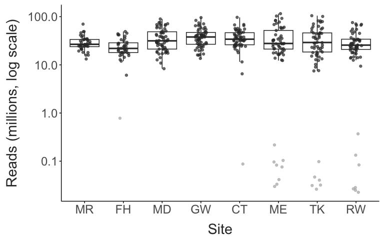

The number of reads per individual varies, but there is no clear
relationship between sequencing depth and individual size or CTmax
(phenotype analysis set only).

|           |       Sum Sq |  Df |   F value |   Pr(\>F) |
|:----------|-------------:|----:|----------:|----------:|
| size      | 9.603839e+14 |   1 | 2.6795203 | 0.1024488 |
| ctmax     | 1.671663e+11 |   1 | 0.0004664 | 0.9827809 |
| Residuals | 1.404992e+17 | 392 |        NA |        NA |

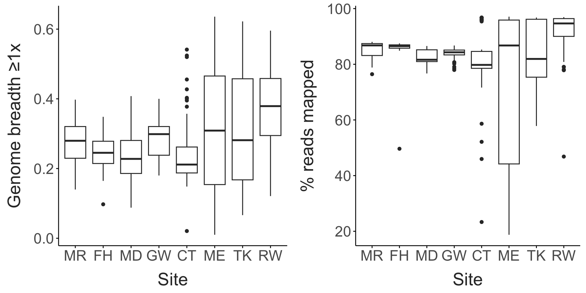

### Clade IDs

*Acartia tonsa* is well known to comprise multiple, deeply diverged
clades. Clade calls currently come from stage1, prior_coi (`prior_coi` =
COI reads skimmed from the low-coverage data; `stage1` = final calls
from the cluster, mitochondrial COI tree plus nuclear clustering). Calls
from failed libraries are not used.

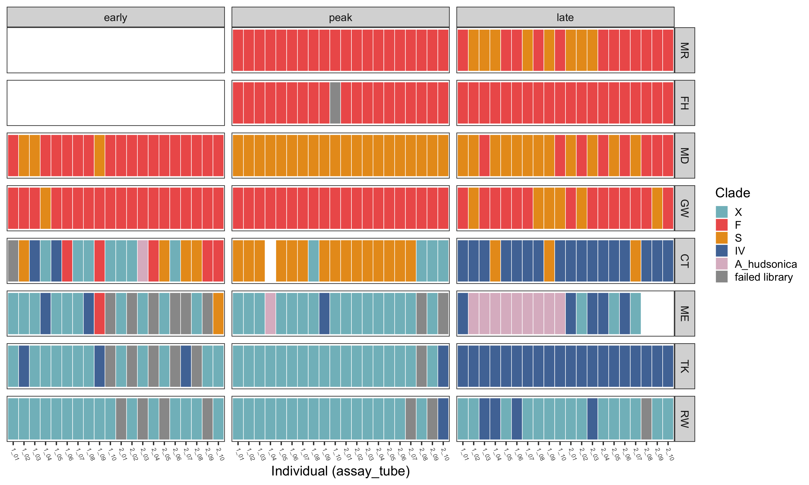

These clades are deeply diverged, which affects the alignment and final
coverage of the genome data (clade X is closest to the reference
genome).

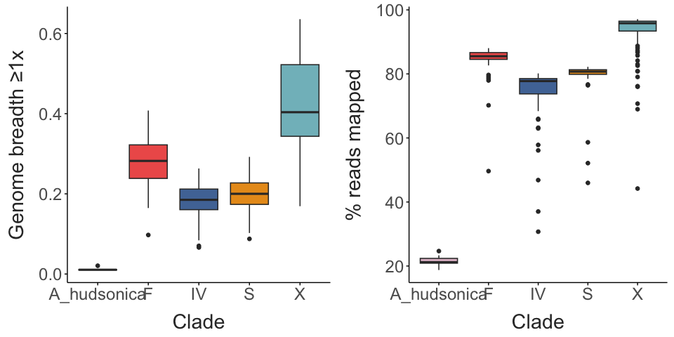

### Clade-specific Physiology

These COI clades were then merged with the CTmax and body size data set
to examine clade-specific patterns of divergence. By plotting CTmax and
size against the collection temperature we can see that these clades
appear to be physiologically differentiated. Clades F and S tend to have
higher CTmax, even when collected at the same temperatures as Clades X
and IV. Size is more variable, with varying degrees of temperature
sensitivity across the clades. Overall, however, Clade F tends to be
smaller than Clades S and X. Clade IV tended to be the largest.

The general result here is that Clade F appears to be more thermally
tolerant than Clades S and X, which in turn are more thermally tolerant
than Clade IV. Clade IV does however, appear to exibit stronger
plasticity than the other clades (although this pattern is only
marginally significant in two of the comparisons; IV-S and IV-X)

These differences in physiology correspond to the distributional
patterns for each clade. Using a Loess smoother (span = 2) highlights
how the proportional abundance of the clades is affected by temperature
in different ways. Clade F occurs in high proportion at high
temperature, Clade IV occurs in high proportions at low temperatures,
while Clade X occurs in high proportions at intermediate temperatures.
Clade S generally occurs in low proportions, with a few exceptions.

### PCA

Per-clade PCA (PCAngsd) and admixture (NGSadmix) come from Stage 1 of
the cluster workflow (`results/04_structure/`). They will be read here
from the cluster export once Stage 1 is done; the earlier exploratory
PCA code (based on covariance matrices from before the Snakemake
pipeline) is kept in `Output/Reports/legacy/report_pre_migration.Rmd`.

## Partitioning Vulnerability

Our study examines spatial and temporal variation in upper thermal
limits for field-acclimated individuals. Given the short generation time
of these copepods, our results likely reflect the combined influence of
phenotypic plasticity (acclimation to the changes in temperature), local
adaptation (variation amongst the sites), and genetic variation between
the clades.

The four clades, while morphologically difficult to differentiate, have
distinct geographic distributions and physiological tolerances. The
inclusion of this clade-level variation decreases the slope of the CTmax
vs. temperature regression. Ignoring this source of variation would lead
to an overestimated capacity for *A. tonsa* to respond to warming
(either through acclimation or via gene flow and evolutionary rescue).

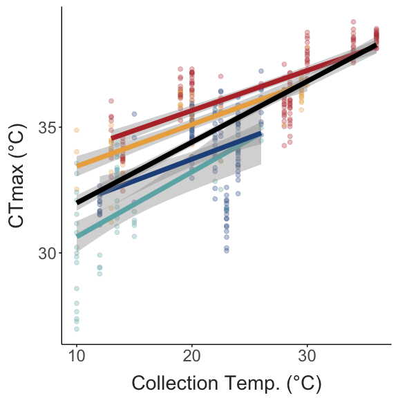

We illustrate the effects of these different levels of variation by
calculating warming tolerance for each collection (site x collection
temperature combination) under three different scenarios.

### Scenario 1 (Fixed CTmax)

Warming tolerance was calculated using the average CTmax from the peak
season collections (across all sites and individuals regardless of
clade). This essentially assumes a fixed CTmax that is constant across
the geographic range examined.

### Scenario 2 (Clade-level variation)

Here, the same approach is taken but for each clade separately. The
average CTmax from the peak season for each clade was used as a fixed
CTmax value when calculating warming tolerance.

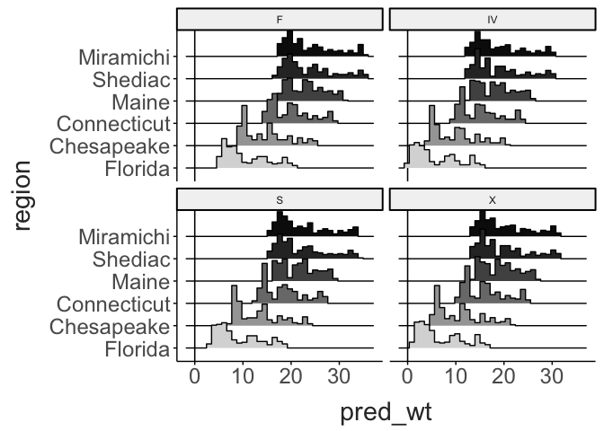

### Scenario 3 (Clade variation and acclimation/adaptation)

Here CTmax is predicted based on the continuous temperature data and a
model of CTmax as a function of the interaction between collection
temperature and clade. The predicted CTmax values fall within the range
of CTmax values observed in the field.

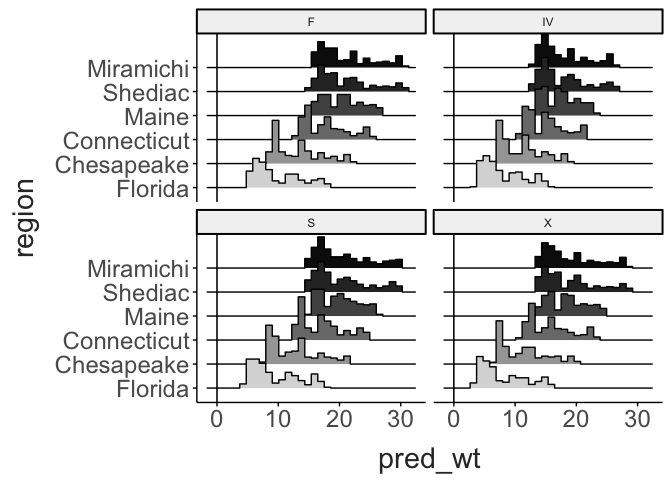

### Comparing Scenarios

There is strong geographic variation in the distributions of these
clades. It does not, for example, make sense to examine warming
tolerance of Clade X individuals in Florida, as this clade was not
collected from lower latitudes. To incorporate this distribution
information, simulated populations were re-assembled reflecting the
proportional clade composition within each region (calculated across the
entire set of collections).

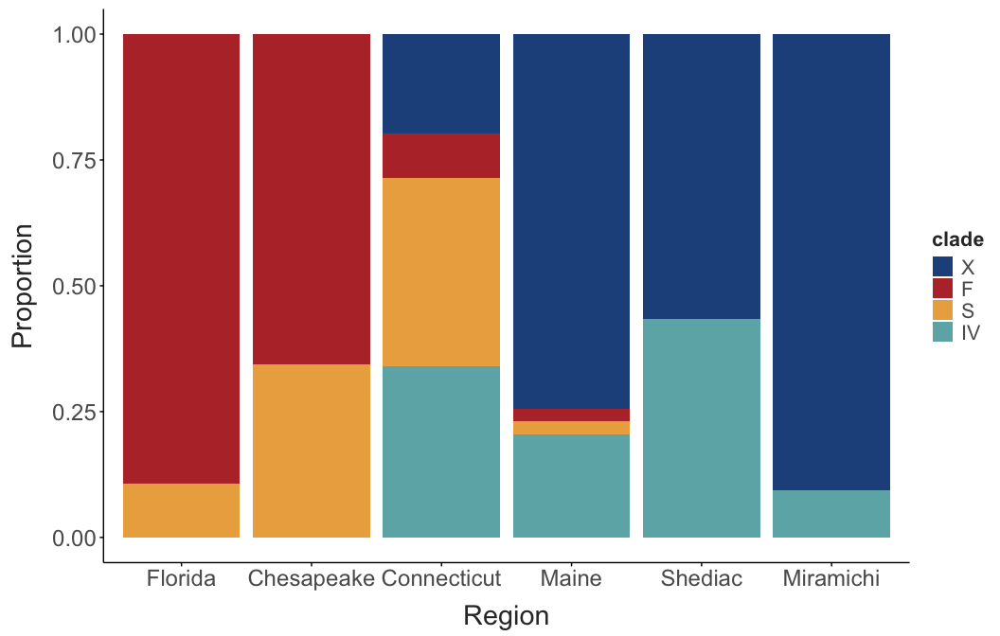

Warming tolerance profiles for each clade were added in these
proportions to generation populations of 100 individuals.

The warming tolerance distributions for each region and the three
different scenarios are shown below.

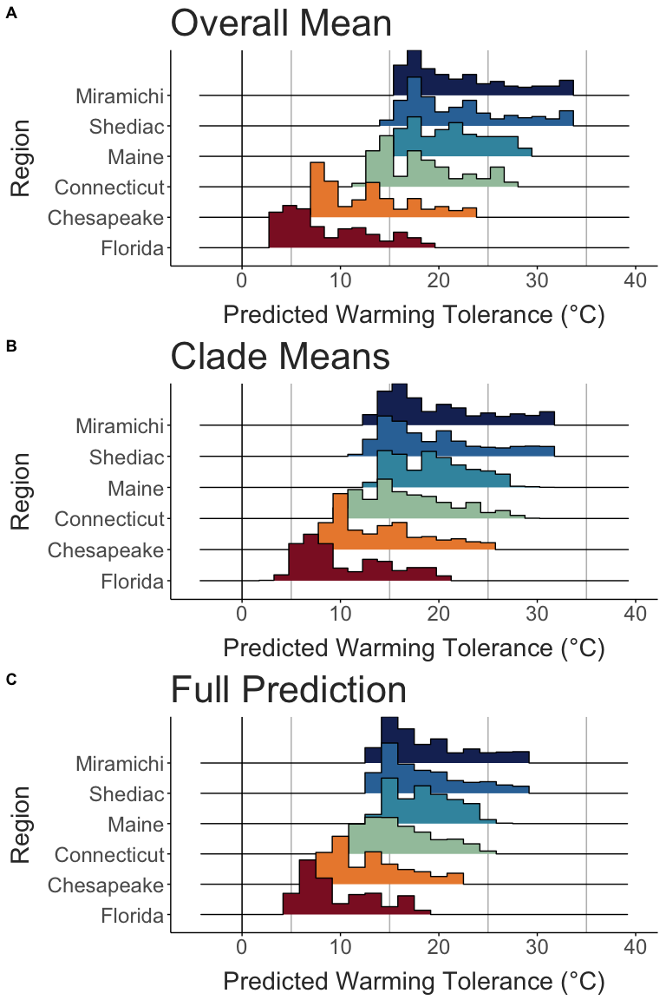

Overall, differences were fairly minor, with slight increases in
predicted warming tolerance in low latitude regions and slight decreases
in higher latitude regions.

We also examined potential effects of warming (a +4°C increase in
temperature). These predictions assume clade composition does not change
over time and that warming is constant throughout the year.

Unsurprisingly warming decreases the predicted warming tolerance.
Similar patterns are observed as in the comparison between the initial
three scenarios - predicted warming tolerance under warming is lowest in
Florida and highest in the high latitude regions. Similarly, including
clade-level variation and acclimation increases warming tolerance in the
lower latitude regions and decreases it in the higher latitude regions.

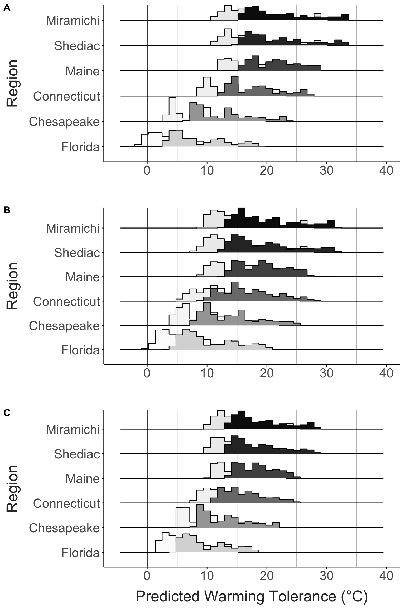

To simplify the comparisons, here we subset the data to just August and
September (the warmest months and the season typically associated with
the highest abundance of A. tonsa).

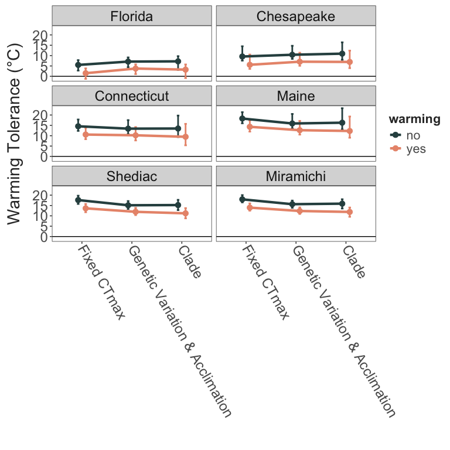

Changes were slight between the scenarios, with the same relative
patterns between the current and warming scenarios. Compared to the
fixed CTmax estimate, incorporating both genetic diversity and
acclimation reduced the range of warming tolerance estimates across the
samples by ~30%.

| Comparison                      | WT Range | % Decrease |
|:--------------------------------|---------:|-----------:|
| Fixed CTmax                     |    13.05 |       0.00 |
| Clade                           |     9.72 |      25.53 |
| Genetic Variation & Acclimation |     8.97 |      31.26 |

## Salinity Comparisons

Nested within each of the three regions (South, Central, and Northern
regions) are pairs of low and high salinity sites:

| Region  | Low.Salinity  |      High.Salinity       |
|:-------:|:-------------:|:------------------------:|
|  South  |   Ft. Hamer   |      Manatee River       |
| Central | Ganey’s Wharf |        Tyler Cove        |
|  North  | Ritchie Wharf | St. Thomas de Kent Wharf |

 

There are fairly well-established divergences between high salinity and
low salinity populations of *Acartia tonsa*. These sets of
geographically proximate sites potentially provide independent
comparisons of the effects of seasonality across salinity gradients.
Shown here are the collection conditions for these pairs of sites.
Temperature was typically similar across the pairs within each
collection, while salinity differences were fairly stable across
collections.

The three pairs of cross-salinity comparisons do show evidence for
fine-scale trait divergence, although there was no consistent pattern in
the direction or magnitude of differences. CTmax was similar across
sites in the Southern and Central pairs. In the Northern pair, CTmax
tended to be slightly lower for individuals from the low salinity site.
Size was more variable between the paired sites. In the South,
individuals from the low salinity site were consistently smaller than
individuals from the high salinity site, despite experiencing similar
temperatures. By contrast, in the Central pair individuals from the low
salinity site tended to be slightly larger than those from the high
salinity site, although the magnitude of this difference this varied
seasonally. In the Northern pair, individuals from the low salinity site
were slightly larger than individuals from the high salinity site during
the early and peak season collections, but there was an abrupt reversal
of this pattern during the late collection, when individuals from the
high salinity site were much larger than individuals from the low
salinity site.

We will return to potential mechanisms behind divergence between these
geographically proximate but environmentally separated sites later in
this report.

## Misc. Details

